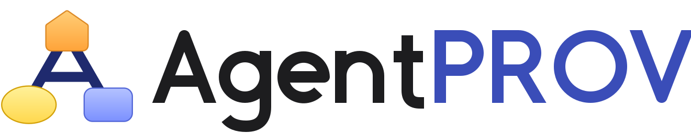
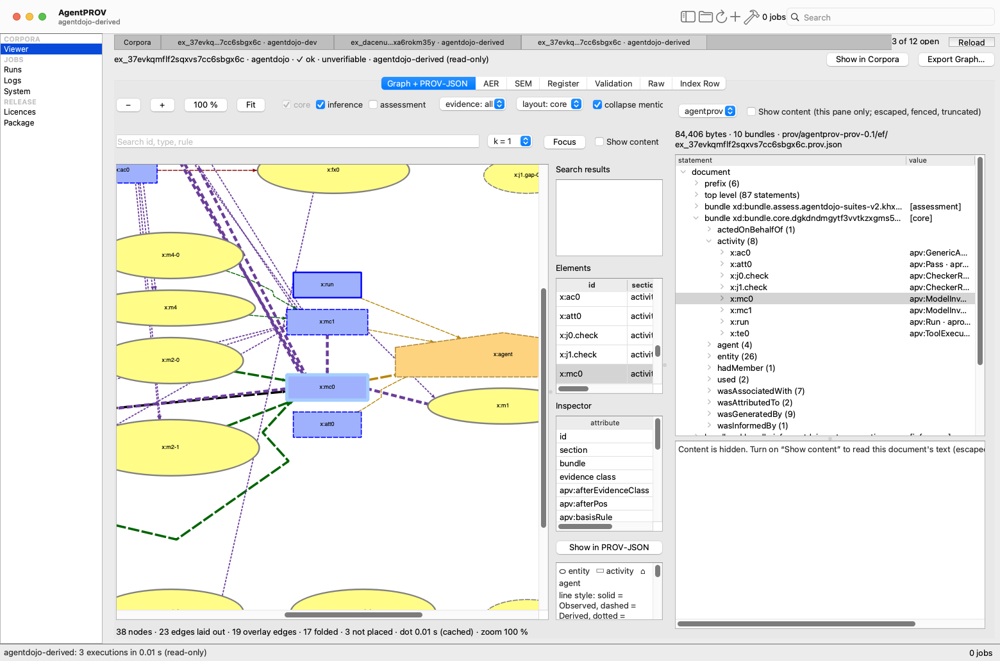
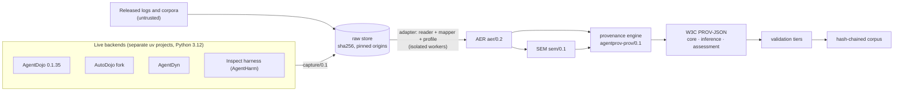
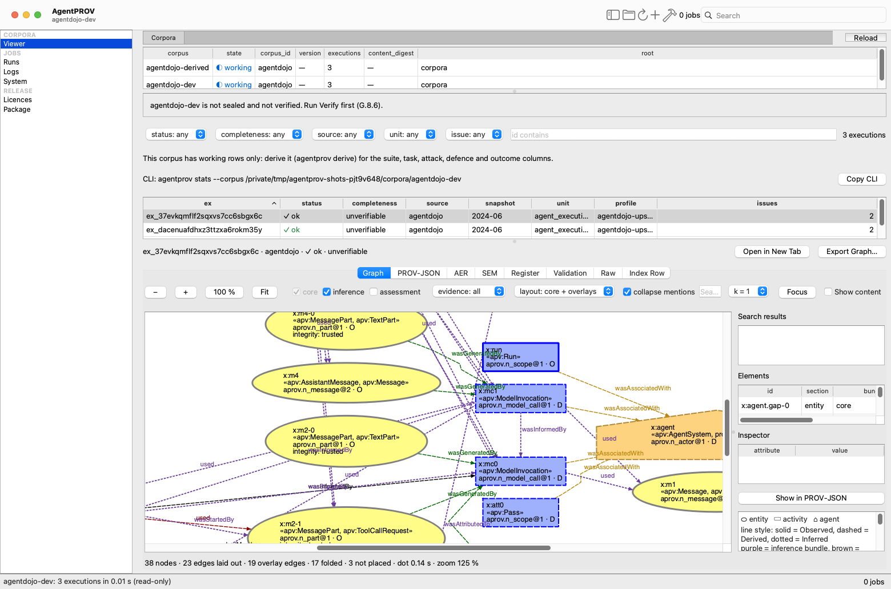

<h1 align="center"><picture><source media="(prefers-color-scheme: dark)" srcset="docs/images/brand/agentprov-wordmark-on-dark.svg"></picture></h1>

<p align="center">
  <a href="https://doi.org/10.5281/zenodo.23786079"></a>
  <a href="https://w3id.org/agentprov/#corpora"></a>
  <a href="https://w3id.org/agentprov/#cite"></a>
  <a href="https://w3id.org/agentprov/docs/"></a>
  <a href="https://github.com/nickjones39/AgentPROV/releases/tag/v0.1.0"></a>
  <a href="LICENSE"></a>
  <a href="https://www.w3.org/TR/prov-overview/"></a>
</p>

<p align="center"><strong>An execution-provenance framework for LLM-agent security research.</strong></p>



AgentPROV turns agent executions into a source-preserving, evidence-qualified canonical record, and derives W3C PROV
from that record. The executions can be captured live or released by other research projects. Every derived PROV
statement names its evidence class, the rule that produced it, and the field of the record that justifies it. Corpora
are hash-chained from the original raw bytes to the final graph. You can verify and recompute them without
re-running any model.

> **Status: the v0.1.0 release.** The design is specified in
> [`docs/architecture/`](docs/architecture/). The README describes what is on `main`. The decisions are in
> [`DECISIONS.md`](docs/architecture/DECISIONS.md). A source counts as **supported** only after its full pinned
> snapshot has been imported through `agentprov import` with zero crashes and the counts are recorded in
> `docs/reports/`.

**Documentation:** the [user guide](docs/user-guide/README.md) explains installation, every command with worked
examples, the desktop app, safety and troubleshooting. Read it on the website, <https://w3id.org/agentprov/docs/>, or
here on GitHub.

## Why provenance for agent-security executions?

Prompt-injection and agent-hijacking benchmarks report outcomes such as "attack succeeded" or "utility kept".
Researchers also need to know *how* an outcome came about: which untrusted content reached the model, which tool call
carried the attacker's goal, what the defence changed, and which of these facts were observed rather than
reconstructed. W3C PROV can express these questions, but only if every relation is backed by evidence. AgentPROV is
built on four rules:

- **Temporal order is never causality.** Order is recorded as order, never as a PROV dependency.
- **Context membership is not data derivation.** A model invocation *uses* the messages in its request. A tool
  execution uses only its request and the environment state it read.
- **Missing evidence is declared, never invented.** There are no placeholder timestamps and no fabricated
  trajectories. Unknowns carry a reason from a closed list.
- **Policy claims are not PROV facts.** Integrity labels, taint and injection markers live in a separate assessment
  bundle.

## What it is



- **Raw store.** Byte-identical, sha256-addressed source artefacts with pinned origins. Raw bytes are never edited, and
  archives are never extracted to disk.
- **AER (`aer/0.2`, frozen).** The AgentPROV Execution Record: one JSONL file per execution with 13 typed record kinds,
  explicit unknowns, locators back into the raw bytes, and a seal digest. The name is always expanded; it is not the
  "Agent Execution Record" of Vispute and Kadam. `aer/0.1` stays frozen and is still read.
- **SEM (`sem/0.1`).** Standoff annotations from versioned semantics profiles: integrity, roles, injection markers and
  outcome meaning.
- **Provenance engine (`agentprov-prov/0.1`).** PROV-JSON in three bundles: **core** (observed and derived statements
  only), **inference** (one bundle per method) and **assessment** (non-PROV claims). Statements come only from the
  engine's versioned rule catalogue, with terms from the `apv:` vocabulary (`https://w3id.org/agentprov/ns#`).
- **Validation tiers** and a **corpus** with a manifest, an index, a register of every candidate, and a sha256 chain
  raw → AER → SEM → PROV.

**Evidence classes.** Every AER record and field is tagged **O** (observed), **D** (derived by a declared,
deterministic rule) or **I** (inferred). Core PROV statements carry O or D; I statements go to the inference bundles.

The [user guide's concepts chapter](docs/user-guide/02-concepts.md) explains all of this in more detail; the full specification is
in [`docs/architecture/`](docs/architecture/) (sections A–Q; start with its [`README.md`](docs/architecture/README.md)).

## Adapter families and sources

A framework or benchmark is an **adapter family**: a reader (one or more dialects), a mapper, source profiles, a rule
catalogue and semantics tables, all registered in the in-repo registry (`src/agentprov/adapters/registry/`; no plugin
loading). `agentprov info` prints the registry with each part's caveat. The tables below are generated from it by
`tools/gen_readme_sources.py`, and a test checks that they match.

The tables list the parts with a sealed corpus and the live parts. Status values are gated. **supported** means the
full pinned snapshot has been imported. **partial** means the part is imported and sealed, but a declared portion of its
evidence is not mapped or is structurally incomplete (the caveat in `agentprov info` says which). **live (tested
subset)** means the live backend passes its scripted live gate, and real-model runs are admitted only for the subset the
part's caveat declares (D-720). *Sealed corpora* counts the distinct sealed corpora that hold a family's parts,
and the detail table names each part's sealed corpus by its tag, `corpus/<corpus_id>/v<version>`, on the sealing
commit. The licence column gives the SPDX id. *(restricted)*
marks a licence with a use clause, such as AgentHarm's "AI safety only" clause.

<!-- BEGIN generated: sources (tools/gen_readme_sources.py --write) -->

| Family | Readers (dialects) | Sources | Parts by status | Sealed corpora |
|---|---|---|---|---|
| `agentdojo` | `agentdojo.results_container`, `agentdojo.tracelogger`, `agentprov.capture` | 32 | 32 supported, 6 partial, 3 live (tested subset) | 34 |
| `adprov` | `adprov.transcript_v1` | 1 | 1 supported | 1 |
| `inspect` | `inspect.eval` | 7 | 11 supported, 1 live (tested subset) | 7 |
| `dtap` | `dtap.trajectory` | 1 | 1 supported | 1 |
| `openhands` | `openhands.events` | 2 | 2 supported | 2 |
| `agentops` | `agentops.trace` | 1 | 1 supported | 1 |
| `credleak` | `credleak.cell` | 1 | 1 supported | 1 |
| `autogen` | `autogen.runs` | 1 | 1 supported | 1 |
| `wirelog` | `wirelog.request_response` | 1 | 1 supported | 1 |
| `mcphunt` | `mcphunt.traces` | 1 | 1 supported | 1 |
| `geminicli` | `geminicli.stream_json` | 1 | 1 supported | 1 |
| `qwencode` | `qwencode.json` | 1 | 1 supported | 1 |

<details>
<summary>The 50 sources and their 64 parts with a sealed corpus or a tested live backend</summary>

| Family | Source | Part (profile) | Status | Licence |
|---|---|---|---|---|
| `agentdojo` | `agentdojo` | `head` (`agentdojo-upstream`) | import supported; sealed as `corpus/agentdojo-upstream-head/v0.1.0` | MIT |
| `agentdojo` | `agentdojo` | `2024-06` (`agentdojo-upstream`) | import supported; sealed as `corpus/agentdojo-upstream-2024-06/v0.1.0` | MIT |
| `agentdojo` | `agentdojo` | `live` (`agentdojo-live`) | live (tested subset) | MIT |
| `agentdojo` | `agentdyn` | `a` (`agentdyn`) | import supported; sealed as `corpus/agentdyn-a/v0.1.0` | MIT |
| `agentdojo` | `agentdyn` | `b` (`agentdyn`) | import partial; sealed as `corpus/agentdyn-b/v0.1.0` | MIT |
| `agentdojo` | `agentdyn` | `c` (`agentdyn`) | import partial; sealed as `corpus/agentdyn-c/v0.1.0` | MIT |
| `agentdojo` | `agentdyn` | `live` (`agentdyn-live`) | live (tested subset) | MIT |
| `agentdojo` | `autodojo` | `live` (`autodojo-live`) | live (tested subset) | MIT |
| `agentdojo` | `autodojo` | `rope-slice` (`autodojo-via-rope`) | import partial; sealed as `corpus/rope/v0.1.0` | MIT |
| `agentdojo` | `rope` | `head` (`rope`) | import supported; sealed as `corpus/rope/v0.1.0` | MIT |
| `agentdojo` | `mandate-agentdojo-eval` | `head` (`mandate-agentdojo-eval`) | import supported; sealed as `corpus/mandate-agentdojo-eval/v0.1.0` | MIT |
| `agentdojo` | `interbolt-agentdojo` | `head` (`interbolt-agentdojo`) | import supported; sealed as `corpus/interbolt-agentdojo/v0.1.0` | Apache-2.0 |
| `agentdojo` | `melon-agentdojo` | `head` (`melon-agentdojo`) | import supported; sealed as `corpus/melon-agentdojo/v0.1.0` | MIT |
| `agentdojo` | `glitch-agentdojo` | `head` (`glitch-agentdojo`) | import supported; sealed as `corpus/glitch-agentdojo/v0.1.0` | MIT |
| `agentdojo` | `mohameduk-agentdojo` | `head` (`mohameduk-agentdojo`) | import supported; sealed as `corpus/mohameduk-agentdojo/v0.1.0` | MIT |
| `agentdojo` | `tacit-agentdojo` | `head` (`tacit-agentdojo`) | import supported; sealed as `corpus/tacit-agentdojo/v0.1.0` | Apache-2.0 |
| `agentdojo` | `geryon-agentdojo` | `head` (`geryon-agentdojo`) | import supported; sealed as `corpus/geryon-agentdojo/v0.1.0` | Apache-2.0 |
| `agentdojo` | `hilarytorn-trajectory-poisoning` | `head` (`hilarytorn-trajectory-poisoning`) | import supported; sealed as `corpus/hilarytorn-trajectory-poisoning/v0.1.0` | MIT |
| `agentdojo` | `yockcheng-prompt-injection-harness` | `head` (`yockcheng-prompt-injection-harness`) | import supported; sealed as `corpus/yockcheng-prompt-injection-harness/v0.1.0` | Apache-2.0 |
| `agentdojo` | `shreeyavarma-llm-safety` | `head` (`shreeyavarma-llm-safety`) | import supported; sealed as `corpus/shreeyavarma-llm-safety/v0.1.0` | MIT |
| `agentdojo` | `gate-agentdojo` | `head` (`gate-agentdojo`) | import supported; sealed as `corpus/gate-agentdojo/v0.1.0` | AGPL-3.0-only (restricted) |
| `agentdojo` | `sentry-agentdojo` | `head` (`sentry-agentdojo`) | import supported; sealed as `corpus/sentry-agentdojo/v0.1.0` | AGPL-3.0-only (restricted) |
| `agentdojo` | `bookkeeper-agentdojo` | `head` (`bookkeeper-agentdojo`) | import supported; sealed as `corpus/bookkeeper-agentdojo/v0.1.0` | GPL-3.0-or-later (restricted) |
| `agentdojo` | `aiauthz-agentdojo` | `head` (`aiauthz-agentdojo`) | import supported; sealed as `corpus/aiauthz-agentdojo/v0.1.0` | AGPL-3.0-only (restricted) |
| `agentdojo` | `kongminos-agentdojo` | `head` (`kongminos-agentdojo`) | import supported; sealed as `corpus/kongminos-agentdojo/v0.1.0` | MIT |
| `agentdojo` | `ceferisbarov-agentdojo` | `head` (`ceferisbarov-agentdojo`) | import supported; sealed as `corpus/ceferisbarov-agentdojo/v0.1.0` | MIT |
| `agentdojo` | `memo-ozdincer-agentdojo` | `head` (`memo-ozdincer-agentdojo`) | import supported; sealed as `corpus/memo-ozdincer-agentdojo/v0.1.0` | MIT |
| `agentdojo` | `linyxus-agentdojo` | `head` (`linyxus-agentdojo`) | import supported; sealed as `corpus/linyxus-agentdojo/v0.1.0` | MIT |
| `agentdojo` | `craibench-agentdojo` | `head` (`craibench-agentdojo`) | import supported; sealed as `corpus/craibench-agentdojo/v0.1.0` | MIT |
| `agentdojo` | `menelaus29-ipi-multidomain` | `head` (`menelaus29-ipi-multidomain`) | import supported; sealed as `corpus/menelaus29-ipi-multidomain/v0.1.0` | MIT |
| `agentdojo` | `llm-lock-agentdojo` | `head` (`llm-lock-agentdojo`) | import supported; sealed as `corpus/llm-lock-agentdojo/v0.1.0` | GPL-3.0 |
| `agentdojo` | `seagent-agentdojo` | `head` (`seagent-agentdojo`) | import supported; sealed as `corpus/seagent-agentdojo/v0.1.0` | CC-BY-4.0 |
| `agentdojo` | `drift` | `head` (`drift`) | import partial; sealed as `corpus/drift-head/v0.1.0` | MIT |
| `agentdojo` | `authority-caps-agentdojo` | `head` (`authority-caps-agentdojo`) | import supported; sealed as `corpus/authority-caps-agentdojo/v0.1.0` | CC-BY-4.0 |
| `agentdojo` | `ipi-defenses-agentdojo` | `head` (`ipi-defenses-agentdojo`) | import supported; sealed as `corpus/ipi-defenses-agentdojo/v0.1.0` | CC-BY-4.0 |
| `agentdojo` | `dca-agentdojo` | `v1` (`dca-agentdojo`) | import supported; sealed as `corpus/dca-agentdojo/v0.1.0` | MIT |
| `agentdojo` | `dca-agentdojo` | `drift` (`dca-agentdojo`) | import partial; sealed as `corpus/dca-agentdojo/v0.1.0` | MIT |
| `agentdojo` | `kavach-agentdojo` | `main` (`kavach-agentdojo`) | import supported; sealed as `corpus/kavach-agentdojo/v0.1.0` | MIT |
| `agentdojo` | `kavach-agentdojo` | `nav-fixer2` (`kavach-agentdojo`) | import supported; sealed as `corpus/kavach-agentdojo/v0.1.0` | MIT |
| `agentdojo` | `kavach-agentdojo` | `rearch-forcedformat-fix` (`kavach-agentdojo`) | import supported; sealed as `corpus/kavach-agentdojo/v0.1.0` | MIT |
| `agentdojo` | `drift1-agentdojo` | `drift` (`drift1-agentdojo`) | import partial; sealed as `corpus/drift1-agentdojo/v0.1.0` | MIT |
| `adprov` | `adprov-v1` | `release` (`adprov-v1`) | import supported; sealed as `corpus/adprov-v1-release/v0.1.0` | CC-BY-4.0 |
| `inspect` | `agent-security-tools-survey` | `agentharm` (`survey-agentharm`) | import supported; sealed as `corpus/ast-survey-agentharm/v0.1.0` | CC-BY-4.0 (restricted) |
| `inspect` | `agent-security-tools-survey` | `agentdojo-runs` (`survey-runs`) | import supported; sealed as `corpus/ast-survey-agentdojo/v0.1.0` | CC-BY-4.0 (restricted) |
| `inspect` | `whistlebench` | `final-runs` (`whistlebench`) | import supported; sealed as `corpus/whistlebench/v0.1.0` | MIT |
| `inspect` | `agentharm` | `live` (`agentharm-live`) | live (tested subset) | MIT (restricted) |
| `inspect` | `kexin-xu-01-agentharm` | `logs` (`kexin-xu-01-agentharm`) | import supported; sealed as `corpus/kexin-xu-01-agentharm/v0.1.0` | MIT (restricted) |
| `inspect` | `fragfuse-agentharm` | `logs` (`fragfuse-agentharm`) | import supported; sealed as `corpus/fragfuse-agentharm/v0.1.0` | MIT (restricted) |
| `inspect` | `controlarena-persistent` | `zip-3-001` (`controlarena-persistent`) | import supported; sealed as `corpus/controlarena-persistent/v0.1.0` | MIT |
| `inspect` | `controlarena-persistent` | `zip-3-002` (`controlarena-persistent`) | import supported; sealed as `corpus/controlarena-persistent/v0.1.0` | MIT |
| `inspect` | `controlarena-persistent` | `zip-3-003` (`controlarena-persistent`) | import supported; sealed as `corpus/controlarena-persistent/v0.1.0` | MIT |
| `inspect` | `controlarena-persistent` | `batch-runs` (`controlarena-persistent`) | import supported; sealed as `corpus/controlarena-persistent/v0.1.0` | MIT |
| `inspect` | `controlarena-persistent` | `auditor` (`controlarena-persistent`) | import supported; sealed as `corpus/controlarena-persistent/v0.1.0` | MIT |
| `inspect` | `atia-benchmark` | `logs` (`atia-benchmark`) | import supported; sealed as `corpus/atia-benchmark/v0.1.0` | MIT |
| `dtap` | `dtap` | `head` (`dtap-bench`) | import supported; sealed as `corpus/dtap-bench/v0.1.0` | Apache-2.0 |
| `openhands` | `openagentsafety` | `head` (`openagentsafety`) | import supported; sealed as `corpus/openagentsafety/v0.1.0` | MIT |
| `openhands` | `redcode-exec-openhands` | `head` (`redcode-exec-openhands`) | import supported; sealed as `corpus/redcode-exec-openhands/v0.1.0` | CC-BY-4.0 |
| `agentops` | `agentops-bench` | `pilot-v1-seeded` (`agentops-bench-pilot`) | import supported; sealed as `corpus/agentops-bench/v0.1.0` | Apache-2.0 |
| `credleak` | `credleak-p15b` | `head` (`credleak-p15b`) | import supported; sealed as `corpus/credleak-p15b/v0.1.0` | CC-BY-4.0 |
| `autogen` | `autogen-guard-placement` | `v1.0` (`autogen-guard-placement`) | import supported; sealed as `corpus/autogen-guard-placement/v0.1.0` | CC-BY-4.0 |
| `wirelog` | `what-surrounds` | `runs-named` (`what-surrounds`) | import supported; sealed as `corpus/what-surrounds/v0.1.0` | CC-BY-4.0 |
| `mcphunt` | `mcphunt` | `head` (`mcphunt`) | import supported; sealed as `corpus/mcphunt/v0.1.0` | CC-BY-4.0 |
| `geminicli` | `code-agent-misalignment-geminicli` | `results-raw` (`code-agent-misalignment-geminicli`) | import supported; sealed as `corpus/code-agent-misalignment/v0.1.0` | CC-BY-4.0 |
| `qwencode` | `redcode-exec-qwencode` | `qwen3coder` (`redcode-exec-qwencode`) | import supported; sealed as `corpus/redcode-exec-qwencode/v0.1.0` | CC-BY-4.0 |

</details>

<!-- END generated: sources -->

The full source matrix, with lineage and the claims AgentPROV must not make, is
[`docs/architecture/I_matrix.md`](docs/architecture/I_matrix.md).

**Corpora.** Each corpus, with its pinned origin, licence, execution count and caveats, and how the sources were found
(a systematic search with fixed eligibility criteria), is listed in the user guide: [Corpora and where they come
from](docs/user-guide/14-corpora.md).

## Quick start

AgentPROV uses [uv](https://docs.astral.sh/uv/) (0.12.22 or later). The core needs Python ≥ 3.14; release builds that
ingest archives need 3.14.8 or later.

```bash
uv sync --frozen --group docs   # core, dev tools and the docs group, exactly as locked
uv run agentprov info      # versions, the source registry, extras, host isolation grade

uv run agentprov fetch --profile agentdojo-upstream --pin 2024-06 --allow-network  # once: fills the fetch cache
uv run agentprov import agentdojo --snapshot 2024-06 --fetch --corpus <corpus>    # from the fetch cache, offline
uv run agentprov validate  --corpus <corpus>
uv run agentprov recompute --corpus <corpus> --dry-run     # byte-identical re-derivation, no model calls
uv run agentprov verify    --corpus <corpus> --level chain
uv run agentprov package   --corpus <corpus> --corpus-version 0.1.0              # seal (chapter 5 lists what it needs); never uploads
```

Corpora, the fetch cache and backend environments live under `AGENTPROV_HOME` (default `~/.agentprov`), outside the
repository. The [user guide](docs/user-guide/README.md) walks through each step on a small demo corpus;
[chapter 11](docs/user-guide/11-cli-reference.md) has every command's `--help`.

**Platforms.** Developed and used on macOS on Apple silicon. The test suite last ran on Linux (x86_64 and arm64) and
Windows in GitHub Actions on 2026-10-08, against early code; CI has not run since (D-431: manual dispatch only). In the
clean-machine tests (G5), bundles built from `main` pass on clean Ubuntu 24.04 (aarch64) and Windows 11 ARM64 machines,
and under emulation on Ubuntu 22.04 x86_64 and Windows x86_64; Windows has no live runs (D-867). Cross-platform use is
not guaranteed. See [Installing AgentPROV](docs/user-guide/01-install.md).

## Live backends

AgentDojo (`agentdojo==0.1.35`), AutoDojo (fork at `aa458794`), AgentDyn (`5353cf76`) and an Inspect harness for
AgentHarm run as separate uv projects on Python 3.12, so benchmark code never shares an environment with the core.
Their environments are built by `agentprov backends build` (offline from the uv cache unless you add
`--allow-network`), and every backend has run scripted
(`--llm-script`) captures end to end. The four live parts (`agentdojo`, `autodojo`, `agentdyn`, `agentharm`) pass
their scripted live gate, and real-model runs are admitted for the subset each part's caveat declares (D-720): a run
against a local model server (LM Studio, Ollama and the like, on loopback) needs `--containment` and
your consent. A run against an API endpoint also needs your key and both caps, `--max-calls` and `--max-cost-usd`
(with `--price-in` and `--price-out`), and a cell starts only if its worst case fits what is left. A small real-model
pilot ran on 2026-10-22 (a local model, OpenRouter and Anthropic; [report](docs/reports/live-pilot/)), and a four-sample
AgentHarm probe through OpenRouter on 2026-10-23. Live corpora cannot be sealed. Only the `agentdojo` backend
takes `--defence NAME` (ten registered defences); the others run undefended. See
[Live runs](docs/user-guide/07-live-runs.md).

## Desktop app

`gui/` holds a desktop viewer and job runner (`agentprov-gui`, PySide6). It is a separate uv project that never writes a
corpus itself: every write runs as an `agentprov` command it shows you first. Corpus content stays hidden until you ask
for it. Live runs and packaging start from the same job runner; the draft-only Zenodo uploader runs in a terminal pane
of the Package page's Create Zenodo drafts dialog. The v0.1.0 release carries bundles for macOS (Apple silicon, signed
ad hoc), Windows (ARM64 and x64) and Linux (aarch64 and x86_64), each with its `bundle-report.json`; see the [release
notes](docs/release-notes/v0.1.0.md). The macOS bundle was tested on the development Mac, and the bundles built for the
clean-machine tests from `main` passed them: Linux aarch64 and Windows ARM64 on clean machines, Linux and Windows x86_64
under emulation (D-750, G5).

```bash
uv sync --project gui
uv run --project gui agentprov-gui [CORPUS]
```



See [The desktop app](docs/user-guide/08-desktop-app.md).

## Derivation and execution reproducibility

Execution reproducibility is limited: LLM executions are nondeterministic, and a seed does not make them repeat exactly.
Derivation reproducibility is exact: the same raw evidence, adapter version, rule catalogue and specification give
byte-identical AER, SEM and PROV across runs, processes and worker counts, and `agentprov recompute --dry-run` reports 0
differences. Every version axis (software, formats, provenance specification, rule catalogue, vocabulary, adapters,
corpus) is recorded in each corpus, and any change to output bytes needs a visible version bump.

## Security

All imported data is untrusted: it is parsed only with bounded, standard-library parsers in isolated worker processes,
archives are never extracted, and raw bytes are withheld rather than edited. Agent-security corpora contain
prompt-injection payloads by design, so content is shown only escaped and only when asked for; never paste corpus
content into an LLM tool without quoting it as data. API keys are never recorded. Read [Safety](docs/user-guide/09-safety.md) before
you share a corpus; the full model is in [`docs/architecture/G_security.md`](docs/architecture/G_security.md) and
[`docs/threat-model.md`](docs/threat-model.md).

## Corpus policy and licences

Exported corpora, raw stores and upstream clones are **never committed to Git**; corpora were released separately on
Zenodo, one collection with one record per licence class (<https://w3id.org/agentprov/#corpora>), and nothing is
published automatically. The draft-only uploader (`agentprov-zenodo`, the `zenodo` extra; D-880) turns a
deposit draft from `agentprov package --deposit` into an unpublished Zenodo draft and never publishes; the `agentprov`
package itself never talks to Zenodo. Data with no licence, or a licence that forbids redistribution, is excluded; data
is never excluded for its outcome; licence classes are kept apart. The tests of the copyleft sources use synthetic
fixtures only (D-945), and test fixtures whose licence restricts their use stay in the private development repository
(the tests that need them skip). Third-party code and the licence bases of importable data are listed in
[`THIRD_PARTY_NOTICES.md`](THIRD_PARTY_NOTICES.md).

## Development

Read the specification ([`docs/architecture/`](docs/architecture/)) and
[`docs/adapter-guide.md`](docs/adapter-guide.md), which walks through adding an adapter, before changing anything.

```bash
uv sync --frozen
uv run pytest -m "not slow"                       # quick developer check
uv run ruff check .                               # lint
uv run mypy                                       # type check
uv run python tools/check_unicode.py              # invisible/control-character guard
uv lock --check
```

**The merge gate is the full suite on the exact commit.** On a shared machine it runs through the machine-wide queue,
one suite at a time:

```bash
uv run python tools/suite_queue.py --label <branch> -- pytest -n <workers> --dist loadgroup -p no:randomly -p no:cacheprovider
```

CI is local by default (`uv run python tools/ci_local.py`, which picks the worker count from the host); GitHub Actions
is optional and has no schedule. The generated blocks (this README's source tables, the user guide's corpus listing and
CLI reference) are regenerated with `tools/gen_readme_sources.py --write`, `tools/gen_readme_corpora.py --write` and
`tools/gen_user_guide_cli.py --write`, never hand-merged.

## Status

v0.1.0 includes the specification; the core (ingest, raw store, AER, workers); the baseline bridge and the compat
oracle; the PROV engine and SEM; `aer/0.2` and `agentprov-corpus/0.2`; live capture through four backends (AgentDojo,
AutoDojo, AgentDyn and the Inspect harness for AgentHarm), with scripted runs, a small real-model pilot and AgentDojo's
ten registered defences; corpus sealing, `derive`, `recompute`, `verify`, `package` and `stats`; the job manager,
estimates and keychain keys (`jobs`, `batch`, `estimate`, `keys`, `prices`, `settings`); withholding and account-path
redaction; the security hardening; the desktop app's viewer, job runner, Run Live and macOS bundle; and the draft-only
Zenodo uploader.

The **corpora are sealed**: 52 corpora at version 0.1.0, sealed on 2026-10-29 after their pre-release checks. Round 1's
eight were rebuilt from fresh pinned imports in the regeneration round ([records](docs/reports/regeneration/round/),
[seal](docs/reports/release/pre-release-checks.md)); wave 2's 44 hold the further sources
([imports](docs/reports/wave-2-corpora/README.md), [seal](docs/reports/release/wave-2-pre-release-checks.md)). The live
presets are calibrated on one development machine ([report](docs/reports/mac-studio-calibration/README.md)). The sealed
corpora were deposited on Zenodo as one collection with one record per licence class, released with v0.1.0
(<https://w3id.org/agentprov/#corpora>).

The desktop bundles passed the clean-machine tests: every platform passed every applicable step from `main`, Linux
aarch64 and Windows ARM64 on clean machines and both x86_64 bundles under emulation (D-863, D-867,
[reports](docs/reports/gui/g5-clean-machine/)). Decisions are recorded in
[`DECISIONS.md`](docs/architecture/DECISIONS.md).

## Relationship to AgentDojo-PROV

AgentPROV is the generalised successor of [AgentDojo-PROV](https://github.com/nickjones39/agentdojo-prov). It makes
AgentDojo one adapter family among several, keeps raw evidence separate from the canonical record, splits the old single
"tool-call activity" into a model invocation and a tool execution, and gives every relation an evidence class. The
AgentDojo-PROV graphs remain derivation-reproducible **byte for byte** through the frozen `adprov-v2.3-compat` profile,
a regression oracle rather than the recommended semantics. The baseline is frozen at `agentdojo-prov@579a908`. The
AgentDojo-PROV v2.3 corpus was deposited on Zenodo on 2026-10-10 (version DOI
[10.5281/zenodo.23276620](https://doi.org/10.5281/zenodo.23276620), concept DOI
[10.5281/zenodo.20692312](https://doi.org/10.5281/zenodo.20692312)).

## Citation

Please cite the software as below. [`CITATION.cff`](CITATION.cff) holds the same record with the software's DOI (GitHub:
*Cite this repository*), and the badge above links the DOI.

```bibtex
@software{jones_agentprov_2026,
  author  = {Jones, Nicholas},
  title   = {AgentPROV: execution provenance for LLM-agent security research},
  version = {0.1.0},
  year    = {2026},
  license = {MIT},
  url     = {https://github.com/nickjones39/AgentPROV}
}
```

## Licence

MIT, © 2026 Nicholas Jones (see [`LICENSE`](LICENSE)). Developed as part of PhD research. Third-party code and data
licences are listed in [`THIRD_PARTY_NOTICES.md`](THIRD_PARTY_NOTICES.md).
