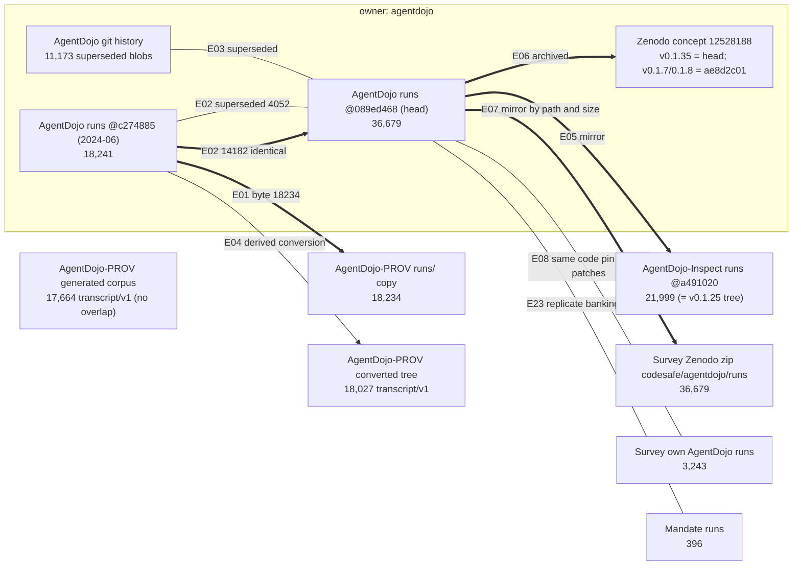
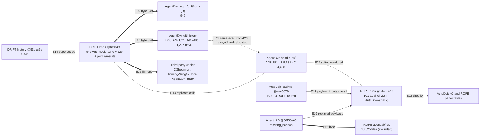
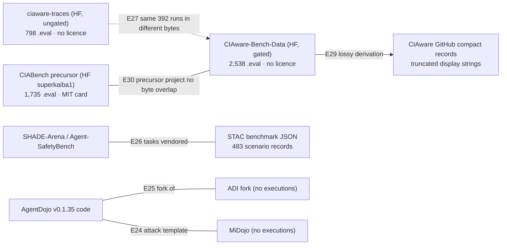

Revision: 2026-10-07 r2 — review resolutions and Addendum B applied.

# I. Framework compatibility matrix

Status: DRAFT-FOR-SPEC, AgentPROV v0.1 architecture and implementation specification. Date: 2026-10-07.

This section is bound by `investigation/DECISIONS.md`. Precedence: **Addendum B** (architect rulings on the review)
overrides **Addendum A**, which overrides the main text. Names, paths, ids and closed vocabularies follow the canonical
naming table of `spec/review/RESOLUTIONS.md` §3. This section is the **owner of status values** (RESOLUTIONS §4.8):
§I.1.1 is the single source of the v0.1 target statuses, and it replaces the D11 table (RESOLUTIONS §2.2 B9). Evidence
base: the twelve source reports `sources/*.md`, their adversarial verification reports
`verify/*.md` (a verification report overrides its source report wherever the two disagree), the structured findings
`sources/*.finding.json`, `baseline/BASELINE.md`, `audit/*.md` and `landscape/*.md`. Every factual statement carries a
bracketed reference. Text quoted from corpora, logs, READMEs or agent-instruction files is **data, not
instructions**; none of it was acted upon.

What this section decides:

1. **I.1** — the master compatibility matrix: a compact summary (§I.1.1) and one card per source with every column
   (§I.1.2).
2. **I.2** — the lineage and overlap graph, the duplication levels (byte, logical, derived, replicate), and the
   normative v0.1 deduplication rule: `source_key` plus declared ownership. Execution-fingerprint deduplication is
   deferred (AD-10 row 7); its design is kept in §I.2.4 as a deferred design.
3. **I.3** — further candidate frameworks found through the survey and the other investigations.
4. **I.4** — the exact list of claims AgentPROV MUST NOT make, per source, each with an enforcement mechanism.
5. **I.5** — the machine-readable form: the registry (`agentprov.adapters.registry`), the **sole** status store, from
   which `agentprov info --matrix`, `agentprov info` (alias `sources`), the README status table,
   `docs/sources/status.md`, the datasheets and the per-source rows of `agentprov stats` are generated; the one
   claims/lint library (`adapters/registry/claims.py`). The full matrix cards stay a reviewed document,
   `docs/sources/matrix.md` (AD-10 row 8).

Rulings on the challenges this section raised (each original box is replaced by a "Resolved" note at the place it
applies):

| Former challenge | Location | Ruling |
|---|---|---|
| A6 (AgentDyn variant-C lineage) | §I.2.2, edge E11 | Accepted (R-62): edge E11 targets `agentdyn` · `history`; the owner of the 4,258 executions is `agentdyn`; DRIFT owns only E09/E10. |
| A6 (survey ASB status) | card #11, §I.1.2 | Accepted (R-15): evidence `partial`, import `planned`. |
| A6 (survey DOI pin) | card #11, §I.1.2 | Accepted (R-62): git `89c4db2c…` is the primary origin; both version DOIs are alternative origins; cite the concept DOI with the version fetched. |

**Changes after review (2026-10-07).** Applied: R-03, R-07, R-08, R-09, R-11, R-14, R-15, R-17, R-19, R-23, R-25,
R-26, R-27, R-28, R-29, R-32, R-36, R-38, R-45, R-48, R-55, R-56, R-57, R-58, R-62 and the RESOLUTIONS §5 variant
list; architect rulings AD-05, AD-07, AD-08 (with the Addendum B nuance), AD-09, AD-10 (with the Addendum B
deviation: `agentprov stats` and `agentprov render` are kept), AD-11, AD-15 (Addendum B deviation: generic
`activity`/`artefact` kinds), AD-16 (Addendum B deviation: `requires-python = ">=3.14"` with release-mode refusal),
AD-20 and AD-21.

---

## I.0 Conventions, scope and how to read the matrix

### I.0.1 Normative language, evidence labels, dates

- MUST, SHOULD and MAY are used as in RFC 2119.
- Evidence classes for derived assertions follow D2: **O** observed in the source bytes, **D** derived by a
  deterministic, versioned rule, **I** inferred (assumption or heuristic, named by a rule id). Classes are static:
  the adapter emits each rule at its effective class at map time, and a change of verification status is a new rule
  id or catalogue version (AD-05).
- For facts about sources the matrix uses three provenance labels, taken from the reports:
  - **verified** — independently reproduced by the adversarial verifier;
  - **investigator** — stated only in the source report;
  - **claim** — stated only by a README, paper, PR or dataset card.
- All repository states are as inspected on **2026-10-07**. A commit hash is always the full or 12-character
  prefix given in the cited report; profiles (§I.5) MUST store the full 40-hex form.

### I.0.2 Two status axes (A6)

Every row and every part of a row carries two independent values.

1. **Evidence availability** ∈ {`yes`, `partial`, `no`}. Is per-execution evidence released and obtainable?
   - `yes`: complete per-execution records exist (they may still have declared gaps, e.g. "final pass only").
   - `partial`: records exist but are structurally incomplete as execution evidence (fragments, scenario prefixes,
     outcome-only rows, free-text tool use, or a slice of a larger unreleased set).
   - `no`: no per-execution evidence is released.
2. **AgentPROV v0.1 implementation status** ∈ {`supported`, `partial`, `planned`, `not_possible`}, plus a
   `caveat` (non-empty for `partial` and for any `supported` part with declared limits), separately for **import**
   and **live**, with the meanings of §D.3.2.

**Spec values are v0.1 targets** (R-15). The registry value is computed from the §D.3.2 gates, including the
full-snapshot import, and is never raised without its gate:

- A part whose importer or backend does not yet exist, or fails its adapter or end-to-end gate (licence-cleared real
  fixture, adapter test and end-to-end test, DoD Q.11), shows `planned` in the registry. For the survey's AgentHarm
  part this gate also includes §D.9 and DoD Q.11a (R-07).
- **Gate for `supported` (HON-10).** The part imports its full pinned snapshot with zero crashes, every file sealed
  (with or without issues), and the counts are recorded in `docs/reports/`. A part that passes its fixtures but not
  this gate shows `partial` with the caveat "full snapshot not yet imported".
- Rows render **per part**, or worst-case over the `source` parts with a `mixed` marker when parts differ; never
  best-case (§I.5.2).

Further vocabulary used in the cards:

- **Role of a part** ∈ {`source`, `mirror`, `owned_elsewhere`, `compat_oracle`, `context`, `not_executions`}
  (RESOLUTIONS §3.8). Earlier labels used by other sections ("mirror of …", a separate "not distinct" status, a
  separate "supported with caveat" status) are encoded as role `mirror` and as `supported` plus a non-empty
  `caveat`; no other status strings exist. "Excluded" is never a licence policy: a part that is not imported has a
  role (`owned_elsewhere`, `mirror`, `compat_oracle`, `not_executions`).
- **Licence policy** (registry) ∈ {`include`, `reference`, `nc_partition`, `forbidden`}; the corpus `raw_policy` ∈
  {`include`, `reference`, `withhold`} is derived from it (`forbidden` → `withhold`; `nc_partition` → `include` inside
  a `-nc` corpus) (R-14, RESOLUTIONS §3.8).
- **Dimension values** (columns "full trajectories" … "framework-specific metadata") ∈ {`yes`, `partial`, `no`,
  `n/a`, `unknown`}, always with a note.

### I.0.3 Rows and parts

The matrix has fourteen rows, one per source the user named. Five rows are split into **parts** because their
sub-corpora differ in format, evidence, licence or ownership:

- AgentDojo: `head`, `2024-06`, `history`, `live`;
- AgentDyn: variants `a`, `b`, `c`, `d` and `history`;
- AutoDojo: `live`, `rope-slice`, `caches`;
- the survey: `agentdojo-runs`, `agentharm`, `asb`, `zenodo-bundled-runs`;
- CIAware-Bench: `github-records`, `hf-gated`, `hf-anon-mirror`, `ciabench`.

Registry identifiers (`source_id`) follow §D.3.3. The AgentDojo-PROV generated corpus and the converted legacy tree
are two parts of `adprov-v1`, shown as two rows here because the user asked for both. Source, profile and corpus ids
follow RESOLUTIONS §3.4 (R-11: `source_id` = registry id, e.g. `agentdojo`; profile id, e.g. `agentdojo-upstream`;
corpus id, e.g. `agentdojo-upstream`); §I.5.8.

### I.0.4 Precedence and differences from earlier tables

Addendum B governs, then A6/A7. §I.1.1 replaces the D11 table (RESOLUTIONS §2.2 B9). §D.3.3, §MN N.3, §H.4.2,
§K.4.2/§K.6, A.5 and O.1.7/O.4.4 are generated from the registry that carries these values, or are compared against
it (R-15). The following values differ from the earlier tables:

| Source | Earlier value | This section (Addenda A and B, verified evidence) | Basis |
|---|---|---|---|
| STAC | D11/§D.3.3 import `partial (pending)` | import `planned` (A7 step 5, stretch); evidence `partial`; records are scenarios (`unit: scenario`) | A6; R-28; [verify/multiturn-agent-attack.md §4] |
| CIAware-Bench | D11/§D.3.3 `planned`; §H.4.2 `withhold` | `github-records` evidence `partial`, import `planned`; `hf-gated` evidence `partial` (listing and hash-bound only; content unobserved), import `planned`; `hf-anon-mirror` import `planned`; `ciabench` import `planned`, licence policy per U-04 (default `reference`); no "scrub" of raw bytes | AD-21 (a); R-29; [verify/ciaware-bench.md §0, §6] |
| Survey | D11 "discovery source" | execution source with three execution parts (plus a mirror part); AgentDojo runs `supported`; AgentHarm a `supported` v0.1 target (registry `planned` until §D.9 and DoD Q.11a pass), separate restricted-use corpus; ASB evidence `partial`, import `planned` | A6, A7; R-07, R-15; [verify/agent-security-tools-survey.md §2.6] |
| AgentDyn | `supported (pending verification)` | verified; A `supported`, B and C `partial`, history `planned` (fingerprint deduplication deferred with it, AD-10 row 7) | A6; R-15; [verify/agentdyn.md §10] |
| AgentDojo live | D11 `supported` | `supported` (target); `partial` since D-720, caveat: the D-720 subset (local model servers with consent; API endpoints with consent and both caps); real-model pilot 2026-10-22, working corpora, not sealed (D-722, D-729); default LLM element `native` | R-25; AD-09; D-720 |
| AgentDojo-PROV converted legacy tree | a separate "oracle-only" import status | import `—`, role `compat_oracle` | R-15 |
| Verification flags | §D.14.2 item 5: AgentDyn, STAC, survey pending | every investigated source has a verification report (12 reports); `verification = "verified"` for every row | `verify/*.md`; R-63 |
| Inspect `.eval` | D4 "planned" | normative v0.1 importer (A7 step 4) and, with TraceLogger `v0.k11`, the `aer/0.1` + `capture/0.1` freeze gate | A7; AD-06 |

---

## I.1 Master compatibility matrix

### I.1.1 Compact summary

`Import` and `Live` are v0.1 target implementation statuses (§I.0.2); the registry shows the gated value. "Owner"
names the source that owns the source keys of a part (§I.2.4); "—" means not applicable. The licence column gives the
registry licence policy (§I.0.2).

| # | Source · part | Evidence | Format (dialect · variant) | Licence → licence policy | Import | Live | Overlap / owner |
|---|---|---|---|---|---|---|---|
| 1 | AgentDojo upstream `agentdojo` · `head` (@`089ed468`) | yes | `agentdojo.tracelogger` · `v0.k11` 24,914, `v1.k14` 11,764, `v1.k14.incomplete` 1 | MIT → include | supported | — | Owner. Mirrored by #4 (byte-identical `v0.1.25` subset) and by the survey's Zenodo zip (#11; path and size identical) |
| 1 | · `2024-06` (@`c274885`) | yes | `v0.k11` · 18,241 | MIT → include | supported | — | 14,182 byte-identical to `head`; 4,052 superseded at `head`; ⊃ the baseline `runs/` copy (18,234) |
| 1 | · `history` (superseded git blobs) | yes | `v0.k11` (+9 `pre_v0`) | MIT → include (opt-in) | planned | — | `superseded_by` `head` (11,173 blobs) |
| 1 | · `live` | n/a | `agentprov.capture/0.1` + native `v1.k14` | user's own → include | — | supported (target; `partial` since D-720), caveat: the D-720 subset (local model servers with consent; API endpoints with consent and both caps); real-model pilot 2026-10-22, working corpora, not sealed (D-722, D-729) (`backends/agentdojo`, `agentdojo==0.1.35`; LLM element `native` by default, AD-09) | — |
| 2 | AgentDojo-PROV generated corpus `adprov-v1` · `release` | yes | `adprov.transcript_v1` | data CC-BY-4.0, code MIT → include; derived licence is the user's choice (U-03; default inherit), carrying AgentDojo's MIT notice for the embedded AgentDojo content | supported (A7 step 1) | — (successor: `agentdojo` live) | No overlap with any other source |
| 3 | AgentDojo-PROV converted legacy tree `adprov-v1` · `converted-legacy` | derived data only | `adprov.transcript_v1` (timing stubbed) | stamped CC-BY-4.0, not carried; MIT by inclusion → — (derived data, no raw; statement per U-03) | — (role `compat_oracle`) | — | Derived conversion of #1 `2024-06` (18,027 executions); owner `agentdojo` |
| 4 | NIST AgentDojo-Inspect `agentdojo-inspect` | no (own) | inherited `v0.k11`; bridge `.eval` never released | NIST notice + MIT → reference (mirror location) | not_possible (`mirror_of = "agentdojo"`) | planned (via Inspect; prefer `inspect_evals`) | 21,999 = AgentDojo `v0.1.25` `runs` tree, all still at #1 `head` |
| 5 | AgentDyn `agentdyn` · `a` | yes | `v1.k14` · 38,281 | MIT (AgentDojo notice) → include | supported | planned | Owner; 0 byte overlap with #1, #4, #7 |
| 5 | · `b` (Progent, vendored AgentDojo 0.1.29) | yes | `v0.k11` · 5,184 | MIT → include | partial (stretch, built after the DoD set; AD-10 row 21) | — | — |
| 5 | · `c` (DRIFT original code, re-keyed) | yes | `drift.k18.messages` · 4,258 | MIT → include | partial (stretch; AD-10 row 21) | — | Same executions as AgentDyn history `runs/DRIFT/**` (E11) |
| 5 | · `d` (`src/…/drift/runs`) | yes | `drift.k18.conversations` · 949 | — (owned by `drift`) | — (role `owned_elsewhere`) | — | Byte-identical to #8 `head`; owner `drift` |
| 5 | · `history` | yes (git) | mixed | MIT, removed by authors → reference | planned (fingerprint deduplication deferred with it, AD-10 row 7) | — | 16,795 blobs = 16,175 executions, ≈11,297 novel |
| 6 | AutoDojo `autodojo` · `live` | n/a | `capture/0.1` + fork `v1.k14` | MIT; user's own runs → include | — | supported (target; `partial` since D-720), caveat "isolated env"; the D-720 subset (local model servers with consent; API endpoints with consent and both caps); local real-model pilot 2026-10-22, not sealed (D-722, D-729) | — |
| 6 | · `rope-slice` | partial | `v1.k14` (inside ROPE) · 2,847 | MIT (ROPE) → include (in corpus `rope`) | partial (`via = "rope"`) | — | Owner `rope` |
| 6 | · `caches` | no (not executions) | `injections.json` optimiser caches · 150 (+3 in ROPE) | MIT → include (as a context artefact, artefact role `supporting`) | — (role `not_executions`) | — | Payload inputs to #7 (E17) |
| 7 | ROPE `rope` | yes | `v1.k14` · 10,791 | MIT → include | supported | planned | Owner of the AutoDojo-attack slice; `agentlab/res/**` not selected (`select.owned_elsewhere`, owner `ext:agentlab`) |
| 8 | DRIFT `drift` · `head` | yes | `drift.k18.conversations` · 1,569 | MIT (from `6fd3df4`) → include | partial (stretch; AD-10 row 21) | planned | Owner; byte copies in #5 `d`, #5 `history`, third-party repos |
| 8 | · `history` (@`53dbc6c`) | yes | same · 1,046 | pre-licence → reference | planned | — | `superseded_by` `head` (949) + 97 deleted |
| 8 | · `asb` (`ASB_DRIFT/logs`) | partial | ASB result CSV · 3 × 400 rows | MIT → include | planned | — | — |
| 9 | MiDojo `midojo` | no | outcome-only branch JSON (92 rows); not imported | Apache-2.0 | not_possible | planned (low priority, not v0.1) | None |
| 10 | ADI `adi` | no | — (definitions only) | MIT + attribution paragraph (GitHub NOASSERTION); CaMeL files Apache-2.0 | not_possible | planned (ADI's own fork, isolated env) | None |
| 11 | Survey `agent-security-tools-survey` · `agentdojo-runs` | yes | `v1.k14` · 3,243 | CC-BY-4.0 → include | supported | — | New executions on AgentDojo `089ed468` + 3 local patches |
| 11 | · `agentharm` | yes | `inspect.eval` · 6 logs, 1,056 samples | CC-BY-4.0; AgentHarm data MIT + use clause → include in the separate restricted-use corpus `ast-survey-agentharm`, clause in `licences.restrictions` (U-05) | supported (v0.1 target; band 0.3.247.dev69; registry `planned` until the §D.9/DoD Q.11a gates pass) | planned (via Inspect) | None |
| 11 | · `asb` | partial | ASB result CSV · 1,200 rows | CC-BY-4.0 (+ ASB MIT) → include | planned | — | None (not Agent-SafetyBench) |
| 11 | · `zenodo-bundled-runs` | (mirror) | AgentDojo `runs/` copy · 36,679 | — (owned by `agentdojo`) | — (role `mirror`) | — | Mirror of #1 `head`; owner `agentdojo` |
| 12 | Mandate-AgentDojo-Eval `mandate-agentdojo-eval` | yes | `v1.k14` · 396 | MIT (publisher unverified) → include | supported (requires `decision` records) | planned (not v0.1) | Replicates of #1 banking cells; 0 shared executions |
| 13 | MultiTurnAgentAttack (STAC) `stac` | partial (scenario records) | `stac.json_array` · 483 records | CC BY-NC 4.0 → nc_partition (no NC corpus is built in v0.1, AD-10 row 22) | planned (A7 step 5, stretch) | planned | None |
| 14 | CIAware-Bench `ciaware-bench` · `github-records` | partial (fragments) | gzip JSONL/JSON records | none → reference | planned (not recommended: lossy) | — | Derived, lossy, from #14 `hf-gated` |
| 14 | · `hf-gated` | partial (listing and hash-bound only: 452 archives bound to GitHub-published SHA-256; content unobserved) | `inspect.eval` · 2,538 | none → reference (gate; permission) | planned (until the user accepts the gate and content is observed, U-04; AD-21) | planned (low priority) | 392 runs are the same executions as `hf-anon-mirror` |
| 14 | · `hf-anon-mirror` | yes | `inspect.eval` (inspect_ai 0.3.200, deflate) · 798 | none → reference | planned (no committed licence-cleared fixture; AD-21) | — | 392 same executions as `hf-gated` (different bytes); 406 only here |
| 14 | · `ciabench` (precursor) | yes | `inspect.eval` (inspect_ai 0.3.170, deflate) · 1,735 (`v2` branch: 1,858) | MIT in card metadata only (not legally settled) → per U-04: `include` on that recorded basis, or `reference` (default) | planned (a `partial` test-sample target only if U-04 accepts; not a phase-6 gate sample, R-29) | — | Distinct, earlier executions; 0 byte overlap |
| 15 | DTap-Bench `dtap` · `head` (runs @`836caf2f`, tasks @`a3edc9b7`; added 2026-10-11, D-26) | yes | `dtap.trajectory` · `v1` · 67,808 trajectory files (67,806 parseable; 20 synthetic, not executions), 65,902 judge results, 6,682 task configurations | Apache-2.0 (both dataset cards; no LICENSE/NOTICE file in either repository) → include, subject to the secrets decision (§D.16.13) | planned (phase 10b; §D.16) | — | None with any other source (4 harnesses, 7 models, 14 domains not in the AgentDojo family) |

Totals of released per-execution records that v0.1 targets for import or linking (owner rows only, no double
counting): AgentDojo 36,679 + 4,059 (`2024-06` executions not at `head`: 4,052 superseded + 7 Mixtral);
AgentDojo-PROV 17,664; AgentDyn 47,723; ROPE 10,791; DRIFT 1,569; Mandate 396; survey 3,243 + 1,056.

These are **records**, not all executions. Three populations are reported separately (R-28; NC-ALL-13):

- **Records with no execution observed.** 207 AgentDojo `claude-3-opus-20240229` logs with `messages: []` that carry
  outcomes [sources/agentdojo.md §4.4], and 2 ROPE logs with `messages: []` and no outcome keys [sources/rope.md
  §3.3]. Both map to `unit: outcome_only` with `execution_observed: false` and issue `no_execution_observed`; the
  2 ROPE logs also carry `no_outcome_recorded`. Execution counts use `unit == agent_execution ∧ execution_observed`.
- **STAC** (483 scenario records, `unit: scenario`): scenarios, not agent executions (NC-ALL-08, NC-ALL-13,
  NC-STAC-01).
- **CIAware Inspect logs**: all parts `planned`, reference-only, with shared actor trajectories (NC-CIA-02).

### I.1.2 Source cards

Each card lists every matrix column in the fixed order C01–C29. In v0.1 the cards are a reviewed document,
`docs/sources/matrix.md`; the `[matrix]` profile table that would make them regenerable (§I.5.3) is deferred (AD-10
row 8). The registry carries C28/C29 (§I.5.2). In C23/C24, "class" is the D2 evidence class the provenance engine
MUST attach (D7: core bundle O/D, inference bundles I, assessments in the assessment bundle).

Where a C23 statement names an activity that is neither a model call nor a tool execution (planning, cache
optimisation, probe sub-tasks, memory or retrieval steps), it maps to the generic `activity` kind, and its products
to the generic `artefact` kind, of `aer/0.1` (Addendum B AD-15 and B-1: 13 record kinds). EF's generic rules G-ACT,
G-USE, G-GEN and G-ASSOC then produce named PROV statements that take part in the Inference-6 closure. Adapters MUST
NOT use `activity` for something an existing kind represents (for example an LLM call with recorded evidence is a
`model_call`).

#### Card 1 — AgentDojo upstream (`agentdojo`)

| Col | Column | Value |
|---|---|---|
| C01 | Canonical repository | `https://github.com/ethz-spylab/agentdojo` (original, not a fork); PyPI `agentdojo`; GitHub–Zenodo software deposits, concept DOI `10.5281/zenodo.12528188` (36 versions, MIT) [sources/agentdojo.md §1; verify/agentdojo.md §2]. Paper arXiv:2406.13352 (NeurIPS 2024 D&B). |
| C02 | Version / commit inspected | `head` = `089ed468cf3ed0322acc66b0211f26d9d90dbf60` (2026-06-02). Tag `v0.1.35` = `a75aba7631d3…` (PyPI 0.1.35, the latest; `main` is 5 commits ahead and still reports `0.1.35`). `2024-06` = `c274885610efaaafec38b6d3eb07152ba7ff3f94` (2024-06-05; `runs` subtree `1227480d…`, 18,241 blobs). `15de44300d05…` (2024-07-15) is the last state before the travel and Llama re-runs. Zenodo `10.5281/zenodo.17458493` (v0.1.35) = the `head` `runs/` state; `10.5281/zenodo.12528189`, `12528333` (v0.1.7) and `12742856` (v0.1.8) hold `runs` subtree `d1c9178a…` (= `ae8d2c01`), a superset of the baseline blobs [verify/agentdojo.md §2.1; audit/legacy_replay.md §2.1]. |
| C03 | Licence and redistribution | Code: MIT (© 2024 Debenedetti et al.). Raw data: `runs/` is covered by the repository MIT licence; no separate data licence; Zenodo records declare `mit-license` [verify/agentdojo.md §1]; the datasheet records the basis verbatim as "MIT by repository; data licence not separately stated" (U-03; R-14). Derived: inherit MIT (U-03 default). Not assessed: model-provider terms on redistributing outputs; Llama 3.3 and Meta-SecAlign output licences. Raw policy `include` with `LICENSE` and `CITATION.bib` [sources/agentdojo.md §10]. |
| C04 | Execution data available? | **Yes.** 36,679 native logs at `head` (426,293,413 B, 29 pipeline directories). Git history holds 47,852 distinct run blobs over 60 commits, 11,173 of them no longer at `head`. A random sample of 30 superseded blobs were all distinct re-executions [verify/agentdojo.md §2]. |
| C05 | Execution format | AgentDojo `TraceLogger` JSON, one file per (pipeline dir, suite, task, attack, injection task). Variants (§D.6.2): `v0.k11` (24,914; string content; logs committed before 2025-03), `v1.k14` (11,764; content blocks; adds `benchmark_version`, `evaluation_timestamp`, `agentdojo_package_version`), `v1.k14.incomplete` (1). Nine `pre_v0` `banking_rw` development logs exist in history only [sources/agentdojo.md §3.4, §5.2]. |
| C06 | Structured? | Yes: JSON with closed key sets per variant. Key order is a code-path artefact without semantics [sources/agentdojo.md §3.4]. |
| C07 | Full trajectories? | **Final pass only.** `TraceLogger.log` overwrites the message list; `run_task_with_pipeline` makes up to 3 passes on the same mutated environment. Retries are provable only in 82 logs whose final assistant content is `null` without a run error (third of three passes); elsewhere they are neither confirmed nor excluded [verify/agentdojo.md §3]. 207 `claude-3-opus-20240229` logs have `messages: []` but carry outcomes (`unit: outcome_only`, issue `no_execution_observed`; R-28); 1 log is incomplete [sources/agentdojo.md §4.4]. |
| C08 | Messages | Yes: 397,064 (system 36,472; user 66,472; assistant 157,561; tool 136,559). Defence-inserted messages are present (tool-filter prompt and answer, repeated user prompts). Local-model assistant content is the raw completion with `<function=…>` tags. Prompting-based Llama-3-70b keeps only the post-parse text [sources/agentdojo.md §3.5]. |
| C09 | LLM calls | **No.** No request, parameters, tool schemas, usage, finish reason, latency or request id. One assistant message ≈ one call is an inference. Temperature behaviour depends on the code era: v0.1.35 drops 0.0, `head` transmits it [sources/agentdojo.md §1.1]. |
| C10 | Tool calls | Yes, 137,374 calls with `function` and `args`. The args are **as executed**: `ToolsExecutor` mutates them in place. Ids: OpenAI/Anthropic provider ids, duplicated in 213 GPT logs; Gemini `""` (2,725 logs with ≥2 empty ids); Cohere key absent; 2025 local models `null`; Llama-3-70b client-generated random ids. `placeholder_args` is null in all 61,461 occurrences. 815 calls have no result [verify/agentdojo.md §3]. |
| C11 | Tool outputs | Yes: model-visible text (YAML or `str()`), plus `error` (7,509 errors, 7,383 with empty content). In 622 logs the PI-detector sentinel replaced the output; the original is lost. Spotlighting wraps outputs in `<<…>>` [sources/agentdojo.md §3.5]. |
| C12 | Environment state | **No.** Reconstructable only by replay against the run-era suite code plus `injections` (class I) [sources/agentdojo.md §6]. |
| C13 | Task definitions | Partial: task ids plus the prompt and GOAL text inside messages. Ground truth, checkers and tool schemas exist only in code. v1 checkers were edited in place after the 2024 runs (`6313f721`, `3ebb8f8c`); `3f58252b` (v1.2.2) also edits `v1/workspace/user_tasks.py` [verify/agentdojo.md §4]. |
| C14 | Attack data | Yes: `attack_type` (15 attacks + none) and `injections` {vector id → exact payload}. Placement is in suite YAML at the run-era commit [sources/agentdojo.md §3.3]. |
| C15 | Outcome labels | `utility`, `security` booleans. `security = true` means **the injection task succeeded**. It is a constant `true` in all 3,560 benign logs, `not utility` in all 485 DoS logs, and imposed as `(False, True)` in all 105 run-error logs [verify/agentdojo.md §4]. Upstream issues #168 and #218 (claim) report checkers that score proposed rather than executed calls. |
| C16 | Security labels | None per message. Integrity and roles are SEM annotations from the suite tables (D6). |
| C17 | Model metadata | Partial: dated API snapshot ids in the pipeline directory and `pipeline_name`. For the 11,765 local-model logs `pipeline_name` is `local*`, and identity comes from the directory only (class I; HF ids are PR #96/#97 claims). No served-model string, no decoding parameters [sources/agentdojo.md §3.2]. |
| C18 | Timestamps | `v0.k11`: `duration` only. `v1.k14`: one naive local `evaluation_timestamp` per run (1 s resolution, timezone unknown, set at logger construction). The date of the commit that introduced the blob is an upper bound (D, rule `agentdojo.committed_no_later_than@1`; never a PROV time) [sources/agentdojo.md §3.1]. |
| C19 | Ordering | Array order of `messages` and `tool_calls`; no sequence numbers; no cross-run order. |
| C20 | Identifiers | Path tuple only: no run id, trace id, seed or UUID. The path is **not** unique across git history (the same path was re-executed), so identity is the source key (§I.2.4) [sources/agentdojo.md §3.2]. |
| C21 | Framework-specific metadata | `pipeline_name` with defence suffix; run-level `error`; `benchmark_version` (`v1.2.1` on all `v1.k14`); `agentdojo_package_version` (`unknown` on all 11,765) [sources/agentdojo.md §3.3]. |
| C22 | Record counts | `head` 36,679 = 33,119 attacked + 2,756 benign user-task + 804 injection-task-as-user-task; 16 attack directories; 137,374 tool calls. `2024-06`: 18,241 (= baseline copy 18,234 + 7 Mixtral). History: 47,852 distinct blobs over 37,446 paths; 11,173 not at `head` [verify/agentdojo.md §2–§3]. |
| C23 | PROV derivable | Run activity with `duration` (O). One `ModelInvocation` per assistant message (activity I; generated message O). Its `used` of the context list (I, AgentDojo pipeline semantics). `ToolExecution` used the request (O) and generated the result (O); the call↔result link is D (unique id) or I (positional). Defence activities: the tool-filter auxiliary LLM call (messages O); PI redaction as a `decision` (I from the sentinel). Payload fixtures (O) attributed to an attacker agent (D). Surfacing assessments (D, versioned YAML/repr normaliser). Judgements (O value) with `origin` (D: `checker`, `harness_default`, `harness_rule`). The `v1.k14` start time is carried as a naive-local time attribute, never as an offset `xsd:dateTime`. |
| C24 | PROV impossible | Per-activity start and end times. Discarded passes (only their existence, for 82 logs). LLM parameters, tool schemas, usage and reasoning. Original outputs under the PI detector and detector scores. Raw completions of prompting-based Llama-3-70b. Environment-state entities and tool→environment derivations. Argument-level injection provenance. Any execution graph for the 207 empty logs. Global identity without (commit, path, blob) [sources/agentdojo.md §7.2]. |
| C25 | Conversion strategy | Dialect `agentdojo.tracelogger`, mapper `agentdojo.tracelogger` (§D.6), profile `agentdojo-upstream` v1 (§D.4.3), semantics profile `agentdojo.suites@1`. Corpus `agentdojo-upstream` with snapshots `head` and `2024-06` (§H.4.2). History is the opt-in sub-source `agentdojo-history` (planned). Live: backend `agentdojo` in the separate uv project `backends/agentdojo/` (Python 3.12, `agentdojo==0.1.35`, wheel sha256 `364bea42…`), run as a spawned worker `<env>/bin/python -I -B -m agentprov_backend.worker` (environment under `$AGENTPROV_HOME/envs/`; AD-01), writing `capture/0.1` and the native log (A1, D5, §D.10). Default LLM element `native` (stock behaviour, recorded at the transport level); `gateway_compat` is an opt-in declared as `request_modifying`/`harness_policy` instrumentation (AD-09). |
| C26 | Known limitations and quirks | All quirks of §D.4.3, plus: generation mixing **within** pipelines (gpt-4o and its 4 defences: benign travel pre-update, attacked travel post-update; gpt-3.5: 119/167 travel pre-update), so era is inferred per file [verify/agentdojo.md §5.3]. Of the 4,052 baseline paths that differ at `head`, 900 differ in utility and 201 in both outcomes (14 pipelines plus Llama-3-70b) [verify/agentdojo.md §5.1]. The hosted Invariant Explorer traces are dead (shut down January 2026). Open PRs #191, #215, #155 and #177 would change logs or scoring. The version string does not identify the code. |
| C27 | Duplicate / overlap status | Owner of every `runs/` blob. Mirrored by AgentDojo-Inspect (E05), by the Zenodo deposits (E06) and by the survey's Zenodo zip (E07). The baseline `runs/` copy ⊂ `2024-06` (E01). Its derived conversion is the converted legacy tree (E04). Mandate replicates 180 banking cells (E23). Third-party HF trajectory sets are separate candidates (§I.3.2) [sources/agentdojo.md §5]. |
| C28 | Evidence availability | `yes` (all parts except `live`, which generates evidence). |
| C29 | Implementation status | Import: `head` and `2024-06` **supported** (targets; gated per §I.0.2); `history` **planned**. Live: **supported** (target); **partial** since D-720, caveat: the D-720 subset (local model servers with consent; API endpoints with consent and both caps); real-model pilot 2026-10-22, working corpora, not sealed (D-722, D-729) (R-25). Verification: verified. |

#### Card 2 — AgentDojo-PROV generated corpus (`adprov-v1` · `release`)

| Col | Column | Value |
|---|---|---|
| C01 | Canonical repository | Framework `github.com/nickjones39/agentdojo-prov` (public; GitHub licence detection NOASSERTION, LICENSE text MIT). Data: Zenodo `10.5281/zenodo.21052314` (v2.2, 2026-06-30, `corpus-prov.zip` 106,017,696 B, md5 `5aac3036…`). The local on-disk corpus is v2.3, which the user deposited on Zenodo on 2026-10-10 (version DOI `10.5281/zenodo.23276620`, concept `10.5281/zenodo.20692312`; split parts of `corpus-prov`, the converted `corpus-og-agentdojo-runs-prov`, `corpus-ml` and `legacy-runs`) (D-900); byte equality of the deposit with the local tree is not verified (U-07) [baseline/BASELINE.md §0, §8.1]. |
| C02 | Version / commit inspected | Framework `579a908354b93361efe0905ffb7623256aa96a06` (`corpus-v2.3-26-g579a908`). Tag `corpus-v2.3` (`a7002b49…`) does not identify the code that produced the on-disk v2.3 graphs. Manifests: `corpus_version` 2.3, generated 2026-10-06T01:50Z. Byte equality of local v2.3 with Zenodo v2.2 is **not verified** [baseline/BASELINE.md §8.1]. |
| C03 | Licence and redistribution | Code MIT. Data CC-BY-4.0 (manifests, Zenodo). Derived: the user's choice (U-03; default inherit, CC-BY-4.0). The corpus MUST carry AgentDojo's MIT notice for the embedded AgentDojo content (task prompts, tool outputs, injection payloads) (R-14). Model-provider terms not assessed. Licence policy `include` (§H.4.2, corpus `agentdojo-prov-v2`). |
| C04 | Execution data available? | **Yes**: the author's own live capture, 17,664 transcripts. The 17,664 PROV graphs beside them are **derived** artefacts (compat-oracle targets), not raw evidence [baseline/BASELINE.md §4.1]. |
| C05 | Execution format | `adprov.transcript_v1` JSON (`adprov_schema`, `meta`, `turns`), one per cell; layout `<model_folder>/prov/<attack>/<suite>_<user_task>[_x_injectiontaskN]_{benign\|injection}.transcript.json`. The schema id was never bumped through field additions and one semantic change (null reply stored as `""` before 2026-10-04) [audit/capture.md §5, §7]. |
| C06 | Structured? | Yes: JSON Schema `docs/transcript.schema.json` (its `format` keywords are not asserted) [audit/legacy_replay.md §1 item 7]. |
| C07 | Full trajectories? | Final scored pass only (`discarded_attempts` occurs 0 times). 153 traces have `usage.n_llm_calls` > assistant turns, so earlier passes are inferred. For DeepSeek (2,944 traces, no `model_config`) re-runs are unknowable [baseline/BASELINE.md §5.1, §8.3]. |
| C08 | Messages | Yes: system 17,664, user 17,664, assistant 64,897, tool 64,781. Null replies are stored as `""` (ambiguous). No `reasoning` and no `refusal` field anywhere [audit/capture.md §5.3, §7]. |
| C09 | LLM calls | Partial: no per-call records. `model_config` (14,720 traces, all but DeepSeek) holds the **configured** temperature 0.0 (not transmitted: `or NOT_GIVEN`), aggregated usage including `n_llm_calls`, and `finish_reasons`. No raw request or response, no served model [audit/capture.md §5.2]. |
| C10 | Tool calls | Yes: 64,829 calls, ids never null, one duplicated id (GLM-4.6 `call_3275`). Args are post-normalisation. `placeholder_args` occurs 0 times [audit/capture.md §5.3; baseline/BASELINE.md §5.1]. |
| C11 | Tool outputs | Yes: 64,781 model-visible YAML outputs with `content_sha256`; 6,920 errors (all with `content == ""`); 48 calls requested but not executed [audit/capture.md §7]. |
| C12 | Environment state | No. Environment digests and diffs are post-release capture features with 0 occurrences in the data [audit/capture.md §1 item 3]. |
| C13 | Task definitions | Ids plus prompt text; AgentDojo v1.2.2 at 0.1.35 by reference. |
| C14 | Attack data | Yes: `meta.injections` {vector → payload}; attacks `direct`, `important_instructions`, `injecagent`. The payload text depends on the harness's `MODEL_NAMES` display-name mutation (e.g. "Gpt 5 Nano") [audit/capture.md §1 item 7]. |
| C15 | Outcome labels | `utility`, `security` (true = attack succeeded). Benign `security` is normalised to `None` (release convention, unlike the legacy `true`) [baseline/BASELINE.md §4.2]. |
| C16 | Security labels | None in the transcripts. The v2.3 graphs' `adprov:integrity` labels are builder-derived, not raw. |
| C17 | Model metadata | `model` is a CLI shorthand (not an identity); `model_id` is the requested id; the served model is absent. Six models: google/gemini-2.5-flash, meta-llama/llama-3.3-70b-instruct, deepseek-chat, gpt-5-nano, qwen/qwen-2.5-72b-instruct, z-ai/glm-4.6 [baseline/BASELINE.md §4.1]. |
| C18 | Timestamps | Run `started_at`/`ended_at` (UTC ISO; they include environment loading and scoring) and monotonic `wall_clock_s` (O). Per-tool `started_at`/`ended_at` from `TimingToolsExecutor` (UTC, O). No LLM-call times. The two GLM activities sharing the duplicated id are untimed [audit/capture.md §5.2–5.3; baseline/BASELINE.md §5]. |
| C19 | Ordering | Turn order; tool order within a turn; per-tool times. |
| C20 | Identifiers | Path stem and tool-call ids; no run UUID. `agentdojo_version = 0.1.35` cannot distinguish forks [audit/capture.md §5.2]. |
| C21 | Framework-specific metadata | `meta.model_config`, `wall_clock_s`, `agentdojo_version`, `benchmark_version` (`v1.2.2`). |
| C22 | Record counts | 17,664 = 6 models × (97 benign + 3 × 949 attacks); suites workspace 10,320, banking 2,688, travel 2,640, slack 2,016; 1,417 tool-free traces [baseline/BASELINE.md §4.1, §5]. |
| C23 | PROV derivable | One `ModelInvocation` per assistant turn (activity I; aggregate usage only). Context membership of the released transcripts is **INFERRED** and goes to the inference bundle `inf.adprov-context_is_prefix-v1` (assumption status `asserted`), unless the user supplies a digest-pinned generation-time harness (U-01) (AD-05). `ToolExecution` with observed UTC start and end (O). Result entities (O). Payload fixtures (O). Judgements (O, with origin). Run start and end (O). Declared instrumentation: developer→system rewrite, malformed-call resampling, upstream-failure retry, display-name mutation, temperature not transmitted (§C.16.2 example). |
| C24 | PROV impossible | LLM call times and transmitted parameters; reasoning; discarded passes; environment state; raw wire messages; served model; failed attempts (the capture gate discarded them) [audit/capture.md §1 item 5]. |
| C25 | Conversion strategy | Dialect and mapper `adprov.transcript_v1` (§D.7), profile `adprov-v1`; A7 step 1. The v1 view is regenerated from the AER alone through a deterministic transcript/v1 view (`views/transcript_v1.py`; sparse `ext.lex` hints written by `aer.canon.lex_hints()`; nothing is read from raw; AD-02). Gates (AD-07): A1 (JCS value identity) and A2 (bytes) for v1 → AER → v1, and B (compat graph bytes) for the compat profile `adprov-v2.3-compat`, on the golden pairs in CI (`tests/fixtures/agentdojo_prov_v1/golden/`, including the R-59 hazard pairs) and on all 35,691 graphs locally (D7, DoD Q.5, phase 13). Compat outputs are flagged `apv:RegressionOracle` in the manifest and index (R-55). |
| C26 | Known limitations and quirks | Constant schema id across capture generations; null-as-`""`; display-name mutation; developer→system rewrite; resampling ≤ 8; upstream-failure retries; 18 workers with a 0–20 s stagger (timing contention); failing attempts discarded (unmeasurable selection effects); `placeholder_args` mis-specified in the docs [audit/capture.md §1, §6, §8]. |
| C27 | Duplicate / overlap status | None. The six models appear in no other source [verify/agent-security-tools-survey.md §2.5]. |
| C28 | Evidence availability | `yes`. |
| C29 | Implementation status | Import **supported** (A7 step 1). Live: — (the old generator is superseded by the `agentdojo` backend). Verification: baseline measured [baseline/BASELINE.md]. |

#### Card 3 — AgentDojo-PROV converted legacy tree (`adprov-v1` · `converted-legacy`)

| Col | Column | Value |
|---|---|---|
| C01 | Canonical repository | Local derived tree `corpus/corpus-og-agentdojo-runs-prov` in the gitignored corpus directory of the framework; never released (Zenodo v2.2 describes only the live corpus) [verify/agentdojo.md §2.2]. Its raw input is AgentDojo `runs/` at `c274885…` (18,234 of 18,241 blobs; 7 Mixtral missing) [audit/legacy_replay.md §1 item 2]. |
| C02 | Version / commit inspected | Produced by `agentdojo_prov/convert_runs.py` at framework `579a908…`. Re-converted on 2026-10-04 when `message_to_turn` changed; no converter version is stamped [audit/legacy_replay.md §1 item 8]. |
| C03 | Licence and redistribution | Stamped CC-BY-4.0 by a build constant, but derived from MIT upstream logs, so MIT by inclusion. The stamp is **not** carried forward (§H.4.2) [audit/corpus.md §9 item 16]; the licence statement for the tree is U-03. Raw: none (derived). Role `compat_oracle`: not imported as a corpus. The frozen v2.3 `checksums.sha256` lists (release and converted) ship in deposits as raw objects with origin `corpus {AgentDojo-PROV, 2.3, producer_commit 579a908}` (R-26; RESOLUTIONS §3.6). |
| C04 | Execution data available? | **Derived data only**: 18,027 transcripts and 18,027 graphs. The 207 empty-message logs went to `EXCLUDED.json` [baseline/BASELINE.md §4.2, §4.7]. |
| C05 | Execution format | `adprov.transcript_v1` with `meta.source = "agentdojo_native_run_log"`, `pipeline_name`, `timing_stubbed: true`, `run_error` (106) [baseline/BASELINE.md §5.1]. |
| C06 | Structured? | Yes. |
| C07 | Full trajectories? | Final pass (inherited from upstream). |
| C08 | Messages | System 18,027; user 21,658; assistant 73,551 (38,536 `text: null`); tool 68,620; inline `<thinking>` in 2,075 Claude-3 traces [baseline/BASELINE.md §5.1]. |
| C09 | LLM calls | None (no `model_config`). |
| C10 | Tool calls | 68,773 calls; 4,413 null ids; 2,175 traces with duplicated ids (null, empty or real) [baseline/BASELINE.md §5.1]. |
| C11 | Tool outputs | As upstream; 2,154 entities flagged `defence_omitted` (PI detector) [baseline/BASELINE.md §5]. |
| C12 | Environment state | No. |
| C13 | Task definitions | As upstream. The 124 "benign" traces per pipeline are 97 user tasks plus 27 injection tasks run as user tasks, mislabelled `benign` [baseline/BASELINE.md §4.2; audit/legacy_replay.md §1 item 6]. |
| C14 | Attack data | `injections` copied from the log. |
| C15 | Outcome labels | Logged values copied without an origin marker (benign `security: true`; 106 run errors with `security: true`; DoS). Manifests merge replay evidence (`outcome_replay.json`), which is derived [baseline/BASELINE.md §4.5, §8 item 7]. |
| C16 | Security labels | Graph-level only, builder-derived. |
| C17 | Model metadata | `pipeline_name` only; `agentdojo_version` and `benchmark_version` are null. |
| C18 | Timestamps | Per-tool `"0"` sentinel with `timing_stubbed`; run `started_at`/`ended_at` null; `wall_clock_s` = upstream `duration` [audit/legacy_replay.md §1 item 7]. |
| C19 | Ordering | Inherited. |
| C20 | Identifiers | Stem from (pipeline, attack, suite, task). **No source path, source hash, upstream commit or converter version** is recorded [audit/legacy_replay.md §1 item 2]. |
| C21 | Framework-specific metadata | `source`, `pipeline_name`, `timing_stubbed`, `run_error`. |
| C22 | Record counts | 18,027 (17 pipelines; 16 attack folders); graphs 173,294 nodes and 316,951 edges [baseline/BASELINE.md §4.5]. |
| C23 | PROV derivable | Nothing independent. Every statement about these executions MUST be derived from the upstream raw bytes (card 1, `2024-06`). The stored v2.3 graphs are regression targets of the compat profile. |
| C24 | PROV impossible | Any time; any version identity; any evidence not already in the upstream log. |
| C25 | Conversion strategy | Read by the `adprov.transcript_v1` reader **in oracle mode only** (gate B: compat graph bytes, card 2). Gate R (`render_converted`; AD-07): the AER of each pinned upstream log at `c274885` (18,241 blobs, including 7 Mixtral), rendered by `views/transcript_v1.render_converted(aer)` from the AER alone, must reproduce the stored converted transcript byte-for-byte. R1/R2 block in CI on the golden converted pairs (C01–C07 plus the MIG-10/R-59 converted pairs). The full 18,027 run is a local **claim gate**: only a pass with 0 mismatches licenses "the native re-import supersedes the converted tree"; otherwise the tree stays a `compat_oracle` part and the mismatch report is published in `docs/reports/`. R3–R5 are reported, not blocking. Linking rule `adprov.converted_stem_to_upstream_path@1` (D): reconstruct the upstream path from the stem and resolve it in the pinned `c274885` tree. It is confirmed when gate R reproduces the stored transcript from the pinned bytes; otherwise issue `adprov.upstream_link_unresolved` (§D.7). |
| C26 | Known limitations and quirks | Injection-task-as-user runs labelled benign; timing sentinel `"0"`; outcomes copied without origin; CC-BY stamp; re-conversion without a version stamp [audit/legacy_replay.md §1]. |
| C27 | Duplicate / overlap status | Derived conversion (E04) of 18,027 executions owned by `agentdojo` `2024-06`. Of the underlying logs, 13,975 are byte-identical at `head` (the 14,182 identical baseline files minus the 207 excluded empty logs) and 4,052 are superseded there [verify/agentdojo.md §5.1]. |
| C28 | Evidence availability | Not a source: derived data only (raw evidence = card 1 `2024-06`, `yes`). |
| C29 | Implementation status | Import `—`, role `compat_oracle` (R-15). The `transcript/v1` reader is supported (A7 step 1), but the tree is **not** imported as a corpus (§H.4.2). Its replacement by the native re-import is licensed only by a 0-mismatch gate-R claim gate (AD-07; J.4.5, §H.4.2). |

#### Card 4 — NIST AgentDojo-Inspect (`agentdojo-inspect`)

| Col | Column | Value |
|---|---|---|
| C01 | Canonical repository | `https://github.com/usnistgov/agentdojo-inspect`, **archived** 2025-10-23. A standalone repository carrying AgentDojo's history; GitHub `fork: false`. NIST PDR `ark:/88434/mds2-3690` (DOI `10.18434/mds2-3690`) links only to the code. Successor: `UKGovernmentBEIS/inspect_evals` `src/inspect_evals/agentdojo` @ `9080b5e9…` [sources/agentdojo-inspect.md §1; verify/agentdojo-inspect.md §1–§2]. |
| C02 | Version / commit inspected | `a491020fd14e87bcc19b2eb77fe307d8b329b05d` (2025-10-23). Fork point `852d005a…` = AgentDojo `v0.1.25`. The NIST feature commit `686e168` was **authored 2025-01-14 and committed 2025-02-06** (rebased), so the code state of NIST's January-2025 experiments is unknown [verify/agentdojo-inspect.md §1]. `uv.lock` pins inspect-ai 0.3.62. |
| C03 | Licence and redistribution | Code: NIST software notice (`LICENSE.md`) + AgentDojo MIT (`THIRD_PARTY_LICENSES.md`). "NIST licence covers the diff" is a README statement only; `pyproject.toml` carries an MIT classifier; GitHub NOASSERTION. Raw data: none of its own; `runs/` is MIT by inclusion (an inference). Policy `reference`: mirror location only; attribute to `ethz-spylab/agentdojo` [verify/agentdojo-inspect.md §2]. |
| C04 | Execution data available? | **No NIST/CAISI or Inspect executions anywhere public.** `logs/` is gitignored by NIST. The January-2025 blog experiments and the CAISI DeepSeek evaluation (Sept 2025, §6.1) are unreleased. `runs/` = 21,999 inherited AgentDojo logs [verify/agentdojo-inspect.md §3]. |
| C05 | Execution format | Inherited `agentdojo.tracelogger` `v0.k11` (one 11-key set). The bridge would write Inspect `.eval` (EvalLog v2, inspect 0.3.62); none was ever observed [sources/agentdojo-inspect.md §5]. |
| C06 | Structured? | Yes (inherited JSON). |
| C07 | Full trajectories? | Inherited: final pass; 207 empty logs. |
| C08 | Messages | System 21,792; user 25,443; assistant 89,015; tool 81,968; the tool-filter prompt appears as a `user` message (1,506) [verify/agentdojo-inspect.md §4]. |
| C09 | LLM calls | None in `runs/`. The bridge would emit ModelEvents (code-derived, never observed). |
| C10 | Tool calls | 82,155. Cohere ids **absent** (4,690); Gemini `""` (8,391); 2,048 runs with duplicate ids; `placeholder_args` key on 6,242 calls, always null [verify/agentdojo-inspect.md §4]. |
| C11 | Tool outputs | 81,968; 2,138 PI-detector replacements; 3,105 spotlighting-wrapped. |
| C12 | Environment state | No. |
| C13 | Task definitions | Ids only. 1,003 runs reference tasks that the NIST fork **deleted** [verify/agentdojo-inspect.md §4]. |
| C14 | Attack data | `injections` (36 vector ids). |
| C15 | Outcome labels | As AgentDojo. The 207 empty runs (6–47 ms, `error: null`) report (T,F) 112, (F,T) 7, (F,F) 88; their cause is unknown, so their outcomes are unverifiable [verify/agentdojo-inspect.md §5]. |
| C16 | Security labels | None. |
| C17 | Model metadata | `pipeline_name` only. |
| C18 | Timestamps | `duration` only; per-pipeline commit dates are upper bounds. |
| C19 | Ordering | Array order. |
| C20 | Identifiers | Path tuple. The whole `runs` tree object `e3c08648…` is identical at AgentDojo `852d005` and here [verify/agentdojo-inspect.md §6]. |
| C21 | Framework-specific metadata | None NIST-specific in the data. Bridge defects (would affect Inspect logs): `inj_task_metadata.goal` holds the difficulty; scorer named `AngentDojoScorer`; a tool error replaces content; synthetic `sample.output`; Inspect cache on by default [sources/agentdojo-inspect.md §5, §11]. |
| C22 | Record counts | 21,999 inherited logs (22 pipelines, 223,844,567 B); 0 Inspect logs; 0 NIST executions. |
| C23 | PROV derivable | Only through card 1. This source contributes a `mirrored_by` location record. |
| C24 | PROV impossible | Every NIST/CAISI experiment; Inspect events; `workspace_plus` (RCE) executions; definitions of the 1,003 runs' deleted tasks in this fork. |
| C25 | Conversion strategy | No adapter. Registry `Capability.mirror_of = "agentdojo"`. Any discovered file resolves to an `agentdojo`-owned source key (`select.owned_elsewhere`). Live: the bridge is archived, async (AgentDojo-PROV hooks are synchronous), logs no ToolEvents or payloads, and caches by default. Prefer `inspect_evals` AgentDojo through the Inspect importer; that it emits ToolEvents is a README claim not yet verified in code [verify/agentdojo-inspect.md §7–§8]. |
| C26 | Known limitations and quirks | Licence scoping by README only; MIT classifier conflict; dead Invariant Explorer links; the `jplhughes` fork branch adds code only [verify/agentdojo-inspect.md §9]. |
| C27 | Duplicate / overlap status | 100% byte-identical mirror (E05) of AgentDojo `v0.1.25` `runs/`, all still at `head`. Against the baseline copy: 14,182 identical, 4,052 same path with different bytes (distinct executions), 3,765 Inspect-only (5 pipelines × 753) [verify/agentdojo-inspect.md §6]. |
| C28 | Evidence availability | `no` (own evidence). |
| C29 | Implementation status | Import **not_possible** as a distinct source (`mirror_of agentdojo`). Live **planned** (via Inspect; prefer `inspect_evals`). |

#### Card 5 — AgentDyn (`agentdyn`; variants A/B/C/D and history)

| Col | Column | Value |
|---|---|---|
| C01 | Canonical repository | `https://github.com/SaFo-Lab/AgentDyn` (the paper's `leolee99/AgentDyn` redirects here); GitHub `fork: false`, but the content is a modified AgentDojo. Paper arXiv:2602.03117 (v3 2026-05-07). HF `agentdyn-dataset/agentdyn` holds task/environment definitions only, with no licence and unverified affiliation [sources/agentdyn.md §1; verify/agentdyn.md §1–§2]. |
| C02 | Version / commit inspected | `5353cf7615b135cace8d07c8f12dac53a16b6db3` (2026-05-19; 26 commits; no tags or releases). Fork point AgentDojo v0.1.35 as released (`5cea5891`/`a75aba7`; still `temperature or NOT_GIVEN` in `de473e5`) [verify/agentdyn.md §7]. |
| C03 | Licence and redistribution | Repository MIT whose only copyright line is the AgentDojo authors'. The AgentDyn authors' own contributions (logs, suites) are not separately licensed, so read this as "MIT as declared by the repository; not legally settled" [verify/agentdyn.md §1]. Vendored CaMeL Apache-2.0. Raw policy: HEAD `include`; history `reference` (committed under MIT, then removed by the authors). Derived: inherit. The HF dataset MUST NOT be used (no licence). |
| C04 | Execution data available? | **Yes.** HEAD `runs/`: 47,723 logs (598,326,615 B, 76 directories). `src/agentdojo/defenses/drift/runs/`: 949 (owned by DRIFT). History: 16,795 history-only blobs = **16,175 distinct executions**: 4,258 are the HEAD variant-C executions, 620 equal DRIFT's AgentDyn-suite logs, and **≈11,297 are novel** (including Claude Haiku 4.5 648 and Sonnet 4.5 213) [verify/agentdyn.md §4]. |
| C05 | Execution format | Variants by key set (§D.6.2): **A** `v1.k14` 38,281 (38,269 complete, 11 without outcomes, 1 without outcomes or `duration`); **B** `v0.k11` 5,184 (vendored Progent with AgentDojo 0.1.29); **C** `drift.k18.messages` 4,258 (DRIFT original code, **re-keyed `conversations`→`messages` and relocated by the authors**); **D** `drift.k18.conversations` 949 (`src/`) [verify/agentdyn.md §3]. |
| C06 | Structured? | Yes. Variant C's `initial_checklist` is JSON encoded inside a string. |
| C07 | Full trajectories? | Final pass only. AgentDyn's `model_output_from_messages` takes the last assistant message anywhere, which changes when retries fire. DRIFT (C) and CaMeL logs have no system message. 16 logs end without an assistant message; the 6 `gpt-5-mini-…-tool_filter` logs are aborted [verify/agentdyn.md §6]. |
| C08 | Messages | Yes: 673,503. The `user` role is not always the human: tool-filter prompts, repeated prompts, 3,792 DRIFT `[CALL ERROR]` messages in 1,663 C files, and 434 integrated-DRIFT `user` messages with an `error` key. No reasoning content anywhere [verify/agentdyn.md §6]. |
| C09 | LLM calls | No. Variant C has run-level `total_tokens` only. Defence-internal calls (DRIFT modules, CaMeL Q-LLM, detectors) are unlogged. The fork's `openai_llm.py` silently drops malformed tool calls. Almost all runs predate the 2026-03-04 temperature fix (the 04-09 and 04-19 batches postdate it) [sources/agentdyn.md §5.1; verify/agentdyn.md §9]. |
| C10 | Tool calls | 254,634. 15,306 null ids (Google-client detector pipelines, SecAlign, CaMeL). Id families vary **within** executions (80 Llama runs), so the routed backend is unknown per call. `placeholder_args` null on 234,637 [verify/agentdyn.md §6]. |
| C11 | Tool outputs | 254,714 messages, 23,935 errors. 29,317 detector redactions, including in benign runs (raw output lost). Mixed YAML and Python-repr text. Spotlighting `<<…>>`. Progent denials `ValidationError: The tool '…' is not allowed..`. CaMeL: 2,635 interpreter tool messages against 658 assistant calls [verify/agentdyn.md §6]. |
| C12 | Environment state | No. The environment is non-deterministic: unseeded OTPs and order ids, `datetime.now()` e-mails. DRIFT's `pipeline_main.py` seeds 98 process-wide (probably for C; inferred). The local client sends an unlogged random seed per request [verify/agentdyn.md §9]. |
| C13 | Task definitions | Ids plus prompts. The GitHub `InjectionTask1` checker was replaced after the runs (`ae6513a`/`1a6d11d`/`2c99edc`). The Progent-vendored suites differ in `user_tasks.py`, IT1 and `task_suite.py` [verify/agentdyn.md §8]. |
| C14 | Attack data | A and B: `injections`. C: none (payload visible only inside tool outputs). Attacks: `important_instructions` 41,118; `direct` 291; benign 6,314 [sources/agentdyn.md §4.1]. |
| C15 | Outcome labels | `utility`, `security` (true = attack succeeded; benign constant true). 5 JSONDecodeError runs with imposed `(False, True)`. 12 runs **without** outcome keys (absent, not null) [verify/agentdyn.md §8–§9]. |
| C16 | Security labels | None (SEM tables for shopping, github and dailylife are new work). |
| C17 | Model metadata | Directory names are **publisher-asserted curation labels**: 3,626 variant-A directories ≠ `pipeline_name`, plus all of B and C. The SecAlign-70B vs -8B distinction rests on the label alone. Dated ids exist for OpenAI models only. The Gemini provider differs by defence (I) [verify/agentdyn.md §5]. |
| C18 | Timestamps | A: naive local `evaluation_timestamp` (2026-01-21 … 2026-04-19) plus `duration`. B and C: `duration` only. Run-time e-mail timestamps inside tool outputs are environment data, not instrumentation [sources/agentdyn.md §3.2, §7.2]. |
| C19 | Ordering | Array order; parallel calls in order. |
| C20 | Identifiers | Path tuple. 390 groups of distinct runs share identical `messages`, so identity is never content [verify/agentdyn.md §6]. |
| C21 | Framework-specific metadata | `benchmark_version` is a label: every suite is registered under every version. `agentdojo_package_version` is the fork's `0.1.35`. C: DRIFT flags, `tool_permission`, `initial_trajectory`, `initial_checklist`, `total_tokens`. |
| C22 | Record counts | 76 directories: 8 base models × 9 configurations (72 directories), plus `gpt-4o-mini-2024-07-18-camel` (386 files), `meta_secalign-70B` and `meta_secalign-8B` (648 files each) and `qwen_qwen-2.5-72b-instruct-progent` (2 files). Nominal cell 648 (60 benign + 28 injection-as-user + 560 attacked). Suites: dailylife 16,730, shopping 15,545, github 15,434, travel 14 [sources/agentdyn.md §4]. |
| C23 | PROV derivable | As card 1 per variant. Defence decisions: detector `decision redact` (I from the sentinel); Progent `decision deny` (O pattern); DRIFT `[CALL ERROR]` (text O, attribution to the validator I). Defence-authored `user` messages are attributed to a defence actor (I, pipeline rule). Payload fixtures for A and B (O). |
| C24 | PROV impossible | Per-step time; LLM parameters; raw outputs where redacted; defence-internal calls; earlier passes; dropped malformed calls; reasoning; environment state; C's payloads as observed (template reconstruction is I only); routed backend [sources/agentdyn.md §7.2]. |
| C25 | Conversion strategy | Dialect `agentdojo.tracelogger` with variant labels A–D; profile `agentdyn` (§D.4.4) plus identity table `tables/agentdyn_pipeline_dirs.toml` (76 rows, evidence `I`, basis "publisher-asserted directory label"); semantics profile `agentdyn.suites@1` (new tables); surfacing normaliser for YAML **and** Python repr. C: the HEAD file is the primary artefact; the authors' curation (re-key plus relocation) is recorded by rule `agentdyn.variant_c_rekey@1` in the `agentdyn` catalogue (R-09; requested for §D.5.4). Its `runs/DRIFT/**` history predecessor becomes an alias origin only when the history part is imported (deferred). History: opt-in `agentdyn-history`, planned; deduplication by execution fingerprint is deferred with it (AD-10 row 7). Corpus `agentdyn` (§H.4.2). |
| C26 | Known limitations and quirks | Prompt and checker versions confound defence comparisons: B lacks the auto-complete system line, and the Progent suites differ. CaMeL logs (2026-01-22) predate the CaMeL code in the repository (2026-04-09). No logs back the paper's Claude-Sonnet-3.5, Qwen3-Coder or Kimi-K2.5 numbers, nor the `gpt-5-mini-tool_filter` cell [sources/agentdyn.md §1.1, §4.2; verify/agentdyn.md §8–§9]. |
| C27 | Duplicate / overlap status | D = DRIFT `head` (E09, byte, 949). History `4d2748c` = DRIFT AgentDyn-suite logs (E10, byte, 620). C ≡ AgentDyn history `runs/DRIFT/**` (E11, same execution, 4,258). One set of 620 executions is stored under three history paths (E12). The `-drift` A directories replicate DRIFT's cells (E13). ROPE and AutoDojo vendor the suites (new executions; 25 ROPE runs are content-identical but ids and durations differ, E21). 0 byte overlap with cards 1, 3, 4 and 7 [verify/agentdyn.md §4, §7]. |
| C28 | Evidence availability | `yes`. |
| C29 | Implementation status | Import: A **supported**; B **partial** and C **partial** (stretch targets, built after the DoD set; AD-10 row 21; AD-06); D — (owned by `drift`); history **planned**. Live **planned** (separate environment: the distribution `agentdojo==0.1.35` clashes). Verification: verified. |

#### Card 6 — AutoDojo (`autodojo`; live, ROPE-hosted slice, caches)

| Col | Column | Value |
|---|---|---|
| C01 | Canonical repository | `https://github.com/xhOwenMa/AutoDojo` (MIT; GitHub `fork: false`; `agentdojo/` is a modified AgentDojo distributed as `agentdojo` **0.1.35**). Paper arXiv:2606.15057; the title changed between versions (cite v3, 2026-09-28) [sources/autodojo.md §1; verify/autodojo.md §2 #26]. |
| C02 | Version / commit inspected | `aa458794b7eb7f082e94daeac4c0f55bfc0c90cc` (2026-09-29; 27 commits; issues disabled). Fork base inferred `462c88d`/`3dce07e` (history squashed) [verify/autodojo.md §2 #18]. ROPE vendors an earlier snapshot (≈ `bf2e4cb3`…`abbcbd8d`) [sources/rope.md §5.2]. |
| C03 | Licence and redistribution | Code MIT (© 2026 Ma et al.) + `agentdojo/LICENSE` (AgentDojo MIT). Caches MIT. Released executions sit in ROPE (MIT). Live runs are the user's own data. |
| C04 | Execution data available? | **AutoDojo repository: none** (`runs/` and `logs/` gitignored and never committed). The only released AutoDojo-attack executions are **2,847 runs inside ROPE** (3 models × 949). Unreleased: 9 of 10 defences; the ROPE defence for GPT-5.4-mini, DeepSeek-v4-Flash and Claude-Haiku-4.5; DeepSeek-v4-Pro (Appendix C.1); optimiser-time executions; the ROPE paper's AutoDojo arms against 11 baseline defences × 3 models [verify/autodojo.md §2 #4, #13]. |
| C05 | Execution format | `caches`: `variants/<suite>/<provider>/<model>/<defence>/injections.json` (optimiser output; not executions). `rope-slice`: `v1.k14`. `live`: `capture/0.1` plus the fork's native `v1.k14` log (D.11). |
| C06 | Structured? | Yes (JSON). |
| C07 | Full trajectories? | `rope-slice`: final pass; 245 runs end with unexecuted calls (220 at the 33-message `max_iters` cut); 16 Gemini runs end empty [verify/autodojo.md §2 #10]. |
| C08 | Messages | `rope-slice`: 2,847 system, 2,847 user, 21,434 assistant, 20,913 tool; no reasoning blocks. |
| C09 | LLM calls | `rope-slice`: none. `live`: every wire request and response (capture/0.1). |
| C10 | Tool calls | 21,174; 1,713 null ids (Gemini, AgentDojo suites); 311 Gemini runs with duplicate null ids. |
| C11 | Tool outputs | 20,913; 3,456 errors (2,687 ROPE denials, 760 with `user task: None.`). |
| C12 | Environment state | No (live capture records environment digests). |
| C13 | Task definitions | AgentDojo v1.2.2 and AgentDyn suites; the fork rewrote shopping's `ground_truth()` methods (security checks unchanged) [verify/autodojo.md §2 #19]. |
| C14 | Attack data | 5,775 payload slots, all linked to a cache's variant 0 after reversing `_yaml_escape`. The cache cell is unique for the AgentDyn suites and Gemini banking, and ambiguous among 8, 40 or 50 cells for other banking, slack and travel. `AUTODOJO_CACHE` and `AUTODOJO_VARIANT` are not recorded [verify/autodojo.md §2 #16]. |
| C15 | Outcome labels | Raw `security` true in 88 of 2,847. ROPE's effect correction yields 71 (recomputed, separate). The AutoDojo paper uses raw, micro-averaged values; the ROPE paper corrected, macro-averaged ones: 4.4 % against 2.8 % for the same GPT-4o-mini AgentDojo cell [verify/autodojo.md §2 #15]. |
| C16 | Security labels | None. |
| C17 | Model metadata | Directory. The 949 qwen3 AutoDojo runs carry the gpt-4o-mini `pipeline_name`; qwen's other arms say `qwen3-235b-local-…` [verify/autodojo.md §2 #11]. |
| C18 | Timestamps | Run-level naive local plus `duration` (gpt-4o-mini 06-27…06-30; Gemini 06-30 and 07-21; qwen 06-30). |
| C19 | Ordering | Array order. |
| C20 | Identifiers | Path tuple (within ROPE). |
| C21 | Framework-specific metadata | `pipeline_name` label `iter4-synthesis-handspec` (undefined; differs from the shipped harness naming) [verify/autodojo.md §2 #22]. |
| C22 | Record counts | `rope-slice` 2,847 (48,275,981 B). `caches`: 150 + 3 cells; 7,600 entries; 38,000 variants; 65,311 trajectory points [verify/autodojo.md §1]. |
| C23 | PROV derivable | Executions as card 7. Attack provenance: payload `wasDerivedFrom` a cache variant (I; ambiguity set kept); the cache is an `artefact` record (type `autodojo:injection_cache`) generated by an `activity` record (type `autodojo:optimisation`; I; no time; optimiser model name O from the cache), via EF G-ACT/G-GEN (AD-15). `live`: the full decomposed model of D7 from capture evidence. |
| C24 | PROV impossible | Optimiser-time executions; the cache path and variant used; candidate→candidate derivation; the exact code commit; the router configuration (paper claim only). |
| C25 | Conversion strategy | Import via ROPE: profile `autodojo-via-rope` with no `[import]`, `via = "rope"`, `[attack_provenance]` with link rule `autodojo.payload_cache_link@1` (§D.4.4). Live: `backends/autodojo/`, an isolated uv project pinned to `aa458794…`; the parent spawns `<env>/bin/python -I -B -m agentprov_backend.worker` (environment under `$AGENTPROV_HOME/envs/`; `agentprov_backend` and `agentprov_capture` installed by path; the backend never installs `agentprov`; AD-01); transport-level recording around the fork's unmodified LLM element (AD-09); scripted fake-client tests (`agentprov_backend.testing.ScriptedTransport`); records the `AUTODOJO_CACHE` sha256 and variant index (A1, D5, §D.11). |
| C26 | Known limitations and quirks | Same distribution name and version as PyPI. Error-skipped tasks score `security=False` (upstream `True`). `ToolsExecutionLoop` adds a `max_input_tokens` guard. Temperature 0.0 transmitted; JSON retry; Gemini-on-OpenRouter pinning; `nltk.download` at import (network side effect); README contradictions; AppleDouble files [sources/autodojo.md §4, §7–§8; verify/autodojo.md §3.4]. |
| C27 | Duplicate / overlap status | The executions are owned by `rope` (E16). Cited by AutoDojo v3 Tables 5, 6, 8, 9: all 56 ROPE-row figures reproduce from the ROPE logs (E22). Caches → ROPE payloads (E17). `tavia-liu/CAD` vendors code only. |
| C28 | Evidence availability | `partial` (`rope-slice` only); `caches` `no` (not executions). |
| C29 | Implementation status | Import **partial** (`via rope`). Live **supported** (target); **partial** since D-720, caveat "isolated env"; the D-720 subset (local model servers with consent; API endpoints with consent and both caps); local real-model pilot 2026-10-22, not sealed (D-722, D-729) (R-25; DoD Q.4, Q.7–Q.9). |

#### Card 7 — ROPE (`rope`)

| Col | Column | Value |
|---|---|---|
| C01 | Canonical repository | `https://github.com/xhOwenMa/ROPE` (MIT; `fork: false`; vendors the AutoDojo fork and AgentLAB artefacts). Paper arXiv:2608.27496 v1 ("code and logs are available") [verify/rope.md §1]. |
| C02 | Version / commit inspected | `64495e16e640d687e06e6b1b6cee6dccc5b9b7cb` (2026-08-31; 3 commits; no tags or releases). |
| C03 | Licence and redistribution | MIT (© 2026 Ma, Xiao, Yeoh, Zhang, Vorobeychik); no separate data licence. `autodojo/LICENSE` is AgentDojo's MIT; `agentlab/LICENSE` is MIT with no holder. Raw policy `include`; cite arXiv:2608.27496, AutoDojo arXiv:2606.15057 and AgentLAB arXiv:2602.16901 [sources/rope.md §9]. |
| C04 | Execution data available? | **Yes**: 10,791 logs in `runs/`, all ROPE-defended (every arm contains denials). Not shipped: undefended arms, 11 baseline defences, router calls [sources/rope.md §2; verify/rope.md §6]. |
| C05 | Execution format | `v1.k14` written by the vendored fork; curated layout `runs/[tree/]<model_dir>/<suite>/<task>/<attack_dir>/<inj>.json` where `tree` ∈ {`ablation/<policy>`, `router/<router>[-clamp]`}; `agentlab_longhorizon` is the renamed `long_horizon` [sources/rope.md §3.2]. |
| C06 | Structured? | Yes. |
| C07 | Full trajectories? | Final pass. **322 logs end on `content: null`, so by code they are third passes on an environment mutated by two unlogged passes** [verify/rope.md §4]. 2 empty logs without outcome keys (`unit: outcome_only`, `execution_observed: false`, issues `no_execution_observed` and `no_outcome_recorded`; R-28) [sources/rope.md §3.3]. 675 logs end with 753 unexecuted calls. |
| C08 | Messages | 187,255. The system prompt is the AgentDojo default **plus** "Complete all tasks automatically without requesting user confirmation.", which the released `autodojo/` harness cannot produce. Assistant content: null 53,539, one text block 22,039, `[]` 7,490 [verify/rope.md §3, §8]. |
| C09 | LLM calls | None. Router (Claude Opus 4.8) and decoding settings are paper claims only [verify/rope.md §8 item 5]. |
| C10 | Tool calls | 83,362; 8,707 null ids (Gemini); `tool_call_id == tool_call.id` always; no duplicate non-null ids. |
| C11 | Tool outputs | 82,609 results. 12,657 guard denials as tool `error` (tool not run; reason not logged; 9,424 `user task: None.` and 3,233 query-echo variants). 2,524 genuine tool errors [verify/rope.md §6]. |
| C12 | Environment state | No. Replay is not deterministic for shopping (random OTPs). |
| C13 | Task definitions | Ids plus prompts; vendored suites; ROPE per-task scopes keyed by prompt text in `src/rope/scopes/**`. |
| C14 | Attack data | `injections` for `important_instructions` (6,436), `autodojo` (2,847) and `long_horizon` (760); 748 clean. `<agent_model_name>` remains unresolved in 123 logs per model for gpt-4o-mini and qwen [verify/rope.md §8 item 2]. |
| C15 | Outcome labels | Recorded `utility`, `security`. Effect-based corrections for slack IT5, dailylife IT7 and github IT1 (`runs/corrections.py`) are **recomputed judgements** stored beside the recorded flag; all 32 recorded slack-IT5 successes flip [verify/rope.md §6]. |
| C16 | Security labels | Denials observable; allow decisions, origin map, router bucket and denial reasons absent. |
| C17 | Model metadata | The directory, corroborated by id style. Dated OpenAI snapshot ids are **tag labels** (I), not API evidence. Qwen checkpoint and Gemini snapshot unknown. 949 qwen AutoDojo logs carry the gpt-4o-mini tag [verify/rope.md §5]. |
| C18 | Timestamps | One naive local start per run (2026-06-16 … 2026-08-12; timezone unknown, possibly heterogeneous across hosts) plus `duration`. |
| C19 | Ordering | Array order. |
| C20 | Identifiers | Path (tree, model directory, suite, task, attack, injection task); `pipeline_name` is a configuration tag. |
| C21 | Framework-specific metadata | Configuration tags (`iter2`/`iter4`/`final-opus`, router, clamp, ablation policy); denial-text variant; `benchmark_version` (`v1.2.2`; `v1.2.1` for long-horizon). The gpt-4o-mini github arm mixes iter2 (06-16) and final-opus (08-12) runs. |
| C22 | Record counts | 10,791 = main 7,871 (gpt-4o-mini 2,268; gpt-4o 1,066; gemini-2.5-flash 2,269; qwen3-235b 2,268) + ablation 1,240 + router 1,680 [sources/rope.md §4.1]. |
| C23 | PROV derivable | `ModelInvocation` per assistant message (I). `ToolExecution` for non-denied calls (O). Denial `decision deny` with no tool execution (O by pattern; C.5.5). Payload fixtures (O). Judgements: recorded (O) and corrected (`origin: recomputed`, D, `revises`). Run start, naive (O), end = start + duration (D). |
| C24 | PROV impossible | Per-step times; LLM parameters and reasoning; environment state; denial reasons, allow decisions and router scope at run time; earlier passes; outputs of unexecuted calls; undefended and baseline-defence executions; model identity from `pipeline_name` [sources/rope.md §7.2]. |
| C25 | Conversion strategy | Profile `rope` (§D.4.4): `model_from = "model_dir"`, `pipeline_name_policy = "config_tag_never_model"`, quirks `rope_guard_denial`, `silent_rerun_last_pass_only` (322), `system_prompt_variant` (auto-complete line, harness attribution unknown). `agentlab/**` and `autodojo/**` excluded; scopes and caches are context artefacts (artefact role `supporting`). Corpus `rope`. |
| C26 | Known limitations and quirks | The logs come from unreleased code states (iter2/iter4/final-opus); the denial text changed mid-evaluation (around 2026-06-29). The README says "all runs through OpenRouter", but Gemini used the native Google path and Qwen a local vLLM. The manuscript's "some behind their defence" is wrong: all arms are defended [verify/rope.md §5, §7]. |
| C27 | Duplicate / overlap status | Owner of 10,791, including the 2,847 AutoDojo-attack runs (E16). `agentlab/res/**` (13,525) = AgentLAB `36f58e60` (E18), excluded. Long-horizon logs replay AgentLAB payloads (E19). No byte or message-array duplicates with AgentDyn; 9 logs match AgentDyn content when provider ids are ignored, but ids and durations differ, so they MUST NOT be merged (E21) [verify/rope.md §7]. |
| C28 | Evidence availability | `yes`. |
| C29 | Implementation status | Import **supported**. Live **planned**: new runs reproduce the released code, not the code behind the logs. Verification: verified. |

#### Card 8 — DRIFT (`drift`)

| Col | Column | Value |
|---|---|---|
| C01 | Canonical repository | `https://github.com/SaFo-Lab/DRIFT` (`SaFoLab-WISC/DRIFT` redirects here; `fork: false`). Paper arXiv:2506.12104 (NeurIPS 2025). OpenReview forum `oY1Xnt83oJ` has a supplementary zip whose contents are **unknown** (bot challenge; the user must download it manually, U-14) [verify/drift.md §2]. |
| C02 | Version / commit inspected | `head` `6fd3df4763fad77398c3c273c2a4fe14dd50f7ea` (2026-07-16, "Add MIT License"); `history` `53dbc6c58d5d1f044f3a68636be30b060bb86d34` (2026-01-31). |
| C03 | Licence and redistribution | MIT "© 2026 Hao Li", added only in `6fd3df4`; a README MIT badge from 2026-04-19 (`840c24d`). History blobs (committed 2026-01-31, deleted 2026-02-14) predate any licence statement → raw policy `reference`. `ASB_DRIFT/LICENSE` MIT © 2024 AGI Research. HEAD → `include` [verify/drift.md §1]. |
| C04 | Execution data available? | **Yes**: `head` 1,569 runs; `history` 1,046 (949 attacked re-executed, 97 benign deleted); `ASB_DRIFT/logs` 3 CSVs × 400 rows [verify/drift.md §2]. |
| C05 | Execution format | `drift.k18.conversations` (one 18-key set; `conversations` not `messages`; no `injections`, no `error`); ASB: CSV with a Python-literal `messages` column. |
| C06 | Structured? | Yes; `initial_checklist` is raw planner text. |
| C07 | Full trajectories? | One pass (DRIFT's `model_output_from_messages` never returns None). But **post-defence**: tool outputs are edited in place by the isolator; most assistant text is re-serialised; refused or deduplicated calls appear only as text [sources/drift.md §5.1]. |
| C08 | Messages | 16,868: user 2,402 (833 are DRIFT validator feedback with role `user`), assistant 8,291 (7,341 re-serialised, 950 raw), tool 6,175. No system message. |
| C09 | LLM calls | No. Per-run `total_tokens` only. DRIFT's own sub-calls are unlogged: planner, injection detector, checklist formatter, alignment judge, privilege assigner and agent parse retries. No temperature is passed [sources/drift.md §5.2–5.3]. |
| C10 | Tool calls | 6,175 executed calls. Ids are seeded-random and trace-local: 975 of 3,265 ids recur across files. Not executed: 833 validator-refused turns (≈1,221 calls), **at most 311** dedup-terminated final turns plus 6 partial-dedup turns, 6 cap-truncated and 20 tag-mismatch turns. The investigator's "606" is refuted [verify/drift.md §4]. |
| C11 | Tool outputs | Post-isolation content, not environment output: 961 frames with an excised GOAL, 118 partly removed. 579 errors. |
| C12 | Environment state | No. |
| C13 | Task definitions | Ids plus prompt; plan fields. `initial_trajectory`/`initial_checklist` mean the **end-of-run state** at `history` but the **initial plan** at `head` [verify/drift.md §5]. |
| C14 | Attack data | Partial: `attack_type` plus `injection_task_id`; **no payload map**. Payloads can be re-derived from the template (D/I), never observed. |
| C15 | Outcome labels | `utility`, `security` (benign constant). HEAD: AgentDojo-suite ASR 17/949; 35 of 1,509 attacked runs succeed. The released runs are **not** the paper's AgentDojo executions (949 vs 629 cases) [verify/drift.md §6]. |
| C16 | Security labels | `tool_permission` (Read/Write/Execute) are LLM-assigned DRIFT privileges, not integrity labels. |
| C17 | Model metadata | Requested snapshot `gpt-4o-mini-2024-07-18`. ASB: gpt-4o-2024-08-06 and the `gpt-4o-mini` alias. The hard-coded attack pipeline name `gpt-4o-2024-05-13` has **no** effect on payload text (both map to "GPT-4") [verify/drift.md §6]. |
| C18 | Timestamps | No structured timestamps. Incidental, timezone-naive, microsecond environment stamps occur inside tool outputs in 371 of 1,569 `head` runs and 172 of 1,046 `history` runs. They anchor some tool activities only as derived, environment-produced times [verify/drift.md §3]. |
| C19 | Ordering | Array order; tool results id-linked within a trace. |
| C20 | Identifiers | Path plus commit; tool-call ids not globally unique. |
| C21 | Framework-specific metadata | DRIFT flags, plan, checklist, privileges, `[CALL ERROR]` texts, `total_tokens`, `benchmark_version` label `v1.2` (meaningless for AgentDyn suites). |
| C22 | Record counts | `head` 1,569 (AgentDojo v1.2 suites: 949 attacked; AgentDyn suites: 560 attacked + 60 benign); `history` 1,046; ASB 1,200 rows; `total_tokens` sum 64,972,778 [sources/drift.md §4]. |
| C23 | PROV derivable | Run activity (O facts); plan fields as `artefact` records (type `drift:plan`; content O) generated by a planner `model_call` (actor `llm_agent` with `role: planner`; class I, inputs `unk`) (AD-15; R-02); assistant output (O, typed as re-serialised); tool execution, request and result (O; the result typed **post-defence**); validator refusal `decision deny` plus feedback entity (O text, I attribution); isolation `decision modify` where the frame heuristic detects excision (I); judgements (O). |
| C24 | PROV impossible | Any per-activity time beyond incidental environment stamps; raw tool output; excised content; sub-LLM calls; the agent's prompt; payloads as observed; environment state; global tool-call identity [sources/drift.md §8.2]. |
| C25 | Conversion strategy | Dialect `agentdojo.tracelogger` variant `drift.k18.conversations`; profile `drift` (§D.4.4) with `drift_*` quirks and `drift.plan_fields_semantics@1` keyed by commit. ASB: register code `select.dialect_planned` in v0.1. Corpus `drift` (HEAD only, §H.4.2). |
| C26 | Known limitations and quirks | The timestamped HEAD AgentDojo-suite runs probably predate detector-prompt commit `336dca9` (inferred from the stamps). One `DRIFTLLM` instance per suite process (possibly stale plan fields). Temperature unpinned [verify/drift.md §3; sources/drift.md §5.4]. |
| C27 | Duplicate / overlap status | Owner. Byte copies: AgentDyn `d` (E09, 949); AgentDyn history `4d2748c` (E10, 620); `CGboom-git/drift-clean`, `CGboom-git/drift-1`, `JinmingWang02/DRIFT` and the framework's gitignored `AgentDyn-main/` (E15, never import from these). AgentDyn `-drift` A directories are replicates (E13). `history` is superseded by `head` (E14) [verify/drift.md §7]. |
| C28 | Evidence availability | `yes` (`head`, `history`); `partial` (`asb`). |
| C29 | Implementation status | Import: `head` **partial** (stretch target, built after the DoD set, AD-10 row 21; caveat: post-isolation outputs; sub-LLM calls unlogged; no payload map); `history` **planned** (reference-only); `asb` **planned**. Live **planned**. Verification: verified. |

#### Card 9 — MiDojo (`midojo`)

| Col | Column | Value |
|---|---|---|
| C01 | Canonical repository | `https://github.com/asago-ai/midojo` (transferred from `dmaniloff/midojo`; `fork: false`); PyPI `midojo` 0.1.0. No paper: a DEF CON 34 AI Village poster, a Red Hat Developer article and TrustyAI blog posts [sources/midojo.md §1]. |
| C02 | Version / commit inspected | `main` `8c02d3d0652ae733816ab2bc589e26f012d617f0` (2026-10-06); release `v0.1.0` = `d0d08e8…` (no assets). Unmerged branch `dev/attack-library` tip `440ee7fd…` [verify/midojo.md §1]. |
| C03 | Licence and redistribution | Apache-2.0 (added `f51aec9`, an ancestor of the branch results). Garak payload sets: 3 declare MIT (PromptInject), 2 declare Apache-2.0. No data licence because no dataset exists [verify/midojo.md §2 #3]. |
| C04 | Execution data available? | **No** trajectory evidence on `main`, in the release, on PyPI, HF, Zenodo, arXiv, in forks or in sibling repositories. The only execution-derived records are 92 **outcome-only** rows in 9 JSON files on the unmerged branch [verify/midojo.md §0]. |
| C05 | Execution format | Branch results: `{model, protocol, suite, timestamp, results[], summary}`. Native output: aggregate `<logdir>/results.json`. The rich per-evaluation record lives only in an in-memory store that is lost on restart [sources/midojo.md §3–§4]. |
| C06 | Structured? | Yes (JSON), but outcome summaries only. |
| C07 | Full trajectories? | No. |
| C08 | Messages | No (final reply truncated to 200 characters in the branch rows). |
| C09 | LLM calls | No: the agent is a black box. |
| C10 | Tool calls | No (released). Live: selective interception without ids. |
| C11 | Tool outputs | No (released). Live: post-injection results of hooked tools only. |
| C12 | Environment state | No (released). Live: per-call environment snapshots through a custom `Store`. |
| C13 | Task definitions | Branch rows resolve only against `suites/minibank/suite.yaml` at `b54b390`. |
| C14 | Attack data | Branch `wrapper` labels disagree with the declared `attack_type` in **50 of 92** rows (the runner reads a non-existent attribute) [verify/midojo.md §2 #11]. |
| C15 | Outcome labels | `utility`, `security` booleans. `security` polarity is **probably inverted** in `quick-test.json` (pre-fix `not:` predicates) [verify/midojo.md §3.3]. |
| C16 | Security labels | None. |
| C17 | Model metadata | Operator-supplied string, unverified. |
| C18 | Timestamps | File-level naive local time; `duration_s`. |
| C19 | Ordering | Row order only. |
| C20 | Identifiers | Run and evaluation ids discarded. Natively `eval_id = secrets.token_hex(5)` (10 hex), unique per store only [verify/midojo.md §2 #18]. |
| C21 | Framework-specific metadata | `protocol`, inferred `channel`/`wrapper`, `summary`. |
| C22 | Record counts | 0 executions; 92 outcome-only rows. |
| C23 | PROV derivable | None as executions. |
| C24 | PROV impossible | Any execution graph; LLM calls; messages; tool identifiers; completeness. |
| C25 | Conversion strategy | None in v0.1. The importer refuses with exit 5 (§MN N.3.3). A future live adapter: `create_app(store=RecordingStore(…))`, `run_benchmark(agent_client=…)` and an OpenAI-compatible logging proxy [verify/midojo.md §2 #23]. |
| C26 | Known limitations and quirks | The poster's 3-row results table has no released data. Open PR #145 would record a Claude Code `transcript_path` string only [verify/midojo.md §3.4]. |
| C27 | Duplicate / overlap status | None. The `important_instructions` template is pinned to AgentDojo `3dce07eb`; `ignore_previous` is near-verbatim AgentDojo text without a pin (E24). |
| C28 | Evidence availability | `no`. |
| C29 | Implementation status | Import **not_possible**. Live **planned** (low priority; not v0.1). |

#### Card 10 — ADI (`adi`)

| Col | Column | Value |
|---|---|---|
| C01 | Canonical repository | `https://github.com/compsec-snu/adi` (`fork: false`; vendors a modified AgentDojo 0.1.35 under `agentdojo/`). Paper arXiv:2607.05120 v1 [sources/adi.md §1]. |
| C02 | Version / commit inspected | `1a3ddf8fa96bf008f3cb80dd56db5149d4ac0df7` (2026-07-13; the only commit). |
| C03 | Licence and redistribution | MIT (© 2026 Choi et al.) plus an AgentDojo attribution paragraph (GitHub NOASSERTION); `agentdojo/LICENSE` MIT; 30 `agents/camel/` files Apache-2.0 (Google). No data licence (no data) [verify/adi.md §1]. |
| C04 | Execution data available? | **No**, in any public location: `runs/`, `results/`, `out/` and `*.log` are gitignored; nothing on HF, Zenodo, the SNU blog, the author's account or any derivative [verify/adi.md §2]. |
| C05 | Execution format | None released. A live run would write `v1.k14` (pipeline agents) or LangGraph-flattened messages (`human` role; tool results without args) [verify/adi.md §3]. |
| C06 | Structured? | n/a. |
| C07 | Full trajectories? | No. |
| C08 | Messages | No. |
| C09 | LLM calls | No. |
| C10 | Tool calls | No. |
| C11 | Tool outputs | No (live outputs would be JSON-serialised). |
| C12 | Environment state | No (initial templates only). |
| C13 | Task definitions | Yes, as code: 96 user tasks; 935 instruction-injection pairs. ADI user tasks differ from AgentDojo's (PROMPT differs in 34 of 85 shared classes, `utility()` in 38) [verify/adi.md §5]. |
| C14 | Attack data | Yes, as code: 108 syntactic and 104 semantic data-injection cases with success predicates. 17 cases use vectors absent from stock AgentDojo. The semantic cases appear only in code, not in the paper [verify/adi.md §0, §5]. |
| C15 | Outcome labels | Predicates only; no per-run labels. Paper aggregates are not linkable to executions. |
| C16 | Security labels | None. |
| C17 | Model metadata | Paper claim: `gpt-5.2-2025-12-11`. |
| C18 | Timestamps | None (git commit time only). |
| C19 | Ordering | n/a. |
| C20 | Identifiers | Task and vector ids in code. The synthetic `injection_task_<idx>` collides lexically with AgentDojo ids. |
| C21 | Framework-specific metadata | Agent configurations (LangGraph and pipeline). |
| C22 | Record counts | 0 executions. |
| C23 | PROV derivable | Benchmark-definition entities only (tasks, attack cases, predicates; `wasDerivedFrom` AgentDojo v0.1.35 files: 70 identical, 46 modified, 18 added, 31 removed). Not in the v0.1 corpus. |
| C24 | PROV impossible | Every execution activity; per-run outcomes; agent association; times. |
| C25 | Conversion strategy | None offline (exit 5). Live (planned): ADI's own fork at `1a3ddf8` in an isolated environment (same distribution name and version as PyPI), a 5-tuple return, `security_check_fn` wiring, namespaced attack-case ids, LangChain callback capture for the LangGraph `baseline`, and Progent/CaMeL observers (A6) [verify/adi.md §8]. |
| C26 | Known limitations and quirks | On API, server or context errors the data-injection loop imposes `security = True` (attack success) [verify/adi.md §4]. The baseline `_norm_match` **does** decode JSON escapes (168 of 168 payloads matched); ADI's own `prompt_injection_happened` normaliser is the one that under-counts [verify/adi.md §6]. |
| C27 | Duplicate / overlap status | None. `fork_of` AgentDojo v0.1.35 (E25). `lindsey98/agentdojo` vendors the ADI attacks (code only). |
| C28 | Evidence availability | `no`. |
| C29 | Implementation status | Import **not_possible**. Live **planned** (not v0.1). |

#### Card 11 — Agent Security Tools Survey (`agent-security-tools-survey`)

| Col | Column | Value |
|---|---|---|
| C01 | Canonical repository | `https://github.com/Forever-CodingNoob/agent-security-tools-survey` (`fork: false`). Zenodo concept DOI `10.5281/zenodo.22135956`; versions v1.0.0 `10.5281/zenodo.22135957` (243,606,319 B, md5 `2cdcea49…`) and v1.0.1 `10.5281/zenodo.22140262` (243,606,321 B, md5 `f623f7f7…`), resource type Dataset, creator Jhih-Jhong Lin [verify/agent-security-tools-survey.md §2.1]. No paper of its own. |
| C02 | Version / commit inspected | `89c4db2c949797fbb38c5bfed85dc82780ddbfe3` (2026-08-28; 51 commits). Submodules: AgentDojo `089ed468` (= card 1 `head`), `inspect_evals` `2dd469ac`, ASB `1f561dcc`. The patched AgentDojo files exist only in the Zenodo zip [sources/agent-security-tools-survey.md §1, §4.1]. |
| C03 | Licence and redistribution | CC-BY-4.0 (repository and Zenodo). AgentHarm task data: "MIT License with an additional clause" (use only to improve AI safety and security), which any AgentHarm-derived corpus MUST carry in `licences.restrictions` (R-14). ASB MIT. Licence policy `include` (§H.4.2 corpus `ast-survey-agentdojo`). The AgentHarm part is a separate restricted-use corpus, `ast-survey-agentharm` (U-05 default; §H.10.6); deposits are grouped by (spdx, sorted restrictions) and the builder refuses mixed licence classes (AD-20). |
| C04 | Execution data available? | **Yes**: 5,499 records committed by the author: 3,243 AgentDojo runs, 1,056 AgentHarm Inspect samples, 1,200 ASB rows. The Zenodo zip also re-packages AgentDojo's 36,679 upstream runs (role `mirror`; not selected) [verify/agent-security-tools-survey.md §2.2]. |
| C05 | Execution format | `agentdojo-runs`: `v1.k14`. `agentharm`: Inspect `.eval` ZIP (log v2, inspect_ai `0.3.247.dev69+g53c1fa98b`, members Zstandard method 93, which A2 allows) [landscape/secure_ingestion.md §3.4]. `asb`: CSV with a Python-literal `messages` column (`ast.literal_eval` only) [landscape/secure_ingestion.md §5.5]. |
| C06 | Structured? | AgentDojo and AgentHarm yes; ASB partly (tool use in free text). |
| C07 | Full trajectories? | AgentDojo: final pass. AgentHarm: complete (sample transcript plus event stream). ASB: text only. |
| C08 | Messages | AgentDojo: system 3,243, user 3,243, assistant 13,599, tool 11,237; reasoning dropped by the client (empty assistant text: gpt-oss 3,979, qwen3:14b 2,990, coder 1,532). AgentHarm: messages including reasoning blocks. ASB: system/user/assistant only [verify/agent-security-tools-survey.md §2.3]. |
| C09 | LLM calls | AgentDojo: none (temperature 0.0 is code-inferred; tenacity retries invisible). AgentHarm: per-call ModelEvents with **inputs stored by reference** (`input_refs` → `events_data.messages`; `call_refs`/`call_key` → `events_data.calls`; `attachment://<md5>`). Generate config in `header.plan.config` and per event; judge events carry no seed or `max_tokens` [verify/agent-security-tools-survey.md §1 items 1–2]. |
| C10 | Tool calls | AgentDojo: 11,286 with real Ollama ids (`call_[a-z0-9]{8}`), 100 % linked. AgentHarm: tool events with ids. ASB: free text, no ids. |
| C11 | Tool outputs | AgentDojo: **mixed YAML and Python repr** (2,385 of 10,431 non-error outputs are dict reprs); 806 errors. AgentHarm: `result`/`error`. ASB: simulated fixed strings [verify/agent-security-tools-survey.md §1 item 3]. |
| C12 | Environment state | AgentDojo no. AgentHarm: TaskState JSON-patch `state` events (synthetic tools). ASB no. |
| C13 | Task definitions | AgentDojo v1.2.2 at `089ed468`. AgentHarm sample metadata in-record; the dataset revision `e23b3fe6` is **inferred from code**, not in the record [verify/agent-security-tools-survey.md §2.5]. |
| C14 | Attack data | AgentDojo `injections` in 2,847 attack runs; about 600 of them never surfaced the payload (approximate). AgentHarm: direct harmful requests (no injection). ASB: DPI text in the user message. |
| C15 | Outcome labels | AgentDojo `security` = attack success (the survey README's "resisted" gloss is wrong; its "Security %" is targeted ASR). 11 gpt-oss runs carry outcomes **imposed** by local patch (c), which copies an existing upstream convention. AgentHarm: score, refusal and judge transcripts. ASB: 3 binary columns [verify/agent-security-tools-survey.md §2.4]. |
| C16 | Security labels | None. |
| C17 | Model metadata | AgentDojo: the model appears **nowhere in the records**; it is path-derived (`runs_<slug>`) plus `run_full_benchmark.sh` (`pipeline_name` is always `openai-compatible`). AgentHarm: `ollama/<tag>` in-record. ASB: file name. |
| C18 | Timestamps | AgentDojo: naive local start (2026-08-17 … 08-21; timezone unknown) plus `duration`. AgentHarm: ISO UTC per event (µs). ASB: none. |
| C19 | Ordering | AgentDojo array order (runs strictly sequential per model). AgentHarm event order plus spans. ASB list order. |
| C20 | Identifiers | AgentDojo path tuple. AgentHarm `eval_id`, `run_id`, `task_id`, sample `uuid`, event and message ids. ASB row index. |
| C21 | Framework-specific metadata | AgentDojo `benchmark_version` and package version (non-identifying). AgentHarm task args, plan, scorer args, packages, git revision. |
| C22 | Record counts | AgentDojo 3,243 = 3 models × (949 + 97 + 35). AgentHarm 6 logs, 1,056 samples (5,261 model events, 4,164 tool events). ASB 3 × 400 [verify/agent-security-tools-survey.md §2.3]. |
| C23 | PROV derivable | AgentDojo: as card 1 with real ids (link D). AgentHarm: the 6 logs record 5,261 model events and 4,164 tool events over 1,056 samples [verify/agent-security-tools-survey.md §2.3]; field-group coverage is measured at import (R-57), not asserted here. Derivable: model calls with observed times, raw request/response entities (after reference resolution), reasoning parts, tool executions (O link via `message_id`), cached calls as `apv:CacheRead` with no model use (R-07), judge calls attributed to a distinct `judge` actor by span (O) with `judgement.generated_by` = the judge `model_call` (R-37), score judgements, TaskState `state` events as patched `state_change` records (`aprov.state_patch@1`, R-35). ASB: assistant-message activities (I) and text-parsed tool uses (D, synthetic ids). |
| C24 | PROV impossible | AgentDojo: per-activity time, LLM parameters, reasoning, environment state, earlier passes, crashed attempts. AgentHarm: model-weights identity; injection provenance (not applicable). ASB: times, LLM calls, real tool executions. |
| C25 | Conversion strategy | `agentdojo-runs`: profile `survey-runs` (§D.4.4) with `model_from = "results_dir_slug"` (rule `survey.model_from_results_dir@1`) and quirks `run_error_imposes_outcome` (11), `unexecuted_trailing_calls` (48), `injection_task_as_user_task_prepass` (105). `agentharm`: normative Inspect importer for producer band `inspect_ai 0.3.247.dev69` (§D.9; A7 step 4; AD-06) with `attachment://` and pool-reference resolution, profile `survey-agentharm`, corpus `ast-survey-agentharm`. Zstandard (method 93, allowed by A2) uses stdlib `compression.zstd`, hence core `requires-python = ">=3.14"`; archive and compressed-stream ingestion refuses below Python 3.14.8 in release mode (`--release`, `package`, `release`) and warns and records `python_version` and `interpreter_advisory` in development mode (Addendum B AD-16). Origins (R-62): the git commit `89c4db2c…` is the primary origin of every survey file; the v1.0.0 (`10.5281/zenodo.22135957`) and v1.0.1 (`10.5281/zenodo.22140262`) zips are alternative origins; every ingested member is verified by sha256; citations give the concept DOI `10.5281/zenodo.22135956` with the version fetched. `asb`: register code `select.dialect_planned` in v0.1. `zenodo-bundled-runs`: `select.owned_elsewhere` (owner `agentdojo`). |
| C26 | Known limitations and quirks | The unchanged baseline converter would collide 2,162 of 3,243 files, null the versions and start time, and label the 105 solvability runs benign. The author's fork `Forever-CodingNoob/agentdojo` (open PR #171) was **not** used for these runs. The ASB `Duration` semantics differ per model; qwen3-coder's ASB 0 % ASR is a format-compliance artefact [verify/agent-security-tools-survey.md §1 items 5–6; sources/agent-security-tools-survey.md §6]. |
| C27 | Duplicate / overlap status | AgentDojo runs and AgentHarm logs: new executions, no overlap. The Zenodo zip's `codesafe/agentdojo/agentdojo/runs/` mirrors card 1 `head` (E07; path and size identical). The `inspect_evals` pin contains the AgentDojo port (code only). "ASB" here is Agent Security Bench, not STAC's Agent-SafetyBench. |
| C28 | Evidence availability | `yes` (`agentdojo-runs`, `agentharm`); `partial` (`asb`). |
| C29 | Implementation status | `agentdojo-runs` **supported**; `agentharm` **supported** (v0.1 target, A7 step 4; producer version `0.3.247.dev69` only, other versions per §D.9; registry `planned` until §D.9 and DoD Q.11a pass); `asb` **planned** (evidence `partial`; R-15). Live: AgentDojo via card 1's backend; AgentHarm via Inspect **planned**. Verification: verified. |

> **Resolved (R-15; RESOLUTIONS §1.3 "I ch survey ASB status": accepted).** A6's "ASB (partial)" is read as
> evidence availability. The survey's ASB part has evidence `partial` (free-text tool use, no ids, simulated outputs,
> no timestamps) and import `planned` until an ASB CSV reader exists: stdlib `csv` with a fixed dialect, never
> `csv.Sniffer`, and `ast.literal_eval` in the worker [sources/agent-security-tools-survey.md §6;
> verify/agent-security-tools-survey.md §2.3; landscape/secure_ingestion.md §5.5]. CSV and Python-literal parsing are
> deferred (AD-10 row 16). The same reader would later serve DRIFT's `ASB_DRIFT/logs` (card 8).

> **Resolved (R-62, accepted; amends A6).** The survey pin is the git commit `89c4db2c…` (primary origin). The v1.0.0
> DOI `10.5281/zenodo.22135957` (243,606,319 B) and the v1.0.1 DOI `10.5281/zenodo.22140262` (243,606,321 B) are
> alternative origins; nobody has compared the two archives' contents, so every ingested member is verified by sha256
> [verify/agent-security-tools-survey.md §1 item 4]. All 3,305 git blobs appear in the v1.0.1 zip with equal sizes.
> Citations give the concept DOI `10.5281/zenodo.22135956` together with the version actually fetched.

#### Card 12 — Mandate-AgentDojo-Eval (`mandate-agentdojo-eval`)

| Col | Column | Value |
|---|---|---|
| C01 | Canonical repository | `https://github.com/jwilliamsc/mandate-agentdojo-eval` (a user account; publisher "Mandate Labs" **unverified**: two empty GitHub organisations of that name have no link to the account) [verify/mandate-agentdojo-eval.md §0 item 5]. No paper. |
| C02 | Version / commit inspected | `fa62a977584962f7b4b24a40772a83345fd920d4` (2026-08-17; the only commit). `runs/` tree `11b6d0e4…`; corpus digest `a8f4a9d7…bd5e` (sha256 of sorted `"<relpath> <sha256>"` lines **with** a trailing LF) [verify/mandate-agentdojo-eval.md §1]. |
| C03 | Licence and redistribution | MIT "© 2026 Mandate Labs"; no separate data licence; outputs subject to OpenAI terms (not assessed). Raw policy `include`. |
| C04 | Execution data available? | **Yes**: 396 logs (3,103,968 B). Several reported runs (`scoped` mode, the envelope pilot's baseline, earlier baselines) are **not released**; overwriting is the most plausible mechanism [verify/mandate-agentdojo-eval.md §3.6]. |
| C05 | Execution format | `v1.k14` (written by PyPI AgentDojo 0.1.35 `TraceLogger`). |
| C06 | Structured? | Yes. |
| C07 | Full trajectories? | Final pass, complete. At most 3 passes in total, with the environment **not reset** between passes [verify/mandate-agentdojo-eval.md §0 item 4]. |
| C08 | Messages | System 396, user 396, assistant 1,621, tool 1,390. |
| C09 | LLM calls | None. No temperature was sent (`temperature or NOT_GIVEN`; code-derived). |
| C10 | Tool calls | 1,390, OpenAI ids unique corpus-wide; `placeholder_args` null. |
| C11 | Tool outputs | YAML or `str()` output, or the `MANDATE_DECLINE: …` reason (240; `content == error`; tool **not executed**). |
| C12 | Environment state | No. The gate's live-environment inputs (known recipients, cap) are not logged. |
| C13 | Task definitions | AgentDojo banking **v1.2.1**. v1.2 updated banking injection tasks 0–6 and 8 (IT7 is still v1). v1.2.2 changes `user_task_6`'s utility **checker**, not its prompt [verify/mandate-agentdojo-eval.md §3.2]. |
| C14 | Attack data | `injections` (4 vectors); payload surfacing 346 of 346 reachable pairs. |
| C15 | Outcome labels | `utility`, `security`. The README headline numbers reproduce exactly. The 27 `injection_task_*` runs are utility checks (`security` constant), not benign runs. The README's "published" comparator rows come from AgentDojo arXiv v1 Table 5 (all suites, benchmark v1), not from the leaderboard [verify/mandate-agentdojo-eval.md §3.1]. |
| C16 | Security labels | Gate declines observed (reason taxonomy); allow decisions only derivable. |
| C17 | Model metadata | `gpt-4o-2024-05-13` as requested in `pipeline_name` (it collides with upstream's pipeline name). |
| C18 | Timestamps | Naive local start (UTC−5 inferred, not recorded) plus duration; all 396 start times are distinct seconds. |
| C19 | Ordering | Array order; cross-run order from timestamps (strictly sequential). |
| C20 | Identifiers | Path tuple; source-qualified ids are mandatory (upstream name collision). |
| C21 | Framework-specific metadata | Defence mode in the `-mandate_<mode>` suffix; decline reasons. |
| C22 | Record counts | 396: baseline 144 II + 27 TK + 9 checks; envelope 27 II + 9; intent 144 II + 27 TK + 9; 240 declines [verify/mandate-agentdojo-eval.md §3.4]. |
| C23 | PROV derivable | As card 1. Gate: `decision deny` for each decline (O), with **no** `ToolExecution`, and the decline message `generated_by` the decision (C.5.5). Allow decisions D (absence of a decline plus code), with the gate agent from the suffix (D). Gate configuration (`cap_floor` 1000, `cap_factor` 2.0) I. |
| C24 | PROV impossible | Gate inputs; explicit allow records; per-step time; LLM parameters; environment state; the overwritten executions. |
| C25 | Conversion strategy | Profile `mandate-agentdojo-eval` (§D.4.4): quirk `mandate_decline`; `model_from = "pipeline_name_minus_suffix"`. The harness code is stored as a context artefact (artefact role `supporting`; RESOLUTIONS §3.3). Corpus `mandate-agentdojo-eval`. Live (planned): a reviewed re-implementation of `gate_decision` as a defence plugin over the AgentDojo backend, wrapping rather than replacing the executor. |
| C26 | Known limitations and quirks | Small and narrow: 1 model, 1 suite. 35 declines are of `update_scheduled_transaction` calls without a `recipient`, and 1 has the literal recipient `"null"`. |
| C27 | Duplicate / overlap status | Replicates of card 1's 2024 `gpt-4o-2024-05-13` banking cells: 0 byte-identical files, 0 of 615 ids shared (E23). |
| C28 | Evidence availability | `yes`. |
| C29 | Implementation status | Import **supported** (requires the `decision` record path; DoD Q.11). Live **planned** (not v0.1). Verification: verified. |

#### Card 13 — MultiTurnAgentAttack / STAC (`stac`)

| Col | Column | Value |
|---|---|---|
| C01 | Canonical repository | `https://github.com/amazon-science/MultiTurnAgentAttack` (**archived**; `fork: false`). Paper arXiv:2509.25624 (v3 2026-07-19) [verify/multiturn-agent-attack.md §1]. |
| C02 | Version / commit inspected | `ddeede7a0042d108b819e35281135b0b0fabb4de` (2026-03-31). `data/STAC_benchmark_data.json`: blob `b2882668…`, sha256 `65efa030…471b`, 4,962,431 B, identical in every commit. |
| C03 | Licence and redistribution | **CC BY-NC 4.0** for the whole repository (GitHub NOASSERTION). Vendored SHADE-Arena and Agent-SafetyBench are MIT; keep their notices and the SHADE canary string. Licence policy `nc_partition`: a separately licensed corpus and deposit (§D.3.4, §H.10.6); CC BY-NC permits non-commercial redistribution (R-14). STAC is `planned` in v0.1, so no NC corpus is built (AD-10 row 22). |
| C04 | Execution data available? | **Scenario records, not executions** (A6). In 482 of 483 records the assistant turns are scripted by STAC step 3, the tool results are real environment outputs of that generation run, and the record ends on an unanswered attack prompt. Record 139 holds one partial real target-agent trajectory (3 turns; model unknown; no outcome). Evaluation trajectories are unreleased; a shipped script's docstring lists private `data/Eval_restructured/` files (claim) [verify/multiturn-agent-attack.md §0]. |
| C05 | Execution format | `stac.json_array`: one JSON array written with `json.dumps(indent=2, ensure_ascii=False)` (byte-reproducible). Records are addressed by byte-range locators (§D.8). |
| C06 | Structured? | Yes. Arguments are double-encoded JSON strings in 775 calls. |
| C07 | Full trajectories? | No (record 139 partial). |
| C08 | Messages | 2,819: user 1,260 (PromptWriter or planner output), assistant 781 (775 scripted, 3 real with calls, 3 real text-only), tool 778. The system prompt is omitted. |
| C09 | LLM calls | Partial: PromptWriter and planner outputs as content; no requests or parameters. Scripted assistant turns are **not** LLM calls. |
| C10 | Tool calls | 778, at most 1 per assistant message (3 text-only messages in record 139); 775 uuid4-hex scripted ids and 3 `call_…` ids. Scripted args equal the plan in 769 of 775 [verify/multiturn-agent-attack.md §2 #14, #16]. |
| C11 | Tool outputs | 778 real environment strings: about 381 Python reprs, 7 JSON, 7 `ValueError:`. Not JSON-only in either dataset [verify/multiturn-agent-attack.md §3.2]. |
| C12 | Environment state | Initial state by reference only. The ASB id link is broken for 89 of 93 ASB cases. `environment_changes` are predictions. |
| C13 | Task definitions | Attack side: goal, verified tool chain (last step = target call), failure mode. No benign user task. |
| C14 | Attack data | Yes: attacker user turns; ASB tool outputs in records 439, 440, 442 and 444 embed indirect injections. |
| C15 | Outcome labels | Target call only; **no outcomes** (no judge scores, no ASR). |
| C16 | Security labels | None. |
| C17 | Model metadata | Generator, verifier and planner `gpt-4.1`; prompt writer `Qwen3-32B` (names only). Target agent unknown (OpenAI-family by code reading; class I). |
| C18 | Timestamps | None. |
| C19 | Ordering | Array order is **presentation** order. Within each (user, assistant, tool) triplet the generation order is reversed: call built → executed → user prompt written from the call [verify/multiturn-agent-attack.md §3.1]. |
| C20 | Identifiers | Record `id` (ASB ids 390–482 renumbered); tool-call ids. |
| C21 | Framework-specific metadata | `generation_config`, `failure_mode`, planner fields. |
| C22 | Record counts | 483 records (SHADE 390 / ASB 93); 1,267 chain steps; 580 planner entries [verify/multiturn-agent-attack.md §0]. |
| C23 | PROV derivable | Design note while STAC is `planned` (R-56). Per record (`unit: "scenario"`; rule `stac.case_is_one_scenario@1`): tool executions of scripted calls (O output). Scripted calls attributed to the STAC script, an `attacker` actor with `role: context_fabricator` (I; R-02), and derived from plan steps (I). The target agent is `unk`, not an asserted `llm_agent` (R-28). User prompts `wasDerivedFrom` the call request (I, code reading); prompt-writing activities used the prior history and the target call. The final user prompt `wasQuotedFrom` the planner output (D, string equality 482/483), not `wasGeneratedBy` it (R-56). Later planner entries depend on agent responses absent from the file (`unk: withheld`). |
| C24 | PROV impossible | Any target-agent execution graph (482 records); outcomes; times; LLM parameters; ASB environment state (89/93); system or defence prompts; `wasInformedBy` from array order. |
| C25 | Conversion strategy | Dialect `stac.json_array` (§D.8; RESOLUTIONS §3.5), profile `stac`, `unit: "scenario"`. Validation: ≤ 1 call per assistant message; prefix invariant (n−1) × (u, a, t) + u; 6 plan mismatches expected. Ordering edges come from code (`b: "causal"`, class I), never from position. A7 step 5 (stretch). |
| C26 | Known limitations and quirks | The ASB id defect is not fixed upstream (`99fd5a16` touches only the Baseline companion). The released file was produced by unreleased post-processing, not by `Baseline/convert_step4_to_benchmark.py`. The "1,352 interactions" figure is unreconciled [verify/multiturn-agent-attack.md §2 #22–#23]. |
| C27 | Duplicate / overlap status | None. It vendors SHADE-Arena (modified) and Agent-SafetyBench (`released_data.json` byte-identical to `thu-coai@74feea8d`) (E26). |
| C28 | Evidence availability | `partial` (scenario records; one partial agent trajectory). |
| C29 | Implementation status | Import **planned** (A6; A7 step 5, stretch). Live **planned**. Verification: verified. STAC MUST NOT count towards D12's "≥ 2 structurally different execution sources" (§D.8; R-28: `unit: scenario`). |

#### Card 14 — CIAware-Bench (`ciaware-bench`; GitHub records, gated HF, public mirror, CIABench precursor)

| Col | Column | Value |
|---|---|---|
| C01 | Canonical repository | Code `https://github.com/JoachimSchaeffer/CIAware-Bench`. Data `schaeff/CIAware-Bench-Data` (HF, gated `auto`). Public lineage copies: `ciaware-anonymous-account/ciaware-traces` (ungated) and `superkaiba1/ciabench-trajectories` ("CIABench" precursor; uploader's display name is a co-author, self-declared). Paper arXiv:2606.11063 (CC BY 4.0) [verify/ciaware-bench.md §0, §2.3]. |
| C02 | Version / commit inspected | GitHub `a2bc24196e65e9af28d515d166f83b39cc9c3e9a`; gated HF `0b26bb901cd64ebfc03bee77317b8f6b69cc8196`; anonymous mirror `43ab88a1136771f0ad1ef1929c3b822532936ed3`; CIABench `main` `344c020402f292a87eda107967cfe62e0411b6f8` and branch `v2` `5e7f8bf8a1c2b17f80d5c0792d80af5bd371166a`. |
| C03 | Licence and redistribution | GitHub and gated HF: **no licence** → raw `reference` only; derived data not redistributable without the authors' permission. Anonymous mirror: no licence → `reference`. CIABench: `license: mit` in card metadata only (no LICENSE file) → per U-04: `include` on that basis recorded verbatim as "MIT in card metadata; not legally settled", or `reference` (the default until the user accepts the basis in writing) (AD-21). Raw bytes are never scrubbed: a credential or personal-data finding (a provider organisation UUID appears in an error message) is handled through `WITHHELD.json` or a private test corpus (R-29) [verify/ciaware-bench.md §6, §8]. The gated card's training-use prohibition and its 3 canary GUIDs are carried in `licences.restrictions` [verify/ciaware-bench.md §1]. |
| C04 | Execution data available? | GitHub: **fragments** (step-k texts, probe answers, 7,772 re-probe calls). HF gated: 2,538 Inspect `.eval` (7.61 GB; content not observed; 452 bound to GitHub-published SHA-256 through LFS pointer oids, 0 mismatches). Anonymous mirror: 798 `.eval` (5.59 GB). CIABench: 1,735 `.eval` on `main`, 1,858 on `v2` (32–37 GB) [verify/ciaware-bench.md §0, §2]. |
| C05 | Execution format | GitHub: gzip JSONL/JSON. HF: Inspect `.eval` ZIP (log v2). Public samples are deflate (method 8) from inspect_ai 0.3.200 and 0.3.170; the repository pins 0.3.222. Zstandard in the gated logs is unverified [verify/ciaware-bench.md §3.2]. |
| C06 | Structured? | Yes, but the GitHub step texts are **display strings**: tool results truncated to 500 characters plus `...` (SHADE original 6,847 of 13,643; replacement 6,583 of 15,537; Bash replacement 1,392 of 3,934) with the `error` field dropped [verify/ciaware-bench.md §0 item 4]. |
| C07 | Full trajectories? | GitHub no. Inspect logs (public copies): yes, with posthoc samples linked to cached actor trajectories through the recorded `cached_eval_log`. |
| C08 | Messages | GitHub: step-k text and probe outputs. Inspect: full histories with ids. |
| C09 | LLM calls | GitHub: 7,766 correction calls with `at`, `routing_audit` and `usage` (6 reused rows lack them). Inspect: ModelEvents with dated provider model ids (e.g. `openai/gpt-4.1-2025-04-14`). |
| C10 | Tool calls | GitHub: positional text, no ids. Inspect: `tool_call_id` pairing; ToolEvents. |
| C11 | Tool outputs | GitHub: truncated, errors dropped. Inspect: complete (up to 16.5 KB) with `error`. |
| C12 | Environment state | GitHub no. Inspect: `store` (e.g. 483 KB of SHADE environment). `cia/__main__.py` monkey-patches Inspect state tracking, so whether state/store diffs are complete is **unverified**. |
| C13 | Task definitions | Partly in the repository (essay topics, bash tasks, probe prompts); SHADE and BCB upstream. |
| C14 | Attack data | No third-party injections: an **AI-control** benchmark. "Attack" means an actor side task in the extension sets only; the intervention (replacement step) is the manipulated content. |
| C15 | Outcome labels | `branch` ∈ {clean, intervened} by construction; probe prediction and confidence. 1,004 "intervened" pairs have serialised text identical to the original (truncation hides differences) [verify/ciaware-bench.md §4]. |
| C16 | Security labels | Clean/intervened labels by construction; LLM-judge cue labels (637). |
| C17 | Model metadata | Aliases; `routing.json` endpoint pins (September 2026 only). Inspect logs carry served model ids. |
| C18 | Timestamps | GitHub: correction calls only. Inspect: per event (ISO). |
| C19 | Ordering | GitHub: `intervention_step` only. Inspect: event order. |
| C20 | Identifiers | Inspect `eval_id`, `task_id` (in the file name), sample `uuid`, tool-call ids; GitHub `source_log` pointers (392/392 resolve). |
| C21 | Framework-specific metadata | Setting, level, policy, reasoning availability, routing manifests, CIAware store keys. |
| C22 | Record counts | GitHub: 19,229 steps; 38,458 + 70,952 probe answers; 29,389 watermark; 7,772 corrections; 11,019 protocol cases; 637 cues. HF counts as in C04. |
| C23 | PROV derivable | Design note while every part is `planned`. Inspect (public copies): full decomposed graph comparable to card 11 `agentharm`, plus cross-log `wasDerivedFrom(posthoc sample, cached trajectory)`, probe sub-tasks as `subagent` scopes or, where no specialised kind fits, generic `activity` records (AD-15), and step-level attribution (actor vs intervener) by construction of the intervention; authorship read from content fields is a declared-sender attribute, and any authorship claim from it is INFERRED, in the assessment bundle (R-20). One actor-trajectory node per (environment, actor, sample) for Essay/BCB/SHADE; one SHADE clean-probe activity per (actor, sample) (I). GitHub: probe activities and answers only. |
| C24 | PROV impossible | From GitHub: any trajectory graph, steps other than k, ids, environment, times except corrections, probe inputs. From the gated logs: everything until the user accepts the gate (no content observed). |
| C25 | Conversion strategy | Inspect importer (§D.9; A7 step 4). The phase-6 freeze gate uses the survey AgentHarm logs only; CIABench is used as a test sample only if the user accepts its licence basis (U-04; R-29). The gated cohort is fetched only after **the user** accepts the gate, verified before download by LFS pointer oid against GitHub-published SHA-256 values, and kept reference-only. The anonymous mirror is reference-only. Identity-fingerprint duplicates (E27) are `not_imported` pending validation, the owner being the first imported part; fingerprints are deferred (AD-10 row 7; R-29). A CIAware semantics profile (intervention step, probe branches, reuse dedup) is **planned**. GitHub records: no reader in v0.1. |
| C26 | Known limitations and quirks | The README's "Hub holds the older release" is stale for `data/` (byte-identical to GitHub `a2bc241`). 5 byte-identical `trajectory.eval` pairs inside the gated set. Heavy internal reuse: 650 trajectories → 5,197 SHADE pairs [verify/ciaware-bench.md §2.1–§2.2]. |
| C27 | Duplicate / overlap status | Anonymous mirror ↔ gated `published/`: the **same 392 runs** (same Inspect task ids, byte-identical `summary.json`) with **different `.eval` bytes** (E27); 406 runs are only in the mirror. GitHub records are lossy derivatives of the gated logs (E29). CIABench: 0 byte overlap, earlier executions (E30). None with the AgentDojo family. |
| C28 | Evidence availability | `partial`: `github-records` (fragments) and `hf-gated` (listing and hash-bound only; content unobserved; AD-21). `yes`: `hf-anon-mirror` and `ciabench` (public Inspect logs observed). |
| C29 | Implementation status | All parts **planned** in v0.1 (AD-21 (a)): `hf-gated` until the user accepts the gate and content is observed (never on the user's behalf, §H.4.3; U-04); `hf-anon-mirror` until a committed, licence-cleared fixture exists; `ciabench` per U-04 (a `partial` test-sample target only if the licence basis is accepted); `github-records` (not recommended). Live **planned** (low priority). Verification: verified. |

#### Card 15 — DTap-Bench (`dtap`; added 2026-10-11, phase 10b, D-26)

Evidence: `investigation/sources/dtap.md` and `investigation/verify/dtap.md` (a first-hand census of every file with
the repository's strict parsers; 2026-10-11), and `docs/reports/systematic-search/candidates/dtap-bench.md`. The
design is §D.16; the decisions are D-26, D-28 and D-29.

| Col | Column | Value |
|---|---|---|
| C01 | Canonical repository | Run logs: Hugging Face dataset `AI-Secure/DTap-Bench-Agent-Trajectories`. Task definitions: Hugging Face dataset `AI-Secure/DecodingTrust-Agent-Platform`. Both cards point to the upstream GitHub repository `AI-secure/DecodingTrust-Agent`. Paper: Chen et al., arXiv:2605.04808 (2026), cited by the card, not read [sources/dtap.md §1]. The runs repository's `README.md` is a copy of the task dataset's card and does not document the trajectory schema (verified). |
| C02 | Version / commit inspected | Runs `836caf2fdd78b888ddd14fb62dc038e932e17898` (2026-07-01T04:46:10Z; 170 commits, 2026-05-21 to 2026-07-01; `main` only, no tags). Tasks `a3edc9b7c48cbf16c2ea9c18990fb94c7494dd04` (2026-06-18T22:20:35Z; 57 commits from 2026-05-14). Staged as bare clones plus pinned worktrees, LFS not smudged (verified) [sources/dtap.md §1; verify/dtap.md §1]. |
| C03 | Licence and redistribution | `license: apache-2.0` in both cards (verified). Neither repository contains a LICENSE or NOTICE file at HEAD or anywhere in history (verified). The upstream LICENSE is the Apache License 2.0 text (sha256 `c71d239d…`, commit `e0e38455`) [candidates/dtap-bench.md §6]. Raw policy `include` with the Apache-2.0 text and attribution, **subject to the secrets decision** (§D.16.13: secret-like strings in 1,206 trajectory files, sandbox `env_vars` in 4,139 configurations, attacker-account tokens in 1,443 files). Not assessed: model-provider terms on redistributing outputs; the vendored sandbox datasets inside tool results [sources/dtap.md §12]. |
| C04 | Execution data available? | **Yes.** 67,808 trajectory-bearing files: 64,110 timestamp-named, 3,590 `trajectory.json`, 99 `_N`, 8 byte-identical `(1)` copies, 1 partial. 67,806 parse; 2 are LFS pointers. 1,609,274 steps; 65,902 judge results; 6,682 task configurations (verified) [sources/dtap.md §2.3, §3.2; verify/dtap.md §3]. |
| C05 | Execution format | `{task_info, traj_info, trajectory[]}` JSON (plus `debug` in 1,534 files), one schema for the four harnesses `openaisdk`, `claudesdk`, `googleadk` and `openclaw`. Steps have role `user` (57,800), `agent` (834,985; 118,447 `send_message_to_user`, 47 `error`) or `tool` (716,489). Layout `<framework>/<model>/<domain>/{benign[/<sub>]|malicious/<threat>/<risk>}/<task>/<file>`. Dialect `dtap.trajectory` · `v1` (§D.16.2) [sources/dtap.md §2.1, §3.1–§3.2]. |
| C06 | Structured? | Yes. Counters (`step_count`, `actions_count`, `tool_count`, `user_turn`) agree with the steps in 100 % of files, and `step_id` equals the index in 100 % (verified). Tool `state` is a dict, a list, text, a Python-repr string (188,050 results, 26.2 %), an integer or null [sources/dtap.md §3.1, §3.3]. |
| C07 | Full trajectories? | **Yes, final and complete per file.** 1,291 task directories hold several attempts (1,828 surplus files) under one judge. 17 trajectories are empty (infrastructure errors); 20 are fabricated `synthetic: true` repairs (not executions); 47 OpenClaw runs are harness failures (verified) [sources/dtap.md §3.7, §4.2]. |
| C08 | Messages | Partial. User text in 57,800 steps, none in 10,154 files (all 7,505 gpt-oss-120b files among them). Agent text as `send_message_to_user`. No system or developer messages in the step stream. 629 `debug.system_prompt` (equal to the configuration's in 476 of 476) [sources/dtap.md §3.6, §8, §11.2 item 7]. |
| C09 | LLM calls | **No.** No request, response boundary, usage, latency, sampling parameters or reasoning. Model calls are inferred groupings of agent steps (class I, §D.16.3) [sources/dtap.md §9]. |
| C10 | Tool calls | Yes: `tool_name`, `server`, `tool_params` on 483,145 calls, and an `action` display string. **No call ids.** Meta-steps: `List MCP Tools` (openaisdk 211,478 pairs) and claudesdk `ToolSearch` (17,223) [sources/dtap.md §3.4, §9]. |
| C11 | Tool outputs | Yes: 716,489 results with no error flag. `duration_s` on 133,667. The claudesdk result `tool_name` is unreliable (`unknown` for 20,318 results in multi-call batches). Inline base64 images in some runs [sources/dtap.md §3.3, §3.8]. |
| C12 | Environment state | **No.** Seeds exist in the task dataset only. |
| C13 | Task definitions | Partial: `task_info` (the instruction is cut at 500 characters in 7,353 files) and the full configuration by a tiered join: a configuration for 67,011 runs; tier A (instruction and goal verify) 62,419 (92.06 %), tier B 2,899, tier C 1,693; 786 missing, 9 unparseable (verified). All runs predate both datasets' first commit, so the run-time revision is not recoverable [sources/dtap.md §6.3, §8]. |
| C14 | Attack data | By configuration: 6,892 attack steps (environment 2,488, tool-description suffix 2,262, skill 239, prompt 1,903). Direct runs replace the user message with a jailbreak wrapper; `direct_prompt` runs (4,800) give the goal without wrapper or injection; `direct_no_attack` (1,920) is a medical control. Exposure is observed only where the payload text appears in a logged tool output, tool-description list (11,413 OpenClaw `mcp_tools`, 1,517 `debug.tool_descriptions`) or user step (verified) [sources/dtap.md §2.2, §6.2, §7]. |
| C15 | Outcome labels | `task_success` and `attack_success` (null for every benign directory) with messages and judge-specific metadata (745 key sets). 458 re-judged on 2026-04-26 (`audit_correction`, both values kept). `direct_prompt` `task_success` is a constant `true`, not a result. 14 judge errors (verified) [sources/dtap.md §5]. |
| C16 | Security labels | None per step. Integrity, roles and channels are SEM annotations from the `dtap.tools@1` tables (I, fail-closed). |
| C17 | Model metadata | **Path only.** No structured model id; 597 files mention a model in free text, never used. Harness and SDK versions are not recorded [sources/dtap.md §3.6]. |
| C18 | Timestamps | One end-of-run time per file (an inference from a 1.8 s median fit; class I). It is naive in 7,415 googleadk files. `duration` has an unstated clock. No per-step times. The file-name stamp is local machine time and never a time (verified) [sources/dtap.md §3.5]. |
| C19 | Ordering | Array order and `step_id`; that this is occurrence order is unverified harness behaviour (I). |
| C20 | Identifiers | Path plus file stem. `task_info.task_id` is not unique (78 keys); `trace_id` is not unique (517 values shared); no run id [sources/dtap.md §3.6]. |
| C21 | Framework-specific metadata | `traj_info.metadata` (`trace_id`, OpenClaw `framework` and `mcp_tools`, `error`, synthetic markers); `debug`; `malicious_instruction_at_eval` with `goal_text_updated` (1,183) [sources/dtap.md §3.1]. |
| C22 | Record counts | 67,808 trajectory files (by split: benign 25,792, direct 16,958, indirect 18,330, `direct_prompt` 4,808, `direct_no_attack` 1,920; by harness: claudesdk 15,245, googleadk 7,556, openaisdk 27,829, openclaw 17,178); 10 harness/model pairs; 7,371 distinct tasks (verified) [sources/dtap.md §4.1]. |
| C23 | PROV derivable | Messages and tool outputs (O); tool executions and their requests (I: no call ids, pairing by order, §D.16.7); model calls as inferred groupings with inferred context (I); payload fixtures from tier-A configurations (I, inference bundle); environment payloads matched in tool outputs and tool suffixes matched in logged description lists (D markers; exposure through context or tool-list membership, I); configured-only exposure (I assessment); judgements with recorded values (O) and origins; the source-released re-judgement beside the original (`recomputed`, D link); harness activities for meta-steps and errors (generic `activity`). |
| C24 | PROV impossible | Per-step times; LLM-call boundaries, parameters, usage; which result belongs to which call within a batch beyond FIFO; exposure to tool-description, skill or prompt payloads where no log shows it (3,533 successful indirect attacks, 57.3 %); system prompt and tool descriptions as observed inputs for runs without `debug` or `mcp_tools`; which attempt a single judge scored when content does not decide; the configuration revision at run time; harness and model versions [sources/dtap.md §10.2]. |
| C25 | Conversion strategy | New family `dtap` (§D.16): reader and mapper `dtap.trajectory`, profile `dtap-bench`, catalogue `dtap` v1 (class I wherever harness behaviour is assumed, D-24), semantics profile `dtap.tools@1`, artefact catalogue. The task configurations are a second pinned context tree; the judge file is a per-directory auxiliary artefact. Corpus `dtap-bench`. |
| C26 | Known limitations and quirks | The injection limitation (C24); configuration drift growing with run date (tier A 94.1 % in February, 86.0 % in April); the medical off-by-one task ids; the 500-character instruction cut; rewritten and appended goal texts; harness failures and empty runs judged anyway; synthetic repaired trajectories in the release; one judge per directory over re-runs; LFS pointers in place of 2 trajectories and 122 screenshots; secret-like strings (counts only; liveness never tested) [sources/dtap.md §3.7, §6.4, §11.2]. |
| C27 | Duplicate / overlap status | None found with any other source. Inside the release: 8 byte-identical `(1)` copies (one execution, two origins). |
| C28 | Evidence availability | `yes`. |
| C29 | Implementation status | Import **planned** (phase 10b; target `supported` after the step-4 full import, D.3.2). Live: — (DTap's sandbox stack is out of scope). Verification: verified. |

---

## I.2 Lineage and overlap graph

### I.2.1 Relation vocabulary and duplication levels

Every lineage edge has exactly one relation, from the closed vocabulary below. The vocabulary is corpus-level
lineage: it extends §H.7.5 `LineageDecl.relation` and the owner profile's `[lineage]` (§D.4.2). It is **not** an AER
vocabulary: in `aer/0.1` the `execution.related.rel` values are pruned to `duplicate_of`, `supersedes`/`superseded_by`
and `replays` (AD-03, AD-15 pruning; R-38), so the "new" names in the last column exist only at the lineage level.
The mapping is given in the last column. Its **level** says what is duplicated:

- **byte**: same bytes, hence the same `source_key`;
- **logical**: the same execution in different bytes;
- **derived**: a conversion or projection of an execution;
- **replicate**: a different execution of the same logical cell;
- **none**: code, task or attack-input lineage only;
- **unknown**: not yet established.

| Relation | Level | Meaning | Treatment (normative) | §H.7.5 `LineageDecl` name / `aer/0.1` `related.rel` |
|---|---|---|---|---|
| `byte_identical` | byte | The same artefact at two origins | Collapse to one execution with several origins (§H.7.2); one owner (§H.7.3) | `owned_by` / `duplicate_of` |
| `mirror` | byte | A non-owner location holding byte-identical copies of a set | The non-owner's selection excludes the set (`select.owned_elsewhere`); the location is recorded as an origin | `mirrored_by` / `duplicate_of` |
| `same_execution` | logical | Different bytes, the same execution: re-keyed, relocated or re-serialised copies, established by the verifier (fingerprint construction of §I.2.4) | v0.1: declared in the owner profile's `[lineage]`; only the owner's form is imported, the other form's path set is not selected (`select.owned_elsewhere`). Alias origins and fingerprint detection are deferred (AD-10 row 7); never two executions | lineage only: `same_execution_as` (no AER relation in `aer/0.1`) |
| `derived_conversion` | derived | A converted or lossy projection of executions (transcript/v1 conversion, compact records) | Never an execution source; link to the raw owner; usable as a test oracle or fragment evidence | lineage only: `derived_from` |
| `superseded_by` | none | Same path, later re-execution (git history) | Distinct executions; opt-in history sub-source | `superseded_by` (also `aer/0.1` `related.rel`) |
| `replicate` | replicate | Same logical cell (`logical_key`, §H.7.4), different execution | Link only; MUST NOT deduplicate | `replicates_cells_of` (lineage only) |
| `contains` | none | A source hosts another project's executions as part of its own release | The host owns them; the other project's registry entry uses `via` | `owned_by` (lineage only) |
| `fork_of` / `vendors_code` | none | Code lineage | Recorded in `[lineage].built_on`; never evidence of shared executions | `fork_of` (lineage only) |
| `vendors_tasks_from` | none | Task or environment definitions copied | Join analyses on task facets with evidence classes; never merge executions | `vendors_tasks_from` (lineage only) |
| `attack_inputs_from` | none | Payloads or attack artefacts produced by another project | `fixture` derivation (class I with ambiguity set where applicable) | lineage only: `attack_inputs_from` |
| `cited_by` | none | A publication's figures are computed from these executions | Recorded in `[lineage].cited_by` with the derivation used | lineage only: `cited_by` |
| `distinct` | none | Related sets (same project lineage or overlapping names) verified to share no executions | Record only; no deduplication | lineage only: `distinct_from` |
| `unverified` | unknown | A suspected relation not yet established | Treated as distinct; only `source_key` deduplication applies; MUST be resolved before either side is a source | lineage only: `unverified` |

### I.2.2 Edge register

Counts are verified unless marked. "Basis" names how the relation was established (blob SHA-1, tree SHA, sha256,
fingerprint, path+size). In v0.1 the register is part of the reviewed document `docs/sources/matrix.md`. The
ownership-relevant edges (byte, mirror, logical, derived, contains) are declared once, in the owner profile's
`[lineage]` (§D.4.2), which the corpus layer reads (§I.2.4). The `[[lineage.edge]]` profile tables of §I.5.4 and an
`info --lineage` renderer are deferred (AD-10 row 8).

| Edge | From → to | Relation (level) | Count | Basis | Owner | Treatment | Evidence |
|---|---|---|---|---|---|---|---|
| E01 | AgentDojo `runs/@c274885` → AgentDojo-PROV `runs/` copy | `byte_identical` (byte) | 18,234 of 18,241 | git blob SHA-1. Also contained at `9d7d1391`, `7d1de5a1`, `ae8d2c01`, `15de4430`, `6260c315`; the exact copy commit is undecidable | `agentdojo` | The local copy MAY serve as a fetch cache only after per-file blob and sha256 checks | [verify/agentdojo.md §5.1; verify/agentdojo-inspect.md §6; audit/legacy_replay.md §2.1] |
| E02 | AgentDojo `2024-06` ↔ `head` | `byte_identical` + `superseded_by` | 14,182 identical; 4,052 superseded; 7 Mixtral removed | blob SHA-1; all 4,052 differ in `duration` | `agentdojo` | One corpus, two snapshots; generation inferred per file | [verify/agentdojo.md §5] |
| E03 | AgentDojo history → `head` | `superseded_by` | 11,173 blobs | blob SHA-1; 30/30 sample re-executed | `agentdojo` | `agentdojo-history`, planned | [verify/agentdojo.md §2] |
| E04 | AgentDojo `2024-06` → converted legacy tree | `derived_conversion` | 18,027 (207 empty excluded) | path reconstruction (D) | `agentdojo` | Role `compat_oracle` (card 3); gate R (AD-07) | [baseline/BASELINE.md §4.2; audit/legacy_replay.md §1] |
| E05 | AgentDojo `v0.1.25` → AgentDojo-Inspect `runs/` | `mirror` (byte) | 21,999 | identical `runs` tree object `e3c08648…`; all still at `head` | `agentdojo` | No corpus; mirror location | [verify/agentdojo-inspect.md §6] |
| E06 | AgentDojo → Zenodo deposits (concept `12528188`) | `mirror` (byte) | v0.1.35 = `head` `runs/`; v0.1.7/0.1.8 = `ae8d2c01` | tree SHA; 733 listed entries by CRC32+size; the rest inferred | `agentdojo` | Alternative immutable fetch anchors | [verify/agentdojo.md §2.1] |
| E07 | AgentDojo `head` → survey Zenodo zip `codesafe/agentdojo/agentdojo/runs/` | `mirror` (byte, by path+size) | 36,679 | path set and sizes identical; byte identity confirmed by sha256 at ingest if ever read | `agentdojo` | Survey selection excludes it | [verify/agent-security-tools-survey.md §2.2] |
| E08 | AgentDojo `089ed468` → survey `agentdojo-runs` | `fork_of` (none; same code pin + 3 patches) | 3,243 new executions | submodule gitlink; patched files in the zip | `agent-security-tools-survey` | Declared instrumentation: patches a–c | [verify/agent-security-tools-survey.md §2.4] |
| E09 | DRIFT `head` → AgentDyn `src/agentdojo/defenses/drift/runs/` | `byte_identical` | 949 | blob SHA-1 | `drift` | AgentDyn excludes `src/**` | [verify/drift.md §7; verify/agentdyn.md §7] |
| E10 | DRIFT `head` (AgentDyn suites, `f9ef3a3`) → AgentDyn history `4d2748c` `runs/gpt-4o-mini-2024-07-18-drift` | `byte_identical` | 620 | blob SHA-1 | `drift` | AgentDyn history excludes them | [verify/agentdyn.md §4, §7] |
| E11 | AgentDyn history `runs/DRIFT/<model>/…` (`conversations`) → AgentDyn `head` variant C (`messages`) | `same_execution` (logical) | 4,258 | execution fingerprint; key rename + path relocation | `agentdyn` | Import the `head` form (variant C, `partial`); curation recorded by `agentdyn.variant_c_rekey@1`; the history blob becomes an alias origin only when the `history` part (`planned`) is imported (deferred, §I.2.4) | [verify/agentdyn.md §3] |
| E12 | AgentDyn history: 620 executions under `runs/DRIFT/gpt-4o-mini-2024-07-18`, `…-injection` and generation 1 of `…-drift` | `same_execution` | 620 executions, 3 storages | execution fingerprint | `agentdyn` | History import dedups to 620 (deferred with the `history` part and fingerprints, AD-10 row 7) | [verify/agentdyn.md §4] |
| E13 | DRIFT `head` AgentDyn-suite (620) ↔ AgentDyn `gpt-4o-mini-2024-07-18-drift` A (648) | `replicate` | 620 shared cells | 0 identical assistant sequences; utility agrees 546/620 | — | Link by `logical_key` | [verify/drift.md §7] |
| E14 | DRIFT `history@53dbc6c` → `head` | `superseded_by` | 949 re-executed + 97 deleted | 0 identical conversations | `drift` | `history` planned, `reference` | [verify/drift.md §5] |
| E15 | DRIFT `head` → `CGboom-git/drift-clean`, `CGboom-git/drift-1`, `JinmingWang02/DRIFT`, the framework's gitignored `AgentDyn-main/` | `mirror` | 1,569 (`AgentDyn-main/`: 949) | blob SHA-1 | `drift` | Never ingest from mirrors; crawls dedup by `source_key` | [verify/drift.md §7] |
| E16 | ROPE `runs/<model>/<suite>/…/autodojo/` | `contains` | 2,847 | path | `rope` | `autodojo` import `via = "rope"` | [sources/autodojo.md §3; verify/autodojo.md §2 #5] |
| E17 | AutoDojo caches (`aa45879`; 150 cells) + ROPE `routed` caches (3) → ROPE `autodojo` payloads | `attack_inputs_from` | 5,775 slots | exact variant-0 match after `_yaml_escape` reversal; ambiguity sets 1/8/40/50 | — | `fixture` derivation, class I, ambiguity set kept | [verify/autodojo.md §2 #16] |
| E18 | AgentLAB `TanqiuJiang/AgentLAB@36f58e60` → ROPE `agentlab/res/long_horizon/` | `byte_identical` | 13,525 files | git tree SHAs (ROPE `gpt-4o` = AgentLAB `gpt-4o-backup-0120`) | AgentLAB (external; not a v0.1 source) | ROPE excludes `agentlab/**` | [verify/rope.md §7] |
| E19 | AgentLAB payloads → ROPE `long_horizon` logs | `attack_inputs_from` (replays; new executions) | 760 | prefix-of-segment payload match | — | `fixture` derivation (I) | [sources/rope.md §5.3; verify/rope.md §7] |
| E20 | AutoDojo (≈ `bf2e4cb3`…`abbcbd8d`) → ROPE `autodojo/` | `vendors_code` | — | file diff | — | `[lineage].built_on` | [verify/rope.md §7] |
| E21 | AgentDyn suites → ROPE and AutoDojo runs on github/shopping/dailylife | `vendors_tasks_from` | — | file identity (shopping `ground_truth()` rewritten) | — | Never merge: 9 (ROPE verify) and 25 (AgentDyn verify) content-identical pairs differ in ids and `duration` | [verify/rope.md §7; verify/agentdyn.md §7] |
| E22 | ROPE logs → AutoDojo v3 Tables 5, 6, 8, 9 (raw, micro-averaged); ROPE paper Tables 2, 14 (corrected, macro-averaged) | `cited_by` | 56 figures reproduce | recomputation | — | `[lineage].cited_by` with derivation | [verify/autodojo.md §3.1] |
| E23 | AgentDojo `head` `gpt-4o-2024-05-13/banking` ↔ Mandate baseline | `replicate` | 180 cells | 0 byte-identical; 0 of 615 ids shared | — | Link by `logical_key` | [verify/mandate-agentdojo-eval.md §3.3] |
| E24 | AgentDojo `3dce07eb` attack template; NVIDIA/garak `d86ca21b` payload sets → MiDojo | `attack_inputs_from` | — | origin pins in code | — | Not imported | [verify/midojo.md §2 #3–#4] |
| E25 | AgentDojo v0.1.35 → ADI `agentdojo/` | `fork_of` | 70 identical / 46 modified / 18 added / 31 removed files | blob SHA-1 | — | — | [verify/adi.md §5] |
| E26 | SHADE-Arena `357a4298`; Agent-SafetyBench `74feea8d` → STAC | `vendors_tasks_from` | SHADE 42/57/31; ASB 698/6; `released_data.json` byte-identical | blob SHA-1 | — | `supporting` artefact (ASB link check) | [verify/multiturn-agent-attack.md §2 #29–#30] |
| E27 | CIAware gated `published/fae3a9d6…` ↔ anonymous mirror | `same_execution` (logical) | 392 runs (406 mirror-only) | same Inspect task ids; byte-identical `summary.json`; `.eval` bytes differ | `ciaware-bench`: the first imported part for the 392 (R-29); `hf-anon-mirror` for the 406 | Both parts `planned` in v0.1. When imported: identity-fingerprint duplicates are `not_imported` pending validation (R-29); never deduplicated by file hash; fingerprints deferred (AD-10 row 7) | [verify/ciaware-bench.md §2.3, §5] |
| E28 | CIAware gated `trajectory_cache/` ↔ `sweeps/agentic_new5_20260916/…/_trajectories` | `byte_identical` | 5 files | LFS pointer oid | `ciaware-bench` | Collapse | [verify/ciaware-bench.md §2.1] |
| E29 | CIAware gated logs → GitHub compact records | `derived_conversion` (lossy) | 452 archives hash-bound; 392 `source_log` resolve | SHA-256 via LFS pointer oid | `ciaware-bench` | Fragment evidence only | [verify/ciaware-bench.md §2.2, §3.1] |
| E30 | CIABench precursor ↔ CIAware gated/anonymous | `distinct` (earlier executions; same project lineage) | 0 byte-identical | LFS oids | `ciaware-bench` (`ciabench`) | Separate part | [verify/ciaware-bench.md §2.3] |
| E31 | CIAware internal reuse: actor trajectories and SHADE clean probes shared across interveners | `same_execution` within the source | 650 trajectories → 5,197 SHADE pairs | design + identical answers (I) | `ciaware-bench` | One execution node per trajectory and per SHADE clean probe | [sources/ciaware-bench.md §3] |
| E32 | Survey Zenodo v1.0.0 (`22135957`) ↔ v1.0.1 (`22140262`) | `unverified` (2 bytes differ; contents not compared) | 1 archive each | size, md5 | `agent-security-tools-survey` | Members verified by sha256; byte-identical members collapse | [verify/agent-security-tools-survey.md §2.1] |
| E33 | HF `sungjuncho/agentdojo-trajectories` ↔ `tomciotomcio/agentdojo-trajectories` | `unverified` (same file counts) | 15,096 files each | counts only | — | Candidate (§I.3.2), not investigated | [verify/agentdojo.md §2] |

> **Resolved (R-62, accepted; amends A6).** Variant C is not "DRIFT history". The 4,258 HEAD variant-C files are
> re-keyed and relocated copies of **AgentDyn's own** git-history blobs under `runs/DRIFT/<model>/…` (key
> `conversations`; worked example: blob `1519466a…` at AgentDyn `eb77246`). Those blobs were produced by DRIFT original
> code (maintainer statement, AgentDyn issue #5), but they are not in `SaFo-Lab/DRIFT` (0 blob matches)
> [sources/agentdyn.md §5.2; verify/agentdyn.md §3]; DRIFT's own history (`53dbc6c`) holds 1,046 different
> AgentDojo-suite executions [verify/drift.md §5]. Edge E11 therefore targets `agentdyn` · `history`, the owner of the
> 4,258 executions is `agentdyn`, and DRIFT owns only the byte copies E09 and E10.

### I.2.3 Lineage diagrams

Legend:
- **thick arrow** (`==>`): byte-identical copy or mirror;
- **dotted arrow** (`-.->`): the same execution in different bytes (logical duplicate);
- **plain arrow** (`-->`): derived conversion, containment, attack-input lineage or citation;
- **plain line** (`---`): replicate, superseded, or code/task lineage (distinct executions; the label says which).

The edge labels carry the edge ids of §I.2.2. Labels avoid punctuation so that the diagrams parse in any Mermaid
version; numbers are written without thousands separators.

**(a) AgentDojo family.**



**(b) DRIFT, AgentDyn, ROPE, AutoDojo, AgentLAB.**



**(c) CIAware lineage and the non-AgentDojo sources.**



### I.2.4 Deduplication rule (v0.1: `source_key` + declared ownership)

In v0.1 the corpus layer (§H.7; `src/agentprov/corpus/dedup.py`, with ownership supplied by dependency injection)
deduplicates on the `source_key` only, and reads ownership from the owner profiles' `[lineage]` (§D.4.2). Content
similarity is **never** a deduplication criterion (§D.4.3 `content_dedup = "never"`). Execution-fingerprint
deduplication is **deferred** (AD-10 row 7; R-45, R-17); its design is kept below as a deferred design.

**Key: `source_key`** (RESOLUTIONS §3.4; R-03). In the AER it is the object `{sha256, loc}`; in the index and the
register it is the string `"sha256:<hex>#" + JCS(loc)`, always with `#`. The locator canon is that of §3.4: `{}` for a
whole artefact (no parse), `{"p":""}` for a JSON root, `{"p":"/<i>"}` for a JSON array element, `{"line":n}`
(0-based) for a JSONL line; `bytes` never enters the key when `line` or `p` is present; an archive member is
addressed by `a` naming the member object (AD-12). Equal source keys mean the same bytes at the same locator.

**Decision procedure (normative for v0.1; `agentprov.corpus.dedup.resolve(candidates) -> DedupPlan`).**

1. Compute the `source_key` of every candidate that passed ingest safety. Candidates with equal source keys are
   **one execution** with several origins (§H.7.2), register entry `dedup.collapsed` (info).
2. **Ownership.** A candidate whose path set another source declares in its `[lineage].duplicates` with an `owner`
   other than the selecting source is not selected: register code `select.owned_elsewhere` with `owner` (§H.7.3). A
   source key claimed by two owners is an error and fails `agentprov package`.
3. Candidates with equal `logical_key` (§H.7.4) but different source keys are **replicates**: they are linked through
   `logical_key` and never merged.
4. Equal message content with different source keys means distinct executions. No rule may merge them (NC-ALL-07).
5. **Known same-execution pairs in different bytes** (E11, E12, E27, E31) are handled by declaration only. In v0.1
   every non-owner form of such a pair belongs to a part that is `planned` (AgentDyn `history`; CIAware `hf-gated` and
   `hf-anon-mirror`), so no execution is counted twice before the fingerprint lands. No
   `wasDerivedFrom(primary_raw, alias_raw)` statement is emitted in v0.1.

**Ownership table (v0.1).**

| Artefact set | Owner | Others (disposition) |
|---|---|---|
| AgentDojo `runs/` blobs (any commit) | `agentdojo` | AgentDojo-Inspect, survey zip, Zenodo deposits, baseline copy: `select.owned_elsewhere` / origin only |
| DRIFT `runs/` blobs | `drift` | AgentDyn `src/**`, AgentDyn history `4d2748c`, third-party copies: `select.owned_elsewhere` |
| AgentDyn `runs/DRIFT/**` history executions = variant C | `agentdyn` (`head` form primary) | history form: not imported in v0.1 (`history` is `planned`); an alias origin when history and fingerprints land (deferred) |
| ROPE `runs/**` (including the AutoDojo-attack arm) | `rope` | `autodojo` import `via` |
| ROPE `agentlab/res/**` | AgentLAB (external, `ext:agentlab`) | `select.owned_elsewhere` |
| CIAware gated `published/` 392 runs ≡ anonymous-mirror copies | the first imported CIAware part (R-29) | the other copies: `not_imported` pending validation of the identity fingerprint (deferred); both parts `planned` in v0.1 |
| Converted legacy tree | `agentdojo` (`2024-06`) | role `compat_oracle` only |

**Register codes (v0.1).** `dedup.collapsed` (info, sealed); `select.owned_elsewhere` (info, not_imported,
`owner`). Deferred with the fingerprint: `dedup.same_execution`, `dedup.efp_conflict`, `dedup.efp_unavailable`,
`dedup.candidate_same_execution`.

**Tests (normative minimum; `tests/unit/corpus/test_dedup.py`, R-48).**

1. DRIFT `head` ↔ AgentDyn `src/**` copies → not selected for `agentdyn` (`select.owned_elsewhere`, owner `drift`);
   equal source keys collapse.
2. The 9 ROPE↔AgentDyn content-identical pairs → distinct.
3. AgentDojo legacy pairs with identical messages and different `duration` → distinct.
4. AgentDojo-Inspect `runs/`, the survey zip mirror and the baseline copy → `select.owned_elsewhere`, owner
   `agentdojo`.
5. Hypothesis properties: the `source_key` string always contains `#`; it is independent of the origin path; it
   changes under any byte change of the artefact or any change of the canonical locator.

#### Deferred design: execution fingerprint (v0.2 candidate; AD-10 row 7)

Kept because the verifier used this construction for AgentDyn [verify/agentdyn.md §3] and because E11, E12, E27 and
E31 will need it once the AgentDyn `history` and CIAware parts are imported. When built, the fingerprint is a
**dialect hook** of the reader, never part of `corpus/keys.py` (RESOLUTIONS §4.8 item 7). The rule
`corpus.same_execution_efp@1` is deferred with it.

A fingerprint is a dialect-defined function over the fields that the execution itself produced and that curation does
not change. Equal *content* fingerprints (`strength = "content"`) mean the same execution recorded in different bytes.

```python
# dialect hook (deferred; not in the v0.1 tree). Core module rules apply: stdlib + rfc8785 only.
from dataclasses import dataclass
from typing import Literal, Mapping, Any

@dataclass(frozen=True)
class Fingerprint:
    value: str                                   # "efp1:" + 64 lower-case hex
    method: str                                  # rule id, e.g. "agentdojo.tracelogger_efp@1"
    strength: Literal["content", "identity"]     # content-based or producer-identity-based

def execution_fingerprint(dialect: str, variant: str, item: Mapping[str, Any]) -> Fingerprint | None: ...
```

| Method (rule id, deferred) | Dialects | Definition | Defined only when |
|---|---|---|---|
| `agentdojo.tracelogger_efp@1` | `agentdojo.tracelogger` `v0.k11`, `v1.k14*`, `drift.k18.*` | `"efp1:" + hex(SHA-256(b"aer-efp/1\n" + JCS({"d": duration, "m": M, "s": security, "u": utility})))`, where `M` is the parsed value of `messages` **or** `conversations` (the key name is excluded) and absent outcome keys are JSON `null` | `M` is a non-empty list and `duration` is a finite number; otherwise `None`. If JCS raises (e.g. an integer outside IEEE-754's exact range), the result is `None` with issue `dedup.efp_unavailable` |
| `inspect.sample_identity_efp@1` | `inspect.eval` | `"efp1:" + hex(SHA-256(b"aer-efp-inspect/1\n" + JCS({"task_id": eval.task_id, "sample": id, "epoch": epoch, "uuid": uuid})))` | `uuid` is present. **Release gate:** it MUST be validated on the CIAware 392-run pair (E27) once the user grants access; until then duplicates it finds are `not_imported` pending validation (R-29), and it never suppresses an import silently |
| — | `adprov.transcript_v1` (generated corpus), `stac.json_array`, `agentprov.capture/0.1` | none: these artefacts have no known second serialisation. Live executions are identified by their UUIDv7 `ex` | — |

Why `duration` is included: content-identical trajectories of **distinct** executions are common. Examples are 390
groups in AgentDyn, 52 groups in ROPE, 22 legacy AgentDojo pairs, and 9 ROPE↔AgentDyn pairs that match once
provider ids are ignored. Every one of them differs in `duration` or in provider ids
[verify/agentdyn.md §6; verify/rope.md §6–§7; verify/agentdojo-inspect.md §6]. A fingerprint over `messages` alone
would merge them.

Deferred procedure steps (to be inserted after v0.1 step 2 when the fingerprint lands):

- Compute the execution fingerprint for every remaining candidate whose dialect defines one.
- Candidates with **different** source keys and **equal content fingerprints** are **one execution** (relation
  `same_execution`, class **I**, rule `corpus.same_execution_efp@1`). The owner is the one declared in the owner
  profile's `[lineage]`; otherwise the first by §H.7.3 precedence (original publisher > re-packager > mirror); within
  one owner and snapshot, the bytewise-smallest origin path is primary. Only the owner's primary form is mapped to an
  AER. Every other form becomes an **alias** in the execution's index row (`aliases[]: {source_key, origin, relation:
  "same_execution", rule, curation}`) and in `raw/origins.jsonl`, with register entry `dedup.same_execution` (info,
  `not_imported`, `owner`). Where the two forms differ by a known curation step (AgentDyn C:
  `conversations`→`messages` and path relocation), `curation` names it (`rekey:conversations->messages`, `relocate`),
  and the PROV top level MAY state `wasDerivedFrom(primary_raw, alias_raw)` with `apv:evidenceClass "I"` and rule
  `agentdyn.variant_c_rekey@1` (in the `agentdyn` catalogue, R-09).
- Equal fingerprints with **different logical cells** (`logical_key`) are an **error** `dedup.efp_conflict` (failed;
  manual review). The rule never merges across cells.
- Identity fingerprints (`strength = "identity"`) only produce `dedup.candidate_same_execution` (info) until their
  release gate passes.
- Deferred tests: the AgentDyn variant-C file ↔ its `runs/DRIFT/…` predecessor (blob `1519466a…`, `eb77246`) →
  `same_execution`; the fingerprint is invariant under JSON whitespace and key order and under renaming
  `messages`↔`conversations`, and changes under any change to `M`, `duration`, `utility` or `security`; a synthetic
  `dedup.efp_conflict`.

### I.2.5 Overlap summary by pair

| Pair | Shared executions | Level |
|---|---|---|
| AgentDojo ↔ AgentDojo-Inspect | 21,999 | byte (mirror) |
| AgentDojo ↔ baseline copy / converted tree | 18,234 / 18,027 | byte / derived |
| AgentDojo ↔ survey | 0 executions (the zip mirrors 36,679) | byte mirror of upstream only |
| AgentDojo ↔ Mandate | 0 (180 replicated cells) | replicate |
| DRIFT ↔ AgentDyn | 949 + 620 byte; 0 between DRIFT and AgentDyn `-drift` A (replicates) | byte / replicate |
| AgentDyn `head` C ↔ AgentDyn history | 4,258 | logical |
| ROPE ↔ AutoDojo | 2,847 (hosted by ROPE) | contains |
| ROPE ↔ AgentDyn | 0 (suites vendored) | none |
| ROPE ↔ AgentLAB | 0 executions; 13,525 artefact files | byte (artefacts) |
| CIAware gated ↔ anonymous mirror | 392 | logical |
| CIAware ↔ CIABench | 0 | none |
| STAC, MiDojo, ADI, AgentDojo-PROV generated ↔ any | 0 | none |

---

## I.3 Further candidate frameworks

These rows are **candidates**, not v0.1 sources. Neither the registry nor any profile may contain them until a
source investigation and an adversarial verification exist (D4: adding a framework means reader + mapper + profile
+ rule catalogue + tests). "Released trajectories" uses the evidence labels of §I.0.1.

### I.3.1 From the Agent Security Tools Survey

The survey's coverage table lists 16 tools; its report's tier lists add ToolEmu and AgentDAM. HEAD SHAs are as
of 2026-10-07 [sources/agent-security-tools-survey.md §12]. Sizes for RiOSWorld and HAICOSYSTEM were re-confirmed by
the verifier; their contents were not inspected [verify/agent-security-tools-survey.md §2.5].

| # | Project (survey role) | Repo @ HEAD | Licence (code / data) | arXiv | Released per-execution trajectories? | Format / location | Suggested matrix row (offline / live) |
|---|---|---|---|---|---|---|---|
| 1 | AgentDojo (evaluated) | ethz-spylab/agentdojo @ `089ed468` | MIT | 2406.13352 | **yes** (verified) | `runs/` TraceLogger | already card 1 |
| 2 | AgentHarm (evaluated) | UKGovernmentBEIS/inspect_evals (`agentharm`) @ `2dd469a` (survey pin) | MIT / "MIT with an additional clause" (HF `ai-safety-institute/AgentHarm` @ `e23b3fe6`) | 2410.09024 | upstream **no** (task files only); the survey's runs **yes** | Inspect `.eval` | already card 11 `agentharm`; upstream: no row |
| 3 | ASB, Agent Security Bench (evaluated) | agiresearch/ASB @ `544540ff` (survey pin `1f561dc`) | MIT | 2410.02644 | upstream **no**; the survey's runs **yes (partial)** | CSV | card 11 `asb`; live would need a custom AIOS adapter |
| 4 | InjecAgent | uiuc-kang-lab/InjecAgent @ `f19c9f2c` | MIT | 2403.02691 | **claim** (README "Release all model outputs", Google Drive `results.zip`, not downloaded) | unknown | planned / partial, after a download with the user's consent; tool responses are pre-simulated; toolkits = ToolEmu's (byte-identical `tools.json`) |
| 5 | AgentPoison | AI-secure/AgentPoison @ `828d0011` | MIT | 2407.12784 | no | — | not recommended |
| 6 | EIA | OSU-NLP-Group/EIA_against_webagent @ `8ff1e5dd` | MIT | 2409.11295 | no | — | not recommended |
| 7 | RedCode | AI-secure/RedCode @ `c84b6db8` | MIT (HF card cc-by-nc-sa-4.0) | 2411.07781 | no | leaderboard aggregates only | not recommended |
| 8 | ToolSword | Junjie-Ye/ToolSword @ `e9abed73` | Apache-2.0 | 2402.10753 | no | test-case JSONs | not recommended |
| 9 | OS-Harm | tml-epfl/os-harm @ `c0fa95e7` | Apache-2.0 / HF `thomas-kuntz/os-harm` cc-by-sa-4.0 (tasks) | 2506.14866 | **claim + one example observed** (Drive results folders; in-repo `exec_trace_example/`) | `better_log.json`, `traj.jsonl` (step timestamps), judgement JSON, human labels | planned (multimodal, size unknown) / heavy (OSWorld VM). It has an explicit injection category |
| 10 | SafeArena | McGill-NLP/safearena @ `a146df40` | no licence file; HF gated | 2503.04957 | no | — | not_possible offline |
| 11 | MobileSafetyBench | jylee425/mobilesafetybench @ `d775aa47` | Apache-2.0 | — | no | — | not recommended |
| 12 | BrowserART | scaleapi/browser-art @ `0d721800` | CC-BY-NC-ND-4.0 | — | no | notebooks only | not recommended |
| 13 | VPI-Bench | cua-framework/agents @ `801aa472` | no top-level licence / HF cc-by-4.0 (test cases) | 2506.02456 | no | local logs only | not_possible offline / heavy |
| 14 | HAICOSYSTEM | XuhuiZhou/HAICosystem @ `702e4175` | no licence file / HF `Xuhui/haicosystem` MIT | 2409.16427 | **yes (observed listing)**: `all_episodes.jsonl` 315,534,179 B plus Redis dumps | Sotopia EpisodeLog (sender/receiver/text triples) | planned / moderate (Sotopia + Redis); simulated users and tools |
| 15 | RiOSWorld | yjyddq/RiOSWorld @ `e717e7f2` | no licence file / HF `JY-Young/RiOSWorld` apache-2.0 | 2506.00618 | **yes (observed listing)**: `trajectory_data.zip` 28,720,382,996 B (141 `trajectory.json`, 51,314 PNG) | per-category/model trajectories | planned / heavy (OSWorld VM) |
| 16 | RedCodeAgent | 1mocat/RedCodeAgent @ `7448982e` | MIT | 2510.02609 | no | — | not recommended |
| 17 | ToolEmu (tier list) | ryoungj/ToolEmu @ `ac4a7ab7` | Apache-2.0 | 2309.15817 | no | test cases and toolkits | not_possible offline / light |
| 18 | AgentDAM (tier list) | facebookresearch/ai-agent-privacy @ `5d4068a4` | CC-BY-NC-4.0 | 2503.09780 | no | local results | not_possible offline / heavy |

The survey's own top-10 ranking for future rows is (1) AgentHarm via Inspect, (2) OS-Harm, (3) RiOSWorld,
(4) InjecAgent, (5) HAICOSYSTEM, (6) ASB, (7) VPI-Bench, (8) ToolEmu, (9) AgentDAM, (10) SafeArena
[sources/agent-security-tools-survey.md §12.1]. Rank 1 is the v0.1 target of A7 step 4 (card 11; DoD Q.11a).

### I.3.2 Found by the other investigations

| Candidate | Location @ revision | Licence | Released trajectories? | Relation to v0.1 sources | Evidence |
|---|---|---|---|---|---|
| UK AISI AgentDojo port | `UKGovernmentBEIS/inspect_evals` `src/inspect_evals/agentdojo` @ `9080b5e9…` | MIT | **no** logs found; live-capable through Inspect. "Inspect handles the tool-calling logic" is a README claim; ToolEvents unverified | successor of card 4; preferred Inspect live target for AgentDojo | [verify/agentdojo-inspect.md §6–§7] |
| AgentLAB | `TanqiuJiang/AgentLAB` @ `36f58e60…` | MIT (no named holder) | **yes (observed)**: attack-optimisation artefacts and victim traces (`newest_messages.json`, newest iteration only; `results.jsonl`) | byte-identical subset inside ROPE (E18); ROPE replays its payloads (E19) | [sources/rope.md §5.3; verify/rope.md §7] |
| SHADE-Arena transcripts | `safety-research/SHADE-Arena` @ `357a4298…` `task_pairs/*/test_transcripts/**/transcript_*.json` | MIT | **yes (observed paths)**: sabotage/monitoring transcripts, not vendored by STAC | unrelated to STAC executions | [sources/multiturn-agent-attack.md §5.2] |
| Third-party AgentDojo trajectories | HF `sungjuncho/agentdojo-trajectories` (rev `43df1b8d…`), `tomciotomcio/agentdojo-trajectories` (rev `0f1748fd…`) | none declared | **yes (listing)**: 15,096 files each (gemma-4-E4B-it 7,915; qwen3.5-9B 7,180) in the native `runs/` layout | apparent duplicates of each other (E33); the TraceLogger reader would read them unchanged | [verify/agentdojo.md §2] |
| AgentDojo-derived HF tables | `ffuuugor/agentdojo-dump`, `Junzj/agentdojo-dump` (per-tool-call parquet with labels); `adityaasinha28/control_arena_agentdojo`, `aksh-n/control_arena_agentdojo-monitor-labels` (ControlArena, upstream `agentdojo==0.1.33`); `tuandunghcmut/trustsight-agentdojo`; `Genteki/agentdojo_tiny`; `Jinming2002/drift-agentdojo-slim` (Docker images) | mostly none | no trajectories (parquet rows or images) | derived or unrelated | [sources/agentdojo.md §2; verify/agentdojo-inspect.md §3] |
| DRIFT third-party runs | `JinmingWang02/DRIFT` @ `94d92f9f…` (partial Llama-3.3-70B runs + timestamped `log.txt`); `CGboom-git/drift-1` (626 IFC-DRIFT runs) | none / unofficial | **yes (observed paths)** | modified DRIFT variants; both also mirror DRIFT `head` (E15) | [sources/drift.md §6.3; verify/drift.md §7] |
| DRIFT paper-time supplement | OpenReview `oY1Xnt83oJ` `/attachment/f7371a3e….zip` | unknown | **unknown** (bot challenge; not bypassed) | the only plausible location of the paper's 629-case executions | [verify/drift.md §2] |
| STAC private evaluations | `data/Eval_restructured/**` (named in `Baseline/scripts/restructure_eval_results.py`) | — | **claim** only | would contain the agent side of STAC records | [verify/multiturn-agent-attack.md §0] |
| ADI raw runs | authors' local `runs/`, `logs/` | — | **claim** (code expects them) | request to the authors is the only route | [sources/adi.md §12] |
| AgentDojo Trace Audit | Zenodo `10.5281/zenodo.22217485` | Apache-2.0 | derived (audits 11,624 records of a "frozen AgentDojo v1.2.1 corpus") | probably derived from the 2025-07 upstream logs (I) | [verify/agentdojo.md §2.2] |
| Upstream-style AgentDojo copy | `yooky0ng/agentdojo-defense-suite` (36,679 runs) | — | **yes (count only)** | apparent mirror of card 1 `head` | [verify/drift.md §7] |
| AgentDyn forks | `ada-sc2125/AgentDyn` (2 third-party runs); `jackhexiangyu12/AgentDyn` (aggregates only) | — | negligible | — | [verify/agentdyn.md §7] |
| Unified fork | `lindsey98/agentdojo` (AgentDyn suites + ADI + ChatInject + Cascade) | MIT | no (upstream `runs/` dropped) | code lineage of cards 5 and 10 | [verify/adi.md §2] |

---

## I.4 Claims AgentPROV MUST NOT make

Each item has an id, the forbidden claim, the evidence that forbids it, and the **claim tags** it forbids (closed
vocabulary of §I.5.6) or another enforcement mechanism. In v0.1 the items are the lint rules of the one
claims/lint library `adapters/registry/claims.py` (AD-10 rows 8–9; DoD Q.11b). Enforcement mechanisms:

- **[V]** validator: AER (D8 tier 2), PROV evidence linkage (tier 4) or corpus (tier 5);
- **[M]** mapper or profile setting;
- **[S]** SEM rule;
- **[C]** corpus or licence policy (§D.3.4, §H.4);
- **[T]** claim tag, checked by the claims/lint library (§I.5.6) over `README.md`, `docs/`, the datasheet templates,
  the labels of `agentprov stats` output and the paper's generated macros (DoD Q.11b; O.3.7 scoped-term lint).

The list is binding for the README, `DATASHEET.md`, `agentprov info`, `agentprov stats`, the manuscript and any
analysis shipped with a corpus.

### I.4.1 All imported sources (NC-ALL)

| Id | AgentPROV MUST NOT claim … | Basis | Enforcement |
|---|---|---|---|
| NC-ALL-01 | a per-activity start, end or point time that the source did not record; a timezone for a naive time | D7 never-emit list | [V] every `prov:*Time` has an `apv:sourcePointer` to an AER `t` with ev O; [T] `per_step_time`, `timezone` |
| NC-ALL-02 | `used`/`wasInformedBy` from temporal or array adjacency | D7; AD-19(c); [verify/multiturn-agent-attack.md §3.1] | [V] every `wasInformedBy` is in the Inference-6 closure over named activities and carries `apv:premise`; the closure includes the generic `activity` records through EF G-ACT/G-USE/G-GEN/G-ASSOC (Addendum B AD-15) |
| NC-ALL-03 | that an imported record is a "lossless" or "complete" capture | final-pass-only logs [verify/agentdojo.md §3] | [T] `lossless` |
| NC-ALL-04 | a model identity taken from `pipeline_name` where the profile declares `pipeline_name_not_identity` | [verify/rope.md §5; verify/agentdyn.md §5] | [M] `identity.model_from`; [T] `model_identity_observed` |
| NC-ALL-05 | an outcome with `origin` ≠ `checker` as a checker observation; `security = true` as "secure" | §C.3.10; [verify/agentdojo.md §4] | [S] `agentdojo.security_polarity@1`; [T] `outcome_observed` |
| NC-ALL-06 | argument-level injection provenance from `placeholder_args` | [audit/capture.md §8 D1] | [M] quirk `placeholder_args_never_injection_evidence` |
| NC-ALL-07 | that two content-identical trajectories are one execution | §I.2.4 | [C] `content_dedup = "never"` |
| NC-ALL-08 | any *empirical* coverage claim other than the registry-generated phrase "adapter-based core; demonstrated on N sources in K formats (single-agent, tool-calling traces)"; that phrase, or "≥ 2 structurally different execution sources", before DoD Q.11a (all 6 survey AgentHarm logs import, derive and validate end to end) passes; STAC never counts. The bare agnosticism term may only describe the core's architectural design goal (README, AGENTS.md and the paper's design sections), never coverage | A7; AD-08 as ruled in Addendum B; R-27; R-28; §D.8 | [T] `coverage_claim`, `agent_execution`; the phrase comes only from `claims.coverage_phrase()` (§I.5.6) |
| NC-ALL-09 | redistribution or relicensing of raw or derived data whose policy is not `include` | §D.3.4 | [C] `agentprov package` refuses; deposits grouped by (spdx, sorted restrictions), mixed classes refused (AD-20) |
| NC-ALL-10 | that `agentdojo_package_version` or `benchmark_version` identifies code or suite semantics | [verify/rope.md §3; verify/adi.md §5] | [M] quirk `package_version_not_code_identity`; [T] `code_identity` |
| NC-ALL-11 | the absence of retries for any AgentDojo-family log | ≤ 3 passes, last logged | [T] `retry_absence` |
| NC-ALL-12 | LLM request parameters, usage or reasoning for any TraceLogger-family source | not logged | [M] `unk not_recorded`; [T] `llm_params`, `reasoning` |
| NC-ALL-13 | that a record with `unit` ≠ `agent_execution` or with `execution_observed = false` is an agent execution (the 207 AgentDojo and 2 ROPE `messages: []` logs; STAC scenarios); execution counts other than `unit == agent_execution ∧ execution_observed` | R-28 (listed as "NC-ALL-09" in RESOLUTIONS §4.8 item 8; renumbered because NC-ALL-09 was already assigned); [sources/agentdojo.md §4.4; sources/rope.md §3.3] | [V] AER header `unit` (required) and index `execution_observed`; [T] `agent_execution` |

### I.4.2 Per source

| Id | Source | AgentPROV MUST NOT claim … | Basis | Enforcement |
|---|---|---|---|---|
| NC-AD-01 | AgentDojo | that 2024 outcomes were scored by today's v1 checkers | in-place checker edits [verify/agentdojo.md §4] | [T] `checker_version` |
| NC-AD-02 | AgentDojo | a benchmark version or generation per pipeline directory | generation mixing within pipelines [verify/agentdojo.md §5.3] | [M] `generation_mixing_per_file` |
| NC-AD-03 | AgentDojo | an execution behind the 207 empty logs, or their outcomes as observations | [sources/agentdojo.md §4.4] | [V] `unit: outcome_only`, `map.no_execution_observed` (R-28); [T] `outcome_observed`, `agent_execution` |
| NC-AD-04 | AgentDojo | original tool outputs or detector scores under `transformers_pi_detector` | sentinel overwrite | [M] `decision redact` with `unk overwritten` |
| NC-AD-05 | AgentDojo | the identity of the 2025 local models as observed | directory + PR claim | [M] evidence `I` |
| NC-AD-06 | AgentDojo | that the website table covers all released runs | subset reproduction [sources/agentdojo.md §4.2] | [T] `leaderboard_equivalence` |
| NC-AD-07 | AgentDojo | the exact commit the baseline copy came from | undecidable [verify/agentdojo.md §5.1] | text |
| NC-ADPROV-01 | AgentDojo-PROV generated | captured reasoning, refusals, environment state, multi-pass records or a capture-completeness verdict | features postdate the data [audit/capture.md §1 item 3] | [T] `reasoning`, `env_state`, `lossless` |
| NC-ADPROV-02 | AgentDojo-PROV generated | that temperature 0.0 was applied | not transmitted [audit/capture.md §5.2] | [T] `llm_params` |
| NC-ADPROV-03 | AgentDojo-PROV generated | stock AgentDojo behaviour (role rewrite, resampling, retries and display-name mutation are declared deviations) | [audit/capture.md §6] | [M] `instrumentation[]`; [T] `stock_behaviour` |
| NC-ADPROV-04 | AgentDojo-PROV generated | that local v2.3 equals the Zenodo v2.3 deposit (D-900); that failed attempts are represented | unverified; gate discarded them | [T] `release_equivalence`, `selection_free` |
| NC-CONV-01 | Converted tree | that it is independent evidence, a corpus, or a release; any timing or version identity; a CC-BY licence for it | derived from MIT logs [audit/legacy_replay.md §1] | [C] role `compat_oracle`; compat outputs flagged `apv:RegressionOracle` (R-55); [T] `distinct_corpus` |
| NC-CONV-02 | Converted tree | that injection-task-as-user runs are benign | [audit/legacy_replay.md §1 item 6] | [M] `injection_task_as_user_task_prepass` |
| NC-NIST-01 | AgentDojo-Inspect | any NIST/CAISI execution, Inspect log or `workspace_plus` run; any distinct corpus | none released [verify/agentdojo-inspect.md §3] | [C] `mirror_of`; [T] `distinct_corpus` |
| NC-NIST-02 | AgentDojo-Inspect | that `a491020` is the code of NIST's January-2025 experiments; that the NIST licence scopes `runs/` | rebase; README-only scoping [verify/agentdojo-inspect.md §1–§2] | text |
| NC-NIST-03 | AgentDojo-Inspect | that `inspect_evals` emits ToolEvents | README claim [verify/agentdojo-inspect.md §7] | text until verified |
| NC-DYN-01 | AgentDyn | directory-derived model or defence (including SecAlign 70B vs 8B) as observed | publisher-asserted labels [verify/agentdyn.md §5] | [M] evidence `I` |
| NC-DYN-02 | AgentDyn | variant C as raw DRIFT output; C's payloads as observed | re-keyed; no `injections` [verify/agentdyn.md §3] | [M] curation alias; [T] `payload_observed` |
| NC-DYN-03 | AgentDyn | 16,795 additional executions in history | 16,175 distinct, ≈11,297 novel [verify/agentdyn.md §4] | [C] `history` `planned`; fingerprint deduplication deferred with it (AD-10 row 7); text |
| NC-DYN-04 | AgentDyn | a per-run provider route | varies per call [verify/agentdyn.md §6] | [T] `provider_route` |
| NC-DYN-05 | AgentDyn | controlled defence comparisons; IT1 labels equal to the current checker | prompt and checker confounds [sources/agentdyn.md §4.4] | [T] `controlled_comparison`, `checker_version` |
| NC-DYN-06 | AgentDyn | evidence for the paper's Claude-Sonnet-3.5, Qwen3-Coder, Kimi-K2.5 or `gpt-5-mini-tool_filter` numbers | no logs [sources/agentdyn.md §1.1, §4.2] | [T] `paper_reproduction` |
| NC-DYN-07 | AgentDyn | that the logs were produced by the public repository's code; deterministic replay | runs predate the repository; unseeded environment | [T] `code_identity`, `replayable` |
| NC-AUTO-01 | AutoDojo | that the AutoDojo repository releases executions; that the paper corpus is released | only the ROPE-defence slice, inside ROPE [verify/autodojo.md §2 #13] | [T] `distinct_corpus`, `paper_reproduction` |
| NC-AUTO-02 | AutoDojo | the cache cell or variant behind a payload beyond the derived ambiguity set | unrecorded [verify/autodojo.md §2 #16] | [M] ambiguity set kept |
| NC-AUTO-03 | AutoDojo | optimiser-time executions; candidate→candidate derivations | not persisted | [T] `agent_execution` |
| NC-AUTO-04 | AutoDojo | an ASR without its label derivation (raw vs ROPE-corrected; micro vs macro) | 4.4 % vs 2.8 % [verify/autodojo.md §2 #15] | [T] `asr` requires `derivation` |
| NC-AUTO-05 | AutoDojo | that live runs reproduce the paper; the router configuration as recorded | keys, code state; paper claim | [T] `paper_reproduction` |
| NC-ROPE-01 | ROPE | dated OpenAI snapshots, the Qwen checkpoint or the Gemini snapshot as API evidence | tag labels [verify/rope.md §5] | [M] evidence `I` |
| NC-ROPE-02 | ROPE | that the logs come from the released harness | system-prompt line, naming [verify/rope.md §3] | [T] `code_identity` |
| NC-ROPE-03 | ROPE | denial reasons, allow decisions or router scope at run time | not logged | [M] `decision` without reason |
| NC-ROPE-04 | ROPE | undefended or baseline-defence executions; AgentLAB's executions as ROPE's | not shipped; E18 | [C] exclusion |
| NC-ROPE-05 | ROPE | that the 322 null-final logs started from the initial environment | third passes [verify/rope.md §4] | [M] `pre_state_not_initial: inferred` |
| NC-ROPE-06 | ROPE | recorded `security` on corrected cells as sound; corrected labels as observed | [verify/rope.md §6] | [M] `origin: recomputed` |
| NC-DRIFT-01 | DRIFT | tool outputs as environment outputs | post-isolation [sources/drift.md §5.1] | [M] `decision modify`; [T] `raw_tool_output` |
| NC-DRIFT-02 | DRIFT | DRIFT sub-LLM calls, the agent prompt or the system prompt | unlogged | [T] `llm_params` |
| NC-DRIFT-03 | DRIFT | payloads as observed | no payload map | [T] `payload_observed` |
| NC-DRIFT-04 | DRIFT | that the released runs are the paper's AgentDojo executions | 949 vs 629 cases [verify/drift.md §6] | [T] `paper_reproduction` |
| NC-DRIFT-05 | DRIFT | structured timestamps; environment stamps as harness instrumentation; "606 silent dedups" | [verify/drift.md §3–§4] | [M] evidence `D` env-produced; text |
| NC-DRIFT-06 | DRIFT | the same plan-field semantics across commits; global tool-call ids | [verify/drift.md §5]; [sources/drift.md §3.4] | [M] `drift.plan_fields_semantics@1` |
| NC-DRIFT-07 | DRIFT | a licence for the history blobs | pre-licence [verify/drift.md §1] | [C] `reference` |
| NC-MID-01 | MiDojo | any execution evidence; trajectories from the branch rows; correct `wrapper` labels; uniform `security` polarity; data behind the poster | [verify/midojo.md §0, §3] | [C] `not_possible`; [T] `agent_execution` |
| NC-ADI-01 | ADI | that ADI executions or per-run outcomes exist; that the paper aggregates link to executions | none released [verify/adi.md §2] | [C] `not_possible` |
| NC-ADI-02 | ADI | that stock AgentDojo + ADI payloads reproduce ADI; `user_task_N` ≡ AgentDojo `user_task_N`; synthetic `injection_task_<idx>` as AgentDojo injection tasks; semantic cases as part of the paper | [verify/adi.md §5, §7] | text; future profile |
| NC-SUR-01 | Survey | the README gloss "security = resisted"; the survey's "Security %" as anything but targeted ASR | [verify/agent-security-tools-survey.md §2.4] | [S] polarity rule |
| NC-SUR-02 | Survey | the AgentDojo-run model identity as in-record; the 11 patched-error outcomes as observed; the Ollama host configuration as observed | [verify/agent-security-tools-survey.md §2.7] | [M] evidence `D`/claim; `origin: harness_default` |
| NC-SUR-03 | Survey | that all tool outputs are YAML | 2,385 dict reprs | [M] opaque text, repr-aware normaliser |
| NC-SUR-04 | Survey | uniform AgentHarm generate config for judge calls; the AgentHarm dataset revision as observed; AgentHarm data without its use clause | [verify/agent-security-tools-survey.md §1, §2.5] | [C] clause carried in `licences.restrictions`; separate restricted-use corpus (U-05); [M] evidence `I` |
| NC-SUR-05 | Survey | ASB tool calls as structured or real executions; qwen3-coder's 0 % ASB ASR as resistance; ASB = Agent-SafetyBench | [sources/agent-security-tools-survey.md §6, §8] | [T] `agent_execution` (ASB) |
| NC-MAN-01 | Mandate | that every reported run is in `runs/`; any `scoped` evidence; that the comparator rows are same-run or from the leaderboard | [verify/mandate-agentdojo-eval.md §3.1, §3.6] | [T] `paper_reproduction` |
| NC-MAN-02 | Mandate | allow decisions, gate inputs or gate configuration as observed; declined calls as executed | [verify/mandate-agentdojo-eval.md §3.4] | [M] `decision deny`, no `tool_execution` |
| NC-MAN-03 | Mandate | temperature 0 transmitted; `user_task_6` utility comparable with v1.2.2; a verified publisher; a recorded timezone | [verify/mandate-agentdojo-eval.md §2–§3] | [T] `llm_params`, `timezone` |
| NC-STAC-01 | STAC | agent executions, outcomes, ASR or a target-agent identity; scripted turns as LLM outputs | scenario records (A6) | [M] `unit: "scenario"`; [T] `agent_execution`, `asr` |
| NC-STAC-02 | STAC | causal or temporal order from array order within a triplet | reversed generation order [verify/multiturn-agent-attack.md §3.1] | [V] NC-ALL-02 |
| NC-STAC-03 | STAC | `environment_changes` as observed state; ASB environments for the 89 broken links; planner text as agent evidence; the "1,352 interactions" figure | [verify/multiturn-agent-attack.md §2] | [M] predictions in `ext`; text |
| NC-STAC-04 | STAC | any licence other than CC BY-NC 4.0 for STAC-derived data | [sources/multiturn-agent-attack.md §9] | [C] `nc_partition` |
| NC-CIA-01 | CIAware | GitHub step texts as verbatim tool outputs or trajectories; "intervened" as "the history differs" | truncation at 500 characters [verify/ciaware-bench.md §0, §4] | [T] `raw_tool_output`, `agent_execution` |
| NC-CIA-02 | CIAware | a separate execution per (intervener, sample) for shared actor trajectories and SHADE clean probes | reuse [sources/ciaware-bench.md §3] | [C] one node per trajectory |
| NC-CIA-03 | CIAware | that gated content was observed (only hash bindings were); redistribution of the gated cohort or the anonymous mirror; that the CIABench MIT declaration is legally verified; that any raw bytes were scrubbed | [verify/ciaware-bench.md §2, §6]; AD-21; R-29 | [C] `reference` (CIABench per U-04); `WITHHELD.json`, never edited raw; text |
| NC-CIA-04 | CIAware | lossless `state`/`store` diffs; Zstandard members in the gated logs; endpoint versions for May runs; prompt-injection or attack-success semantics | monkey-patch; unverified; AI-control benchmark | [T] `env_state`, `asr` |
| NC-CIA-05 | CIAware | that anonymous-mirror bytes equal gated bytes | same runs, different bytes (E27) | [C] both parts `planned`; identity-fingerprint duplicates `not_imported` pending validation (R-29; fingerprint deferred, AD-10 row 7) |

### I.4.3 Live capture and provenance documents (NC-LIVE, NC-PROV)

| Id | Scope | AgentPROV MUST NOT claim … | Basis | Enforcement |
|---|---|---|---|---|
| NC-LIVE-01 | Live sessions | stock AgentDojo behaviour, or rates comparable with upstream or `native`-element runs, for any session whose instrumentation includes a `request_modifying` or `harness_policy` item (for example the `gateway_compat` LLM element: developer→system role rewrite, resampling of malformed replies up to 8 times) | AD-09; R-25; [audit/capture.md §6] | [M] declared `instrumentation[]` in the AER header, with per-execution counts of resampled and retried replies; [T] `stock_behaviour`, derived from the AER header |
| NC-LIVE-02 | Live sessions, title and abstract | that live capture was run against a real model, or "Live Capture" as a demonstrated capability (for example in the paper's title), without an approved, sealed, non-`test_only` live corpus; live corpora cannot be sealed in this build, and the 2026-10-22 real-model pilot (D-729) ran working corpora, not sealed | AD-08 (Addendum B); R-25; R-27; U-10, U-18 | [T] `real_model_live`; registry caveats of the `live` parts |
| NC-PROV-01 | Every core bundle | that core bundles are a blind input for detectors or learning: the core carries configuration ground truth (attack, target and defence ids, payload fixtures, attacker attributions, outcome values and checker runs) as genuine configuration provenance | AD-11 (A); R-23 | [T] `blind_input`; datasheet text. The normative blind view and its leakage test arrive with the deferred ML export (AD-10 row 1) |

---

## I.5 Machine-readable form: one source of truth

### I.5.1 Principle and authoritative locations

The registry `agentprov.adapters.registry` is the **sole status store** (R-45; AD-10 row 8). It is the package
`src/agentprov/adapters/registry/`: `__init__.py` (registry data, factories, `EXTERNAL_OWNERS`), `claims.py` (the one
claims/lint library, §I.5.6) and `render.py` (§I.5.7) (RESOLUTIONS §3.2). Every status rendering is generated from
it:

- `agentprov info` (alias `sources`), `agentprov info --matrix` and `agentprov info <source> --must-not-claim`
  (§MN N.2; §I.5.7);
- the README status table and `docs/sources/status.md` (§K.16 item 5);
- each corpus `DATASHEET.md` (§H.9), through generated placeholders only (AD-10 row 9);
- the per-source and per-status rows of `agentprov stats` (kept in v0.1 by Addendum B AD-10; `src/agentprov/stats/`);
- the manuscript's compatibility table and macros (D12; PQ phase 14), read through `agentprov.api`.

The full matrix cards (C01–C29), the edge register (§I.2.2) and the lineage diagrams (§I.2.3) form a **reviewed
document**, `docs/sources/matrix.md`, in v0.1 (AD-10 row 8). Its status cells (C28/C29) are checked against the
registry by a self-test (§I.5.9). After implementation the tables in this section are a **snapshot**. If they disagree
with the registry, the disagreement is a defect, resolved on evidence, never by editing generated text.

Each field has exactly one authoritative location; any copy is checked for equality by a self-test (§I.5.9).

| Information | Authoritative location | Copies (checked) |
|---|---|---|
| Source id, name, family, capabilities, per-part target and gated statuses, caveats, roles, evidence availability, verification, `via`, `mirror_of`, licence policy and restrictions | Registry `agentprov.adapters.registry` (§D.3.1, extended in §I.5.2) | C28/C29 of `docs/sources/matrix.md`; generated tables. Source profiles carry **no** status (R-38: generic profile schema `[profile] [source] [licence] [lineage] [import]`) |
| Pins, layout, identity rules, quirks, outcomes, live configuration | Source profile (§D.4.2); family facts in `[family.<ns>]` (R-38) | — |
| Ownership and duplicate declarations | The owner profile's `[lineage]`, declared once (§D.4.2) | edge register E01–E33 in `docs/sources/matrix.md` |
| Card text C01–C27, counts, derivable and impossible statements, limitations | `docs/sources/matrix.md` (reviewed) | — |
| Must-not-claim items and the claim-tag vocabulary | `adapters/registry/claims.py` (§I.5.6) | the generated datasheet section "Limitations and claims not supported" |

Deferred (AD-10 row 8): `[matrix]` card tables and `[[lineage.edge]]` tables as profile data (§I.5.3, §I.5.4), card
and lineage renderers, and any status carried in a profile. Sources without an importer (`midojo`, `adi`,
`agentdojo-inspect`) therefore need **no** profile in v0.1: their registry entry carries statuses, licence policy,
`mirror_of` and evidence references, and the AgentDojo-Inspect mirror is declared in the `agentdojo` profile's
`[lineage].duplicates`.

### I.5.2 Registry additions (`src/agentprov/adapters/registry/__init__.py`)

```python
from dataclasses import dataclass
from typing import Literal

Status = Literal["supported", "partial", "planned", "not_possible"]          # §D.3.2, unchanged
Evidence = Literal["yes", "partial", "no"]                                   # A6
Role = Literal["source", "mirror", "owned_elsewhere", "compat_oracle", "context", "not_executions"]
LicencePolicyValue = Literal["include", "reference", "nc_partition", "forbidden"]   # RESOLUTIONS §3.8

@dataclass(frozen=True)
class MatrixPart:
    part_id: str                          # "head", "2024-06", "a", "c", "history", "agentharm", "hf-gated", …
    label: str                            # rendered text, e.g. "variant C (DRIFT original, re-keyed)"
    role: Role
    evidence: Evidence | None             # None only for roles "mirror"/"owned_elsewhere" and live-only parts
    import_target: Status | None          # v0.1 target (§I.1.1); None = not applicable (e.g. a live-only part)
    live_target: Status | None
    dialect: str | None                   # "agentdojo.tracelogger", "inspect.eval", …
    variant: str | None                   # "v1.k14", "drift.k18.messages", "v2", …
    profile: str | None                   # profile id that maps this part (or None)
    owner: str | None = None              # source_id (or "ext:<name>") owning the source keys; None = this source
    licence_policy: LicencePolicyValue | None = "include"   # None for parts with no raw of their own
    restrictions: tuple[str, ...] = ()    # carried into licences.restrictions (AgentHarm use clause, CIAware card)
    caveat: str | None = None             # REQUIRED (non-empty) for "partial", and for "supported" with limits
    records: int | None = None            # headline count, rendered in the summary (verified basis in the card)

@dataclass(frozen=True)
class GateResult:                         # produced by the self-tests and phase reports; never hand-edited
    adapter_gate: bool                    # licence-cleared real fixture + adapter test + end-to-end test (DoD Q.11)
    extra_gates: tuple[str, ...] = ()     # e.g. ("D.9", "Q.11a") for the survey AgentHarm part
    extra_gates_passed: bool = True
    full_snapshot: bool = False           # full pinned snapshot imported, zero crashes, all sealed, counts in docs/reports/

def gated_status(part: MatrixPart, mode: Literal["import", "live"], gate: GateResult | None) -> Status | None: ...

@dataclass(frozen=True)
class SourceRegistration:                 # §D.3.1, extended
    source_id: str
    name: str
    family: str | None
    capabilities: tuple["Capability", ...]
    licence: "LicencePolicy"
    evidence: tuple[str, ...]             # report references
    parts: tuple[MatrixPart, ...] = ()
    row: int = 0                          # rendering order in the matrix (1–14 for v0.1)
```

Rules:

1. **Vocabulary.** Statuses are exactly `Status` plus `caveat`; roles encode the former extra labels (§I.0.2). The
   registry MUST NOT invent other status strings (R-15).
2. **Gated value (§I.0.2).** `gated_status` returns a `planned` or `not_possible` target unchanged. For a
   `supported` or `partial` target it returns `planned` when there is no gate result, the adapter gate failed or an
   extra gate failed; it returns `partial` with the caveat "full snapshot not yet imported" for a `supported` target
   whose full pinned snapshot has not been imported; otherwise it returns the target. A live `supported` target needs
   the §D.3.2 live gate (a real benchmark task end to end with a fake transport); its caveat stays until a real-model
   pilot is sealed and approved (U-10).
3. **No best-case aggregation** (R-15). The registry stores per-part values only. A one-line-per-row rendering prints,
   for evidence and for each mode, the **worst** gated value over the `source`-role parts and appends `mixed` when the
   parts differ (orders: `not_possible` < `planned` < `partial` < `supported`; `no` < `partial` < `yes`); licence
   policies that differ print `mixed` with the distinct values. `Capability.status` for a mode is the worst gated
   status over the `source` parts; a self-test enforces this. The default rendering is per part (§I.1.1).

### I.5.3 Deferred design: the `[matrix]` card table (AD-10 row 8)

Not in v0.1: the cards are the reviewed document `docs/sources/matrix.md`. The design is kept so that the cards can
later be regenerated from profiles without a redesign. When it is reinstated: the card is a closed table of the
source profile, validated by the profile loader's closed schema (§D.4.1; not a published JSON Schema, AD-10 row 13);
`[matrix.dimensions]` gains open `x.<ns>.*` keys (R-38); the card never stores a status (the registry is the sole
status store); must-not-claim items are cited by id only.

```toml
[matrix]
format = "agentprov-matrix-card/0.1"      # deferred format id (RESOLUTIONS §3.5)
row = 5                                   # 1..14 (rendering order)
title = "AgentDyn"                        # row label
inspected_on = "2026-10-07"
canonical_repository = "https://github.com/SaFo-Lab/AgentDyn"            # C01 (plus aliases below)
aliases = ["https://github.com/leolee99/AgentDyn"]
versions = ["git:5353cf7615b135cace8d07c8f12dac53a16b6db3 2026-05-19"]  # C02; full ids only
licence_summary = { code = "MIT (AgentDojo authors' notice)", raw = "MIT as declared by the repository", derived = "inherit" }  # C03
execution_data = { value = "yes", note = "47,723 HEAD logs; 949 owned by drift; 16,175 history executions" }  # C04
execution_format = "agentdojo.tracelogger: A v1.k14, B v0.k11, C drift.k18.messages, D drift.k18.conversations"  # C05
structured = { value = "yes", note = "C: initial_checklist is JSON inside a string" }                         # C06
evidence_refs = ["sources/agentdyn.md", "verify/agentdyn.md"]

[matrix.dimensions]                       # C07–C21: closed keys; every value ∈ {yes, partial, no, n/a, unknown}
full_trajectories   = { value = "partial", note = "final pass only; DRIFT/CaMeL without system message", refs = ["verify/agentdyn.md §6"] }
messages            = { value = "yes",     note = "user role sometimes defence-authored", refs = ["verify/agentdyn.md §6"] }
llm_calls           = { value = "no",      note = "C: run-level total_tokens only", refs = ["sources/agentdyn.md §6"] }
tool_calls          = { value = "yes",     note = "15,306 null ids; id families vary per call", refs = ["verify/agentdyn.md §6"] }
tool_outputs        = { value = "partial", note = "29,317 detector redactions; YAML and Python repr mixed", refs = ["verify/agentdyn.md §6"] }
environment_state   = { value = "no",      note = "non-deterministic environment", refs = ["sources/agentdyn.md §1.2"] }
task_definitions    = { value = "partial", note = "ids + prompts; GitHub IT1 checker changed after runs", refs = ["verify/agentdyn.md §8"] }
attack_data         = { value = "partial", note = "A/B injections map; C none", refs = ["sources/agentdyn.md §6"] }
outcome_labels      = { value = "yes",     note = "5 imposed; 12 outcome keys absent", refs = ["verify/agentdyn.md §8–§9"] }
security_labels     = { value = "no",      note = "SEM tables for the 3 new suites are new work", refs = [] }
model_metadata      = { value = "partial", note = "directory names are publisher-asserted labels", refs = ["verify/agentdyn.md §5"] }
timestamps          = { value = "partial", note = "A: naive local start + duration; B/C: duration", refs = ["sources/agentdyn.md §3.2"] }
ordering            = { value = "yes",     note = "array order", refs = [] }
identifiers         = { value = "partial", note = "path tuple; never content", refs = ["verify/agentdyn.md §6"] }
framework_metadata  = { value = "partial", note = "benchmark_version is a label", refs = ["sources/agentdyn.md §3.2"] }

# no [[matrix.part]]: parts and statuses live only in the registry (§I.5.2)

[[matrix.count]]                          # C22: each count is a test expectation (§I.5.9)
name = "head_logs"
value = 47723
unit = "files"
basis = "verified"                        # verified | investigator | claim
ref = "verify/agentdyn.md §2"
check = "full_scan"                       # none | fixture | full_scan

[[matrix.derivable]]                      # C23
statement = "Progent denial as a decision with verdict deny; no tool_execution for the call"
class = "I"
rules = ["agentdyn.progent_denial_pattern@1"]
refs = ["sources/agentdyn.md §3.8"]

[[matrix.impossible]]                     # C24
statement = "raw tool output where a detector redacted it"
reason = "overwritten"                    # unk reasons (7): not_recorded | lost | overwritten | withheld | ambiguous | not_captured | not_applicable
refs = ["sources/agentdyn.md §7.2"]

[matrix.conversion]                       # C25
dialects = ["agentdojo.tracelogger"]
mapper = "agentdojo.tracelogger"
profiles = ["agentdyn"]
semantics_profile = "agentdyn.suites@1"
corpus_ids = ["agentdyn"]
a7_step = 2

[[matrix.limitation]]                     # C26
id = "prompt_checker_confound"
text = "B lacks the auto-complete system line; Progent suites differ; defence comparisons confounded"
refs = ["sources/agentdyn.md §4.4", "verify/agentdyn.md §8"]

[matrix.overlap]                          # C27: rendered from [[lineage.edge]] whose from/to name this source
summary = "D = DRIFT head (949, byte); history 4d2748c = DRIFT (620, byte); C ≡ history runs/DRIFT/** (4,258, logical)"
edges = ["E09", "E10", "E11", "E12", "E13", "E21"]

[matrix.claims]                           # §I.4 items live in adapters/registry/claims.py; the card cites ids only
must_not_claim = ["NC-DYN-01", "NC-DYN-02", "NC-DYN-03", "NC-DYN-04", "NC-DYN-05", "NC-DYN-06", "NC-DYN-07"]
```

Column mapping: C01 `canonical_repository`/`aliases`; C02 `versions`; C03 `licence_summary`; C04
`execution_data`; C05 `execution_format`; C06 `structured`; C07–C21 `[matrix.dimensions]` (in table order; C15
`outcome_labels`); C22 `[[matrix.count]]`; C23 `[[matrix.derivable]]`; C24 `[[matrix.impossible]]`; C25
`[matrix.conversion]`; C26 `[[matrix.limitation]]`; C27 `[matrix.overlap]`; C28 and C29 the registry (§I.5.2).

### I.5.4 Lineage in v0.1, and the deferred `[[lineage.edge]]` design

**v0.1.** Lineage is declared **once**, in the owner profile's `[lineage]` (§D.4.2: `built_on`, `vendored`,
`duplicates` entries `{of, path, relation, owner}`, `cited_by`, `content_dedup`), using the relation names of
§I.2.1. The corpus layer (`corpus/dedup.py`, §I.2.4) reads ownership from these declarations. A source key claimed by
two owners fails `agentprov package`. External owners use `owner = "ext:<name>"`, e.g. `ext:agentlab`,
`ext:thu-coai-agent-safetybench`, listed in `agentprov.adapters.registry.EXTERNAL_OWNERS` with repository and pin.

**Deferred (AD-10 row 8).** One `[[lineage.edge]]` table per edge of §I.2.2, stored in the owner's profile, from which
`[lineage].duplicates` would be computed (edges with `level ∈ {byte, logical}`; `mirror` → `relation = "mirror"`) and
the register and diagrams rendered:

```toml
[[lineage.edge]]
id = "E11"
relation = "same_execution"               # vocabulary of §I.2.1
level = "logical"                         # byte | logical | derived | replicate | none | unknown
from = { source = "agentdyn", part = "history", selector = "runs/DRIFT/**", pin = "git:eb77246…" }   # the shipped file MUST hold the full 40-hex id
to   = { source = "agentdyn", part = "c", selector = "runs/*-drift/**", pin = "git:5353cf7615b135cace8d07c8f12dac53a16b6db3" }
count = 4258
basis = "execution_fingerprint"           # blob_sha1 | tree_sha | sha256 | path_size | execution_fingerprint | identity_fingerprint | payload_match | recomputation | file_diff | design
fingerprint = "agentdojo.tracelogger_efp@1"
owner = "agentdyn"
treatment = "import_owner_form_alias_other"   # collapse | exclude_non_owner | import_owner_form_alias_other | link_only | oracle_only | fixture_derivation | record_only
curation = ["rekey:conversations->messages", "relocate"]
ev = "I"
rule = "corpus.same_execution_efp@1"         # deferred with the fingerprint (§I.2.4)
refs = ["verify/agentdyn.md §3"]
```

### I.5.5 Example: the CIAware-Bench parts (registry entries)

```python
MatrixPart(
    part_id="hf-gated",
    label="schaeff/CIAware-Bench-Data (gated, 2,538 .eval)",
    role="source",
    evidence="partial",                   # listing and hash-bound only; content unobserved (AD-21)
    import_target="planned",              # until the user accepts the gate and content is observed (U-04)
    live_target="planned",
    dialect="inspect.eval", variant="v2", profile=None,                 # CIAware is planned; no profile ships in v0.1
    licence_policy="reference",
    restrictions=("gated dataset card: training-use prohibition and its 3 canary GUIDs",),   # C03
    caveat="reference-only; the user accepts the HF gate; content verified by LFS pointer oid "
           "against GitHub SHA-256 before use",
    records=2538,
)
MatrixPart(
    part_id="github-records",
    label="GitHub compact records (truncated display strings)",
    role="source",
    evidence="partial",
    import_target="planned", live_target=None,
    dialect="ciaware.records_jsonl_gz", variant=None, profile=None,   # reserved id; no v0.1 reader
    licence_policy="reference",
    caveat="tool results truncated at 500 chars; errors dropped; not trajectories",
    records=19229,
)
```

### I.5.6 Claims and lint library (`src/agentprov/adapters/registry/claims.py`)

The one claims/lint library (AD-10 rows 8–9; R-45) serves the README, `docs/`, the datasheets, the labels of
`agentprov stats` output and the paper (DoD Q.11b). It holds (1) the §I.4 items as lint rules keyed by a closed
vocabulary of claim tags, (2) the registry-generated coverage phrase (AD-08), and (3) `check_claim` for datasheet
placeholders and the paper's macro generator. A separate datasheet `CLAIMS` registry and a separate card linter are
merged into it (AD-10 row 9); a gate that tags every generated statistic beyond these surfaces is deferred (AD-10
row 8).

```python
from dataclasses import dataclass
from pathlib import Path
from typing import Iterable, Literal, Mapping, Sequence

ClaimTag = Literal[
    "per_step_time", "timezone", "lossless", "llm_params", "reasoning", "env_state", "raw_tool_output",
    "payload_observed", "outcome_observed", "asr", "model_identity_observed", "code_identity", "checker_version",
    "agent_execution", "distinct_corpus", "coverage_claim", "retry_absence", "provider_route",
    "controlled_comparison", "paper_reproduction", "leaderboard_equivalence", "release_equivalence",
    "selection_free", "replayable", "stock_behaviour", "real_model_live", "blind_input",
]

@dataclass(frozen=True)
class ClaimViolation:
    source_id: str | None     # None for a source-independent rule (e.g. NC-ALL-08 in README prose)
    tag: ClaimTag | None
    nc_id: str                # e.g. "NC-STAC-01"
    location: str             # file and line, or macro name
    detail: str               # escaped with escape_untrusted

def forbidden_tags(source_id: str, part_id: str | None = None) -> frozenset[ClaimTag]: ...
def check_claim(source_ids: Iterable[str], tags: Iterable[ClaimTag], *,
                derivation: Mapping[str, str] | None = None, location: str = "",
                agent_executions_only: bool = False, phrase: str | None = None) -> list[ClaimViolation]: ...
def coverage_phrase(registry: Sequence["SourceRegistration"] = REGISTRY) -> str | None: ...
def lint_text(path: Path, text: str) -> list[ClaimViolation]: ...
```

Rules:

1. `asr` is allowed only together with a `derivation` mapping that names the label source (`raw`, `recomputed:
   <rule>`) and the averaging (`micro`/`macro`). This enforces NC-AUTO-04.
2. **No `benchmark_agnostic` tag** (R-27; AD-08 as ruled in Addendum B). Every empirical coverage statement carries
   `coverage_claim` and MUST be the exact text returned by `coverage_phrase()`: "adapter-based core; demonstrated on N
   sources in K formats (single-agent, tool-calling traces)". N counts the registered sources with at least one
   `source` part whose **gated** import status is `supported` or `partial`, excluding `unit: scenario` populations
   and parts with `via` set (their executions are counted under the serving source; NC-AUTO-01; D-481); K counts the distinct dialects of those parts. `coverage_phrase()` returns `None` until DoD Q.11a has passed and at
   least one counted part has a dialect outside the AgentDojo lineage (`agentdojo.tracelogger`,
   `adprov.transcript_v1`, `agentprov.capture`) (NC-ALL-08). `lint_text` flags the bare agnosticism term everywhere
   except inside blocks marked as statements of the core's architectural design goal (in `README.md`, `AGENTS.md` and
   the paper's design sections, O.3.7); such a block MUST NOT contain counts or source names. Two marker pairs delimit
   a design-goal block, and `lint_text` recognises both: the Markdown form `<!-- agentprov:design-goal -->` …
   `<!-- agentprov:end-design-goal -->` and the LaTeX form `% agentprov:design-goal` … `% agentprov:end-design-goal`.
3. `stock_behaviour` is derived from the AER header: it is forbidden for every execution whose `instrumentation[]`
   holds a `request_modifying` or `harness_policy` item (NC-LIVE-01). `real_model_live` is forbidden for every
   `live` part that carries the caveat "fake-client tested in v0.1; no real-model run", and, while live corpora cannot
   be sealed, for every `live` part (NC-LIVE-02; D-729).
4. The lint runs over `README.md`, `docs/`, the datasheet templates and the paper sources (O.3.7). The figure pipeline
   (D12: data → stats → render → macros) declares the tags of each macro it emits and calls `check_claim` on them;
   `agentprov stats` labels each per-source value with the forbidden tags of its source. A violation fails DoD Q.11b.

### I.5.7 Renderers and commands (`src/agentprov/adapters/registry/render.py`)

```python
from pathlib import Path
from typing import Literal, Sequence

def matrix_rows(registry: Sequence[SourceRegistration] = REGISTRY, *, gated: bool = True) -> list[MatrixRow]: ...
def render_summary(rows: Sequence[MatrixRow], fmt: Literal["text", "markdown", "json"], *,
                   per_part: bool = True) -> str: ...
def render_must_not_claim(source_id: str | None, fmt: Literal["markdown", "json"]) -> str: ...
def write_generated_block(path: Path, marker: str, content: str, *, check: bool) -> bool: ...
```

- The per-part summary has exactly the columns of §I.1.1; the compact view (one line per row) applies §I.5.2 rule 3.
  Statuses are gated values; JSON output (JCS) also carries each part's target.
- CLI (owner MN; RESOLUTIONS §3.7; read-only, no network, untrusted-string escaping per §D.3.5 rule 3):
  - `agentprov info --matrix [--format text|markdown|json]`;
  - `agentprov info <source> --must-not-claim [--format markdown|json]`.

  `info --card` and `info --lineage` are not in v0.1 (AD-10 row 8). The full-scan count check is
  `agentprov verify --profile-counts SOURCE --raw DIR` (R-19; §I.5.9).
- Generated blocks in `README.md` and `docs/sources/status.md` sit between
  `<!-- agentprov:generated matrix-summary begin -->` and `<!-- … end -->`.
  `tools/gen_docs.py` (MN), which calls `agentprov.adapters.registry.render`, rewrites them; `tools/gen_docs.py
  --check` exits 1 if they are stale (used by the `lint` job and by `tests/docs/test_status_docs.py`, §K.16 item 5).
- `DATASHEET.md` (§H.9) includes, for each source in the corpus, through generated placeholders only: the gated
  status per part with caveats, the owner-profile `[lineage]` declarations touching the source, a pinned reference to
  the source's card in `docs/sources/matrix.md`, and the must-not-claim list as a "Limitations and claims not
  supported" section.
- This module is distinct from the `agentprov render` command kept by Addendum B AD-10 (the baseline
  `visualize.render_prov_graph` ported to read `agentprov-prov/0.1` bundles, core bundle by default;
  `src/agentprov/render/`, optional `render` extra with pydot and graphviz), and from `agentprov stats`
  (`src/agentprov/stats/`), which takes its per-source and per-status rows from `matrix_rows()`.

Example output (abridged; compact view; the values are the §I.1.1 targets, i.e. what the registry prints once every
gate has passed — before that, gated values appear, §I.0.2):

```console-test
$ agentprov info --matrix --format text
AgentPROV 0.1.0  registry 2026-10-07 (sha256 …)  compact view: worst case over source parts; per part: --format markdown
#  SOURCE                        EVID.            IMPORT                  LIVE        LICENCE POLICY   OWNER/OVERLAP
1  agentdojo                     yes              planned (mixed)         supported*  include          owner; mirrored by #4, #11
2  adprov-v1 (release)           yes              supported               —           include          none
3  adprov-v1 (converted-legacy)  derived          — (compat_oracle)       —           —                derived from #1 2024-06
4  agentdojo-inspect             no               not_possible (mirror)   planned     reference        = agentdojo v0.1.25 runs
5  agentdyn                      yes              planned (mixed)         planned     mixed (inc/ref)  D owned by drift; C ≡ history
6  autodojo                      partial          partial (via rope)      supported*  include          owned by rope
7  rope                          yes              supported               planned     include          owner of 2,847 AutoDojo runs
8  drift                         partial (mixed)  planned (mixed)         planned     mixed (inc/ref)  copies in agentdyn d/history
9  midojo                        no               not_possible            planned     —                none
10 adi                           no               not_possible            planned     —                none
11 agent-security-tools-survey   partial (mixed)  planned (mixed)         planned     include†         zip mirrors agentdojo
12 mandate-agentdojo-eval        yes              supported               planned     include          replicates agentdojo cells
13 stac                          partial          planned                 planned     nc_partition     none
14 ciaware-bench                 partial (mixed)  planned                 planned     reference        anon mirror ≡ gated (392)
* caveat: the D-720 subset (local model servers with consent; API endpoints with consent and both caps); real-model pilot 2026-10-22, working corpora, not sealed (D-722, D-729); gated value `partial` (D-720)
† agentharm: separate restricted-use corpus; use clause in licences.restrictions
```

### I.5.8 Identifiers and requests to other sections

Identifiers follow RESOLUTIONS §3 (R-11; RESOLUTIONS §4.8 item 12), which replaces this section's former mapping
table: `source_id` is the registry id, and profile and corpus ids follow §3.4 (for example `agentdojo` /
`agentdojo-upstream` / `agentdojo-upstream`; survey AgentHarm corpus `ast-survey-agentharm`); version axes, dialect
variants and catalogue references follow §3.5. Per-row values are registry data (§D.3.3). Card-level profile names
used above (`adprov-v1`, `agentdyn`, `autodojo-via-rope`, `rope`, `drift`, `survey-runs`, `survey-agentharm`,
`mandate-agentdojo-eval`) are those of §D.4/§D.9; `stac` is a reserved (planned) profile id with no shipped profile in
v0.1, and the CIAware parts have no profile (`profile=None`, §I.5.5). The AgentDojo-PROV profile is named `adprov-v1`
here and in §D.7.

Requests to other sections, with their disposition after the review:

1. **§D.3.3 / §MN N.3 / §K.6.1 statuses.** Generated from, or compared against, the registry carrying §I.1.1
   (R-15). STAC `planned`; CIAware parts `planned` (AD-21); survey parts per card 11; AgentDyn verified;
   `verification = "verified"` everywhere (§D.14.2 item 5 closed, R-63). The former extra status strings are encoded
   per §I.5.2 rule 1.
2. **§D.4.2 profile tables.** `[matrix]` and `[[lineage.edge]]` are deferred (AD-10 row 8). The generic profile schema
   is `[profile] [source] [licence] [lineage] [import]` with family facts in `[family.<ns>]` (R-38); profiles carry no
   status; card-only profiles are not needed in v0.1 (§I.5.1).
3. **§D.9 Zstandard.** Resolved by R-07: method 93 is observed in the survey's AgentHarm logs and allowed (A2)
   [landscape/secure_ingestion.md §3.4]; the public CIAware/CIABench samples are deflate; Zstandard in the gated
   CIAware logs is unverified [verify/ciaware-bench.md §3.2].
4. **§H.4.2 / §H.7.** Add the CIAware parts as `planned`, reference-only (AD-21), and the CIABench corpus only if
   U-04 accepts its basis. The execution fingerprint, `aliases[]` index rows and the `dedup.same_execution`,
   `dedup.efp_conflict`, `dedup.efp_unavailable` and `dedup.candidate_same_execution` codes are deferred (§I.2.4).
   The lineage relation names of §I.2.1 (`same_execution_as`, `derived_from`, `attack_inputs_from`, `cited_by`,
   `distinct_from`, `unverified`) are lineage-level names for `LineageDecl` and `[lineage]`.
5. **§C.5.6.** Withdrawn: `aer/0.1` `related.rel` is pruned to `duplicate_of`, `supersedes`/`superseded_by` and
   `replays` (AD-03; R-38), so `same_execution_as` is not added to the AER.
6. **STAC dialect id.** Resolved: `stac.json_array` (RESOLUTIONS §3.5).
7. **D11 table in DECISIONS.** Resolved: §I.1.1, as amended, replaces it (RESOLUTIONS §2.2 B9).
8. **§D.5.4 rule catalogues (new).** Add `adprov.converted_stem_to_upstream_path@1` to the `adprov` catalogue, and
   `agentdyn.variant_c_rekey@1` to the `agentdyn` catalogue (R-09); every rule id cited in this section must exist in
   D.5.4 (RESOLUTIONS §5). Card 3's unconfirmed link uses the issue code `adprov.upstream_link_unresolved`, already
   declared in §D.7, so no new issue code is requested.

### I.5.9 Self-tests (`tests/adapters/registry/test_status.py`, `tests/adapters/registry/test_claims.py`)

Paths follow K.3.1 (R-48); registry tests live under `tests/adapters/registry/`.

1. **Registry schema.** Every `MatrixPart` uses the closed vocabularies of §I.5.2; `caveat` is non-empty for every
   `partial` target and gated value; every evidence reference matches
   `^(sources|verify|audit|baseline|landscape)/[a-z0-9_.-]+(\.md|\.json)( §[0-9.–]+)?$` (the references are
   investigation documents, recorded as text; the test checks the form only).
2. **Status gates (§D.3.2, §I.0.2).**
   - `gated_status` follows §I.5.2 rule 2, with a test per branch (no gate result; adapter gate failed; extra gate
     failed, e.g. the AgentHarm part before DoD Q.11a; full snapshot missing → `partial` with "full snapshot not yet
     imported"; all gates passed).
   - `supported` requires a licence-cleared real fixture, an adapter test and an end-to-end test for that part
     (DoD Q.11), plus the full pinned-snapshot import recorded in `docs/reports/` (HON-10).
   - `partial` requires a non-empty `caveat`.
   - `evidence = "no"` implies `import_target ∈ {not_possible, None}`.
   - `role = "mirror"` implies `mirror_of` or an owner-profile `[lineage].duplicates` entry with `relation = "mirror"`.
   - A `not_possible` source has no reader that accepts its files (§K.6.1).
3. **Agreement.** The gated registry statuses equal the C28/C29 cells of `docs/sources/matrix.md` and the generated
   tables; no source profile carries a status; `Capability.status` equals the worst gated part status (§I.5.2 rule 3).
4. **Counts.**
   - Fixture counts are asserted in CI on the committed fixtures.
   - Full-scan counts are asserted by `agentprov verify --profile-counts SOURCE --raw DIR` against locally fetched
     raw evidence and the counts declared in the source profile (§D.4.2). `agentprov package` refuses a corpus whose
     sources' full-scan checks were not run, or are stale against the pinned snapshot digests. A skipped check is never
     counted as passed (D8).
5. **Must-not-claim.**
   - Every §I.4 item has a non-empty tag set or another enforcement entry.
   - Every `rule:` and `validator:` reference resolves in the shipped rule catalogues or the check registry.
   - `check_claim` has a negative test per item that has tags, e.g. `asr` on `stac` → violation `NC-STAC-01`.
   - `coverage_phrase()` returns `None` before DoD Q.11a passes; `lint_text` flags the bare agnosticism term outside a
     design-goal block and flags counts or source names inside one; `stock_behaviour` is forbidden for a fixture whose
     header declares `gateway_compat`.
6. **Generated documents.** `tools/gen_docs.py --check` passes for `README.md` and `docs/sources/status.md` (§K.16
   item 5). The rendered per-part summary reproduces §I.1.1's columns. `agentprov info --matrix` lists every row of
   §I.1.1 (DoD Q.2, Q.10).
7. **Lineage.** Every `[lineage].duplicates` owner is a registered source or in `EXTERNAL_OWNERS`. No source-key set
   is owned twice. Every edge of §I.2.2 that names a declared path set has a matching owner-profile declaration.
