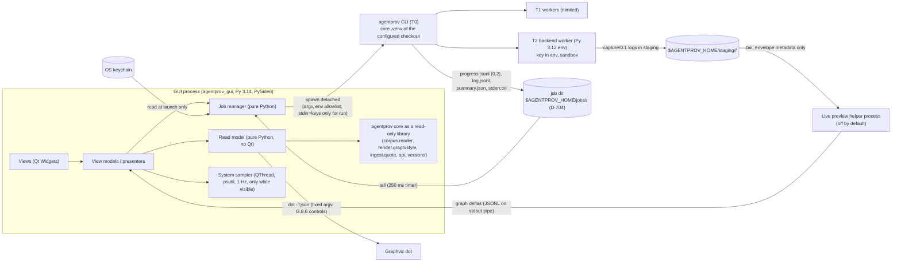

# AgentPROV desktop GUI: design (no code)

Status: **approved as the direction** (2026-10-14; the user, relayed by the orchestrator session). The build comes
after the regeneration round. Branch `gui-research`, from origin/main `c4fd0dc2`. Research only: no application code is
written. The evidence, the options compared and the measurements are in [`research.md`](research.md). Low-fidelity
wireframes are in [`wireframes/`](wireframes/). Decisions **D-390 to D-399** (§17) are recorded in
`docs/architecture/DECISIONS.md`.

**Native macOS look and behaviour:** see [`macos-design.md`](macos-design.md) (2026-10-14, **D-440 to D-449**,
approved as the direction). It keeps every constraint here. §18 below lists the earlier choices it would change.

The design is written so that a later session can build it without repeating the research. Where it needs a CLI change,
the change is named, sized and given a decision number. Nothing here changes AER, SEM or PROV bytes, the compat oracle or
any stored corpus.

## 0. Summary

- **Toolkit:** PySide6 6.12 (Qt 6.12, LGPLv3), **Qt Widgets** only, from the `PySide6-Essentials` wheel. Qt WebEngine,
  Qt Quick/QML and QtNetwork are not used and are excluded from bundles (D-390).
- **Placement:** a separate uv project `gui/` (distribution `agentprov-gui`, package `agentprov_gui`, Python ≥ 3.14, its
  own `uv.lock`). It depends one-way on the core as a read-only library (an allowlist of modules). The core never imports
  it, and it is never added to the core environment (D-391).
- **Write path:** every write is the `agentprov` CLI in a **detached** subprocess. The GUI follows its progress, log and
  summary files and re-attaches after a restart. Closing the GUI never stops a job (D-392).
- **Live channel:** the existing `--progress-file` (`agentprov-progress/0.1`, D-8) grows **additively** into
  `agentprov-progress/0.2`:
  - a `run` header;
  - a periodic `heartbeat` snapshot with per-stage counters;
  - `worker` and `session` events;
  - append mode with bounded rotation.

  Overhead: one enqueue of ~1 µs per unit, and one line every 2 s (D-393).
- **Pause and stop:** a cross-platform control file that the CLI polls at unit boundaries. **Drain** finishes in-flight
  units and exits resumable; **stop** aborts in-flight units cleanly. Resume re-runs the same command under the existing
  resume rules (D-394).
- **Keys:**
  - stored only in the OS keychain (`keyring`; insecure back-ends refused);
  - handed to `agentprov run` on **stdin** (`--env-stdin`, a new CLI option);
  - forwarded by the existing allowlist into the T2 worker environment only;
  - never on disk, in argv, in the T0 environment or in logs (D-395).
- **Display security:**
  - plain text only;
  - content hidden by default (G.8.2);
  - every data string through `escape_untrusted_line` or `quote_untrusted`;
  - tooltips escaped;
  - no links, images or HTML from data;
  - the GUI imports no network module;
  - all enforced by static tests (D-396).
- **Graph:** the core's pure `render.graph.build_model`, the trusted-grammar DOT of `render.style`, a `dot -Tjson`
  layout under the G.8.6 process controls, and drawing in `QGraphicsView`. Level of detail and an overview raster keep
  10k-node scenes interactive. The real per-execution maximum seen locally is ~2.8k nodes (D-397).
- **Live PROV preview:** experimental and **off by default**. A separate helper process tails the capture logs (envelope
  metadata only), builds a provisional graph and redraws at ≤ 1 Hz. It is labelled "Preview: not corpus provenance"
  (D-398).
- **Packaging:** development runs with `uv run --project gui`. Release bundles are built with PyInstaller (macOS
  signed and notarised `.app`, Windows signed folder or installer, Linux AppImage), with LGPL relinking compliance. Every
  write uses the CLI of a configured checkout, so the producer commit and lock digest stay true (D-399).

## 1. Hard constraints and how each is met

| Constraint | Mechanism | Where |
|---|---|---|
| No web server, no browser UI, native on macOS, Windows, Linux | Qt Widgets. No Qt WebEngine, Qt Quick or QtNetwork. A static test bans the imports, and the PyInstaller spec excludes the modules | §13, §11 S11 |
| Loosely coupled; separate project; never imported by the core; not in the core env | `gui/` uv project with its own lock. A core boundary test (no `agentprov_gui` import), plus a GUI allowlist of read-only core modules | §2.2 |
| Writes only through the CLI; all guards kept | `JobSpec` → argv list → detached `agentprov …`. The GUI never calls writer APIs (the allowlist excludes `corpus.writer`, `corpus.package`, `release.builder`, `cli`, …) | §4 |
| Closing the GUI never kills a job; re-attach | New session or process group, no pty, no pipes left open, files for progress, log and summary; `job.json` with pid + create time | §4.3–4.5 |
| Negligible overhead; anything costly OFF by default | Budgets in §10. The sampler runs only while visible; the live preview is off by default; the log level stays `status` unless the user asks for `steps` | §10 |
| Plain-text rendering, `quote_untrusted` | Widget factory and lint (S1–S4) | §11 |
| Graph labels and tooltips untrusted; no link attributes (G.8.6) | DOT built only from `render.style` (trusted grammars, no URL, href or tooltip). Popovers are plain-text tables | §7, §11 S5 |
| Never read `.env`; keys only in the keychain, passed only to the capture process | `keyring` plus `--env-stdin`. The GUI never passes `--env-file`, and `--env-stdin` disables the default `.env` read | §8.2, D-395 |
| Zenodo: build and verify only, never upload (**superseded by D-880**, 2026-10-28: the GUI creates and cross-links unpublished drafts; publishing stays the user's, on Zenodo) | The Package flow ends at `verify` of the deposit and a "manual upload" checklist. The GUI has no network code | §6.7 |

## 2. Architecture

### 2.1 Processes



| Process | Lifetime | Runs | Never runs |
|---|---|---|---|
| GUI | the window | views, read model, job manager, sampler | capture, map, derive, seal, package, network I/O |
| `agentprov` CLI (T0) and its T1/T2 workers | the job; survives the GUI | everything that writes | — |
| Live preview helper | while the preview is open | tail plus provisional graph | anything written to disk |
| `dot` | one layout | layout of trusted-grammar DOT | data-derived labels |

### 2.2 Project layout and dependency rules

```
gui/                               # separate uv project (like capture/ and backends/*)
  pyproject.toml                   # name = "agentprov-gui"; requires-python >= 3.14
  uv.lock                          # its own lock; exclude-newer like the core
  src/agentprov_gui/
    app.py                         # QApplication, theme, main window, single-instance guard
    readmodel/                     # NO Qt: typed, immutable records over corpus files
      corpus.py  executions.py  register.py  detail.py  licences.py  offsets.py  cache.py
    jobs/                          # NO Qt: JobSpec, argv builders, risk tiers, spawn, follow, re-attach
      spec.py  commands.py  manager.py  follow.py  progress.py  control.py  platform.py
    secrets/keychain.py            # keyring wrapper, back-end allowlist
    sysmon/sampler.py              # psutil; process set from progress events
    graph/                         # layout service, scene builder, LOD, overview raster, search
    preview/                       # live preview helper (separate process entry point) + client
    ui/                            # Qt Widgets: views, view models, delegates, dialogs
      safe.py                      # THE only place that creates text-bearing widgets (S1)
    about.py
  tests/                           # offscreen-QPA tests, lint tests, synthetic fixtures only
```

- **Dependencies:** `agentprov` (path dependency on the checkout, editable), `pyside6-essentials==6.12.*`,
  `psutil>=7.2,<9`, and `keyring`. Every one of them is pinned in `gui/uv.lock`. No pydot: the GUI emits DOT itself
  from `render.style`, §7.1.
- **Core-module allowlist** (a static test in `gui/tests`):
  - `agentprov.api`
  - `agentprov.versions`
  - `agentprov.formats`
  - `agentprov.ingest.quote`
  - `agentprov.ingest.loaders`
  - `agentprov.ingest.limits`
  - `agentprov.corpus.reader`
  - `agentprov.corpus.index`
  - `agentprov.corpus.register`
  - `agentprov.corpus.layout`
  - `agentprov.aer.reader`
  - `agentprov.sem.types`
  - `agentprov.render.graph`
  - `agentprov.render.style`
  - `agentprov.render.dot` (for `run_dot` only)
  - `agentprov.adapters.registry`
  - `agentprov.progress` (types only)

  Anything else fails the test. That includes `cli`, `corpus.writer`, `corpus.package`, `release`, `raw.fetch`, `io.workers`
  and `adapters.runner`.
- **Transitive core modules (GR-34, 2026-10-21).** The allowlist governs the GUI's own imports. The allowlisted modules
  load other core modules in turn. Since GR-34's core fix, `agentprov.corpus` and `agentprov.raw` re-export
  `CorpusWriter` and the `raw.members` names lazily, and `corpus.reader`/`corpus.register` import `raw.members` only
  where it is used.
  - **Accepted:** `CorpusReader` loads `raw.store`, `raw.origins`, `io.atomic` and `io.canonical`. The GUI calls none of
    their write paths, and every corpus read goes through the strict opener.
  - **Not loaded:** `corpus.writer`, `raw.members`, `io.workers` and `agentprov.host`.
    `gui/tests/test_review_core_loaded.py` checks this in a fresh interpreter.
- **Core rule:** `tests/boundary/test_import_boundary.py` gains one rule: nothing under `src/`, `capture/` or `backends/`
  imports `agentprov_gui`. No core lockfile lists `agentprov-gui` or `pyside6*`.
- **Version check:**
  - At start the GUI compares the formats its library sees (`agentprov.versions.VERSIONS`) with the CLI it will run
    (`agentprov --version --json`).
  - A difference in `aer`, `sem`, `prov_spec` or the progress format puts the GUI into **viewer-only** mode, with a banner.

### 2.3 Layers inside the GUI process (MVVM / presenter)

1. **Read model** (`readmodel/`, no Qt). Immutable dataclasses: `CorpusSummary`, `ExecutionRow`, `ExecutionDetail`,
   `RegisterRow`, `ProvGraph` (`render.graph.GraphModel`), `WithheldLedger`, `LicenceRecord`, `VerifyResult`.
   - All parsing goes through the core's strict readers (`CorpusReader`, `strict_json_loads`, `iter_jsonl` under
     `IngestLimits`), as G.8.6 requires of display surfaces.
   - Raw artefacts are never parsed. "Show source" fetches bytes through the core's locator resolver and passes them
     to `quote_untrusted` only.
2. **Services** (no Qt): `JobManager`, `ProgressFollower`, `LogFollower`, `LayoutService` (dot), `Keychain`, `Estimator`.
   Pure and unit-testable.
3. **View models** (Qt): `QAbstractTableModel` and `QAbstractItemModel` adapters over the read model, plus presenters that
   own the state of one screen. Sorting and filtering are done **in the model** in Python. `QSortFilterProxyModel` is not
   used over Python models: at 10k rows it is about 100× slower, see research §M5.
4. **Views** (Qt Widgets): built only through `ui/safe.py`.

Threads:
- The UI thread does no file I/O larger than 64 KiB.
- File and JSON work runs in a `QThreadPool`. Results return as immutable objects through queued signals.
- The sampler has its own `QThread`.
- Layout is a `dot` subprocess, started by `QProcess` from the UI thread (asynchronous) with the G.8.6 controls.

### 2.4 Read model at scale

- **Index tables.** `executions.jsonl` (≤ 52.7 MB for 38,281 rows locally) and `register.jsonl` (≤ 90,474 rows,
  31 MB) are read once in a worker thread into column tuples. Measured: ~45 MiB for 100k rows and a 0.1 s sort at 100k
  (§M5).
- **Above 200k rows** (none locally; the budget is for growth), an **offset sidecar** is used: a SQLite file in
  `$AGENTPROV_HOME/gui/cache/<content_digest or working-tree fingerprint>.sqlite`, holding the sort columns plus byte
  offsets. H.1.5(6) allows caches outside the corpus. The key is `(content_digest, fn_digest)` for a sealed corpus, and
  `(path, size, mtime_ns of executions.jsonl)` for a working tree.
- **Per execution:** paths are computed from `ex` (layout shard rule) and digests are checked on read, as `CorpusReader`
  already does. An LRU cache holds parsed documents: 64 entries or 256 MiB, whichever is reached first.
- **Working trees during a run:** the GUI never reads a `.partial` tree while a writer holds its lock, beyond the
  lock-free atomic documents (`corpus.json`, `executions.jsonl`, `register.jsonl` are swapped atomically). It shows
  "working tree, being written" and refreshes on the job's `heartbeat`, not by polling the tree.

## 3. Data flows

**Read (Viewer).**
1. Corpus root → `CorpusSummary` (manifest and seal state) → the executions table.
2. Selection → `ExecutionDetail`, loaded in the background: AER, SEM, PROV, validation row, register rows.
3. The tabs fill in: Graph, PROV-JSON, AER, SEM, Register, Validation, Raw.
4. Content stays hidden until the user turns on "Show content" for that pane (G.8.2).

**Write (Runs).**
1. A form produces a `JobSpec`, which validates and computes its risk tier.
2. A confirmation dialog appropriate to the tier.
3. `JobManager.spawn`:
   - creates the job directory and `job.json`;
   - builds argv: the CLI path plus the subcommand, plus `--progress status --progress-file … --log-file … --summary-json …`;
   - spawns detached.
4. Followers tail the files, the dashboard updates, and on exit `summary.json` is read.
5. "Open in Viewer".

**Live (Run live).**
1. Form, then `run --dry-run [--m5ultra]` to plan, then the estimate, then explicit consent.
2. The key is read from the keychain into a local variable.
3. `agentprov run … --env-stdin --i-consent-to-api-costs`, with stdin a pipe. The key is written as one JSON line and
   the pipe closed; the variable is dropped.
4. Progress, log and summary are followed as for any job.
5. The optional preview helper tails the session capture logs that `session` events name.

## 4. Job manager

- **As built (D-704, 2026-10-22).** The job manager is the core's (`agentprov.jobs`, `agentprov jobs`,
  `agentprov batch`). The GUI is its client:
  - It starts a job with `jobs start … -- ARGV`, and stops, kills, drains and prunes with the matching `jobs`
    commands of the configured checkout's CLI.
  - It reads job state through the read-only `agentprov.jobs.record`.
  - Jobs live in `$AGENTPROV_HOME/jobs/<id>/`. Each runs under a supervisor that writes `ended.json` with the real
    exit code.
  - **Batches** run as their own driver job (`batch run`; user decision), so §4.4's "the queue advances only while the
    GUI is open" no longer holds. Resume Batch confirms held R2 steps, then calls `batch resume --confirm-r2`.
  - The rules below (§4.1–§4.6) are the CLI's now: the single writer, the slots, stop, kill and drain. The GUI still
    reports a stale lock from its own read.

### 4.1 Job directory

`$AGENTPROV_HOME/jobs/<job_id>/` (D-704; `gui/jobs` before), where `<job_id>` is a UUIDv7. The directory is mode 0700 where `posix_permissions`
holds (G.4.12(7)).

| File | Written by | Content |
|---|---|---|
| `job.json` | GUI (atomic) | `{format:"agentprov-gui-job/0.1", job_id, created, argv[], cwd, env_names[], corpus, command, tier, pid, pid_create_time, platform, cli_path, cli_version, batch_id?, label}`. No secret, no env values. |
| `progress.jsonl` (+ `.1`) | CLI `--progress-file` | `agentprov-progress/0.2` (§5) |
| `log.jsonl` | CLI `--log-file` | DEBUG JSON lines, append mode, already redacted by the CLI |
| `summary.json` | CLI `--summary-json` (atomic at the end) | `agentprov-cli-summary/0.1` |
| `stdout.txt`, `stderr.txt` | the spawn's redirection | bounded by the CLI's behaviour; the GUI reads at most the last 64 KiB |
| `control.json` | GUI (atomic) | §4.6 |
| `ended.json` | GUI, when it observes the exit | exit code, end time, how observed (`waited`, `summary`, `pid gone`) |

Retention: the last 200 jobs, or 90 days. Older job directories are deleted only after the user confirms the list,
following the "inspect before deleting" rule.

### 4.2 Spawn

- **argv** is a list, never a shell string. The program is the configured checkout's
  `<checkout>/.venv/bin/agentprov` (on Windows, `Scripts\agentprov.exe`), or `uv run --locked --project <checkout> agentprov`.
- **cwd** is the job directory.
- **env** is an allowlist: `PATH`, `HOME` (or `USERPROFILE`, `APPDATA`, `LOCALAPPDATA`, `SystemRoot` on Windows), `LANG`,
  `TZ`, `AGENTPROV_HOME`, `AGENTPROV_UPSTREAM_CACHE`, `AGENTPROV_BASELINE_CORPUS` if set. Nothing else: no `*_API_KEY`,
  no `UV_*` overrides.
- **stdin** is `DEVNULL`, except for `run` with keys, where it is a pipe that is written once and closed (§8.2).
- **stdout and stderr** are opened as files in the job directory and handed to the child, so no pipe ties the child to
  the GUI.
- **Detaching:**
  - POSIX: `subprocess.Popen(..., start_new_session=True, close_fds=True)`. The new session means a terminal hang-up
    never reaches the job. The CLI does not handle SIGHUP (CLI inventory §6), so this matters.
  - Windows: `creationflags = CREATE_NEW_PROCESS_GROUP | DETACHED_PROCESS | CREATE_BREAKAWAY_FROM_JOB`. The last flag
    keeps a GUI launched inside a kill-on-close Job Object from taking the CLI with it.
  - macOS: nothing extra. A child in its own session is not terminated when the app quits.
- **Identity:** after the spawn, the manager records `pid` and `psutil.Process(pid).create_time()`. A pid alone is
  reused by the OS; the pair is not.

### 4.3 Re-attach

At GUI start, every `job.json` without `ended.json` is checked:
- **The process exists and its create time matches:** attach. Followers start from the beginning of `progress.jsonl`;
  state is rebuilt from the last `heartbeat` (§5.3), so only the tail is parsed. The log follower starts at the last
  10,000 lines.
- **The process is gone:**
  - read `summary.json` if it exists (outcome and exit code);
  - otherwise mark the job `ended (unobserved)` and examine the corpus lock: a stale `.agentprov.lock` with this pid
    gives a "stale lock" notice with the `--break-stale-lock` action (a tier R1 confirmation).

The GUI never holds a job's lock and never deletes it itself.

### 4.4 Single-writer and serialisation rules (enforced by the GUI before spawning)

- One writer per corpus tree. The CLI enforces this too (G6); the GUI checks first, so the user gets a clear message
  instead of exit 4.
- One global slot each for `fetch`, `import --fetch`, `backends build` and `verify --against-pins --allow-network`. No lock
  covers the fetch cache, environment builds or staging (CLI inventory §6).
- One `run` per backend environment unless the user overrides it. `run --jobs` maxima are per process, not per host.
- **Batch queue (the regeneration round):** an ordered list of `JobSpec`s with a concurrency limit (default 1). A step
  starts only when its corpus is free and the previous step did not end with exit 4 or 70, unless the batch says
  `continue_on_failure`. The batch file is `$AGENTPROV_HOME/batches/<id>.json` (D-704) and survives restarts.
  **Superseded by D-704 (user decision 2026-10-22):** a batch runs as one driver job (`agentprov batch run ID`), so it
  advances with the GUI closed. A resident scheduler is still rejected (research §Q2): a driver exists only while
  its batch runs, and it is listed, stopped and killed like any job.

### 4.5 Stop, pause, resume (needs D-394 for the cross-platform parts)

| Action | Today (CLI as built) | With D-394 | UI |
|---|---|---|---|
| **Pause** (drain) | not available | `control.json {"request":"drain"}`. The CLI stops scheduling new units, finishes in-flight ones, flushes, releases the lock and exits with outcome `drained` (exit 0, `summary.outcome = "drained"`) | "Pause" means "finish current units, then stop". Shows "draining N in flight" |
| **Resume** | re-run the same argv; resume rules skip finished units | same | "Resume" re-spawns from `job.json.argv` as a new job linked by `resumes:<job_id>` |
| **Stop** | POSIX: one `SIGTERM` (the CLI flushes, seals aborted live sessions, exits 130). Windows: no graceful path (TerminateProcess) | `control.json {"request":"stop"}`, the same behaviour as the first SIGTERM, on every OS | "Stop" asks: "In-flight units are aborted and recorded as aborted. Paid calls already made are not refunded." |
| **Force kill** | SIGKILL / TerminateProcess | same | Only after "Stop" has waited for a timeout (default 120 s), with a tier R1 confirmation that names the consequences (stale lock, unflushed index for `import`, orphaned staging) |

- SIGSTOP/SIGCONT freezing is **rejected**. Live HTTP calls and the cell timeout keep running against a frozen process,
  T1 watchdogs misread a frozen interval, and Windows has no equivalent (research §Q2).
- **Drain latency:** one unit. For `import`, one execution; for `run`, one cell, which is at most `--cell-timeout`
  (1,800 s by default). The UI shows the in-flight unit count from the heartbeat.

### 4.6 `control.json` (D-394)

- **Location:** `--control-file PATH` (a new global option for writers). The GUI uses `<job dir>/control.json`.
- **Format:** `{"format":"agentprov-control/0.1","request":"drain"|"stop","issued":"<RFC3339>","nonce":"<hex16>"}`.
  It is written atomically (temp file plus replace).
- **CLI side:** a `stat` of the file at each unit boundary, and at most once per second inside long units. One `stat` is
  ~1–3 µs. When `mtime` changes, the file is read and parsed with the strict loader; an unknown request is ignored and
  logged.
- The CLI echoes the request as a progress event `control{request, nonce, accepted}` so the GUI knows it was seen.
- **Rejected:** POSIX signals as the only mechanism (none graceful on Windows; SIGUSR1 is not portable); a socket or named
  pipe (a server, against the hard constraint, and harder to re-attach); stdin commands (stdin is closed after the keys and
  no pipe may tie the job to the GUI).

## 5. Progress events: `agentprov-progress/0.2` (D-393)

### 5.1 Why extend `--progress-file` rather than parse logs or poll corpus files

| Option | Live? | Complete? | Cost | Verdict |
|---|---|---|---|---|
| Parse `--log-file` text or JSON | yes | no: messages are prose, not counters; per-unit lines only at DEBUG | DEBUG level costs real I/O | rejected as the primary channel; used for the Logs pane |
| Poll `executions.jsonl` / `register.jsonl` / `corpus.json` | **no for `import`**: they are rewritten only at flush, at the end or on interrupt (CLI inventory §5.4); per attempt for `run` | partial | a full re-read of a 50 MB file per poll | rejected; used only after the job ends |
| `--progress-file` 0.1 as built | yes (daemon writer, flush per line) | gaps: `import` has no per-stage events; T1 pool `unit_done` is never wired; `package` and `verify` emit nothing; container imports can exceed 100%; the file is truncated (`"w"`) on each start | ~1 µs enqueue per event (measured) | **kept and extended** |
| A socket or pipe protocol | yes | yes | low | rejected: a server; breaks re-attach |

### 5.2 Event schema

Every line is one JCS object, the D-8 sink contract is unchanged (non-blocking, drop and count), and every string is
metadata, already passed through `escape_untrusted` by the CLI. Readers must ignore unknown events and fields
(pytest-reportlog rule). 0.2 is a superset of 0.1: the 0.1 events keep their shape.

Common fields: `v` (`"agentprov-progress/0.2"`), `ts`, `seq` (new: per-file, 0-based, so gaps from drops are visible),
`level`, `event`, `run` (new: the run id on every line).

| Event | When | New fields (0.2) |
|---|---|---|
| `run` (new) | first line of each file segment | `run` (UUIDv7), `pid`, `command`, `corpus_id`, `corpus_root` (escaped), `mode` (`release`/`dev`), `dry_run`, `stages[]` (the planned stage names in order), `total` (if known), `jobs`, `agentprov_version`, `resumed{skipped:int}`, `segment` (0, 1, …) |
| `start` | as 0.1 | — |
| `unit_start`, `unit_done`, `step`, `trace` | as 0.1 | `unit_done` gains `stage_counts_hint` (optional). Container imports gain `unit_kind` (`container`/`execution`), so totals do not mix |
| `stage` (new) | a corpus-level stage begins or ends (`plan`, `store`, `expand`, `map`, `seal`, `sem`, `prov`, `validate`, `index`, `checksums`, `verify`, `swap`, `deposit`) | `stage`, `phase` (`begin`/`end`), `done`, `total`, `duration_s` |
| `heartbeat` (new) | every `--progress-interval` seconds (default 2, minimum 1) and at each `stage` end | a **full snapshot**, see below |
| `worker` (new) | a T1/T2 worker or a `dot` process starts or exits | `pid`, `slot`, `tier` (`t1`/`t2`/`dot`), `phase` (`spawn`/`exit`), `exit_code?`, `rss_peak?` |
| `session` (new, live) | a capture session starts or ends | `cell`, `session`, `attempt`, `staging` (path relative to `AGENTPROV_HOME`), `status?` |
| `control` (new) | a control request is seen (D-394) | `request`, `nonce`, `accepted` |
| `end` | as 0.1 | adds `outcome` (`ok`, `failures`, `refused`, `interrupted`, `drained`, `internal`) and `summary` (path, if `--summary-json`) |

`heartbeat` snapshot (absolute counters, Docker style, so a reader that joins late or misses lines can recover):

```json
{"v":"agentprov-progress/0.2","seq":812,"run":"019…","event":"heartbeat","ts":"…","elapsed_s":5412.3,
 "stages":{"map":{"done":20117,"total":38281,"failed":3,"running":11},"seal":{"done":20109,"total":null},
           "sem":{"done":20100,"total":null},"prov":{"done":20090,"total":null},"validate":{"done":20088,"total":null}},
 "counts":{"sealed":19702,"sealed_with_issues":385,"degenerate":4,"failed":3,"excluded":0,"duplicates":12,
           "skipped_resume":0,"withheld":0,"not_imported":0},
 "issues_top":{"code.example_a":381,"map.adapter_defect":3},"issues_other":0,
 "workers":{"configured":12,"alive":12,"busy":11,"pids":[51210,51211,…]},
 "queue":{"pending":18164},"dropped":0}
```

- **For `run`**, `stages` becomes `cells{planned, done_before, attempted, conclusive, inconsistent, inconclusive, failed,
  quarantined}`. A `live{in_flight:[{slot, cell, session, since_s}], canary{done, total, stopped}}` block is added. The
  counters are the ones `run` already keeps.
- **For `package`**, `stages` covers preflight, write, withhold, checksums, verify and swap, and `counts` gains
  `withheld_entries` and `withheld_executions`.
- **For `verify`**, `stages` gains per-level `done/total` over files and executions.

### 5.3 File handling

- `--progress-file` **appends**; 0.1 truncated with `"w"`. Each process start writes a new `run` line, so a resumed job
  extends the same file and the history of attempts stays readable.
- **Rotation:** when the file passes `--progress-max-bytes` (default 8 MiB), the writer thread renames it to `<file>.1`
  (replacing any older `.1`), then opens a new file whose first lines are `run` (with `segment` + 1) and an immediate
  `heartbeat`. Disk use is therefore ≤ 2 × 8 MiB per job.
- **Reader algorithm** (GUI `ProgressFollower`):
  - Keep one open handle and the byte offset. On a 250 ms timer, and on a `QFileSystemWatcher` hint, read from the offset
    to EOF, at most 1 MiB per tick.
  - Split on `\n` and keep the trailing fragment.
  - Parse each complete line with the strict loader, under a line cap of 64 KiB (longer lines are counted and skipped).
  - Detect rotation by a file identity change (inode, or file ID on Windows) or by `size < offset`, then reopen.
  - **On attach**, seek back from EOF to the last `heartbeat` line of the current file and fold forward from there. A
    reader never needs `.1`.
- **Overhead**, measured (research §M1):
  - Producer: one `queue.put_nowait` per event, ~1 µs including the drop path. The heartbeat adds one line every 2 s.
  - The writer thread spends ~13.5 µs per line (encode, write, flush).
  - At `status` level, a 38k-execution import adds ~38k lines in total, about 0.5 s of writer-thread time over a run of
    hours.

### 5.4 Derived metrics (GUI side, never in the CLI)

- **Throughput:** a bias-corrected EWMA of units/s (tqdm's form; α = 0.3 per 5 s window), shown together with the overall
  mean.
- **ETA:**
  - only after at least 30 units **and** 60 s;
  - a range, `remaining / rate_long` to `remaining / rate_short`, where the long window is the overall mean and the short
    window is the EWMA;
  - per stage when stages are unbalanced;
  - shown as "≈ 2 h 10 m (1 h 50 m – 2 h 40 m)".
  - For `run`, the remaining cells are divided by `jobs` and multiplied by the median cell duration (p50 to p90).
- **Worker utilisation:** busy over configured, from the heartbeat. Per-process CPU comes from the System sampler, when
  open.
- **Failure codes:** `issues_top`, sorted, linking to the register view of the finished corpus.

## 6. Screens and navigation

Main window: a left navigation rail with **Viewer**, **Runs**, **Logs**, **System**, **Licences**, **Package**, then
**Settings** and **About** at the bottom. A status strip at the bottom shows active jobs, as "2 running · 1 draining",
with a mini progress bar. Every screen works with the keyboard alone (§12). Wireframes:
[`wireframes/README.md`](wireframes/README.md).

The tab is named **"System"**, not "Activity" or "Runs":
- "Activity" is a W3C PROV term, `prov:Activity`, and would be ambiguous in this tool.
- "Runs" names the job list.

### 6.1 Viewer ([wireframe](wireframes/01-viewer.md), [graph](wireframes/02-graph.md))

- **Corpora list.** Configured roots, by default `~/.agentprov/corpora` plus any added. Each row shows `corpus_id`, the
  state (sealed, working, being written), version, executions, `content_digest` (short), and verified status (from the
  last `verify` job, when there was one).
  - Opening an unsealed or unverified corpus shows the G.8.6 banner: "Not verified: run Verify first".
- **Executions table.** Virtualised; the columns come from the index: `ex`, `status`, `completeness`, `source_id`, `unit`,
  task facets, `model.requested`/`served`, the counts `n.*`, outcome, issues.
  - There is a filter bar (closed-vocabulary pickers plus a text filter over ids) and model-side sort.
  - Data-derived cell text goes through `escape_untrusted_line`.
  - **As built (D-706, 2026-10-22).** A derived corpus adds suite, task, attack, injection task, defence, attack
    succeeded, utility, judgements and repeat, from each full row's `cell` and `outcome` facet; a working corpus shows
    them blank, with a hint to run `derive`.
    - **Attack succeeded** is the SEM claim `attack_succeeded` holding true. The AgentDojo profile gives it only on an
      attacked cell, for a checker's result, so a benign row is never marked, whatever its raw `security` judgement.
      A succeeded row gets a theme-aware tint (stronger under Increase Contrast) **and** the glyph ⚑ with the word
      "yes", so colour is never the only signal; a legend and the tooltips state the rule.
    - **Every filter is a CLI selection** (D-700): the line under the filters is the `agentprov stats --corpus …
      --select …` command that selects the rows shown (Copy CLI copies it). The keys are `stats`'s own
      (`cell.<member>`, `outcome.<claim>=true|false|none`, `facet.model.requested`, `issue`, …), and the readers are one
      implementation (`agentprov.corpus.rowvalues`). The id search is a view search, so the line says it has no
      selector.
- **Execution tabs (D-840..D-845, 2026-10-28).** The Viewer has a document tab bar: the first tab is the corpus
  browser above (with a preview of the selected row), and a double-click, Return or Open in New Tab opens an execution
  in a closable tab of its own, with the Graph and PROV-JSON side by side and the other tabs below as sub-tabs. Design:
  [`viewer-tabs/design.md`](viewer-tabs/design.md).
- **Execution detail.** Tabs:
  - **Graph**: §7.
  - **PROV-JSON**: a collapsible tree (bundles → sections → statements → attributes) plus a raw-text pane
    (`QPlainTextEdit`, read-only). Selection is synced both ways with the graph by statement key.
  - **AER**: records grouped by kind in a tree. Each record shows id, kind, `ev` badge, `by`, rule ids, `src` locators,
    `unk` reasons and `after` edges. Content fields (message text, tool args and results) are hidden until "Show content",
    and then shown through `quote_untrusted` with the record's locator.
  - **SEM**: annotations by target, linked to the AER record and, where one exists, the PROV element: type, value,
    `ev`, rules, premises, method and confidence.
  - **Register**: rows for this `ex`.
  - **Validation**: the row and its check results.
  - **Index Row** (D-706): the checked index row as JSON (`ensure_ascii`, plain text). **Export Graph…** opens the
    `agentprov render` job form for the execution (`--ex`; SVG, PNG, PDF or DOT).
  - **Raw**: artefact list (role, sha256, bytes, media, origin). Locators resolve to byte ranges. "Show content" displays
    the bytes only through `quote_untrusted` with `max_chars` (default 500, maximum 2,000); they are never parsed or
    rendered as media (T-10).

### 6.2 Runs ([wireframe](wireframes/03-runs.md), [live](wireframes/04-run-live.md))

- **Run live is first-class.** It is the primary button at the top of Runs (**▶ Run live…**, also Ctrl/Cmd+L and the
  File menu), next to **New job ▾** and **Batch**.
  - The user configures, estimates, confirms, starts, monitors, pauses (drains), resumes and stops a live corpus build
    entirely from the GUI (§8).
  - Underneath, it is the same detached CLI job as every other write. Runs survive the window, keys reach only the
    capture process, and the same run can be started or watched from a terminal or over SSH.
- **Job list:** running, queued, draining, ended. Per row: command, corpus, tier badge, elapsed time, a progress bar and
  the outcome.
- **Job dashboard:**
  - header: the command as a copyable argv, mode release or dev, started, elapsed;
  - **stage strip**: one bar per stage with done/total and failed counts;
  - throughput and ETA;
  - counts (sealed, with issues, degenerate, failed, withheld, excluded, duplicates, skipped on resume);
  - **failures by code**: a table, clickable to the Logs pane filtered by that code;
  - workers: busy out of configured, with per-worker RSS and CPU when the System sampler is on;
  - resume point: "resumed: 20,117 units skipped";
  - dropped-event count;
  - actions: Pause (drain), Stop, Resume, Open in Viewer, Open log, Copy command.
- **New job:** one form per command, generated from a declarative table of options (Appendix A). Each form shows the
  exact argv it will run and its tier, before confirmation.
- **Corpus picker for imports:** a table from the registry (`adapters.registry`): source, part, family, licence (SPDX,
  policy, restrictions), import status, live status, and the profile. Tick boxes select sources and parts; "planned" or
  "none" statuses cannot be ticked. A ticked set becomes a **batch**: one `import` per part with its profile, then
  `derive` and `validate` as chosen.
- **Regeneration round view:** a corpus × stage matrix. Each cell is a coloured `done/total` pill. There is one row per
  batch step; clicking a row opens that job's dashboard.

### 6.2a Sessions panel in Runs (development workflow; read-only; added after the merge of `4b343df5`)

The orchestrator's workflow tools (D-428 on main) give a second, ready-made data source for Runs:
- per-session status files, `agentprov-session-status/1` in `$AGENTPROV_SESSIONS_DIR` (else `$AGENTPROV_HOME/sessions`),
  written by `tools/session_status.py`;
- the aggregate view `tools/queue_status.py --json`: states, merge-train candidates, the suite queue, and stall flags
  (STALE, DEAD, WAITING-ON-USER, SUITE-OLD, GONE, INVALID).

The GUI adds a **Sessions** sub-tab to Runs.
- **Source:** `uv run --project <checkout> python tools/queue_status.py --json`, run as an R0 subprocess every 30 s while
  the sub-tab is visible.
  - This keeps a single interpretation of the stall rules. `tools/` is outside the GUI's core-module allowlist, and
    re-implementing the flags would drift.
  - When the checkout is unavailable, the GUI falls back to reading the `*.json` files directly with the strict loader
    and checking them against `docs/workflow/schemas/session-status-1.schema.json`, with no stall flags.
- **Columns:** name, state, waits on, branch, ahead/behind, dirty, last suite result and its commit, heartbeat age, and
  flags. Rows sort with WAITING-ON-USER first, by age, because that is the failure the tool was built for.
- **Read-only.** The GUI never writes session files. They belong to their sessions. `session_status.py` uses `fcntl`
  (POSIX), so writing is not portable anyway.
- **Every string is untrusted** (the files are written by other processes): `escape_untrusted_line`, plain-text cells.
- **Kept separate from CLI jobs.** Sessions are development sessions, not `agentprov` jobs, and the two never share a
  table or a progress bar. A suite run that a session records (`suite-running`) is shown as that session's state, not as
  a job.

### 6.3 Logs ([wireframe](wireframes/05-logs-system.md))

- **Source:** `log.jsonl` of a selected job (structured: ts, level, logger, msg, ex, cell, stage, code), or `stderr.txt`
  as plain lines.
- **View:** a `QListView` over a **ring-buffer model** of 50,000 records (configurable, 10k–500k; ~300 B each, so
  ~15 MB at 50k), with `uniformItemSizes`. Columns are drawn by a delegate in plain text.
- **Filters:**
  - level toggles (info, warning, error; debug on request);
  - logger, stage and code pickers;
  - a text search (substring, case-insensitive; regex optional, with a 50 ms time cap per pass);
  - "only this execution".
- **Follow/pause:** follow scrolls to the end. Pause stops auto-scroll while ingestion continues. When the ring evicts
  lines during a pause, a banner shows "N older lines left the buffer; the full log is on disk".
- **Back-pressure:**
  - the follower reads at most 1 MiB per 250 ms tick;
  - rows are inserted in one `beginInsertRows` per tick;
  - when the file grows faster than this, a "lagging by X MB" chip appears and the reader catches up. Lines are never
    dropped from the file, only from the view buffer.
- **Copy:** selected rows as plain text (TSV), already escaped. The GUI never copies raw content without its fence.
- **Bounded memory:** the ring, plus at most one 1 MiB read buffer.

### 6.4 System ([wireframe](wireframes/05-logs-system.md))

- **Charts:** drawn with `QPainter` sparklines. Qt Charts and Qt Graphs are GPLv3-only Addons and are not used
  (research §Q1).
  - CPU per core (sparklines, 120 s history);
  - memory (used and available, swap);
  - per-job process tree: T0, T1 workers, T2 worker, `dot` (RSS, CPU %, threads, open files);
  - disk I/O (system read and write rates; per process on Linux and Windows only, where psutil provides `io_counters`);
  - free disk under `AGENTPROV_HOME`;
  - temperatures: Linux only, through `psutil.sensors_temperatures`. psutil has none on macOS or Windows; the GUI says
    "not available on this OS" rather than shelling out to `powermetrics` or WMI.
- **Sampling:**
  - 1 Hz, in a `QThread` of the **GUI** process, never inside the job processes;
  - on only while the System tab or the job dashboard's worker panel is visible, or when "keep sampling" is on (it is
    off by default);
  - the process set comes from the progress `worker` events (D-393). Without them, `children(recursive=True)` is
    refreshed every 10 s, because that call costs ~37 ms on macOS (§M4).
- **Measured cost:**
  - ~0.3–0.5 ms per sample against a 13-process tree with known pids;
  - ~3–4 ms amortised with the 10 s tree refresh;
  - about 0.04–0.4 % of one core at 1 Hz;
  - no measurable effect on a 12-worker CPU-bound job (§M2).

### 6.5 Licences ([wireframe](wireframes/06-licences-package.md))

- **One row per source,** joined on `source_id`:
  - registry: `LicencePolicy` (spdx, policy, restrictions, basis, attribution, unassessed) and part statuses;
  - profile `[licence]` (basis, holders, data_licence, overrides);
  - the corpus `licences` block for opened corpora (class, redistribution, raw policy);
  - systematic-search record(s): decision, exclusion code, `corpus_licence_class`, `runs_estimate`.

  The records join by name or URL, because there is no shared id (research §Q9). Unmatched rows are listed as
  "unmatched" and never guessed.
- **Flags** (computed, each with its rule shown on hover in plain text):
  - **copyleft** (the `release/metadata.py` regex);
  - **NC**;
  - **restricted** (restrictions present);
  - **private-only fixture**, from `THIRD_PARTY_NOTICES.md` or a fixture `licence_class = restricted`. There is no
    `private_only` field in code; the GUI derives the flag and states its basis.
- **Excluded sources:** a second tab lists the 708 excluded records with criterion codes (EX-LIC-1, EX-NOLOG, …) and the
  wording of their reasons from `eligibility-criteria.md`.
- **"Feeds"** panel, for an opened corpus: how its licences appear in the datasheet (H.9), in `LICENSES/`, and in the
  deposit licence class (mixed classes refused unless overridden; NC never mixed).
- **Read-only.** Changing a licence is a profile or registry change made in code review, not in the GUI.

### 6.6 Settings ([wireframe](wireframes/07-settings-about.md))

- **Paths:** the AgentPROV checkout (required for writes), `AGENTPROV_HOME`, corpus roots, upstream cache, and the `dot`
  binary (resolved with `which`, version shown).
- **Appearance:**
  - theme: Follow system, Light or Dark;
  - graph canvas: Follow theme or Light paper;
  - palette: "W3C exact" or "Accessible" (§12);
  - font scale.
- **Viewer:** the content display limit (500, maximum 2,000), the default bundle mode (core) and the LOD thresholds.
- **Jobs:**
  - default `--jobs`;
  - progress level (`status`; `steps` warns about cost);
  - job retention;
  - batch `continue_on_failure`.
- **Live** (§8):
  - **API keys:** one row per key variable the endpoints use (`DEEPSEEK_API_KEY`, `OPENAI_API_KEY`, `OPENROUTER_API_KEY`).
    Each row shows set / not set and the date set, and has Set / Replace / Remove buttons. The value is **never shown
    again**.
  - endpoint base URLs and model ids (non-secret);
  - the price table (user-entered, dated);
  - containment default.
- **Experimental:** live PROV preview (off by default), keep sampling (off by default).
- **Compute (every value the CLI and the tools accept is adjustable here; D-432):**
  - **Machine preset:** "This machine (auto)", `--m5ultra`, or a named `--preset NAME`. The preset fills the fields below,
    and every field stays editable afterwards. The chosen preset is shown in the job's argv preview.
  - **Workers:** default `--jobs` per command (`import`, `derive`, `recompute`, `validate --corpus`, `verify`, `render`,
    `run`), with "0 = host default" explained (`min(CPUs, floor(0.75 RAM / 4 GiB))`), the live `--start-stagger`, and
    the "Tune" action (§8.1) that copies a measured plan into these fields.
  - **Machine budget** for the shared job queue (`tools/suite_queue.py`, D-427): the CPU budget
    (`AGENTPROV_JOB_CPU_BUDGET`, default CPUs − 2) and the memory budget (`AGENTPROV_JOB_MEM_GIB_BUDGET`, default 75 % of
    RAM), the import/rehearsal slot count, and the per-job `--cpu`/`--mem-gib` reservation used for GUI-started heavy jobs.
  - **Test gate:** the pytest worker count for the local gate (default `-n 10`, D-400..D-409).
  - **Ingest limits:** shown read-only from `ingest/limits.py`, plus any per-source `[import] limits` a profile raises
    (D-323, 64 MiB ceiling). Changing them stays a profile edit, never a GUI override, because they are part of a corpus's
    recorded identity.
- **Continuous integration (where CI runs; D-431, D-432):** three targets, chosen per action and settable as the default:
  1. **Local (default):** `tools/ci_local.py` on this machine, through the job queue. No GitHub minutes. The result is
     shown in Runs as a job, with per-job pass/fail.
  2. **GitHub-hosted:** `gh workflow run ci.yml --ref <branch>` (tier R2: network, and it spends Actions minutes; the
     dialog shows the last known billing status and a reminder that a private repository's minutes are limited). The
     toggle "Run CI on every push" sets the repository variable `CI_ON_PUSH` (`gh variable set CI_ON_PUSH --body
     true|false`; tier R2, since it changes repository settings, with an explicit confirmation).
  3. **Mac Studio (self-hosted):** sets `CI_RUNNER` to the Mac Studio runner's label, so dispatched (or on-push) runs execute
     on the Mac Studio's self-hosted runner instead of GitHub's machines. The Windows leg always stays GitHub-hosted. Shown
     as "not configured" until a runner with that label is registered (planned for when the Mac Studio arrives).
  The Settings page shows the current values of both repository variables, read with `gh variable list` (tier R0), and
  never stores a token.

### 6.7 Package ([wireframe](wireframes/06-licences-package.md))

A guided flow that calls only `agentprov package` and `agentprov verify`. It never re-implements them.

1. **Choose a working corpus** (`DIR.partial`). The GUI lists the preconditions it can see:
   - `partial:false`;
   - no lock;
   - no `interpreter_advisory`;
   - stages complete;
   - strict validation done;
   - a clean git commit of the checkout.

   It runs `package --dry-run --json` and shows each refusal code and its text.
2. **Withholding review:**
   - from the dry run and, after sealing, from `WITHHELD.json`;
   - entries by reason (secret, personal_data, licence, takedown) and basis (purge, raw_policy, profile_rule, container);
   - affected and withheld executions;
   - the rule ids of profile `[withhold]` policies.

   The withheld **values** never appear. The `DIR.withheld/` sidecar is not opened.
3. **Counts and licences:** from the manifest counts and the licences block, plus the deposit licence class.
4. **Datasheet:** the generated `DATASHEET.md`, shown **as plain text** (not rendered Markdown, so no autolinks; G.8.2
   residual), with the claim pass/fail list.
5. **Seal:** `package --corpus DIR --corpus-version X.Y.Z [--release-date]`, a tier R1 confirmation, then a dashboard.
6. **Verify:** `verify --corpus DIR --level chain --release --root-digest <from the seal>`. Optionally `rederive`, with
   the time estimate from the last derive.
7. **Release scan check:** whether `<corpus>.release-scan.json` exists and is fully triaged. Running the scan
   (`tools/release_scan.py`) stays a terminal step for now: it is a repo tool, not a CLI command.
8. **Deposit:** `package --deposit OUT --corpus … --metadata release.toml --release-date …`. Then
   `verify --corpus OUT/<id>-v<ver>.meta.zip`. The page shows `DEPOSIT-MANIFEST.json` (archives, sizes, sha256, md5).
9. **Finish page:**
   - "The deposit is built and verified. **Nothing has been uploaded.** Uploading to Zenodo is a manual step, done only
     on the project owner's explicit instruction."
   - A checklist of the files to upload, as plain text (the repository name and file names, no links).

### 6.8 About ([wireframe](wireframes/07-settings-about.md))

- AgentPROV GUI version and the core software version (`agentprov.versions.__version__`).
- Format versions: `aer/0.1`, `sem/0.1`, `capture/0.1`, `agentprov-prov/0.1`, `apv 0.1.0`, plus `agentprov-corpus/0.1`
  and the progress format.
- Licence: "MIT, free to use". Author: "Nicholas Jones". "Developed as part of PhD research."
- **Git commit:**
  - from `git rev-parse HEAD` of the configured checkout, run through the same hardened helper as
    `cli/package.git_facts`, with "(modified)" when the tree is dirty;
  - for a frozen bundle, the commit stamped at build time;
  - "not available" when neither exists.
- **Repository:** the text `nickjones39/AgentPROV (private)`, as selectable plain text with **no link**.
- Third-party notices: Qt and PySide6 (LGPLv3) with the relinking statement and source offer (§13), psutil (BSD-3),
  keyring (MIT), Graphviz (EPL-1.0; not bundled).

## 7. PROV graph view

### 7.1 Pipeline

1. `strict_json_loads` of the PROV file, with the digest checked by `CorpusReader`.
2. `render.graph.build_model(doc, ex=…, mode="core"|"all")`. This is pure, validates first, and needs no pydot.
3. DOT text from a small GUI emitter over the same `render.style` tables (`node_attrs`, `node_label`, `dot_quote`).
   `render.dot.build_dot` cannot be reused unchanged, because it puts edge labels on every edge. Labels are the
   **default trusted-grammar labels only** (id, «types», rule, class letter), and there are no edge labels.
   `show_content` is never used for layout. The emitter needs no pydot, so the GUI drops that dependency.
4. Layout: `dot -Tjson` with fixed argv, DOT on stdin, `PATH`/`LANG`/`TZ` only, an empty temp cwd, a new session, a 120 s
   timeout, stdout capped at 64 MiB and stderr tail kept, never parsed (G.8.6).
   - D-397 proposes adding `json` to `render.dot.run_dot`'s format allowlist, so the controls live in one place.
   - The JSON is parsed with the strict loader under limits.
   - **Engine tiers** (measured, research §M7, §M7b, §M12):
     - **(a) `dot`** for the core bundle and any drawn set of ≤ 600 nodes or ≤ 1,500 edges. Every real core bundle took
       0.08–0.12 s of CPU. The flags `-Gnslimit=2 -Gnslimit1=2 -Gmclimit=0.2 -Gremincross=false` are added above 300
       nodes, and edge labels are never sent to `dot`: the GUI draws them at the edge midpoint.
     - **(b) GUI layered layout** (pure Python, deterministic) for anything larger or anything `dot` does not finish in
       10 s of CPU:
       - break cycles by deterministic DFS back-edge reversal;
       - longest-path ranks, so time runs left to right (PROV-DM, wiki);
       - four barycentre ordering sweeps;
       - polyline edges.

       It took 10 ms for the largest real all-bundle document (2,766 nodes, 8,465 edges), 37 ms at 10k nodes and 0.24 s
       at 50k.
     - **(c) `sfdp`** only as an optional "organic" view (fast, but ignores time direction).
5. **Cache:** the layout JSON is stored in `$AGENTPROV_HOME/gui/cache/layout/<prov sha256>-<mode>-<style digest>.json`.
   The cache is keyed by digest, so it is never stale.
6. **Scene:** one item per node (built-in `QGraphicsEllipseItem`, `QGraphicsRectItem` and a polygon for agents, with
   `QGraphicsSimpleTextItem` labels) and one `QGraphicsPathItem` per edge, from the spline control points. The y axis is
   flipped (Graphviz y points up, Qt y points down).
   - Styles come from `render.style` tables (fills, borders, evidence-class pens) plus the dark or accessible variants
     of §12.

### 7.2 Interaction

- **Pan and zoom:**
  - left-drag pans (`ScrollHandDrag` on the background; a drag on a node selects it);
  - the wheel zooms around the cursor (`AnchorUnderMouse`);
  - toolbar buttons: +, −, 100 %, Fit (`fitInView`, `KeepAspectRatio`);
  - keys: `+`, `-`, `0`, `F`.
- **Hover:**
  - after 400 ms, a **popover** opens: a frameless child widget, not a `QToolTip`. It contains a plain-text table of the
    element's **full** attributes: QName, the value from `_plain` passed through `escape_untrusted_line` and truncated
    at the viewer limit, and the evidence class.
  - Values that are data content (free text) show `‹text, 1,234 chars, sha256:ab12…›` until "Show content" is on.
  - Click pins the popover; Esc closes it.
  - The PROV-JSON tab is the place to read the complete text.
- **Bundles:**
  - toggles for core, inference (one per method slug) and assessment;
  - inference adds purple borders and edges, assessment brown, and integrity and role overlays apply only when
    assessment is shown (as in `render.style`);
  - ghost nodes are dashed grey;
  - toggling changes visibility in the scene and does not re-lay out;
  - **one layout, overlays for the rest.** `dot` lays out the core bundle plus the top-level and ghost endpoints it
    needs. That is ≤ ~700 nodes locally and seconds at most.
    - Inference bundles are drawn as **overlay edges** between the already-placed nodes (they are almost all
      `wasInformedBy`/`used` between core nodes).
    - Assessment `mentionOf` entities collapse into **badges** on their subject nodes, and claim links become badge
      tooltips.
    - Expanding a badge places its mention entities in a small local fan next to the subject. Nothing is re-laid out.
    - A full multi-bundle layout uses engine (b). `dot` is impractical here: a 544-node, 1,714-edge all-bundle document
      needed 59 s of CPU without edge labels (> 320 s with them), and the largest needed 121 s even with the fast flags
      (research §M7b).
- **Evidence class:** borders and lines are solid for Observed, dashed for Derived, dotted for Inferred. A legend shows
  O, D and I, and a filter can dim everything except one class.
- **Search and focus:**
  - search by local id, PROV type or rule id (trusted grammars), plus attribute values when content is shown;
  - results appear in a list. Enter centres and selects the node, and "Focus" dims everything outside a k-hop
    neighbourhood (k = 1–3).
- **Selection sync:** with the PROV-JSON tree and the AER record (through `apv:sourcePointer`).
- **Export:** the existing `agentprov render` (a job). The GUI does not write SVG itself, so the SEC-12 output rules stay
  with the CLI.

### 7.3 Scale (measured, research §M6 and §M7)

- **Real sizes:**
  - core bundle: ≤ ~700 nodes;
  - "all" mode: ≤ 2,766 nodes and 8,465 drawn edges (agentdyn's largest; 2,342 of the nodes are assessment mentions);
  - the median document is 115–320 KB.

  The design budget is **10k nodes interactive and 50k viewable**, because comparison views and future sources may be
  larger.
- **Level of detail,** per item through `levelOfDetailFromTransform`, following the Qt 40000 Chips pattern:

  | LOD (scale) | Drawn |
  |---|---|
  | < 0.15, or > 3,000 items in the viewport | **overview raster:** a `QImage` of the whole scene, rendered once in a worker thread (QImage painting is thread-safe) and shown as one pixmap item; items hidden; selection and search highlights drawn as overlays |
  | 0.15 – 0.5 | shapes without labels, no antialiasing, edges as polylines |
  | 0.5 – 1.2 | shapes plus a one-line label (local id) |
  | ≥ 1.2 | the full default label (id, «types», rule · class) and edge labels |

- **Culling:** the BSP index is static after build (`BspTreeIndex`), with `sceneRect` set explicitly and
  `MinimalViewportUpdate`. Labels are hidden by toggling visibility at LOD transitions, not by Python `paint()`
  overrides, so painting stays in C++.
- **Collapse:**
  - assessment mention entities fold into a badge on their subject node by default (~2.3k of the 2.8k nodes in the
    largest document are mentions);
  - inference bundles show as edge overlays;
  - each `apv:Pass` scope can be collapsed into one node.
- **Layout time:**
  - core bundles: 0.08–0.12 s of CPU with `dot` (11 real documents, including the largest);
  - all-bundle and synthetic large graphs: engine (b) at ≤ 0.25 s up to 50k nodes;
  - default `dot` on synthetic layered DAGs passed 300 s of CPU from 1k nodes up (research §M7);
  - above 10k nodes the collapsed view is shown first.
- **Incremental layout:** used only by the live preview (§9). A layered placement is appended per event, and `dot` is
  never re-run per event.

## 8. Run live

### 8.1 Flow (first-class; [wireframe](wireframes/04-run-live.md))

1. **Backend picker** (user decision 2026-10-22). The entries are the registry sources whose live capability names a
   registered backend (`adapters.registry`): `agentdojo` and `autodojo` today, and `agentdyn` once its own backend is
   built from AgentDyn's pinned repository. Import-only benchmarks have no entry.
   - Each backend's `run <backend> --catalogue` (D-652) is the source of truth for its benchmark versions, suites,
     tasks and attacks. The form shows only what the picked backend reports.
   - The same suite can be run on two backends to compare them. The backend is recorded in `job.json` and in the
     estimate's priors key (D-653).
   - A backend whose environment is not built shows "not built: `agentprov backends build <name>`", and nothing is
     launched for it. "Build environment" is the `backends build` form: R2 if network is allowed, else offline.
2. **Model:**
   - a shorthand from `endpoints.toml` (deepseek, openai, openrouter, gemini, llama, qwen, glm, ollama, omlx); or
   - an endpoint plus `--model-id`; or
   - `--llm-script` (scripted, test-only, no keys, no network).
   - **The model picker (as built, D-707, 2026-10-22)** is a client of `agentprov models`, with no discovery code of its
     own. For a local endpoint it lists what the running server serves (`models --endpoint NAME`), offering only the
     models it can run here (not remote, servable), with their facts as tooltips. **Identity…** shows the record a
     run would record (`--model-id ID`; weight digests are cached by the CLI). For an API provider it shows the dated
     cached list (`--refresh-if-stale`: fetched only under `models.auto_refresh` when over 24 h old, D-733), with
     priced-but-unlisted models offered too. **Refresh List** fetches now (`--allow-network`, R2, confirmed). A key
     comes only from the keychain (`--keychain`), never `.env`: without a stored key only a public list (OpenRouter's,
     and the providers it lists for) is fetched, and Refresh is otherwise disabled with the reason. An endpoint the CLI
     has no list for falls back to the price table's models.

   It also covers display name, temperature, reasoning effort, LLM element and `--allow-text-tool-calls`. Each field
   shows which key variable it needs and whether the keychain has it.
3. **Cells:** suites and attacks as tick lists from the catalogue (an attack the backend refuses cannot be ticked and
   says why; one that needs options names them), user tasks and injection tasks (`all`, ids or index ranges),
   `--benign` include / exclude / only, repeats, `--benchmark-version`, or a `--plan PLAN.toml` (More options). `--defence`: only `none` is accepted today; other values are shown disabled with "unsupported
   (exit 5)".
4. **Concurrency:**
   - `--jobs` and `--start-stagger`;
   - **Tune:** runs `run --dry-run --m5ultra` (or `--preset NAME`) with the model-size fields and shows the plan (compute,
     memory and server caps, the chosen jobs and stagger). "Apply" copies jobs and stagger into the form.
   - A live run with a preset exits 5, and `--tune-jobs` exists only in the spec (N.2.1a(4)); the GUI does not invent it.
5. **Safety:** `--containment` (required for real models; `sandbox-exec` needs the probe recorded by `backends build`),
   `--cell-timeout`, `--max-attempts`, `--canary`, `--keep-staging`, and `--allow-custom-endpoint` with a warning.
6. **Corpus:** a campaign name or `--corpus-id`, and the corpus path under `AGENTPROV_HOME/corpora`. The G3 check
   requires the path to be outside the repository.
7. **Estimate (§8.3), then Confirm (tier R2),** then Start. A **separate** "Preflight only" button runs
   `--preflight-only`: one paid probe call, with its own R2 confirmation.
8. **Dashboard:**
   - cells, canary status, per-slot in-flight cells (from the heartbeat `live` block), and conclusive, inconsistent and
     inconclusive counts;
   - quarantined sessions;
   - log, System, and the optional live preview;
   - Pause (drain: finishes the current cells), Stop, Resume.
9. **On finish,** "Open in Viewer".

**Today's gating** (CLI inventory §0): real-model runs of the `planned` live parts exit 5, and so does every defence but
`none`. The GUI reads the capability from `agentprov info --format json`. While a run is gated, the Start button is
disabled with that reason, and scripted runs (`--llm-script`) still work end to end. The whole flow can therefore be
built and tested before live parts are promoted.

### 8.2 Keys (D-395)

- **Storage:** `keyring` (MIT), with service `agentprov` and user = the variable name.
  - **Allowed back-ends:** macOS Keychain, Windows Credential Locker, Linux Secret Service (libsecret over D-Bus),
    KWallet.
  - **Refused:** `keyrings.alt` plaintext and encrypted-file back-ends, `fail.Keyring`, `null`, and any chainer whose
    first viable member is not in the allowlist.
  - Without an allowed back-end (for example headless Linux), Settings says "No secure keychain: keys cannot be stored;
    real-model runs from the GUI are disabled" and points to the CLI.
- **Entry:**
  - a password-mode `QLineEdit` in a modal dialog;
  - on OK the value goes straight to `keyring.set_password` and the widget is cleared;
  - the GUI never reads a key back for display, only to launch;
  - Qt disables copy and cut in password mode.
- **As built (D-702, superseding D-655's GUI helper):** keys are a CLI feature the GUI calls. `agentprov keys
  status|list|set|delete` and `run --keychain` use the core keychain helper process (`python -I -m agentprov.keys.helper`,
  the only importer of `keyring`). Settings › Keys calls `agentprov keys` (the value typed into the password field goes
  on the subprocess's stdin, `keys set NAME --stdin`), and Run live passes `run --keychain`, so no stored key passes
  through the GUI at all.
- **As built first (D-655), now moved into the core:** `keyring` is never imported by the GUI process. Its dependency `jaraco.context` loads
  `urllib.request`, which S11 forbids. Every keychain operation is a short-lived helper process,
  `python -I -m agentprov_gui.keychain_helper`. It builds the allowlisted back-end directly (never
  `keyring.get_keyring()`, which reads keyring's config, its `keyring-path` and entry points). For a launch it writes
  the key line straight into the pipe that becomes the CLI's stdin, so the GUI process never reads a stored key.
- **Use:**
  - at launch, the helper's `emit` → `{"OPENROUTER_API_KEY": "…"}` as one line into a pipe → the pipe's read end is
    the child's stdin → the GUI closes its copies;
  - the JCS object contains only the variables `endpoints.toml` names for the chosen endpoint;
  - **residual:** Python `str` objects cannot be wiped reliably. The key lives in GUI memory for milliseconds, and core
    dumps are disabled for the GUI process where possible (`RLIMIT_CORE = 0`).
- **CLI side (D-395):**
  - `run --env-stdin` reads one strict-JSON object (≤ 64 KiB) from stdin before any other step. It is mutually exclusive
    with `--env-file`, and **disables the default `<repo>/.env` read**.
  - The mapping replaces the dotenv mapping in `_read_env_file` and then follows the existing path: only the selected
    endpoint's names; the key value is registered for redaction; it is passed only into the T2 worker environment.
  - It is accepted only for `run`. `backends build` already ignores `--env-file`.
- **Never:**
  - on disk: no temporary `.env`, nothing in `job.json` or QSettings;
  - in argv;
  - in the T0 environment (environments of same-user processes are readable through `ps eww` or `/proc/<pid>/environ`);
  - in logs: the GUI's own logger has a redaction filter for registered values, and the CLI already redacts;
  - in crash reports: the GUI ships none.
- **The GUI never reads `.env`.** A guard test greps the GUI sources for `.env` and `dotenv`.

### 8.3 Cost and time estimate (shown before confirmation; amended by D-650 and D-653, 2026-10-22)

- **As built (D-701):** the estimate is the CLI's `agentprov estimate SOURCE <run options> --format json`
  (`agentprov.estimate`), and the prices are `agentprov prices`. Run Live passes the open corpora as `--stats-corpus`
  and shows the CLI's numbers and lines. Settings › Prices and Settings › Estimate write through `prices set|unset`
  and `settings set estimate.default.*`. Below, "the corpus open in the viewer" means those `--stats-corpus` corpora;
  `data/…` means `src/agentprov/estimate/data/`; and the tools are in `tools/estimate/`.

The estimate covers the complete run: every suite × user task × injection task × chosen attack, plus benign cells if
included, × repeats, less the units already settled. It updates whenever the backend, suites, tasks, attacks, benign
mode, repeats or model change, and also appears for a live dev run (§19.2).

- **cells:** from `run --dry-run --plan-json` (D-651): one row per cell with its suite, attack and kind, and how many
  of its repeats are settled.
  - A real-model dry run needs the key and is refused while the live part is `planned`. Unless both conditions hold,
    the estimate's dry run uses a scripted stand-in. The cells are the same, but a resumed real-model corpus's
    settled units are not counted, and the estimate says so.
- **calls per cell, tokens per call (input, cached, cache-write, output) and cell duration, p50 and p90:**
  1. from the corpus open in the viewer (a sample of up to 200 AER files);
  2. else from the shipped priors table (`data/estimate_priors.json`, built from the stored corpora by
     `gui/tools/gen_estimate_priors.py`: counts and quantiles only), keyed by benchmark, suite, attack (or benign),
     model family and backend;
  3. else from the user's defaults (Settings › Estimate), labelled as assumptions.
  - Tokens come from the recorded `usage`, in each provider's convention (D-656). Otherwise they are estimated from
    message sizes (chars / 4) plus the suite's tool-definition size from the catalogue, since the AgentDojo-family
    corpora record no usage.
- **price (D-650):**
  - in order: a per-model override in Settings › Prices, the newest refreshed OpenRouter snapshot, then the shipped
    dated table (`data/prices.json`: OpenRouter, OpenAI, DeepSeek and Anthropic rows, each with its source and "as
    of" date);
  - **Refresh prices** is a confirmed R2 job and never automatic;
  - every estimate shows the price's date, with a warning past 60 days.
- **cost:**
  - `(in − cached − written)·p_in + cached·p_cached + written·p_write + out·p_out` per call, × calls, at p50 and p90,
    plus the preflight probe (1 call); the canary is counted within the cells;
  - a worst case: every due attempt at p90;
  - per-suite and per-attack breakdowns;
  - shown as "≈ $41 (p90 $77) for 1,240 cell run(s), prices as of 2026-10-21 (https://openrouter.ai/api/v1/models)".
- **time:** `ceil(cells / jobs) × cell duration` at p50 and p90, where the duration comes from the `live.sessions[]`
  ledger and AER `scope.t`, else a user default.
- **Confirmation dialog:**
  - endpoint host, model, key variable name (not value), containment, cells, repeats, jobs, both estimates, and "Model
    calls may be billed by the provider";
  - a checkbox "I consent to API costs for up to N cell attempts", which must be ticked to enable Start; the GUI then
    passes `--i-consent-to-api-costs`.
  - The CLI's own consent text, which `_consent` prints to stderr, appears in the log pane.

### 8.3a PROV conformance check: optional, off-switch with a warning (D-432)

Every form that generates or converts PROV (`import`, `derive`, `recompute`, and `run` for live generation) has a
checkbox **"Run the W3C PROV conformance check (tier 4)"**, **on by default**.

- **Unticking it** shows a blocking warning that must be acknowledged each time: "Not advisable. The PROV bundles of this
  run will not be checked against the W3C PROV constraints. The corpus will be marked unvalidated, cannot be sealed or
  released until a full recompute validates it into a new corpus, and its results should not be reported." The warning
  is logged in the job's `job.json` and in the Logs pane.
- **What it maps to:** a CLI option (proposed name `--skip-prov-conformance`) that the core does not have yet. It is a
  core change (G2c-5) with its own decision and owner, built before the GUI exposes the checkbox. Required semantics:
  - only tier 4 (the PROV-O round trip and constraint checks) is skipped. Mapping, SEM, PROV generation, the AER validator
    and linkage still run, so no output bytes change;
  - the corpus manifest records `validation.prov_conformance: "skipped"` with the reason, and `verify`, `package` and the
    release seal refuse such a corpus. **Only a full recompute clears the mark** (user decision 2026-10-15):
    `recompute --corpus OLD --out NEW --stages sem,prov,validation` writes a new, validated corpus. `validate --corpus`
    stays read-only and records nothing, and nothing is ever rewritten in place;
  - a dev-mode convenience only: `--release` and the regeneration round never allow it.
- **Why offer it at all:** tier 4 is 70–90 % of import CPU (pipeline-perf profile). For quick scratch iterations the user
  may accept validating later with one full recompute into a new corpus. The GUI offers it as **Revalidate (full
  recompute)…** wherever a marked corpus is shown (Viewer banner, Package Seal step): the Recompute form, pre-filled
  with `--out <corpus>-revalidated --stages sem,prov,validation` and the check on, run as a detached job.

#### 8.3a Addendum (2026-10-14, user requirement relayed by the orchestrator): converted and generated corpora

The toggle applies to **both** kinds of corpus: **converted** (import of existing logs) and **generated** (live capture
runs, the G3 Run live form and its validate step). The rules are those above: on by default, an acknowledged warning on
every untick, the corpus marked `validation.prov_conformance: "skipped"`, and never with `--release`, `package` (seal
or deposit) or the regeneration round. The command map (from the CLI robustness session, G2c-5):

| Command | Flag | When it lands | GUI |
|---|---|---|---|
| `import` | `--skip-prov-conformance` | its D-525 importer entry, after D-414 | Import form; dev runs (import step) |
| `run` | `--skip-prov-conformance` (also covers its validate step) | with the importer entry | Run live form (G3) |
| `derive` | `--skip-prov-conformance` | after the derive owners | Derive form |
| `recompute --out` | `--skip-prov-conformance` (not with `--dry-run`) | after the derive owners | Recompute form, only with a new corpus |
| `validate --corpus` | none: it is read-only and records nothing, so it never clears the mark | — | no checkbox |
| `recompute --out NEW --stages sem,prov,validation` | the check on | — | **Revalidate (full recompute)…**: the only way to clear the mark (user decision 2026-10-15); a new corpus, never in place |
| `package`, deposit | refused for a marked corpus (`package.refused.prov_conformance`, exit 4) | — | Seal disabled with the reason |
| `verify` | fails a marked corpus (`corpus.validation.prov_conformance_skipped`) | — | shown in the job's failures |

- Each checkbox is **enabled only when that command's `--help` lists the flag** (feature detection, as for
  `--sample-mode`); otherwise it stays ticked and disabled, with "this CLI cannot skip the check yet (G2c-5)".
- `--release` with the flag exits 2; the form refuses the combination before the CLI does.
- **Dev runs** (§19): with the check off, the import step gets the flag, the validate step runs the tiers
  `aer,sem,linkage` and is labelled "PROV tier not run" (a scratch corpus stays marked; dev runs are never sealed),
  and `recompute --dry-run` takes no flag. A dev run whose `import` lacks the flag is refused, never silently
  checked. The warning is acknowledged at every start.
- **Marked corpora** are shown prominently: the Viewer banner, the Runs dashboard ("UNVALIDATED"), and the Package
  flow, whose Seal step is disabled with the reason and offers Revalidate. A derive never carries a skipped validation
  layer: it reports `version_mismatch`.

### 8.4 Confirmation tiers (every command; Appendix A gives each option's tier)

| Tier | Meaning | Examples | Confirmation |
|---|---|---|---|
| R0 | read-only | `info`, `inspect`, `stats` (stdout), `validate --corpus`, `verify` (no network), `recompute --dry-run`, every `--dry-run` | none; the argv is shown |
| R1 | writes local data | `import --input`, `derive`, `recompute --out`, `render`, `package` (seal or deposit), `backends build` (offline), `--break-stale-lock` | a dialog naming what is written and where. **`purge`** additionally requires typing the first 8 hex digits of the object, as the CLI's TTY prompt does; the GUI then passes `--yes` |
| R2 | network or paid model calls | `fetch`, `import --fetch`, `verify --against-pins --allow-network`, `backends build --allow-network`, `run` with a real model (including preflight), `--i-consent-to-large-download` | a dialog with the hosts and sizes or the cost estimate, and an explicit tick box. The `--allow-network` / `--i-consent-*` flags are added only after the tick |
| R3 | publishing | none: no command uploads, and the GUI has no such action | the Package finish page states the manual step |

Release vs scratch mode:
- **Release** adds `--release` where the command has it. The form then disables filters, `--limit`, `--sample` and
  `--in-process`, which the CLI would refuse.
- **Scratch** corpora go to a "scratch" root, `~/.agentprov/migration-work/<name>`, and are labelled `dev`.

## 9. Experimental live PROV preview (D-398; OFF by default)

- **Purpose:** to watch the shape of a live execution while it runs, as a **preview**. The corpus PROV is produced by the
  engine from the versioned rule catalogue after recording (invariant 1). The preview is never saved, never exported and
  never compared with corpus PROV. Every preview window carries the banner "Preview: provisional graph from the capture
  stream. Not corpus provenance; the engine derives the real PROV after recording."
- **Discovery:** `session` events (D-393) name `staging/<session>/`. The capture log is
  `raw/capture/<session>.capture.jsonl`. Up to `--jobs` logs grow at once.
- **Process:** a separate helper process, `python -I -m agentprov_gui.preview <AGENTPROV_HOME> <session…>`.
  - It runs at below-normal priority: `os.nice(10)` on POSIX, `BELOW_NORMAL_PRIORITY_CLASS` on Windows.
  - It tails the logs (offset reader, partial-line buffer, `prev` chain check per line) and sends graph deltas to the GUI
    as JSONL over its stdout pipe.
  - If the GUI closes, the helper gets EOF or SIGPIPE and exits; the run is unaffected.
- **What it reads:** **envelope metadata only**: `seq`, `type`, `pass`, `actor`, and the ids `call`, `occ`, `status`,
  `at`, `input_at`, `n_messages`.
  - Never `data` content, blobs or `pass.end.messages`. Staged files have passed only the worker's redactor, not T0's
    secret scan, so content must not be shown.
  - Tool names are data-derived. They are shown only with "Show content", through `escape_untrusted_line`.
- **Provisional mapping** (from the capture brief; `capture_mapper.py`):

  | Capture event | Preview element |
  |---|---|
  | `session.start` | the Run activity; agents from `actors` |
  | `pass.start` | a Pass activity |
  | `llm.request` + `llm.response` | a ModelInvocation activity, completed on the response |
  | `tool.dispatch` + `tool.result` | a ToolExecution activity |
  | `tool.result` with `status: denied` | a Decision activity |
  | `decision` | a Decision activity |
  | `pass.end` | closes the pass |
  | `outcome` | an Outcome entity |

  Edges are added only where the event ids name both ends: `call`, `occ` and `at`. Message entities are **not**
  previewed, because messages reach the log only at `pass.end`, as a blob.
- **Drawing:** a layered placement in event order, appended per event (no `dot` call), and a redraw at most once per
  second. All styling is "provisional": dashed and desaturated, with the PREVIEW watermark.
- **Overhead:**
  - the writer's `os.write` is not slowed by a reader on POSIX (no locks; §M10 measures writer latency with and without
    the tailer);
  - on Windows, the reader opens with `FILE_SHARE_READ | FILE_SHARE_WRITE` (Python's default), which is compatible with
    the writer's handle;
  - helper CPU: ≈ 0.8 % of one core including start (≈ 0.55 % steady) at 8 writers × 50 events/s, about 10–100× the
    real live event rate; writer latency unchanged within noise (research §M10).
  - The run's timing (`ts`, `mono_ns` in the capture) is therefore unaffected within measurement noise. The research
    report gives the numbers and their limits.
- **Off by default.** It is switched on per run in the dashboard and never auto-starts.
- **As built (G4, 2026-10-22):**
  - `agentprov_gui/preview/model.py` (CaptureTail, PreviewGraph); the helper `python -I -m agentprov_gui.preview HOME`
    (the frozen bundle uses `--preview-helper`); the window `ui/preview.py`.
  - The dashboard's **Live Preview (experimental)…** is enabled only for a running `run` job. Sessions come from the
    follower's `session` events (`ProgressState.sessions`) and are sent to the helper as `{"watch": id}` lines.
  - A session id that is not a plain label is ignored, so it can never name another path.
  - Tool names are not previewed at all, even with Show content: the helper never reads them. The labels are its fixed
    vocabulary ("Model call (ok)", "Tool execution (denied)" …).
  - The Windows priority uses `psutil` (S15 keeps `ctypes` in the native layer).

## 10. Performance budgets

| Item | Budget | Measured or cited | Default |
|---|---|---|---|
| GUI start to first window | ≤ 1.5 s (bundle), ≤ 2.5 s (`uv run`) | 0.42–0.62 s to first paint with a bare window, warm cache (§M9); the read model loads after the window | — |
| GUI idle CPU | ≤ 0.5 % of one core with no job; ≤ 1 % while following a job | timers at 250 ms and 1 Hz | — |
| GUI memory | ≤ 300 MiB with a 100k-row table and one 3k-node graph | ~140 MiB at 100k rows (§M5); ~160 MiB at a 3k-node scene (§M6) | — |
| Progress channel in the CLI | ≤ 0.1 % of run time | ~1 µs per event enqueue; ~13.5 µs per line in the writer thread; one heartbeat every 2 s (§M1) | **on** (status level), for GUI jobs |
| `steps` level | ≤ 1 % | ~3–10 events per unit | off |
| Log follower | ≤ 1 MiB read per 250 ms | — | on, while the Logs tab or dashboard is open |
| System sampler | ≤ 0.5 % of one core | 0.3–4 ms per sample at 1 Hz (§M4, §M2) | on **only while visible** |
| Live preview helper | ≤ 2 % of one core; no change in capture timing | ≈ 0.8 % of one core at 400 events/s; writer p50 latency unchanged (§M10) | **off** |
| Table sort and filter, 100k rows | ≤ 200 ms | 86 ms and 94 ms (§M5, model-side) | — |
| Table page paint | ≤ 50 ms, independent of row count | 38 ms native at 1M rows (§M5b) | — |
| Graph: open a median execution | ≤ 0.5 s, including layout | load + model 15–100 ms CPU, core layout 0.08–0.12 s CPU (§M7b) | — |
| Graph: pan or zoom at 10k nodes | ≥ 20 fps in LOD mode | 162 ms fit view without AA offscreen (§M6) → overview raster | — |

## 11. Security rules (each with its enforcing test)

- **S1. Plain text only.**
  - Every text-bearing widget comes from `ui/safe.py`:
    - `SafeLabel` sets `TextFormat.PlainText`, `TextSelectableByMouse` and `openExternalLinks(False)`;
    - `safe_message_box` sets `setTextFormat(PlainText)` and plain informative and detailed text;
    - `safe_tooltip(s)` returns `Qt.convertFromPlainText(escape_untrusted_line(s))`;
    - `ReadOnlyText` is a `QPlainTextEdit`.
  - **Measured:** QLabel and QMessageBox default to `AutoText`, and QLabel by default has `LinksAccessibleByMouse`.
    A synthetic `<b>…</b><a href>…</a>` string is interpreted as HTML by the defaults and shown
    literally by the guards (§M8).
  - **Test:** an AST lint over `gui/src` bans the following outside `safe.py`:
    - `QLabel(`, `setText(` on labels;
    - `setHtml`, `setMarkdown`, `insertHtml`;
    - `QTextBrowser`, `QGraphicsTextItem`;
    - `Qt.RichText`, `Qt.AutoText`, `Qt.MarkdownText`;
    - `setOpenExternalLinks(True)`, `QDesktopServices.openUrl`;
    - `setToolTip(` without `safe_tooltip`.
- **S2. Content is off by default** (G.8.2). Every pane shows locators, hashes and sizes until its "Show content" toggle
  is on. The toggle is per pane, not persisted, and resets when a corpus opens. Shown content goes through
  `quote_untrusted(text, locator, max_chars)`.
- **S3. One-line labels.** Table cells, tree nodes, chips and window titles use `escape_untrusted_line`, truncated. The
  CLI's own JSON (logs, progress, summary) is already escaped. The GUI applies `display_clean(s)`: unchanged if no code
  point would be escaped, else `escape_untrusted_line`. This avoids double escaping of `<U+…>` markers, because
  `escape_untrusted` is not idempotent.
- **S4. No links or media from data.**
  - Nothing clickable is built from data.
  - URLs in data are text.
  - Images, HTML and other blobs are never decoded or rendered (T-10).
  - The repository name is text.
- **S5. Graph input.**
  - DOT only from `render.style` (trusted grammars, `dot_quote`, no URL, href, tooltip, image or shapefile).
  - `dot` runs under the G.8.6 controls. Its JSON is parsed with the strict loader, and draw ops that carry text are
    ignored; labels are drawn from the model.
  - **Test:** a hostile PROV fixture, built at test time from fragments, yields no data-derived string in the DOT or the
    scene.
- **S6. Keys:** §8.2. **Tests:** the keyring back-end allowlist; the argv and `job.json` never contain a registered
  value; `--env-stdin` round-trip tests are in the core (D-395).
- **S7. No `.env`.** The GUI never reads it or passes `--env-file`. A grep test covers this.
- **S8. Process hygiene:** argv lists, the environment allowlist, `close_fds`, the job directory at 0700, and no shell.
- **S9. Untrusted corpora:** strict readers only, the "verify first" banner, and no raw parsing.
- **S10. Single instance:** a lock file in `$AGENTPROV_HOME/gui/`, so two GUIs do not both drive the same batch.
- **S11. No network in the GUI:**
  - the GUI imports no `socket`, `ssl`, `http`, `urllib.request`, `QtNetwork` or `QtWebEngine*`;
  - this is checked by a static test plus a fresh-interpreter `sys.modules` check, as in `test_release_offline.py`;
  - `dot` is the only external tool besides the CLI.
- **S12. Logs of the GUI itself:** metadata only, under `$AGENTPROV_HOME/gui/gui.log`, rotated at 4 × 1 MiB, with the
  key redaction filter.
- **S13. Clipboard:** copies are plain text that is already escaped. A copy of shown content keeps its
  `<<UNTRUSTED … >>` fence.
- **S14. Prompt-injection posture:** the GUI never forwards content to a model (N.1.13), and has no "ask AI" feature.

## 12. Theming and accessibility

- **Style:**
  - the native `macos` style on macOS;
  - **Fusion** on Windows and Linux. Qt calls Fusion its "preferred style for Windows 11" for dark mode (research §Q11).
    A `windows11` style is reported only by a secondary source and can be evaluated during G1;
  - "Follow system" uses `QStyleHints.colorScheme()` and `colorSchemeChanged` (Qt ≥ 6.5);
  - Light and Dark force `QStyleHints.setColorScheme` (Qt ≥ 6.8).
- **Colour tokens:** one module maps semantic tokens to (light, dark) pairs. PROV notation colours come from
  `render.style` for light, plus the measured dark variants (§M11).
- **Text on fills:** black text on the W3C fills has a contrast of 10.2–19.5:1. The sink fill (#B02E2E) uses white text,
  at 6.4:1.
- **Dark canvas:** fills keep their W3C hue, which reads as identity colour. Borders and edges switch to measured dark
  variants with ≥ 6.6:1 on #1E1E1E:
  - activity border #0000FF → #8FA6FF;
  - `wasGeneratedBy` darkgreen → #5CC85C;
  - `used` red4 → #FF7A7A;
  - inference #6A3D9A → #B994E6;
  - assessment #B15928 → #E8925F;
  - other relations black → #E6E6E6.
- **Light canvas, "Accessible" palette (default):**
  - the three colours under the WCAG 1.4.11 3:1 non-text minimum get darker variants:
    - association, attribution and delegation #FED37F (1.4:1) → #B8860B (3.3:1);
    - influence grey (1.9:1) → #7F7F7F (4.0:1);
    - ghost #999999 (2.8:1) → #7A7A7A (4.3:1);
  - "W3C exact" restores the `prov.dot` colours for side-by-side checks against `agentprov render` output.
- **Not by colour alone:** evidence class is also encoded by line style, and bundle by colour **and** a cluster frame and
  legend. Integrity and role overlays also get a text tag in the label at LOD ≥ 1.2, as `render.style` does.
- **Accessibility:**
  - every widget has an accessible name;
  - graph nodes are exposed through a parallel list view ("Elements") that screen readers can navigate, because
    `QGraphicsView` items have no accessibility objects;
  - focus order is explicit;
  - shortcuts are listed in Help;
  - the font scale is honoured.

## 13. Packaging per OS

- **Development (primary):** `uv sync --project gui`, then `uv run --project gui agentprov-gui`. It uses the checkout's
  core through the path dependency.
- **Bundles:** PyInstaller 6.x one-folder builds (not one-file: a one-file build unpacks Qt to a temporary directory on
  each start and complicates LGPL relinking). Built per OS in CI on manual dispatch (AGENTS §8 "manual CI runs"):
  - **macOS:** a `.app` bundle, universal2 or arm64, **signed ad hoc** (D-657, user decision 2026-10-22: no Apple
    Developer ID is bought). It starts on the Mac that built it. On any other Mac, the first launch needs Finder's
    right-click › Open (Gatekeeper), once. `build_bundle.py --sign-identity NAME` signs with a real identity and the
    hardened runtime if one is ever added, and notarisation (`notarytool`, stapling) would then be a separate step.
    Entitlements are minimal; no JIT is needed (Qt Widgets without QML JIT).
  - **Windows:** a folder plus an Inno Setup installer, signed with `signtool` (Authenticode).
  - **Linux:** AppImage (glibc baseline of the build image). Flatpak is optional later.
  - **Excluded modules:** `QtWebEngine*`, `QtQuick*`, `QtQml*`, `QtNetwork`, `QtMultimedia`, `Qt3D*`, `QtPdf`. A
    build-time check lists the bundled Qt libraries and fails on any of these.
- **LGPLv3 compliance** for Qt and PySide6 (research §Q1):
  - Qt is linked dynamically: the shared libraries sit as files in the bundle, never statically linked.
  - The licence texts are included.
  - About and `THIRD_PARTY_NOTICES` state that Qt and PySide6 are LGPLv3 and how the user can replace the libraries,
    with a written offer or link for the corresponding source of the exact versions.
  - No modification of Qt is made.
  - PyInstaller's one-folder layout allows relinking.
- **Graphviz** is **not bundled** (EPL-1.0, plus platform builds). The GUI uses the system `dot` (Homebrew, winget or
  apt), and when it is missing shows "Graph layout needs Graphviz `dot`". Everything else works without it.
- **Bundles and writes:**
  - A frozen bundle contains the core library for reading.
  - Writes need a configured checkout with its `.venv`, so `corpus.json.producer` records the checkout's real commit and
    lock digest, and `package` keeps its "clean known git commit" rule.
  - Without a checkout the GUI is **viewer-only**.
- **Nuitka and Briefcase:** rejected as the default (research §Q1). PyInstaller has the widest PySide6 track record, and
  `pyside6-deploy` (Nuitka) is acceptable later if start time matters.

## 14. Testing (GUI project)

- **Offscreen QPA tests** (`QT_QPA_PLATFORM=offscreen`) with plain `QApplication` fixtures. pytest-qt is optional; the
  lock decides.
- **Lint and boundary tests:**
  - S1 bans;
  - S11 no-network;
  - the core-module allowlist;
  - `.env` grep;
  - the PyInstaller exclusion check.
- **Synthetic fixtures only.** Hostile strings are built from fragments at run time, as in K.4.2. No real corpus text,
  and no third-party agent files.
- **Job manager tests** against a fake CLI (a tiny script that writes progress and log files and honours
  `control.json`):
  - re-attach after the GUI is killed;
  - stale-lock detection;
  - pid-reuse defence;
  - rotation;
  - partial lines;
  - Windows creation flags (CI matrix).
- **Core tests** for D-393, D-394 and D-395 live in the core test suite, owned by whichever session builds them.

## 15. Phased build plan

| Phase | Scope | Exit criteria |
|---|---|---|
| **G1 MVP viewer** | `gui/` project, safe widgets, read model, Viewer (corpora, executions, detail tabs without Raw content), graph view (dot layout, LOD, bundles, popover, search), PROV-JSON, AER, SEM, Register, About, theming | Opens agentdyn-a-p10 (38k rows) in ≤ 3 s; graph of the largest document interactive; S1/S2/S5/S11 tests green; no core change needed |
| **G2 job runner** | job manager, Runs, Logs, System, forms for every command (Appendix A), batches, Package flow, Licences | Re-attach after kill; every R-tier dialog; Package dry-run → seal → verify → deposit → verify on a copy of `phase10k/trial/c2seal` |
| **G2c (core, separate session)** | D-393 progress 0.2, D-394 control file, D-395 `--env-stdin`, D-397 `run_dot` json | core tests; overhead re-measured; `recompute --dry-run` 0 differences (byte-neutral) |
| **G3 run live** | Run live flow, keychain, estimate, preflight-only, tune | Scripted run end to end; real-model path gated on the live parts' status. **Built 2026-10-22** (branch `gui-g3`; build log § G3), plus D-650 prices, D-653 priors, D-654 CLI parity, D-655 keychain helper and the backend picker |
| **G4 live preview** | helper process, provisional graph | Off by default; overhead re-measured on a scripted run; banner present. **Built 2026-10-22** (helper, model, window; tests); **overhead re-measured 2026-10-24** on longer scripted cells, within the criteria (build log, G4 "Overhead measured") |
| **G5 packaging** | PyInstaller bundles per OS, LGPL notices; macOS signed ad hoc (D-657: no Developer ID, no notarisation) | **macOS (D-657):** the ad-hoc-signed bundle starts on this Mac; first launch elsewhere needs right-click › Open (Gatekeeper); excluded-module check green. Windows and Linux: bundles start on clean VMs. **Built 2026-10-22:** spec, frozen entry, LGPL texts, generated notices, `gui/tools/build_bundle.py` checks (`--sign-identity` optional); PySide6 6.12.1 is not on PyPI yet |
| (later) | Textual SSH companion monitor (reads the same progress files over SSH), remote attach | — |

G1 needs no core change. G2 works with today's CLI and progress 0.1, with degraded counters, and becomes complete with
G2c.

## 16. Open questions for the user

1. **Bundle signing identities.** Answered for macOS (D-657, 2026-10-22): no Apple Developer ID; bundles are signed ad
   hoc. A Windows code-signing certificate is still open; without one, the Windows bundle is unsigned (SmartScreen
   asks on first start).
2. **Where the GUI's cache and job directories live:** inside `AGENTPROV_HOME` (proposed) or in the per-OS application data
   directory.
3. **A Textual SSH monitor** in scope for v0.1, or later?
4. **Ownership of the core changes (G2c):** the orchestrator assigns the session.
5. **G2c-5 (`--skip-prov-conformance`, §8.3a):** a core CLI option with its own decision, to be built before the GUI
   exposes the checkbox; owner assigned by the orchestrator.
6. **The Mac Studio CI target (§6.6):** needs a self-hosted runner registered with a label when the Mac Studio arrives.

## 17. Decisions (D-390 … D-399)

Approved as the direction on 2026-10-14. The full text is in `DECISIONS.md`. Rejected alternatives are argued in
`research.md`.

- **D-390 (toolkit).** PySide6 6.12 / Qt 6.12, Qt Widgets, `PySide6-Essentials` only, LGPLv3 with dynamic linking.
  - **Rejected:** Tkinter (weak accessibility and theming; no virtualised 100k table); Textual as the main GUI (terminal
    only; `textual serve` is a web server); Dear PyGui (no accessibility; immediate-mode GPU UI); Toga (immature table
    and graph primitives; its WebView path); Slint (GPLv3 or royalty-free licence terms for an MIT app; young Python
    bindings); Tauri and Electron (web views, against the hard constraint); Flet, NiceGUI and pywebview (a server or
    web view); PyQt6 (GPL or commercial); Qt Quick/QML (AutoText default, bigger deploy, no gain for tables and graphs).
- **D-391 (placement and coupling).**
  - A separate uv project `gui/`. It depends one-way on the core through an allowlist of read-only modules.
  - The core never imports it, enforced by a new boundary rule.
  - The GUI writes only through the CLI and has no network code.
  - **Rejected:** a `gui` extra of the core (it would put Qt into the core lock); a GUI that calls writer APIs
    in-process (it duplicates guards and dies with the window); a GUI with no core import (it would re-implement
    `quote_untrusted` and `render.graph`).
- **D-392 (job manager).**
  - Detached CLI subprocesses, with a job directory and `job.json` (pid plus create time).
  - Re-attach from files; one writer per corpus; global slots for fetch and builds.
  - A batch queue that advanced only while the GUI was open (superseded by D-704: each batch runs as its own job).
  - **Rejected:** `QProcess` with pipes (the job dies or blocks with the GUI); a resident scheduler daemon (a service the
    project does not need); a terminal multiplexer (not cross-platform).
- **D-393 (progress 0.2, core change).**
  - The additive events `run`, `stage`, `heartbeat` (absolute snapshot), `worker`, `session` and `control`, plus `seq`.
  - `--progress-file` appends and rotates at `--progress-max-bytes` (8 MiB, one `.1`).
  - The T1 pool reporter is wired up, and `package` and `verify` stage events are added.
  - Byte-neutral for corpora (progress is not provenance).
  - **Rejected:** parsing logs; polling corpus files; a socket protocol; making the corpus depend on the GUI.
- **D-394 (control file, core change).**
  - `--control-file` with `drain` and `stop`, polled at unit boundaries.
  - Drain exits resumably (outcome `drained`); stop behaves like the first SIGTERM.
  - **Rejected:** SIGSTOP/SIGCONT; signals only (not graceful on Windows); stdin commands; sockets or named pipes.
- **D-395 (keys, core change plus GUI).**
  - The OS keychain through `keyring`, with an allowlist of back-ends.
  - `run --env-stdin` (one strict JSON object, the same name allowlist, and the default `.env` read disabled).
  - **Rejected:** a temporary `.env` file; keys in the T0 environment or argv; QSettings; an encrypted file with a
    master password (re-implements a keychain).
- **D-396 (GUI display security).**
  - Rules S1–S14 and their tests.
  - Content off by default, per pane.
  - Tooltips go through `convertFromPlainText` after `escape_untrusted_line`.
  - **Rejected:** relying on each widget's defaults (AutoText); HTML-escaping alone (it misses bidi and controls);
    showing content by default in the GUI (G.8.2 prevails).
- **D-397 (graph view).**
  - `render.graph` model, trusted-grammar DOT, `dot -Tjson` (add `json` to `render.dot.run_dot`'s formats) for the core
    and small graphs, plus a deterministic GUI-side layered layout for large and all-bundle graphs, with native
    `QGraphicsView` drawing.
  - LOD tiers, an overview raster, collapse of mentions and passes, and a digest-keyed layout cache.
  - **Rejected:** embedding SVG (`QSvgWidget` has no per-element interaction, and an SVG web view breaks the hard
    constraint); `prov.dot` (data-derived URL and href); an in-process Python layout (slower and worse for PROV
    direction); force-directed layout as the default (ignores time direction).
- **D-398 (live preview).**
  - Experimental and off by default.
  - A separate low-priority helper that reads capture envelope metadata only, draws a provisional graph at ≤ 1 Hz, and
    always shows the PREVIEW banner.
  - **Rejected:** previewing through the engine in-process (heavy, and blurs invariant 1); showing message content
    (staged content has not passed T0's secret scan); a preview that saves anything.
- **D-399 (packaging and names).**
  - `uv run` for development; PyInstaller one-folder bundles per OS (macOS signed and notarised, Windows signed, Linux
    AppImage); Graphviz not bundled.
  - Writes through the configured checkout's CLI only.
  - The tab name "System".
  - The About contents of §6.8.
  - **Rejected:** Briefcase or Nuitka as the default; bundling a frozen CLI for writes (the producer commit and lock
    digest would be wrong); the tab name "Activity" (a PROV term).

**Downstream effects:**
- D-390, D-392, D-396, D-398 and D-399 touch only `gui/`.
- D-391 adds one boundary rule to the core tests.
- D-393, D-394, D-395 and D-397 change `src/agentprov/cli/`, `progress.py`, `io/workers.py`, `corpus/derive.py`,
  `corpus/package.py`, `corpus/verify.py` and `render/dot.py`. None of these files is in any stage's code digest.
- None of the decisions moves AER, SEM or PROV bytes, the compat oracle or any sealed manifest.
- **Exception:** emitting events from `adapters/runner/importer.py` moves the `aer` stage's `engine_code_sha256` for later
  imports, as D-321 did. Either it goes with the regeneration round (regen-batch rule), or the events are emitted from
  the CLI layer instead (see D-399 "Downstream" in `DECISIONS.md`).
- There are no manuscript numbers.

## 18. Addendum: native macOS design (D-440 … D-449, approved as the direction 2026-10-14)

[`macos-design.md`](macos-design.md) maps every screen to Apple's HIG and gives the Windows (Fluent) and Linux (GNOME,
KDE) equivalents. It also sets the visual system, the graph's native interaction, platform integration, accessibility
and macOS packaging. High-fidelity Light and Dark mockups are in [`mockups/`](mockups/README.md). The decisions
are in `DECISIONS.md` (user decision 2026-10-14: approved as the direction; the build comes after the regeneration
round).

These earlier choices change (macos-design §11 has the full table):
- **§0, §2.2:** the toolkit stays PySide6 / Qt Widgets (D-390), and a darwin-only **PyObjC native chrome layer** is
  added: a native `NSToolbar`, Dock progress, notifications, the Window menu and accessibility flags. It lives in
  `platform/macos.py` (D-440).
- **§6:** the navigation is per platform.
  - On macOS: a sidebar with Corpora / Jobs / Release, Settings in its own window (⌘,), About in the App menu, and a
    toolbar activity item instead of the bottom status strip.
  - On Windows: Settings pinned at the bottom of the pane, with About inside it.
  - On GNOME: a primary menu (D-442, D-449).
- **§6.6:** "font scale" becomes Text size 85–200 %, and "Follow system" is the recommended appearance (D-446).
- **§7.2:** trackpad pinch and smart zoom with two-finger panning; the popover becomes a `Qt.Popup` that a click pins to
  the inspector (D-444).
- **§11:** S11 is amended for PyObjC's `socket` import, and a new rule **S15** confines the native layer (D-448).
- **§12:** the Qt `windows11` style on Windows 11 (verified as Qt's default since 6.7) instead of Fusion, with Fusion
  kept for Windows 10. Status and surface tokens gain Increase Contrast values (D-443, D-449).
- **§13:**
  - the macOS bundle is signed ad hoc (D-657; Developer ID signing and notarisation dropped), **outside the App
    Sandbox and the Mac App Store** (measured:
    the sandbox blocks the checkout CLI and nested `sandbox-exec`);
  - its main executable is linked against the current SDK, since the uv CPython 3.14.8 is SDK 15.0 and gets the
    compatibility look;
  - Qt ≥ 6.12.1 on macOS 27 (D-441, D-447).
- **§15:** G1 adds the native toolbar and a time-boxed native-sidebar spike; G2 adds Dock progress and notifications; G5
  adds the bootloader SDK check.

## 19. Addendum: Dev runs (D-544, 2026-10-14; user feature request; defaults proposed, all editable)

- **As built (D-705, 2026-10-22).** Dev runs are the core's, through `agentprov devrun plan|start|list|prune`. The
  settings below are `agentprov settings` `devrun.*` keys. Start Dev Run shows the CLI's plan, then runs
  `devrun start --confirm-r2`, and the CLI creates the run folder, its manifest and its batch (D-704) and prunes.

A **dev run** answers "does the pipeline still work end to end?" in minutes: a few samples of every chosen corpus part,
imported into fresh scratch corpora and checked. It is a development tool; nothing it writes is a stored corpus.

### 19.1 Import dev run (built in G2)

| Setting | Default | Notes |
|---|---|---|
| Samples per source/part | **5** | a per-source/part override table; 0 skips a part |
| Parts | every part whose import status is `supported` or `partial` | include and exclude lists (by `source` or `source/part`) |
| Sampling mode | **first-N** | `import --sample N --sample-mode first\|spread\|random` (D-529, on main since 2026-10-15; `--limit N` with an older CLI). The GUI enables the modes only when `agentprov import --help` lists `--sample-mode`. **spread** (round-robin over the source's arms or variants, then first-N by source key within each) works for the readers that name a stratum (`inspect.eval`, `autogen.runs`, `credleak.cell`); for any other part the import ends with exit 5 and `import.sample.unsupported`, and the dev run inserts a first-N import of that part, noted as a fallback in the summary. **random** uses the seed |
| Seed | 0 | passed only with `--sample-mode random` (the CLI refuses it otherwise); recorded in the run's `devrun.json` |
| Queue reservation | `--class import --cpu 2` | every step runs through `tools/suite_queue.py`, so a dev run never starves a gate |
| Keep | the last **5** dev runs | older `$AGENTPROV_HOME/dev-runs/<timestamp>/` folders are deleted automatically, only those folders, never while one of their jobs runs or while its batch is unfinished (GR-25: pending between steps, waiting for a slot, or held for a confirmation after a restart) |

Steps per part, as one GUI batch (concurrency 1, continue on failure; the batch is pinned to the checkout's path, commit
and uncommitted diff, and a change blocks the remaining steps, GR-70). When a part's import fails, its validate and
recompute steps are skipped, not queued:
1. `import <source> --snapshot <part> --fetch --limit N --corpus $AGENTPROV_HOME/dev-runs/<UTC timestamp>/<source>-<part>`
   (an offline read of the verified fetch cache; a part whose pin is not cached ends with the CLI's own refusal, shown
   in its row; the dev run never adds `--allow-network`);
2. `validate --corpus <scratch>` (every tier; the corpus is small);
3. `recompute --corpus <scratch> --dry-run`.

Never `--release`, never `package`, `verify --release`, a deposit or a write into `~/.agentprov/corpora`. The summary
screen has one row per part: executions mapped, sealed with issues, degenerate and failed (from the import summary's
counters), the top issue codes, the validation outcome, the recompute differences, and the wall time of each step. The
run folder holds `devrun.json` (settings, seed, the CLI path and commit, the batch id).

**Caveat (core review D, CD-7):** with `--limit`, which raw members are stored can depend on the import batch size; the
fix is held in a core branch, and today's `import` has no `--batch-size` to pin. Dev-run raw-member sets are therefore
compared only within one CLI commit (recorded in `devrun.json`).

### 19.2 Live capture dev run (built with G3, 2026-10-22)

| Setting | Default | Notes |
|---|---|---|
| Transport | **scripted** (`run --llm-script`; `testing.ScriptedTransport`) | no network, no API call, no cost |
| Tasks per suite / attacks per task | 3 / 1 | all configured suites |
| Real model | **off** | opt-in: the §8.3 estimate first, then consent; keys only from the keychain through `run --env-stdin` (D-395) |
| Model-call cap | 5 calls in total | editable; enforced by stopping the job (D-394 drain when available) when the heartbeat's call count reaches the cap |
| Cost cap | none until the user enters prices | the estimate must stay under it to enable Start |

Output and retention as in §19.1 (`dev-runs/<timestamp>/live-<backend>/`).

As built: **Live Dev Run…** in Runs opens the Run Live dialog preset with the scripted transport and the shipped
synthetic script, every suite ticked, user tasks `0..N-1` and injection task `0`, the attack `direct`, and the corpus
`dev-runs/<UTC stamp>/live-agentdojo/`. The job runs at progress level `steps`. The Runs page counts its
`model_call` steps and drains the job (D-394) at the call cap, or sends one SIGTERM without a control file. With a
cost cap, Start stays disabled until the estimate's p90 is under it.

### 19.3 Settings › Dev runs

Global default N; per-source/part overrides; include and exclude lists; sampling mode and seed; keep count; queue CPU
reservation; for live: transport, tasks per suite, suites, attacks per task, call cap and cost cap. Values are stored
with the GUI's settings; **Reset to defaults** restores the table above.

## Appendix A. CLI command → form map

The full option inventory (types, defaults, mutual exclusions, guards and exit codes) is in research §Q7. That section
was generated from `agentprov <cmd> --help` for every command and checked against `src/agentprov/cli/` and MN §N. Each
form below lists its fields and the tier each option raises it to.

| Command | Form | Fields (→ option) | Tier |
|---|---|---|---|
| `info` | Settings › Installation; Licences | source → `SOURCE`, format json | R0 |
| `inspect` | Viewer (in-process read model; `inspect` is used only for "copy CLI command") | — | R0 |
| `stats` | Viewer › Corpus › Statistics | corpora → `--corpus`…, tables, `--per-execution`, `--prov-spec`, select, format json → GUI table; "Export…" → `--out` (R1) | R0 / R1 |
| `validate` | Runs › Validate | corpus, tiers, `--prov-spec`, strict or `--release`, `--report` (R1), sample and seed, `--card` | R0 / R1 |
| `verify` | Runs › Verify; Package step 6/8 | corpus or deposit path, level, `--root-digest`…, `--release`, sample and seed, jobs, `--against-pins` + `--allow-network` (R2), cache dir | R0 / R2 |
| `render` | Viewer › Graph › Export | corpus, `--ex` or select + limit, bundle, format, direction, out, jobs | R1 |
| `derive` | Runs › Derive | corpus, out (required, new), `--prov-spec`…, stages, views, semantics profile, jobs, `--link-raw`, `--no-reuse`, `--trig` | R1 |
| `recompute` | Runs › Recompute | corpus, `--dry-run` (R0) or out (R1), stages, show-diff, strict, jobs | R0 / R1 |
| `import` | Runs › Import (registry picker) | source(s) (ticks), corpus, input + `--verify-against-pin` or `--fetch` + `--allow-network` (R2), cache dir, large-download consent (R2), profile, pin, snapshot, corpus id, select, suite, attack, variant, limit, until, `--prov-spec`, `--retry-failed`, `--release`, jobs, max file bytes, max JSON depth, `--dry-run` | R1 / R2 |
| `fetch` | Runs › Fetch | corpus + only, or profile + pin, history, path; cache dir; `--allow-network` (R2); large-download consent | R2 |
| `package` | Package flow | seal: corpus, version, spec, licence files, release date. Deposit: out, corpora, metadata, release date, max archive bytes, mixed licence classes | R1 |
| `purge` | Viewer › Raw › object › Purge… | sha256, reason, corpus or cache, `--yes` after a typed 8-hex check | R1 (destructive) |
| `backends build` | Run live › Backend | backend, `--offline-check` (R0), `--allow-network` (R2), dry run | R0 / R1 / R2 |
| `migrate` | Runs › Migration gates (advanced) | gate, scope, workers, release, report, reports dir (**writes into the repo's `migration/reports` by default**: the GUI points `--reports-dir` at the job directory unless told otherwise), config, gate-specific options | R1 |
| `run` | Run live (§8) | all of §8.1; every `run` option is a field of the `run` form (More options for the advanced ones). The GUI manages `--keychain` (D-702), `--i-consent-to-api-costs` (after the consent tick) and `--catalogue` (lists); `--env-file` is refused (S7); `--env-stdin` and `--plan-json` are excluded (the GUI uses `--keychain` and `agentprov estimate`) | R1 (scripted) / R2 |
| `estimate` | Run live › Estimate (§8.3, D-701) | the run form's fields less the run-only ones, `--stats-corpus` (the open corpora), `--format json`; `--keychain` managed as for run | R0 |
| `prices list\|get\|set\|unset` | Settings › Prices; Run live's model list and price line (D-701) | endpoint, model, input, output, cached input, cache write, as of | R0 / R1 |
| `inspect` | Runs › Inspect | target, corpus, view, record, bundle, max chars (content stays hidden: `--show-content` is never set), format | R0 |
| `migrate <gate>` | Runs › Migration gate (verify-baseline, gate-a/b/d/e, gate by name) | scope, workers, release, report, reports dir, config, in-process; gate-d/gate: corpus, limit, accept-gap (repeatable); gate-e/gate: semdiff dir | R1 |
| `jobs start\|list\|show\|follow\|stop\|kill\|drain\|resume\|prune` | Runs (every job the GUI starts, stops, force-kills, pauses or prunes; D-704) | label, writes, reads, slot, control file, queue CPUs, progress level, tool, notes, `--meta` facts; `kill --yes` and `prune --yes` after the GUI's confirmation | as the job's own tier |
| `batch create\|start\|run\|resume\|stop\|list\|show` | Runs › Batches, dev runs (D-704) | the steps on stdin, label, concurrency, continue on failure; `--confirm-r2` when the user started the batch or confirmed its held steps (Resume Batch) | R1 / R2 |
| `prices refresh` | Runs › New Job › Refresh model prices (D-650, D-701) | `--allow-network` (on), or `--from-file` with `--fetched` (advanced) | R2 |

Global options on every job:
- `--progress status --progress-format jsonl` is not used, because stderr goes to a file.
- `--progress-file`, `--log-file` and `--summary-json` point into the job directory.
- `--no-colour` is always set.
- `-v` is available as "verbose log".
- `--show-content` is **never** set by the GUI: the GUI shows content from its own read model, under S2.
- **Pending options.** A field with `pending` (D-656's `--max-tokens`, the live pilot's caps D-725) and an entry of
  `PENDING_MANAGED` (the live pilot's `--i-consent-to-local-run`, D-726) may wait for the CLI. The GUI shows or sets
  each one only once `run --help` lists it.
- **D-654 (CLI parity).** Every option of every command is reachable. `gui/tests/test_cli_parity.py` walks the argparse
  tree and fails on any option that is not a form field, a job-wide global, GUI-managed, or excluded with a reason:
  - **Job-wide globals** (More options): `--verbose`, `--quiet`, `--log-format`, `--progress-interval`,
    `--progress-max-bytes`, `--max-listed`, `--break-stale-lock`.
  - **Managed:** `--progress`, `--progress-format`, `--progress-file`, `--log-file`, `--summary-json`, `--no-colour`,
    `--control-file`; per command the conformance box's `--skip-prov-conformance`, purge's `--yes`, and run's four
    above.
  - **Excluded:** `--version` (Settings › Installation reads it), `--show-content`, `--log-content`, `--content-chars`
    (S2), `--json` (the summary is a file), `--env-file` (S7).
  - **Options added since G2** and now fields: import `--sample`, `--sample-mode`, `--seed` (D-525/D-529),
    `--context`, `--no-context`, `--spec`, `--pipeline`, `--size-hints`, `--allow-hardlinks`, `--artefacts`,
    `--in-process`; `--no-validation-cache` on validate/derive/recompute/verify; validate's file mode (`FILE…`, `--aer`,
    `--store`, `--card`, `--dry-run`); render `--max-edges`; stats `--artefacts`; verify's repeatable
    `--root-digest` (D-641); info `--source`, `--matrix`, `--must-not-claim`.
- **D-700 (reverse parity).** Everything the GUI sets or does has a CLI equivalent, and the GUI calls that equivalent.
  `gui/tests/test_reverse_parity.py` walks the built main window, the Settings dialog and Run live, and fails on an
  unmapped widget (the registry is `agentprov_gui/parity.py`):
  - **Settings:** every pane declares `KEYS`, an input's attribute → its `agentprov settings` key, checked against the
    core schema. Jobs, Compute, CI, Dev runs and Estimate are all `settings` keys, loaded with `settings list` and saved
    with `settings set`/`unset` (only what changed). The dialog's own fields are excluded with a reason: theme,
    palette, native toolbar, content limit, corpus roots, and the checkout whose CLI the GUI runs.
  - **The CLI honours them:** `jobs start` gives queued jobs the budget `compute.cpu_budget`/`compute.mem_gib_budget`;
    `jobs prune` keeps `jobs.retention`/`jobs.retention_days`; `batch create` follows `jobs.continue_on_failure`
    (`--[no-]continue-on-failure` overrides it). A corrupt settings file is refused (exit 2), never guessed.
  - **Run live:** each input is a `run` form field or names the `run` option it decides (`RUN_LIVE_INPUTS`).
  - **Actions:** each button and menu action is a `FORMS` title, the CLI command it runs (`ACTIONS`), or presentational
    with a reason (navigation, zoom, view filters). Any `agentprov CMD --option` a reason quotes must exist.
  - **Closed gaps:** `jobs follow --log` prints a job's log records (the Logs page's source). The CI pane's "Read
    repository variables" button, which was never connected, was removed.
