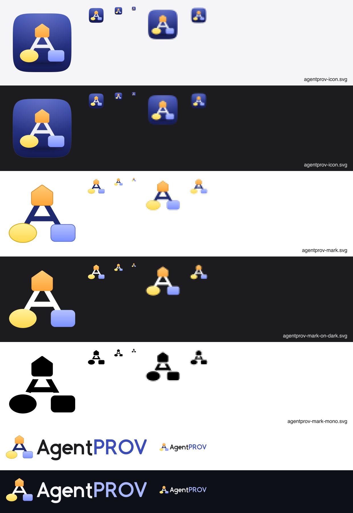

# AgentPROV brand note (2026-10-28)

The logo is **Graph A** (concept C, chosen by the project owner on 2026-10-28; see [concepts.md](concepts.md) and
[research.md](research.md)). It is the letter **A** drawn as a provenance graph: an **agent** (PROV pentagon) at the
apex, an **entity** (ellipse) and an **activity** (rectangle) at the feet, and three **relations** as the legs and the
crossbar. Its colours are version 1's soft PROV hues with gentle gradients. The owner chose them on 2026-10-28 over a flat,
saturated revision 2 (see [concepts.md](concepts.md), "Colour decision"). It is hand-drawn SVG, original to this
project, released under the repository's MIT licence. No font, Apple
artwork, SF Symbol or third-party mark was used.



## Files

All sources are in `docs/images/brand/`. Every generated file is rendered from them by `gui/tools/make_icons.py`
(see "Regenerating").

| File | Use |
|---|---|
| `agentprov-icon.svg` | The app icon: the A on a deep indigo tile. The tile is a superellipse (n = 5) at the 824 px macOS inset on a 1024 canvas, with a top light, a hairline highlight and a contact shadow, and nothing outside the tile. |
| `agentprov-mark.svg` | The flat mark for **light** backgrounds: ink relations and hairline outlines on the nodes. |
| `agentprov-mark-on-dark.svg` | The flat mark for **dark** backgrounds: white relations. It is the guide's header logo. |
| `agentprov-mark-mono.svg` | One colour (black, so it can serve as a template image). The relations stop short of the nodes, so the shapes read from the silhouette alone. Recolour by changing the single fill and stroke. |
| `agentprov-wordmark.svg`, `agentprov-wordmark-on-dark.svg` | The mark plus "AgentPROV". The letters are geometric strokes drawn for this logo (cap height 140, x-height 100, stroke 22 on a 256-high box), so no font licence is involved. "PROV" is in the accent colour. |

Generated from them:

| Output | Where it is used |
|---|---|
| `gui/packaging/icons/AgentPROV.icns` | The macOS `.app` (`BUNDLE(icon=…)`) and the `.dmg` volume icon |
| `gui/packaging/icons/AgentPROV.ico` | `AgentPROV.exe` (`EXE(icon=…)`); PNG entries at 16, 20, 24, 32, 40, 48, 64 and 256 px |
| `gui/packaging/icons/hicolor/` | Linux: `_internal/share/icons/hicolor`, installed by `install-desktop-entry.sh` |
| `gui/src/agentprov_gui/data/icons/` | The window icon (`QApplication.setWindowIcon`) and the About window's mark |
| `docs/user-guide/images/brand/` | The guide's `theme.logo` and `theme.favicon` |
| `gui/packaging/icons/icons.json` | The sha256 of every source and output, and the renderer version |

## Palette

| Role | Light | Dark / end of gradient | Notes |
|---|---|---|---|
| Tile | `#3A4DB8` (top) | `#141A52` (bottom) | Deep indigo, so the pastel PROV hues keep their contrast |
| Entity (yellow) | `#FFF19A` | `#FFD84D` | From the W3C convention's `#FFFC87`; outline `#D4A20A` on light |
| Activity (blue) | `#B4C2FF` | `#7B90FF` | From `#9FB1FC`; outline `#5468D8` on light |
| Agent (amber) | `#FFCB73` | `#FFA63D` | From `#FED37F`; outline `#D9821A` on light |
| Relations | `#1F2A6E` (ink, light backgrounds) | `#FFFFFF` (on the tile, at 92 %; on dark backgrounds) | |
| Wordmark text | `#1D1D1F` | `#F5F5F7` | |
| Wordmark accent ("PROV") | `#3A4DB8` | `#A9B8FF` | |

Contrast (WCAG non-text, 3:1 guideline): against the tile, the entity is at least 5.2:1 and the agent 3.7:1. The
activity is 2.5:1 at the tile's lighter top and more lower down. On `#1C1C1E` every node is 5.9:1 or more. On white
the fills alone are faint (1.4:1 to 2.9:1), which is why the light-background mark has hairline outlines and ink
relations (`#1F2A6E`, 13:1). The wordmark accent is 7.2:1 on white (`#3A4DB8`) and 9.9:1 on GitHub's dark theme
(`#A9B8FF`).

The node hues follow the PROV diagram convention and the GUI's graph (`render.style`, `ui/theme.py`), so the logo and
the graphs in the app speak the same visual language.

## Clear space and minimum sizes

- **Clear space:** at least the height of the agent pentagon (about a quarter of the mark's height) on every side. The
  mark SVGs already include 32 units of it in their viewBox.
- **Minimum sizes:** the app icon down to 16 px (it is a silhouette at 16 and fully readable from 32). The flat mark is
  readable from 24 px. The wordmark needs at least 24 px of height; below that, use the mark alone. For 16 px
  monochrome uses, use the mono mark.

## Do

- Use the icon wherever the operating system shows the app (Dock, Finder, taskbar, launcher) and the flat mark
  everywhere else (README, guide, slides, About).
- Use `-on-dark` variants on dark backgrounds and the plain ones on light. In HTML, use a
  `<picture>`/`prefers-color-scheme` pair, as the README does.
- Regenerate with `make_icons.py` after any change to an SVG, and commit the SVGs and the outputs together.

## Don't

- Don't put the flat mark on a tile of another colour, recolour the nodes, or swap their shapes. The three shapes
  *are* PROV's node types.
- Don't add effects to the icon (glows, bevels, outer shadows). Anything drawn outside the tile makes macOS 26 and later
  shrink the icon onto a grey plate (research §2; the check on macOS 27.2 is
  [previews/macos-27-icon-check.png](previews/macos-27-icon-check.png): our `.icns` on the left is shown full size,
  and a control with no tile on the right is plated).
- Don't set "AgentPROV" in SF Pro or another font as a substitute wordmark, and don't use Apple's or anyone else's
  symbols in or next to the mark.

## Regenerating

```bash
uv run --project gui python gui/tools/make_icons.py          # macOS: needs rsvg-convert (brew install librsvg) and iconutil
uv run --project gui python gui/tools/make_icons.py --check  # anywhere: sources and outputs match icons.json
```

The output is byte-for-byte reproducible with the same `rsvg-convert` (checked: two runs give identical files; the
version is recorded in `icons.json`). `gui/tests/test_g5_bundle_layouts.py` runs `--check`, and `build_bundle.py`
checks that each bundle carries the icon (`icon_problems` in the report).

## Release artefacts

| OS | Artefact (`build_bundle.py`) | Where the icon appears |
|---|---|---|
| macOS | `AgentPROV-macos-<arch>.dmg`, containing `AgentPROV.app` and an Applications link | the app (Finder, Dock, Launchpad) and the mounted volume (`.VolumeIcon.icns` with the custom-icon flag). The `.dmg` file itself keeps Finder's standard disk-image icon. |
| Windows | `AgentPROV-windows-<arch>.zip` | `AgentPROV.exe` in Explorer, the taskbar and shortcuts, plus the window icon |
| Linux | `AgentPROV-linux-<arch>.tar.gz` | `./install-desktop-entry.sh` adds the menu entry and the hicolor icons under `~/.local/share` (`--remove` undoes it), plus the window icon. Wayland matches the window to `org.agentprov.gui.desktop`. |

These artefacts are not full installers. A Windows setup program or a Linux AppImage would need new build tools on the
runners, so they are left for a later decision.

## Icon Composer

The project builds with PyInstaller and the Command Line Tools, not Xcode, so the macOS icon is a classic `.icns`. If
the app ever moves to Xcode, use `agentprov-icon.svg`'s foreground (the relations and three nodes, without the tile)
as square, unmasked Icon Composer layers, and set the indigo gradient as the background. Icon Composer then adds the
Liquid Glass effects and the dark, clear and tinted appearances.
