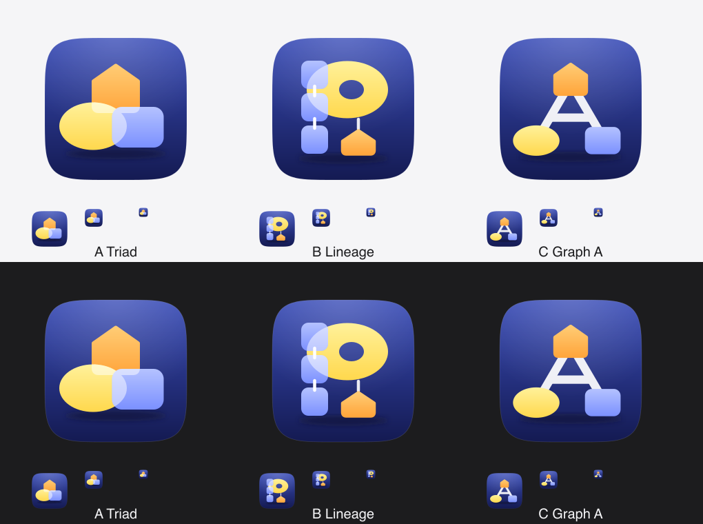

# AgentPROV logo: three concepts (2026-10-28)

All three concepts are hand-written SVG on a 1024 px canvas. The tile is a superellipse (n = 5) at the standard
824 px macOS inset, computed from the formula, with nothing outside it. All three use the same vocabulary: the W3C PROV
node shapes in soft PROV hues (entity: yellow ellipse; activity: periwinkle-blue rectangle; agent: amber pentagon). The
shapes have gentle top-to-bottom gradients and sit on a deep indigo tile, with a soft top light and a contact shadow.
Nothing is traced or copied. The reasons are in [research.md](research.md).

**Colour decision (project owner, 2026-10-28): version 1, the softer gradient colours shown here.** After the direction
to "use impactful colours", a revision 2 was tried (`87db436a`): flat, saturated fills (entity `#FFC928`, activity
`#4C7BFF`, agent `#FF8A1F`) on a darker navy tile, with ink outlines on white. The owner compared the two and chose to
"keep version 1, the softer gradient colours I liked first". Revision 2's colours were reverted (`git checkout` of the
version-1 files from `2954c3b0`, in a new commit). Its per-concept notes below were kept and rewritten for the
version-1 palette.

| | Idea | Strengths | Risks |
|---|---|---|---|
| **A, Triad** | The three PROV node types overlap. The overlaps read as glass. | It is the most abstract and the most Apple-like (overlapping filled shapes). It says "PROV" to anyone who knows the notation, and holds a clear silhouette down to 16 px. | It names no letter. Without the PROV reference it is "three shapes". |
| **B, Lineage** | A **P**. Its stem is three hash-chained blocks (activities), its bowl is an entity, and an agent hangs below (attribution). | It carries the most meaning: P for PROV, the hash chain and attribution. | It is the busiest. At 16 px the chain gaps and links merge, and the bowl's counter makes it look like a donut. |
| **C, Graph A** | An **A** drawn as a provenance graph: an agent at the apex, entity and activity at the feet, and the crossbar is a relation. | It reads as "A" at every size and as a graph at large sizes. The silhouette is the most distinctive, and it is the calmest of the three. | At 16 px the feet are dots. The white edges become an ink colour on light backgrounds (mark-light). |

Per-concept sheets (icon on light and on dark, flat mark on light and on dark; 256, 64, 32 and 16 px at 1:1, then 32
and 16 px enlarged ×4):

- A: [a-triad-sheet.png](concepts/previews/a-triad-sheet.png), source [a-triad-icon.svg](concepts/a-triad-icon.svg)
- B: [b-lineage-sheet.png](concepts/previews/b-lineage-sheet.png), source [b-lineage-icon.svg](concepts/b-lineage-icon.svg)
- C: [c-graph-a-sheet.png](concepts/previews/c-graph-a-sheet.png), source [c-graph-a-icon.svg](concepts/c-graph-a-icon.svg)

### How each concept meets the direction

The direction (relayed 2026-10-28): impactful colour that stays legible small and on light and dark backgrounds; a form
that expresses provenance, verifiable evidence and agent executions; and a tone credible in papers, posters, GitHub and
slides, with no mascots, neon, "AI sparkle" or busy effects. Contrast figures are WCAG non-text ratios (3:1 is the
guideline) for the version-1 palette. Against the tile, the worst case is the lighter or darker end of each gradient.

| | Colour | Meaning | Tone |
|---|---|---|---|
| **A, Triad** | Soft PROV hues on indigo. Entity at least 5.2:1 against the tile and agent 3.7:1. The periwinkle activity reaches only 2.5:1 at the tile's lighter top, but the overlaps keep the shapes apart. It holds as a three-colour blob at 16 px. | It is PROV's own vocabulary (entity, activity, agent), but it shows no relation between them, so "provenance" depends on the viewer knowing the notation. | It is quiet and geometric, but the overlapping glass is the most decorative element of the three. |
| **B, Lineage** | Same palette. At 16 px the blue blocks and the yellow bowl blur into each other. | It says the most: P for PROV, a hash-chained stem for the verifiable corpus, and an agent attached by attribution. | It is the busiest of the three. In print the chain links and the counter read as ornament, not structure. |
| **C, Graph A** | Same palette. It has the clearest silhouette: white strokes on indigo and three separate nodes. The A survives at 16 px. On white, the flat mark uses hairline outlines and ink relations (13:1), because the pastel fills alone are faint there (1.4:1 to 2.9:1). | It is an actual provenance graph (an agent, an entity and an activity joined by relations) that also spells the A of AgentPROV, so the graph is the logo, not an illustration of one. | It is a diagram, the way a research figure is: no mascot, robot, sparkle or neon. The gradients are single-hue and gentle. |

The mono variant and the wordmark exist only for the chosen design.

**Choice (user, 2026-10-28): C, Graph A.** The final family is in `docs/images/brand/`; see [brand.md](brand.md).
