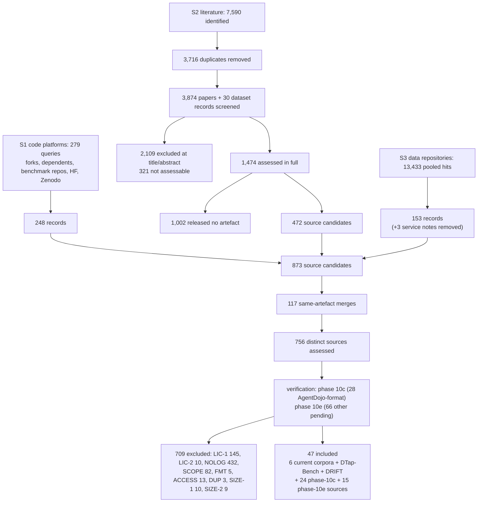

# Systematic source search: PRISMA-style flow

Status: 2026-10-11, eligibility counts updated 2026-10-12 after the phase-10e verification. Counts per stage per strand (S1 code platforms, S2 literature, S3 research-data repositories) and merged. Identification and screening counts come from the strand logs and summaries under `data/`; the eligibility counts come from `records-merged.jsonl`. Generated by `scripts/merge_screen.py` from the strand records under `data/`; regenerate rather than edit by hand. Names, URLs and notes are third-party data, reduced to printable ASCII, with `|` escaped. The method is in `protocol.md`.

## 1. Flow per strand

| Stage | S1 code platforms | S2 literature | S3 data repositories |
|---|---|---|---|
| Queries and calls | 279 logged queries and API calls | 27 database queries, 13 site-restricted web searches, 8 location searches (Zenodo, HF) | 296 logged queries (Zenodo 56, HF 111, DataCite 19, Figshare, Dryad, OSF and Software Heritage 85, Kaggle 25); Mendeley and Papers with Code not searchable |
| Identified | 243 forks; 3,192 distinct dependent or mentioning repositories; 831 benchmark repositories tree-screened from 51 repository searches; about 70 HF datasets (148 calls); 50 Zenodo records; 1 GitLab and 0 Codeberg hits (overlap between steps not removed in the log) | 7,500 database records + 90 arXiv ids from web search = 7,590 | 13,433 pooled unique hits (HF 8,684; Zenodo 1,941; DataCite 1,394; Software Heritage 539; Figshare 529; Kaggle 233; Dryad 98; OSF 15) |
| Duplicates removed within the strand | distinct repositories per step (not logged as a number) | 3,716 | pooled per repository before counting |
| Screened on title/abstract or listing | 243 forks compared with upstream; 1,184 dependents and 831 benchmark repositories tree-screened; HF and Zenodo metadata | 3,874 papers + 30 curated dataset records | all pooled hits (keyword filter, then manual reading of about 200 records) |
| Excluded at screening | not recorded per record (only retained items became records) | 2,109 (1,573 no release signal; 390 no LLM-agent signal; 116 non-LLM domain; 30 before 2023) + 321 not assessable (non-arXiv full text not retrieved) | not recorded per record |
| Assessed in full by the strand | 248 records | 1,474 (1,444 papers + 30 dataset records) | 156 records |
| Removed: not a source | 0 | 1,002 papers with no data or code artefact (430 code-only or unrelated links; 361 no repository link; 211 inspected: code or definitions only) | 3 search-service notes (Papers with Code, Mendeley, Dryad) |
| Source candidates entering the merge | 248 | 472 | 153 |
| Distinct sources (after grouping) | 245 | 447 | 139 |
| Excluded EX-LIC-1 | 58 | 81 | 23 |
| Excluded EX-LIC-2 | 5 | 5 | 3 |
| Excluded EX-NOLOG | 99 | 312 | 49 |
| Excluded EX-SCOPE | 27 | 19 | 43 |
| Excluded EX-FMT | 4 | 0 | 1 |
| Excluded EX-ACCESS | 1 | 11 | 1 |
| Excluded EX-DUP | 1 | 1 | 2 |
| Excluded EX-PIN | 0 | 0 | 0 |
| Excluded EX-SIZE-1 | 9 | 0 | 1 |
| Excluded EX-SIZE-2 | 5 | 3 | 1 |
| Pending verification | 0 | 0 | 0 |
| Included | 36 | 15 | 15 |

A strand column counts every distinct source the strand found. A source found by several strands is counted in each column, so the columns do not add up to the merged total.

## 2. Merged flow

| Stage | Count |
|---|---|
| Source candidates from the three strands (248 + 472 + 153) | 873 |
| Removed as the same artefact (repository, HF id, DOI or deposit version family; papers sharing one repository) | 117 |
| Distinct sources screened and assessed against the criteria | 756 |
| of which found by more than one strand | 61 |
| Excluded EX-LIC-1 | 145 |
| Excluded EX-LIC-2 | 10 |
| Excluded EX-NOLOG | 432 |
| Excluded EX-SCOPE | 82 |
| Excluded EX-FMT | 5 |
| Excluded EX-ACCESS | 13 |
| Excluded EX-DUP | 3 |
| Excluded EX-PIN | 0 |
| Excluded EX-SIZE-1 | 10 |
| Excluded EX-SIZE-2 | 9 |
| **Excluded, total** | **709** |
| **Pending verification** | **0** (none left) |
| **Included** | **47** (6 current corpora + 41 candidates: DTap-Bench, DRIFT, 24 AgentDojo-format sources verified in phase 10c and 15 sources verified in phase 10e) |

Verification after screening: phase 10c verified 28 AgentDojo-format candidates (2026-10-11) and phase 10e the other 66 pending sources (2026-10-12) at pinned commits, revisions and DOI versions; their outcomes are part of the eligibility counts above (`included-excluded.md` sections 6 and 7).

## 3. Flow diagram

No source was excluded under EX-PIN: every eligible source can be pinned by commit, DOI version or HF revision. EX-FMT was first used in phase 10e (5 sources), for per-run records whose trajectory omits tool arguments, tool results or inputs; at screening, format problems had occurred only in records that the licence already excluded.
