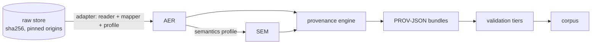

# 2. Concepts

This chapter is a short tour of what AgentPROV builds and why. Each section links to the specification section that
defines it.

## The pipeline



1. **Raw evidence.** The bytes of an imported log, or of a live capture, are stored unchanged in the corpus's raw
   store under their sha256, with the pinned origin they came from (a git commit, a Zenodo, Hugging Face or URL file, or
   a capture session). Raw bytes are never edited, and archives are never extracted to disk.
2. **AER**, the AgentPROV Execution Record (`aer/0.2`). An adapter maps each execution to one JSONL file of typed
   records: execution, actor, scope, message, model call, tool execution, decision, state change, fixture, judgement,
   and the generic activity and artefact. Records point back into the raw bytes, declare what is unknown and why, and
   end with a seal record whose digest covers them all
   ([C](https://github.com/nickjones39/AgentPROV/blob/main/docs/architecture/C_data_model.md)). The name is always
   written out; it is not the "Agent Execution Record" of Vispute and Kadam.
3. **SEM** (`sem/0.1`). A semantics profile adds standoff annotations: integrity labels, roles, injection markers and
   what an outcome means.
4. **PROV.** The provenance engine (`agentprov-prov/0.1`) derives W3C PROV-JSON from the AER and SEM, using only its
   versioned rule catalogue (`aprov`)
   ([E](https://github.com/nickjones39/AgentPROV/blob/main/docs/architecture/EF_provenance.md)).
5. **Validation.** Every execution is checked in tiers: the AER, the SEM, PROV structure and constraints, the W3C PROV
   round trip (tier 4), and evidence linkage, which resolves every core statement to the AER field that justifies it.
6. **Corpus.** A directory with a manifest, an index, a register of every candidate, and a sha256 chain from the raw
   bytes to the PROV ([H](https://github.com/nickjones39/AgentPROV/blob/main/docs/architecture/HL_corpus_versioning.md)).

Every step after the raw store is a pure, versioned function of its inputs. The same raw evidence, adapter, rule
catalogue and specification give byte-identical AER, SEM and PROV across runs, processes and worker counts. This is
tested on macOS on Apple silicon; other platforms are untested ([chapter 1](01-install.md)). That is what `agentprov
recompute` checks ([chapter 4](04-derive-recompute-validate-verify.md)).

## Evidence classes

Every AER record and field, every SEM annotation and every PROV statement carries one of three evidence classes
([F](https://github.com/nickjones39/AgentPROV/blob/main/docs/architecture/EF_provenance.md)):

| Class | Meaning |
|---|---|
| **O**, observed | read from the source; the record says which party recorded it (`by`: `source`, `benchmark`, `config`, …) |
| **D**, derived | computed by a declared, deterministic rule from observed facts |
| **I**, inferred | a reasoned guess under a named assumption |

A rule may give class D only when the code that produced the record is code its catalogue entry cites. Otherwise its
class-I `_unverified` twin applies (for example `agentdojo.functions_runtime_unverified@1`). Combining classes always
gives the weakest one.

An imported log is evidence of what the source harness *recorded*, not of what happened. A source that consistently
mis-records cannot be detected; it can only be attributed (`by: source`) and cross-checked.

## Bundles: core, inference and assessment

Each execution's PROV-JSON document holds several bundles:

- **core**: observed and derived statements only. Every statement names its evidence class (`apv:evidenceClass`), the
  rule that produced it (`apv:rule`) and a pointer into the AER (`apv:sourcePointer`);
- **inference**: inferred statements, one bundle per set of assumptions (method), so a reader can include or exclude
  each method on its own;
- **assessment**: claims that are not PROV facts, such as integrity labels, exposure and taint. They never become
  `prov:used` or `prov:wasDerivedFrom`.

The top level of the document records the conversion itself: raw → AER → bundles, with the software and rule
catalogues as agents and plans.

What AgentPROV never asserts: a dependency from temporal order alone, from shared context alone or from policy taint;
a tool execution using anything except its request and the environment state it read; or any time the source did not
record. Order is kept as order (`apv:afterCausal` and the AER's `after` edges), never as a PROV dependency.

## Missing evidence, withholding and redaction

- **Unknowns are declared.** A value the source did not record is not filled in. It is declared unknown with a reason
  from a closed list: `not_recorded`, `lost`, `overwritten`, `withheld`, `ambiguous`, `not_captured`,
  `not_applicable`.
- **Failing executions are kept.** An execution with problems is sealed with issues, never silently dropped. The
  register (`register.jsonl`) lists every candidate the import saw, including the ones it did not map, with a reason
  code.
- **Withholding, never editing.** Raw bytes are never redacted in place. A purged object (`agentprov purge`), a
  snapshot with raw policy `withhold`, or a source profile's `[withhold]` rules make the sealed corpus leave the
  affected raw objects (and, depending on the rule, the executions citing them) out of the released tree.
  `WITHHELD.json` lists what was withheld by digest and origin, and the datasheet says how many and why
  ([chapter 5](05-package-and-deposit.md)).
- **Account-path redaction.** A workstation path such as a home directory can name a real person. Where a source
  profile declares redaction rules, the mapper replaces each matched value in the AER (and so in SEM and PROV) with a
  short label made from the first 12 hex digits of a salted SHA-256 of the value, usually written `acct-<12 hex>`. The
  label cannot be reversed, but a short or common name could be guessed, and the datasheet says so. Raw objects that
  hold such a path ship unchanged by default, because the same bytes are public at their pin
  ([chapter 9](09-safety.md#account-paths)).

## Version axes

Versions are independent and all recorded in the corpus (`src/agentprov/versions.py`):

| Axis | In this build |
|---|---|
| software | `agentprov 0.1.0` |
| record and corpus formats | `aer/0.2` (`aer/0.1` still read), `sem/0.1`, `capture/0.1`, `agentprov-corpus/0.2` (`agentprov-corpus/0.1` still read and verified) |
| provenance specification | `agentprov-prov/0.1` (`adprov-v2.3-compat` is the frozen regression oracle, produced only on request) |
| rule catalogue | `aprov` version 3 (recorded by digest in `derivation.json` and in `corpus.json` `rule_catalogues`; corpora built before D-930 record version 2) |
| vocabulary | `apv 0.2.0` |
| adapters | adapter SemVer, plus integer versions of source profiles, rule catalogues and semantics profiles (for example `agentdojo-upstream@2`, `agentdojo.suites@2`) |
| corpus | the corpus SemVer you choose when sealing |

Benchmark and framework identity is recorded as observed commits and digests, never as bare version strings: AgentDyn
and AutoDojo both call themselves `agentdojo 0.1.35`. Any change to output bytes needs a visible version bump. An LLM
execution itself cannot be reproduced, even with a seed; what AgentPROV makes exact is the *derivation*.

## The corpus layout

```text
<corpus>/
  corpus.json            manifest: versions, sources, pinned origins, counts, licences, digests, run state
  executions.jsonl       index: one row per execution
  register.jsonl         every candidate, including the ones not mapped, with a reason code
  derivation.json        software version, code digests, lockfile, stage definitions
  checksums.sha256       (sealed corpora)
  raw/objects/<h0h1>/<sha256>.<ext>, raw/origins.jsonl, raw/members.jsonl
  aer/<shard>/<ex>.aer.jsonl
  sem/<profile>/<shard>/<ex>.sem.jsonl
  prov/<spec>/<shard>/<ex>.prov.json
  validation/            validation results
  views/                 derived views, such as transcript-v1 (when added)
  rules/, schemas/       copies kept as a record; never loaded as an authority (sealed corpora)
  DATASHEET.md, CHANGELOG.md, LICENSES/, WITHHELD.json (sealed corpora; WITHHELD.json only when something is withheld)
```

Execution ids look like `ex_37evkqmflf2sqxvs7cc6sbgx6c`. The shard directory is the first two characters of a digest.

### Working trees and sealed corpora

- A command that writes a corpus works in `DIR.partial/`, the **working tree**. You can name the corpus as `DIR` or
  `DIR.partial`; AgentPROV finds the working tree. Imports resume: running the same import again maps only what is
  missing.
- `agentprov package` **seals** the working tree: it writes the full manifest, checksums, datasheet, licences and
  record copies, then renames `DIR.partial/` to `DIR/` and prints the corpus's root digest.
- A sealed corpus is never modified. Every writing command refuses it (exit 4, `corpus.sealed`); a correction is a new
  corpus version, written by `derive --out` or `recompute --out` into a new directory.
- An import that stopped early leaves its snapshot `incomplete`; `package`, `derive` and `recompute` refuse such a
  corpus until a later run of the same import finishes it.

## The AgentPROV vocabulary (apv)

W3C PROV gives the relations (`used`, `wasGeneratedBy`, `wasAssociatedWith`, …) and the basic types (entity, activity,
agent). It has no words for what an agent-security analysis needs to say about each statement: how good its evidence
is, which rule made it, where in the execution record it comes from, and why a value is missing. The `apv:` vocabulary
adds those terms. Its namespace is `https://w3id.org/agentprov/ns#`.

`apv:` declares classes, properties and individuals, and nothing else:

- **classes** for the things in an agent execution, each a subclass of a PROV class: `apv:ModelInvocation` and
  `apv:ToolExecution` (activities), `apv:AssistantMessage`, `apv:ToolCallRequest`, `apv:Fixture` (entities),
  `apv:AgentSystem`, `apv:Attacker` (agents), and the bundle kinds;
- **properties** that qualify statements: `apv:evidenceClass`, `apv:rule`, `apv:basisRule`, `apv:sourcePointer`,
  `apv:rulePointer`, the `apv:…Status` properties for missing values, and descriptive ones such as `apv:toolName`;
- **individuals** in closed lists: the evidence classes `apv:Observed`, `apv:Derived`, `apv:Inferred`, epistemic
  statuses such as `apv:NotRecorded`, and roles such as `apv:CallRequestInput`.

Instances never live in the vocabulary namespace. The nodes of one execution have IRIs under
`https://w3id.org/agentprov/exec/<execution-id>#` (prefix `x:`), and its documents and bundles under
`https://w3id.org/agentprov/exec/<execution-id>/` (prefix `xd:`). Raw artefacts are `raw:sha256-<hex>`, software
agents `sw:…` and rule catalogues `rules:…`
([E.4.1](https://github.com/nickjones39/AgentPROV/blob/main/docs/architecture/EF_provenance.md#e41-namespaces-and-prov-json-prefixes)).

### How a PROV document uses it

This excerpt is from the demo corpus (`prov/agentprov-prov-0.1/ef/ex_37evkqmflf2sqxvs7cc6sbgx6c.prov.json`), cut to
one activity and one usage of the core bundle. It holds no message text: by default the engine writes no content
(`emit_content: false`).

```json
"prefix": {
  "apv": "https://w3id.org/agentprov/ns#",
  "x": "https://w3id.org/agentprov/exec/ex_37evkqmflf2sqxvs7cc6sbgx6c#",
  "xd": "https://w3id.org/agentprov/exec/ex_37evkqmflf2sqxvs7cc6sbgx6c/",
  …
},
…
"activity": {
  "x:te0": {
    "prov:type": {"$": "apv:ToolExecution", "type": "prov:QUALIFIED_NAME"},
    "apv:evidenceClass": {"$": "apv:Derived", "type": "prov:QUALIFIED_NAME"},
    "apv:rule": "aprov.n_tool_execution@1",
    "apv:basisRule": "agentdojo.tool_msg_is_one_execution@1",
    "apv:sourcePointer": "te0",
    "apv:startTimeStatus": {"$": "apv:NotRecorded", "type": "prov:QUALIFIED_NAME"},
    "apv:afterCausal": {"$": "x:m2", "type": "prov:QUALIFIED_NAME"},
    "apv:toolName": "search_files_by_filename",
    …
  }
},
"used": {
  "x:use_request.zpkacwnt2f4uihmy": {
    "prov:activity": "x:te0",
    "prov:entity": "x:m2-1",
    "prov:role": {"$": "apv:CallRequestInput", "type": "prov:QUALIFIED_NAME"},
    "apv:evidenceClass": {"$": "apv:Derived", "type": "prov:QUALIFIED_NAME"},
    "apv:rule": "aprov.use_request@1",
    "apv:basisRule": "agentdojo.call_id_unique_match@1",
    "apv:sourcePointer": "te0/call"
  }
}
```

Reading it:

- `x:te0` is the AER record `te0`, a tool execution. Its class comes from `prov:type apv:ToolExecution`.
- It is **derived** (`apv:Derived`): the engine rule `aprov.n_tool_execution@1` made the node, because the AgentDojo
  rule `agentdojo.tool_msg_is_one_execution@1` (`apv:basisRule`) maps each tool message to one execution.
- `apv:sourcePointer` `te0` is where the evidence is in the AER; the linkage validator resolves it.
- The log has no start time, so the time is not invented: `apv:startTimeStatus apv:NotRecorded` says why it is absent.
- The ordering after message `m2` is an attribute (`apv:afterCausal`), not a PROV dependency.
- The `used` statement says the tool execution used one thing, its own call request `x:m2-1` (part `#1` of message
  `m2`), in the role `apv:CallRequestInput`. Its evidence is the call-id match recorded at `te0/call`.

The vocabulary version a document was built with is stated on its derivation activity, `apv:vocabularyVersion
"0.2.0"`; the corpus manifest records it too (`corpus.json` → `ontology.version`). See
[chapter 13](13-namespace.md#which-version-a-corpus-uses).

### Its own version axis

`apv` has its own semantic version, independent of the software (`agentprov 0.1.0`) and of the provenance
specification (`agentprov-prov/0.1`). Patch versions change documentation only, minor versions add terms, and major
versions change meaning or remove terms. Terms are never deleted after release, only marked `owl:deprecated`. The
current version, 0.2.0, adds 27 terms to 0.1.0 and changes none
([E.4.6](https://github.com/nickjones39/AgentPROV/blob/main/docs/architecture/EF_provenance.md#e46-ontology-versioning-and-publication)).

### Persistent IRIs, and IRIs that do not resolve

The vocabulary's IRIs are under [w3id.org](https://w3id.org/), a permanent-identifier service: they redirect to wherever
the vocabulary is hosted, so they keep working if the host moves. `https://w3id.org/agentprov/ns` answers with the
Turtle file or an HTML page, depending on what the client asks for.

Execution IRIs (`https://w3id.org/agentprov/exec/…`) are identifiers only. They name the nodes of one execution so
that graphs from different executions never collide, but they are not individually dereferenceable: the execution is
described by the corpus that contains it. [Chapter 13](13-namespace.md) covers looking up terms and versions.
