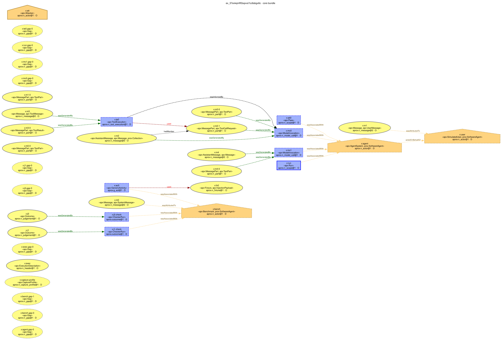

# 6. Statistics and rendering

`stats` computes generic tables over one or more corpora; `render` draws the PROV graphs of selected executions. Both
only read the corpus, and both write their output outside it.

## stats

`stats` computes four table sets for each corpus separately. Corpora are never pooled, because the same execution can
appear in more than one corpus.

| Table | Rows |
|---|---|
| `counts` | records per source and profile, by unit, status, completeness and whether an execution was observed; plus the register codes |
| `statements` | PROV statements by bundle, method, statement type, evidence class and rule; plus the structural relations (`hadMember`, `mentionOf`, `specializationOf`) |
| `unknowns` | for each field-group pointer, how many values are O, D or I, and how many are unknown, by reason |
| `field_groups` | the information-loss table: per field group, the share of executions whose fields are observed or derived (`coverage`) or observed only (`observed_share`) |

Only aggregates are printed; no content.

```text
$ agentprov stats --corpus corpora/demo
agentprov stats: corpora=1 plan=counts,statements,unknowns,field_groups
stats: finished in 120ms (exit 0)
  units    3 of 3: ok 3
agentprov stats (agentprov-stats/0.1; agentprov 0.1.0; fn sha256:c75c1bb7…; prov spec agentprov-prov/0.1)

corpus demo-agentdojo; state sealed; verification checksums; root sha256:2d5372e2…; content sha256:e8d2ac2e…; rows 3, selected 3, n_executions 3

== counts (1 rows)
source_id  profile               registry_parts  registry_import_status  records  n_executions  n_outcome_only  unit_agent_execution  …
agentdojo  agentdojo-upstream@2  2024-06 head    supported               3        3             0               3                     …

== register (2 rows)
stage  code                               severity  disposition  n
map    map.accounting_unverifiable        info      sealed       3
map    map.earlier_attempts_unobservable  info      sealed       3

== statements (77 rows)
source_id  profile               bundle      method                                  stype              evidence  rule                       n
agentdojo  agentdojo-upstream@2  core                                                actedOnBehalfOf    D         aprov.deleg_user@1         3
agentdojo  agentdojo-upstream@2  core                                                activity           O         aprov.n_scope@1            3
…
agentdojo  agentdojo-upstream@2  inference   agentdojo-context_is_prefix-v1          used               I         aprov.use_context@1        32
…
agentdojo  agentdojo-upstream@2  assessment  agentdojo-suites-v2                     entity             I         aprov.a_taint@1            2
…

== unknowns (25 rows)
…

== field_groups (19 rows)
source_id  profile               group           n_executions  excluded  cells  denominator  coverage  observed_share  O   D  I  not_recorded  …
agentdojo  agentdojo-upstream@2  ctx             3             0         3      3            0.0       0.0             0   0  3  0             …
agentdojo  agentdojo-upstream@2  model_served    3             0         3      3            0.0       0.0             0   0  0  3             …
agentdojo  agentdojo-upstream@2  sysprompt       3             0         3      3            1.0       1.0             3   0  0  0             …
agentdojo  agentdojo-upstream@2  link            3             0         3      3            1.0       0.0             0   3  0  0             …
…
agentdojo  agentdojo-upstream@2  all             3             0         47     47           0.297872  0.234043        11  3  6  24            …
```

Reading the demo's tables:

- **Context use is inferred.** The `ctx` group is class I for every execution, and the statements table shows the
  context usages (`aprov.use_context@1`) in the inference bundle of the method `agentdojo-context_is_prefix-v1`. The
  TraceLogger log does not record what was sent to the model, so "the model used these messages" is an inference
  under a named assumption, never a core fact.
- **Some fields are simply not recorded.** The served model, sampling parameters, token usage, finish reasons and
  times are `not_recorded` in these logs (`coverage 0.0`).
- **Tool-result links are derived.** The `link` group is D: tool results are matched to calls by call id under a
  declared rule.

| Option | Use |
|---|---|
| `--corpus DIR` | a corpus (sealed, working or `.partial`); repeat for several, one table set each |
| `--tables LIST` | any of `counts,statements,unknowns,field_groups` (default: all four) |
| `--select KEY=VALUE[,VALUE...]` | an index-row filter (keys `source_id`, `profile`, `unit`, `status`, `mode`, `completeness`, `execution_observed`, `adapter`, `snapshot`, `issue`, `facet.<name>`, `cell.<member>` such as `cell.suite` or `cell.attack_id`, and `outcome.<claim>=true|false|none`) |
| `--per-execution` | the statements table also at execution grain |
| `--artefacts` | also scan the selected executions with the shared artefact layer |
| `--prov-spec` | count the PROV files of `agentprov-prov/0.1` (default) or `adprov-v2.3-compat` |
| `--format text\|csv\|json\|markdown` | the payload format |
| `--out PATH` | write the payload to a file (never inside a corpus) |

For example, the statements table as CSV:

```text
$ agentprov stats --corpus corpora/demo --tables statements --format csv --out stats.csv
agentprov stats: corpora=1 plan=statements
stats: finished in 127ms (exit 0)
  units    3 of 3: ok 3
wrote csv statistics for 1 corpus/corpora to …/stats.csv
```

On a working or downloaded corpus, `stats` reminds you that nothing has been verified yet:

```text
agentprov stats: notice: agentdojo-upstream: working corpus, not sealed or verified (run 'agentprov verify' before trusting a downloaded corpus)
```

**Rates.** `stats` gives counts, not attack-success or utility rates. When you compute rates from a corpus, state the
convention: for example, whether outcome-only records and run-error outcomes imposed by the harness are counted.
Count agent executions only where `unit == agent_execution` and `execution_observed == true`.

The same tables are available from Python through `agentprov.api`.

## render

`render` draws the `agentprov-prov/0.1` graph of chosen executions. It needs the `render` extra (`uv sync --frozen
--group docs --extra render`) and, for images, Graphviz `dot`. Nothing is rendered unless asked: there is no render-all.

```text
$ agentprov render --corpus corpora/demo --ex ex_37evkqmflf2sqxvs7cc6sbgx6c --format svg,png --out renders
agentprov render: units=1 plan=core bundle, svg,png workers=4
render: finished in 717ms (exit 0)
  units    1 of 1: ok 1
wrote …/renders/agentprov-prov-0.1/ef/ex_37evkqmflf2sqxvs7cc6sbgx6c.dot
wrote …/renders/agentprov-prov-0.1/ef/ex_37evkqmflf2sqxvs7cc6sbgx6c.svg
wrote …/renders/agentprov-prov-0.1/ef/ex_37evkqmflf2sqxvs7cc6sbgx6c.png
rendered 1 of 1 selected execution(s) (core bundle) to …/renders; 0 failed
```



*The core bundle of `ex_37evkqmflf2sqxvs7cc6sbgx6c`. The `.svg` above is the file `render` wrote, unchanged.*

How to read the drawing:

- Entities are ovals (yellow), activities are boxes (blue) and agents are house shapes (orange), in the W3C PROV
  colours.
- **The border shows the evidence class:** solid and thick for observed, dashed for derived, dotted for inferred, thin
  grey for no class.
- Each label holds the node's IRI local name (`x:te0`), its types (`«apv:ToolExecution»`) and the rule that made it
  with its class (`aprov.n_tool_execution@1 · D`). Without `--show-content`, labels never hold content.
- The column of `apv:Gap` nodes on the left records what the log does not contain: each gap is a declared unknown,
  drawn so that it is visible.
- With `--bundle all` the inference bundles are drawn in purple and the assessment bundles in brown; untrusted
  integrity is salmon, unknown integrity or role grey, sinks dark red and endorsers light blue.

Selecting executions: `--ex ID [ID ...]`, or `--select KEY=VALUE` with `--limit N` (required with `--select`), or
`--limit N` alone for the first N. `--dry-run` builds the DOT text in memory and lists the files it would write:

```text
$ agentprov render --corpus corpora/demo --limit 2 --dry-run
agentprov render: units=2 plan=core bundle, svg workers=4
…
would render 2 of 2 selected execution(s) (core bundle) to …/corpora/demo-rendered; 0 failed
```

| Option | Use |
|---|---|
| `--bundle core\|all` | core only (default), or also the inference and assessment bundles |
| `--format LIST` | any of `svg,png,pdf,dot` (default `svg`); the `.dot` text is always written |
| `--direction LR\|TB` | rank direction (default `LR`) |
| `--out DIR` | output directory (default `<corpus>-rendered`); never inside a corpus |
| `--max-edges N` | a graph with more edges gets its `.dot` text but no image (default 800; 0 = no limit, and `dot` still times out at 120 s) |
| `--jobs N` | parallel `dot` processes |

`--show-content` adds attribute values to the labels (escaped, one line, cut at `--content-chars`). Those values can
include prompt-injection payloads; see [chapter 9](09-safety.md) before you use it.

## Common errors

| Message | Cause and fix |
|---|---|
| `[render.extra_missing]` (exit 3) | `uv sync --frozen --group docs --extra render` |
| `render.graph_too_large` (exit 1) | the graph has more edges than `--max-edges`; its `.dot` is written; raise the limit or render the core bundle only |
| `[render.output_in_corpus] refusing to write renders inside a corpus` (exit 4) | choose an `--out` outside every corpus |
