# 8. The desktop app

`agentprov-gui` is a desktop viewer and job runner for AgentPROV corpora, written with PySide6 (Qt Widgets). It is a
separate uv project in `gui/`, with its own lockfile, and it imports only an allowlisted, read-only part of the core.

Three rules shape everything it does:

- **It never writes a corpus itself.** Opening a corpus is read-only: no file is written and no lock is taken.
  Everything that writes runs as an `agentprov` command in a separate process, and the app shows you that exact
  command, with its tier, before it starts.
- **Content stays hidden until you ask for it.** Message text, tool arguments and tool results are shown as a
  placeholder with their length and digest. A *Show content* switch shows them escaped and fenced, because corpora
  contain prompt-injection payloads by design.
- **Every action has a CLI equivalent** (the parity rule), and every setting that changes a run, its data or stored
  state is an `agentprov settings` key. This chapter names the command for each action. A test walks the CLI's parser
  and the app's windows and fails when either side has something the other lacks.

The screenshots were made by `gui/tools/screenshots.py` on macOS with the native toolbar, in the light appearance, on
synthetic corpora (the three AgentDojo test logs, and that corpus after `agentprov derive`) with a temporary
`AGENTPROV_HOME`. The script refuses to save an image whose visible text matches an account path, an e-mail address or a
key shape. The Run Live screenshots use stub answers instead of a backend, a keychain or a model server; they say so
below.

## Starting the app

From a checkout:

```bash
uv sync --project gui
uv run --project gui agentprov-gui [CORPUS]     # optionally open a corpus directory at start
```

Only one copy runs at a time ("AgentPROV is already running"), because the app drives the job queue. At start it asks
the configured checkout's CLI, or without a checkout the installed one (below), for its version (`agentprov
--version`). With neither, or a CLI whose record formats differ from the app's own library, it runs as a viewer only
and says why in the status bar.

**Bundles.** `uv run --project gui python gui/tools/build_bundle.py` builds a one-folder application outside the
repository. It carries this user guide (the chapters and their pictures, as they were when it was built), which
Help › Docs shows when no checkout is set. A bundle has no `agentprov` command of its own: with a checkout set in
Settings › General the app runs that checkout's CLI; without one it runs the `agentprov` installed with
`pip install agentprov` (Python 3.14 or later; [Installation](01-install.md)), the one named in Settings › General ›
*agentprov program*, else the first on `PATH`, then in `~/.local/bin`, `/opt/homebrew/bin` and `/usr/local/bin` (an app
started from the Finder or a desktop menu does not see your shell's `PATH`). That is enough for Help › Assistant, the
Settings panes and the jobs of the commands the package has. Live runs and the repository's own tools (Dev Runs, local
CI, the job queue) still need a checkout, since the backend projects are not in the package (D-1030).

| Platform | Bundle | State |
|---|---|---|
| macOS (Apple silicon) | `AgentPROV.app` (in `AgentPROV-macos-arm64.dmg`), signed ad hoc (no Apple Developer ID, no notarisation) | built and tested on the development Mac. On another Mac, macOS refuses the first launch: open System Settings › Privacy & Security and click Open Anyway (macOS 15 and later no longer offer Control-click › Open for this) |
| Linux aarch64 | `.tar.gz` | a bundle built from `main` in a clean Ubuntu 24.04 VM is **tested on a clean Ubuntu 24.04 machine** (G5 clean-machine run, package `sha256:9cb011da…85d7`; [report](https://github.com/nickjones39/AgentPROV/blob/main/docs/reports/gui/g5-clean-machine/linux-arm64.md)). Needs glibc 2.39 or newer and the X11 libraries `libxcb-cursor0 libxcb-icccm4 libxcb-keysyms1 libxkbcommon-x11-0 libegl1 libfontconfig1`. Released with v0.1.0 as `AgentPROV-linux-aarch64.tar.gz`. Run Live's containment choice shows `sandbox-exec` disabled, with the reason as its tooltip (it is macOS only; declare `dedicated-user` or `vm`) |
| Linux x86_64 | `.tar.gz` | a bundle built from `main` in a clean Ubuntu 22.04 VM is **tested on a clean Ubuntu 22.04 x86_64 machine under emulation** (QEMU on Apple silicon, not x86_64 hardware; package `sha256:8e57c020…de29`; [report](https://github.com/nickjones39/AgentPROV/blob/main/docs/reports/gui/g5-clean-machine/linux-x86_64.md)). Needs glibc 2.35 or newer and the same X11 libraries as aarch64. Released with v0.1.0 as `AgentPROV-linux-x86_64.tar.gz`. Run Live's containment choice shows `sandbox-exec` disabled, with the reason as its tooltip (it is macOS only; declare `dedicated-user` or `vm`) |
| Windows ARM64 | one folder (zip), unsigned (SmartScreen: More info, then Run anyway) | a bundle built from `main` in a clean Windows 11 ARM64 VM is **tested on a clean Windows 11 ARM64 machine** (G5 clean-machine run, package `sha256:269a75f7…dfbc08`; [report](https://github.com/nickjones39/AgentPROV/blob/main/docs/reports/gui/g5-clean-machine/windows-arm64.md)). Released with v0.1.0 as `AgentPROV-windows-arm64.zip`. One intermittent job-stop failure seen on a branch run stays open. **Live runs work on macOS and Linux; on Windows ARM64 they are not available yet:** the AgentDojo backend cannot be installed there, because its pinned dependencies `cryptography` 50.0.2 and `cachebox` 5.2.3 publish no Windows ARM64 wheels and backends install from wheels only, so `agentprov run` and `backends build agentdojo`, `autodojo` and `agentdyn` are refused (D-867, D-1064). **The machine-wide job queue works on macOS and Linux; on Windows it is not available** (it locks with `fcntl`), and `--queue-cpu` is refused. Enforced containment (`sandbox-exec`) is macOS only. **In the app** these controls stay where they are but are disabled, each with the reason as its tooltip: Run Live… (the File menu item, ⌘L/Ctrl+L, and the Runs button), Live Dev Run…, Run Live's Start… and Preflight Only…, Continue… of the backend build form for `agentdojo`, `autodojo` and `agentdyn` (its dry run stays), the job queue settings (Settings › Compute and Settings › Dev Runs' reservation) and `sandbox-exec` in Run Live's containment choice. Runs and Run Live show a "Not available on Windows ARM64" notice with the reason and a How to run it link to the guide section; everything else works. [Platforms](07-live-runs.md#platforms) has the table |
| Windows x86_64 | one folder (zip), unsigned (SmartScreen: More info, then Run anyway) | a bundle built from `main` is **tested under emulation** (Windows 11 on ARM's x64 emulation, a clean machine, not x86_64 hardware; package `sha256:5c17b051…14be`; [report](https://github.com/nickjones39/AgentPROV/blob/main/docs/reports/gui/g5-clean-machine/windows-x64.md)). Released with v0.1.0 as `AgentPROV-windows-x64.zip`. **Live runs work on macOS and Linux; on Windows x86_64 they are not available yet:** the backend environment builds, but the backend worker exits at start-up for a reason not yet diagnosed, so `agentprov run` is refused (D-867, D-1064). **The machine-wide job queue works on macOS and Linux; on Windows it is not available** (it locks with `fcntl`), and `--queue-cpu` is refused. Enforced containment (`sandbox-exec`) is macOS only. **In the app** these controls stay where they are but are disabled, each with the reason as its tooltip: Run Live… (the File menu item, ⌘L/Ctrl+L, and the Runs button), Live Dev Run…, Run Live's Start… and Preflight Only…, the job queue settings (Settings › Compute and Settings › Dev Runs' reservation) and `sandbox-exec` in Run Live's containment choice. Runs and Run Live show a "Not available on Windows x86_64" notice with the reason and a How to run it link to the guide section; everything else works, the backend builds included. [Platforms](07-live-runs.md#platforms) has the table |

Each release bundle carries its `bundle-report.json` (its checks, interpreter, glibc floor, signature and sha256). The
Linux and Windows bundles have passed the clean-machine tests above (D-750, G5); the x86_64 ones were tested under
emulation.

## The window

The sidebar has four sections: **Corpora** (Viewer), **Jobs** (Runs, Logs, System), **Release** (Licences,
Package) and **Help** (Docs, Assistant). A page fills the window; the Assistant opens as a tab beside it (see *Help:
Docs and Assistant* below). The menus repeat every action: File (Open Corpus… ⌘O, Reload ⌘R, Run Live… ⌘L, New Job… ⌘N, Dev Run…,
Open in New Tab, Close Tab ⌘W, Close Other Tabs ⌥⌘W, Close Window ⇧⌘W), Edit (Settings… ⌘,), View (Toggle Sidebar
⌃⌘S; Show/Hide Corpora ⌥⌘1 and Show/Hide Inspector ⌥⌘I, the Viewer's side panes; Text Size: Bigger ⌥⌘=, Smaller ⌥⌘−,
Default ⌥⌘0), Go (⌘1 to ⌘7 for the seven pages and ⌘8 for the Assistant; Corpora, Next Tab ⌘⇧],
Previous Tab ⌘⇧[; outside the Viewer they switch between the page and the Assistant tab), Window (macOS) and Help (About AgentPROV, Check for Updates…, AgentPROV Help ⌘?, Ask the Assistant, Keyboard Shortcuts). On macOS, Settings…, About
AgentPROV and Check for Updates… sit in the AgentPROV menu; on Windows and Linux, ⌘ is Ctrl. On macOS the native toolbar holds Toggle Sidebar,
Open Corpus, Reload, New Job, Dev Run, the job count and a search field that filters the Viewer by execution id;
elsewhere a Qt toolbar holds the same actions and the search field, and the job count is at the right of the status
bar.

## Viewer

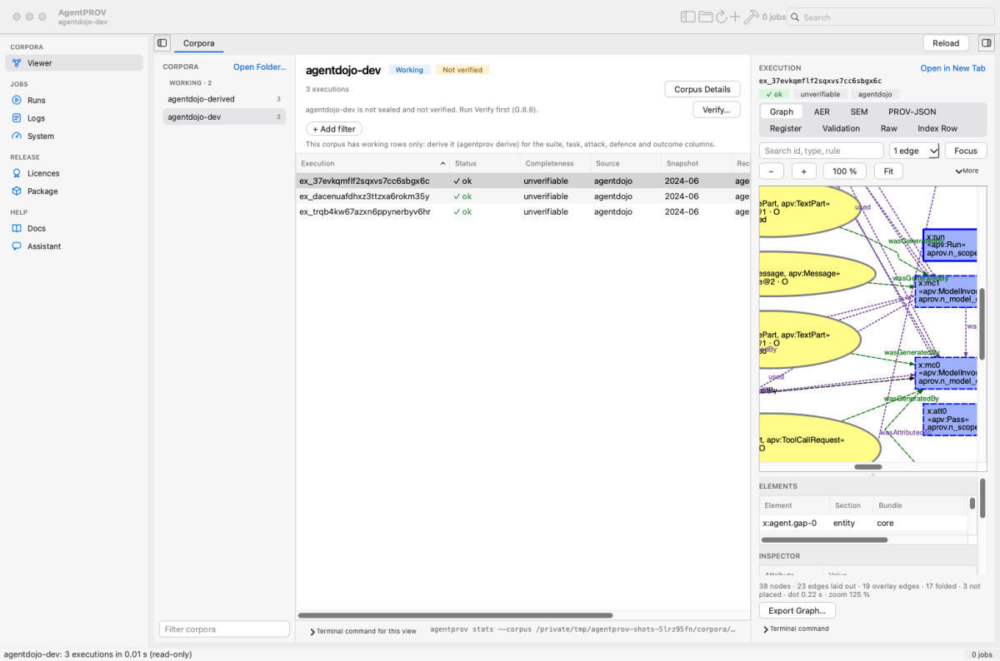

*The Viewer with the demo working corpus: the corpora list at the left, the corpus's name with its Working and Not
verified badges, the filters and the executions table in the middle, and the graph of the selected execution's core and
inference bundles in the inspector at the right. The ⚑ marker appears on a derived corpus (next picture).*

The Viewer has a tab bar at the top. Its first tab, **Corpora**, is the corpus browser described below and cannot be
closed; every other tab is one execution you opened (see [Execution tabs](#execution-tabs)). *Reload* (rescan the
corpus roots, ⌘R) and the count of open tabs sit at the right end of the bar, with a button at each end that shows or
hides the pane on that side. The Corpora tab has three panes side by side:

- **Corpora** (left): the corpora found under the corpus roots (Settings › General), grouped by state: *Sealed*,
  *Working*, *Being written* (a job holds its lock) and *Unreadable*, each heading with its count. A row is the corpus's
  name and its execution count; hover it for its folder. Click a row (or move to it with ↑↓) to open the corpus;
  opening reads its files only. The box at the bottom filters the list by name, and *Open Folder…* opens a corpus
  folder from elsewhere (as File › Open Corpus… ⌘O).
- **Executions** (middle), from top to bottom:
  - **The header**: the corpus's name with its state and verification as badges (*Sealed*, *Working*, *Being
    written*; *Verified*, *Not verified*, *Unvalidated*), its version and how many executions the filters show of all
    in the corpus, and *Corpus Details*, which shows the corpus id, version, execution count, content digest, folder
    and state from its `corpus.json`. Under it a line says whether the corpus is a working tree, sealed but not
    verified by this app, or sealed and verified (with the level, date and job). *Verify…* opens the verify form
    (`agentprov verify --corpus DIR`, a job). A corpus built with `--skip-prov-conformance` gets *Revalidate…*, which
    opens the Recompute form with `--out <corpus>-revalidated --stages sem,prov,validation`.
  - **Filters**: each filter you apply is a chip, such as *Attack: important_instructions ×*; click the chip to remove
    it, or *Clear all*. *+ Add filter* lists the columns you can filter by: status, completeness, source, record type
    and issue code, and on a derived corpus suite, attack, injection task, defence, model requested, utility and attack
    succeeded. Each lists its values with the number of executions it would show beside the filters already applied;
    choosing another value of the same column replaces the chip. On a working corpus with plain index rows the app says
    to derive it first (`agentprov derive`). The id search is the search field of the window's toolbar; while it holds
    text, a chip *Id contains: …* shows it.
  - **The executions table** sorts by any column. Columns that are empty for every row are left out. A click (or ↑↓)
    shows the row in the inspector; a double-click, Return, or *Open in New Tab* (the inspector's link, the row's
    context menu, the File menu) opens it in a tab of its own.
  - **Terminal command for this view** (collapsed at the bottom; its start shows beside it) is the `agentprov stats`
    command that selects the rows shown, with *Copy*, and `agentprov verify` while the corpus is not verified. It runs
    nothing. The id search has no CLI selector, and the card says so.
- **Inspector** (right): the selected execution's id, its status, completeness and source as badges, and a segmented
  control with its views: Graph, AER, SEM, PROV-JSON, Register, Validation, Raw and Index Row (the checked index row as
  JSON). *Export Graph…* renders the execution as a job; *Terminal command* (collapsed) holds the `agentprov inspect`
  command that prints the open view and the `agentprov render` that Export Graph… opens.

**Collapsing the side panes.** The corpora list and the inspector each collapse to a slim strip that says what it
holds (*CORPORA · name*, *EXECUTION · ex_…*), so the table gets the width. Click the strip, the button at that end of
the tab bar, or View › Show/Hide Corpora (⌥⌘1) and Show/Hide Inspector (⌥⌘I) to open it again. Drag a divider to change
a pane's width. The app remembers each pane's width and whether it is open. When the window is too narrow for three
panes, the inspector collapses first and then the corpora list, and they open again when the window is wide enough;
opening a collapsed pane in a narrow window collapses the other one instead.

### Execution tabs

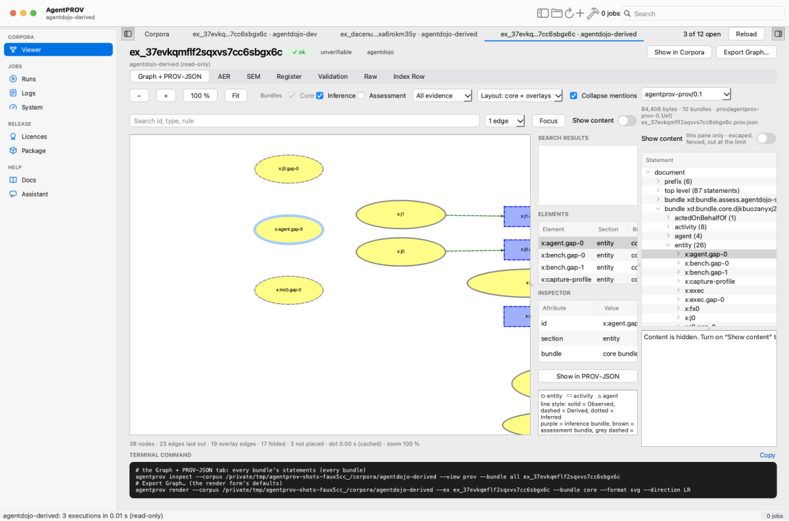

*Three executions open in tabs, from two corpora, so each tab names its corpus too. The current tab shows its graph and
PROV-JSON side by side, with one statement selected in both.*

- **What a tab holds.** The first sub-tab, *Graph + PROV-JSON*, puts the graph and the PROV-JSON tree (above its raw
  text) side by side; drag the divider to give either more room. Selecting a node selects its statement in the tree,
  and selecting a statement selects its node. AER, SEM, Register, Validation, Raw and Index Row follow as sub-tabs.
  *Show in Corpora* selects the execution's row in the Corpora tab (opening its corpus again if another one is open);
  *Export Graph…* works as in the inspector. *Show content* starts off in every new tab. A segmented control above the
  views switches them, as in the inspector.
- **Titles.** A tab shows the execution id, shortened in the middle; its tooltip gives the full id, the corpus name and
  the corpus path. While tabs from more than one corpus are open, each title adds its corpus name.
- **Opening it again** brings its existing tab to the front.
- **At most 12 tabs.** Opening a 13th closes the tab you looked at least recently (never the current one), and the
  status bar says which. To keep memory down, only the current tab and the three most recently viewed keep their graph
  drawn; the others redraw from their saved layout when you come back to them.
- **Other corpora.** Opening another corpus keeps the tabs open, so you can compare an execution across corpora. A tab
  is a read-only snapshot of what it loaded; on a corpus that a job is writing, its title row gives the time it was
  loaded. *Reload Execution* (the tab's context menu) reads it again; if the corpus is gone, the tab says so and keeps
  the snapshot.
- **Keys.** ⌘W closes the current tab (on the Corpora tab it closes the window); ⌥⌘W closes the other tabs; ⌘⇧] and ⌘⇧[
  switch tabs (Ctrl+PgDown and Ctrl+PgUp on Windows and Linux); ⌃Tab and ⌃⇧Tab switch the views inside a tab. A
  middle-click on a tab closes it. The tab's context menu has Close Tab, Close Other Tabs, Show in Corpora, Reload
  Execution and Copy Execution Id.

### Outcome columns and the attack-succeeded marker

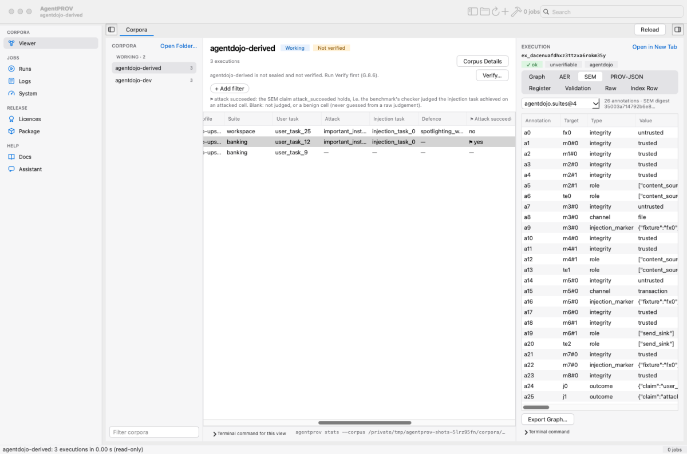

*The derived demo corpus, its table scrolled to the task and outcome columns. The selected row is an attacked cell
whose attack succeeded (⚑ yes); the inspector's SEM view lists its annotations.*

A row gets the ⚑ marker, and a tint, only when the SEM claim `attack_succeeded` holds: the benchmark's checker judged
the injection task achieved on an attacked cell. A blank means not judged, or a benign cell. The marker is never
guessed from a raw judgement. The legend under the filters says this in full.

### The graph

The Graph view (in the inspector, and on the left of an execution tab) draws the `agentprov-prov/0.1` document of the
execution. On the canvas the mouse wheel zooms, keeping the point under the pointer where it is: one notch is one
step of the − and + buttons, within the same limits (5 % to 800 %). Pinch zooms too. To move around, drag the
background, or scroll with two fingers on a trackpad (or a Magic Mouse); Shift with the wheel, or tilting the wheel
sideways, scrolls as well, and ⌘ or ⌥ with a two-finger scroll zooms. The app tells a trackpad from a wheel by the
scroll phases the system reports; a touchpad that reports none (Windows precision touchpads) zooms like a wheel, and
dragging pans there. Its toolbar has zoom (−, +, 100 %, Fit; ⌘−, ⌘+, ⌘0, ⌘9), the bundles (core always on; inference on by
default; assessment off), an evidence filter (all, only Observed, only Derived, only Inferred), the layout (core with
overlays, or a full layered layout), *collapse mentions*, a search box (id, type, rule), k-hop *Focus* and *Show
content*. In the inspector, which can be narrow, the toolbar takes two lines: the search box with the number of edges
and *Focus* first, then the other tools on one line. The tools that do not fit that line move, from its end, behind
**More ▾**, which opens a small panel holding them, with the same tooltips; widen the inspector and they come back into
the line. There the side panel sits under the graph. The side panel lists search results and every element; clicking
a node fills the *Inspector*, and *Show in PROV-JSON* jumps to its statement. The legend matches `agentprov render`:
entities are ovals, activities boxes, agents house shapes; solid borders are observed, dashed derived, dotted inferred.
Layout uses Graphviz `dot` when it is installed and the graph is small enough, and the app's own layered layout
otherwise.

### The other views

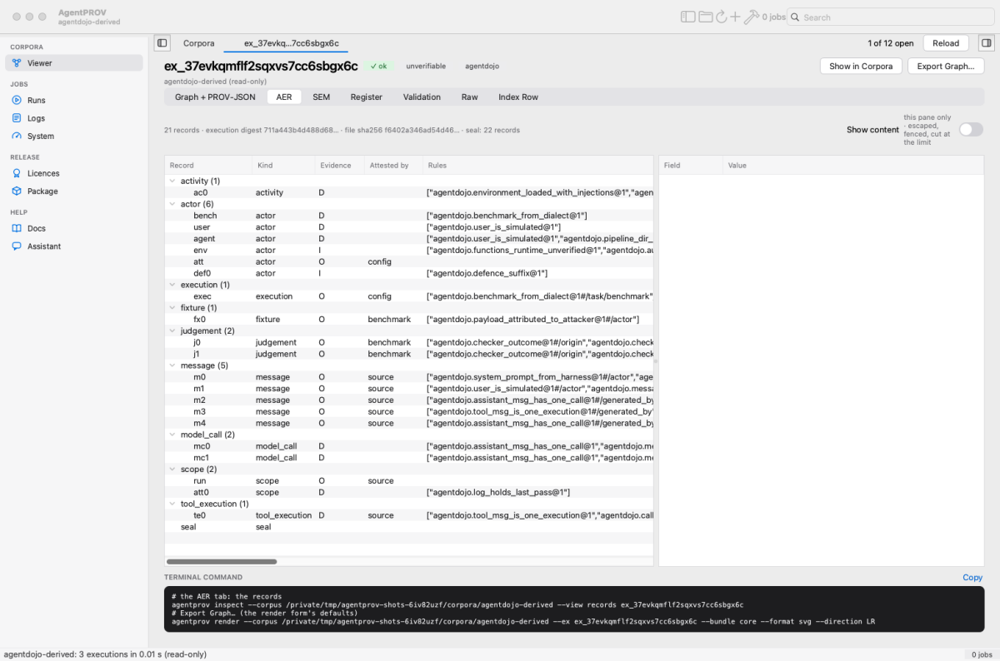

*The AER view of an execution open in its own tab: the record count and digests above, then the records grouped by
kind, each with its evidence class (Evidence, `ev`), attesting party (Attested by, `by`) and rules, and the fields of
the selected record at the right. The execution is an attacked cell whose attack did not succeed (attack succeeded:
no).*

| View | Shows |
|---|---|
| PROV-JSON | the document as a tree of statements; the raw text only with this pane's *Show content* switch |
| AER | records by kind with Record, Kind, Evidence, Attested by, Rules, Evidence locators, Unknowns and After (the AER members `id, k, ev, by, rule, src, unk, after`, named in each header's tooltip), and the fields of the selected record |
| SEM | the annotations of the chosen semantics profile: target, type, value, evidence class, rule, premises |
| Register | the register rows of the execution: code, severity, stage, disposition, rule |
| Validation | the verdict and each check's result |
| Raw | the raw artefacts (role, sha256, included); content is not shown |
| Index Row | the execution's index row, as JSON |

**CLI equivalents.** `agentprov inspect ID --corpus DIR` shows the same records as text (`--view records`, `evidence`,
`sem`, `prov`, `raw`); `agentprov stats --corpus DIR --select …` counts the rows a filter selects; `agentprov render
--corpus DIR --ex ID` draws the graph to a file.

## Runs

The Runs page starts and follows jobs. Its top bar has **▶ Run Live…**, **New Job ▾** (a menu of every form, below),
**Dev Run…**, **Live Dev Run…** and **Rebuild Stale Environments…**. A job is a detached `agentprov` process
(`agentprov jobs start … -- <command>`): it keeps running when the window closes, and the app finds it again when it
reopens.

**Rebuild Stale Environments…** is for the moment after an update when Run Live shows no suites for a backend because its
environment was built for the old version. It asks first, with the exact command
(`agentprov backends rebuild-stale --allow-network`, tier R2: it downloads the pinned wheels the backend locks name, and
AutoDojo's pinned NLTK data, when they are not cached, and takes about 15 minutes when every backend is rebuilt). The job
then checks each registered backend's environment, builds each stale one in turn and checks it offline; its row in the
jobs table counts backends (done of 4), and its details list each backend's outcome. A backend that fails is reported
with its reason and the command to run, and the others still run. Earlier environments in `$AGENTPROV_HOME/envs` are left
as they are. About's update flow starts the same job as its last step (D-1130). It needs the
repository checkout: without one, the button explains and nothing starts ([chapter 7](07-live-runs.md#after-an-update-rebuild-the-stale-environments)).

### Jobs

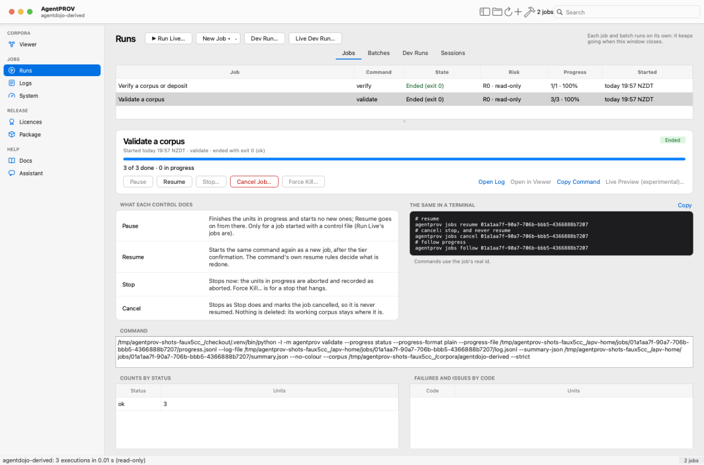

*Two finished jobs on the derived demo corpus (validate and verify), and the details of the validate job: its state,
progress and controls, what each control does with the same commands for a terminal, its exact command, and its counts
by status and by issue code (the end of its stderr is further down).*

The job list shows each job's label, command, state, risk tier, progress and start time (in your computer's time
zone). Select a job for its details:

- **The header**: the job's name, when it started, and its state as a word with a tint: *Running*, *Pausing* (a Pause
  was asked for), *Paused* (it finished what was in progress and stopped early), *Stopping*, *Stopped* (exit 130),
  *Cancelled*, *Ended* (exit 0) or *Failed* (another exit code). Under it are the progress bar and the job's facts:
  units done of the total, units in progress, the rate and an ETA range. A live run (`agentprov run`) counts **cells**,
  and also shows the model and endpoint, how many traces run at once, and, when it has caps, its **billed model calls**
  and the **upper bound of its spend** against the caps (`--max-calls`, `--max-cost-usd`), read from its working
  corpus (`live.caps` in `corpus.json`) every few seconds. A run without caps shows no call or cost figures.
- **What each control does**, and **the same in a terminal**: the `agentprov jobs` commands for this job, with its real
  id, and a Copy link. Only the commands that apply are listed.
- The job's exact command, counts by status and by issue code, and the last part of its stderr.

| Button | What it does | CLI equivalent |
|---|---|---|
| Pause | finishes the units (cells) in progress and starts no new ones; Resume goes on from there. Only for a running job started with a control file, which Run Live's jobs are | `agentprov jobs drain ID` |
| Resume | starts the same command again as a new job, after the tier confirmation; the command's own resume rules decide what is redone. A live run skips its recorded cells, and its caps carry over (they count the whole working corpus). Never for a cancelled job | `agentprov jobs resume ID` |
| Stop… | a graceful stop, after a confirmation: units in progress are aborted and recorded as aborted (a live run's count against its caps and run again on Resume), and the command exits with code 130 | `agentprov jobs stop ID` |
| Cancel Run… (Cancel Job…) | after a confirmation, stops the job as Stop does and marks it **cancelled**, so it is never resumed: Resume is disabled, and `jobs resume` refuses it (exit 4). Nothing is deleted. For a job that has ended, only the mark is written | `agentprov jobs cancel ID` |
| Force Kill… | kills the job's process tree, after a confirmation (it can leave a stale lock); for a Stop that hangs | `agentprov jobs kill ID --yes` |
| Open Log | the job's log on the Logs page | `agentprov jobs follow ID --log` |
| Open in Viewer | opens the corpus the job wrote | — |
| Copy Command | copies the job's command | — |
| Live Preview (experimental)… | a provisional graph of a running live capture (below) | — |

Each button is enabled only when it applies: Pause, Stop and Force Kill while the job runs (Pause not while a pause or
stop is under way), Resume once it has ended, Cancel while it runs or until it is cancelled. Cancel Run… and Force
Kill… are red, because they end the job for good; the app uses the same red wherever an action deletes, cancels for
good or goes back a version (Delete Key… in Settings › Keys, Remove Override in Settings › Prices, and New Job's
Continue… for such a job). Cancelling keeps the
run's working corpus where it is: the app has no command to delete a partial corpus, so remove its `DIR.partial`
folder yourself if you no longer want it (never a sealed corpus). A cancelled job's mark is the file `abandoned.json`
in its job folder (D-1061).

From a terminal, the same jobs:

```text
$ agentprov jobs start --label "demo verify" --reads corpora/demo -- verify --corpus corpora/demo
started 01a162e4-ce91-76d9-94c0-7b6047e6b610 (verify, tier R0): …/jobs/01a162e4-ce91-76d9-94c0-7b6047e6b610
$ agentprov jobs list
01a162e4-ce91-76d9-94c0-7b6047e6b610  ended exit 0  verify  demo verify
$ agentprov jobs show 01a162e4-ce91-76d9-94c0-7b6047e6b610
01a162e4-ce91-76d9-94c0-7b6047e6b610  ended exit 0  verify  demo verify
  stderr: …
  stderr: agentprov verify: level chain: passed; 0 failed, 0 unverified or tombstoned
  stderr: root digest sha256:2d5372e2db9b555f0c2c552206363b8694808fe124457b875a1e9091429dcba3
  …
```

Pausing, resuming, stopping and cancelling a job from a terminal (`ID` is the job id, or a unique prefix of at least 8
characters):

```text
$ agentprov jobs drain ID      # pause: finish what is in progress, start nothing new
$ agentprov jobs resume ID     # start the same command again as a new job
$ agentprov jobs stop ID       # stop now (exit 130); it can still be resumed
$ agentprov jobs cancel ID     # stop (if it runs) and mark it cancelled: jobs resume then refuses it
$ agentprov jobs follow ID     # print its progress until it ends
```

Each job runs in its own folder under `$AGENTPROV_HOME/jobs/`, so `jobs start` turns the relative paths of the options
and positional arguments it recognises into absolute ones against your current directory before the job starts (the
arguments of `--tool` are left as given). The app's forms still require absolute paths and refuse relative ones.
`agentprov jobs prune` deletes old ended jobs (it lists them without `--yes`).

### Batches

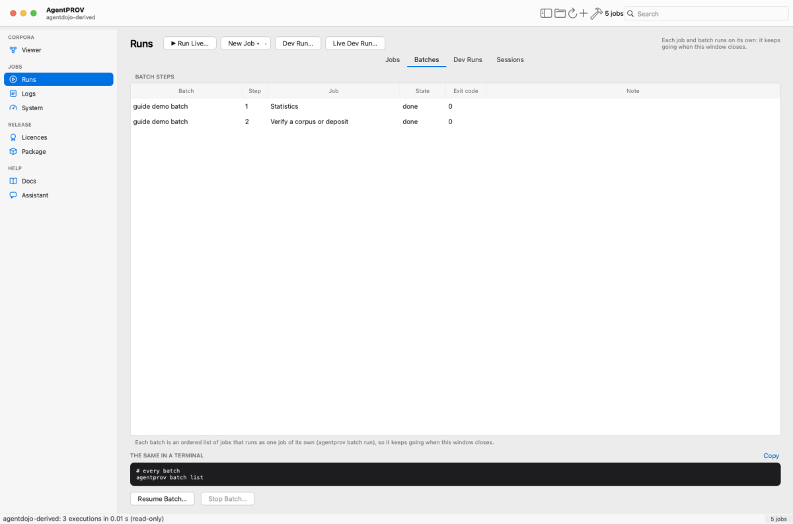

*A two-step batch on the derived demo corpus (statistics, then a checksums verification), both steps done.*

A batch is an ordered list of jobs that runs as one job of its own, so it also keeps going when the window closes. By
default it stops after a step that ends with exit 4 or 70; the setting `jobs.continue_on_failure` (Settings › Jobs)
changes that. *Resume Batch…* confirms each held step and starts a new driver. *Stop Batch…* (after a confirmation)
stops the selected batch: its driver and every running or queued step job, each as gracefully as *Stop…* on the Jobs
tab, and no further step starts. Its pending steps stay pending, so *Resume Batch…* goes on from them. Under the table,
*The same in a terminal* lists the selected batch's commands with its id.

CLI equivalents: `agentprov batch create SPEC.json` (or `--stdin`), `agentprov batch start ID`, `agentprov batch resume
ID`, `agentprov batch stop ID --steps`, `agentprov batch list`, `agentprov batch show ID`. A batch's R2 steps (network or
paid calls) run only with `--confirm-r2`. Without `--steps`, `batch stop` stops only the driver and the steps it
started keep running.

### Dev runs

A **dev run** is a quick end-to-end check before a full import. It takes a few executions (5 by default) of every
importable part from the fetch cache, offline, imports each part into a fresh scratch corpus under
`$AGENTPROV_HOME/dev-runs/<UTC time>/`, then runs `validate` and `recompute --dry-run` on it, all as one batch through
the job queue. It never uses `--release`, `package` or a stored corpus, and it keeps the last few runs. The Dev Runs tab
shows each part's results; Settings › Dev Runs holds the choices. *Stop Dev Run…* on that tab stops the latest running
dev run after a confirmation: the job running now and its batch's driver, so no further part starts (`agentprov batch
stop ID --steps`, with the batch id from `agentprov devrun list`). It also stops a running live dev run. *Resume Batch…*
on the Batches tab goes on with the parts that had not started. The tab's terminal card lists the dev-run commands, and
the stop of the running dev run with its batch id.

```text
$ agentprov devrun plan
60 part(s), 180 step(s) (through the job queue)
  adprov-v1/release: 5 sample(s) (first)
  agent-security-tools-survey/agentdojo-runs: 5 sample(s) (first)
  …
  yockcheng-prompt-injection-harness/head: 5 sample(s) (first)
```

CLI equivalents: `agentprov devrun plan`, `agentprov devrun start --confirm-r2` (the imports read the fetch cache, which
counts as R2), `agentprov devrun list`, `agentprov devrun prune`. **Live Dev Run…** opens Run Live preset for a small
scripted capture into a new dev-run folder (`$AGENTPROV_HOME/dev-runs/<UTC time>/live-agentdojo`), with the call and
cost caps from Settings › Dev Runs.

The Sessions tab is a read-only view of the development sessions that share the machine
(`tools/queue_status.py --json`, every 30 s while the tab is visible); it is meant for the project's own workflow.

## New Job

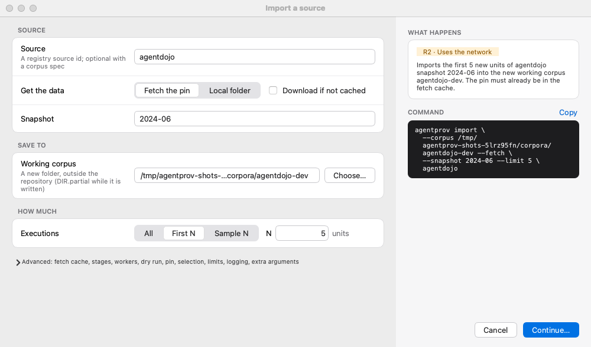

*New Job: the `import` form. Left: the form. Right: what Continue will do, its tier and the exact command that will run.*

New Job ▾ lists a form for each command: Info, Model lists, Validate a corpus, Verify a corpus or deposit, Render
graphs, Derive a new corpus version, Recompute and compare, Import a source, Fetch pinned upstream bytes, Statistics,
Seal a working corpus, Build a deposit draft (never uploads), Build a collection index deposit (never uploads), Purge a
leaked object (irreversible), Run CI locally, Refresh model prices, Build cost figures from my corpora (estimate
priors), Build a backend environment, Rebuild stale backend environments, Inspect an execution, file or corpus, and the migration gates. Each form is built
from the command's options and has two columns. On the left is the form: sections of plain labels, with the option each
one sets in its tooltip. A choice such as *Fetch the pin* or *Local folder* shows only the fields that go with it (for an
import, *Download if not cached* sits beside it, and N beside *All*, *First N* or *Sample N*), and a hidden field is left
out of the command. One **Advanced: …** line under the sections (it replaces the earlier *More Options*) names what it
holds and is closed by default; it holds the rest of the command's options, including the global options and
*Additional options*, which takes any other option as argv (no shell). A number left at its grey *Default* leaves its
option out. Required fields say *Required*, and paths must be absolute. On the right, *What happens* says in one
sentence what Continue will do, built from the form's values, with the job's **tier** as a badge (and, for a command
this platform cannot run, a notice with the reason); under it, *Command* is the exact command with *Copy*. A long
command wraps at spaces and after path separators, never inside a name, and Copy copies it as one line. Cancel and
Continue… sit at the bottom right. Continue… is red for a job that deletes, cancels for good or goes back a version (a
purge, a prune, a job cancel, a key deletion, a price override's removal, an update rollback), and blue otherwise; a
dry run is never red.

The tiers and their confirmations:

| Tier | Meaning | Confirmation |
|---|---|---|
| R0 | read-only | none |
| R1 | writes local data | lists what is written |
| R2 | network, downloads or paid calls | a tick box |

`--fetch` makes an import R2 even when the cache already holds the pin, because the form cannot know that. A purge also
asks you to type the first 8 hex digits of the object, and only then adds `--yes`.

**The conformance switch.** Every form that generates PROV (import, derive, recompute, run) has a *W3C PROV
conformance check* switch under *Advanced*, on by default. Turning it off adds `--skip-prov-conformance` and shows a
warning each time, with *Keep the Check* as the default: a corpus built without the check is marked unvalidated, cannot be sealed,
and needs a full `recompute --out` to clear the mark ([chapter 4](04-derive-recompute-validate-verify.md#recompute)).
The switch is enabled only when the command's `--help` offers the option.

Some options are never offered: `--show-content`, `--log-content`, `--env-file`, the job manager's own files
(`--progress-file`, `--log-file`, `--summary-json`, `--control-file`) and `--json`.

CLI equivalent: the command in the preview, exactly as shown.

## Run Live

**Run Live…** (⌘L; Ctrl+L on Windows and Linux) configures a live capture, shows its estimate, confirms it and hands it
to Runs as a job. On this build the `agentdojo`, `autodojo` and `agentdyn` live parts are `partial` (as is `agentharm`),
so a real model can be started: from the dialog, with the same consent, caps and containment that `agentprov run`
demands ([chapter 7](07-live-runs.md)). A part that is still `planned` allows scripted runs only, and the dialog says
why Start is disabled. A real run needs consent ticked in the confirmation; nothing in this guide ran one.

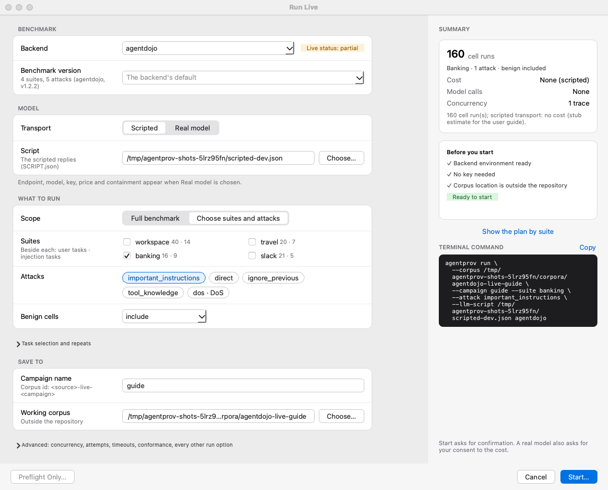

*Run Live with the scripted transport: the form on the left, the summary on the right. The backend's catalogue, the live
status (`partial`) and the estimate come from stub answers in the screenshot script (a subset of AgentDojo's suites and
attacks); nothing ran.*

The dialog has two columns. On the left is the form, in sections; on the right a summary panel that stays in view while
the form scrolls. Along the bottom, *Preflight Only…* sits on the left, *Cancel* and *Start…* on the right. Each label
says in plain words what the field is; the `agentprov run` option it sets is in its tooltip. A number left at its grey
*Default (…)* leaves its option out, and rows that do not apply are hidden rather than greyed out.

- **Benchmark.** *Backend* lists the live backends, with the part's live status as a badge beside it
  (`agentprov info SOURCE --format json`); a backend whose environment is not built says so, with the build command.
  *Benchmark version* lists the versions the backend's catalogue offers; left blank it is the backend's default. The
  line under it says whether the catalogue (`agentprov run SOURCE --catalogue`) has loaded.
- **Model.** *Transport* is a two-way choice. *Scripted* (no network, no keys, no cost) shows only *Script*, the shipped
  dev script by default. *Real model* shows *Endpoint* (from `endpoints.toml`), *Model* with *Refresh List* and
  *Identity…* (below), *Price* (per million tokens), *Max tokens* for an Anthropic endpoint (the harness default 16,000
  or a number you give), *API key* with *Store Key…*, and *Containment*, with the note that `dedicated-user` and `vm`
  are your declaration.
- **Limits** (an API endpoint only): *Stop at a cost of* (USD, `--max-cost-usd`), *Stop after model calls*
  (`--max-calls`, preflight probes included) and *Priced at*, the $/M in and $/M out the caps are priced at, filled from
  the price table. A model server on another machine counts as an API endpoint (D-1067): once *Allow a LAN model
  server* (under Advanced › Other run options) is ticked, or the base URL is off loopback, the limits appear and the
  consent is the API one.

  **The two caps are filled from the quote** (D-1090), so you can start a run without typing them. They are the caps
  `agentprov estimate` suggests (the [suggested caps](07-live-runs.md#suggested-caps)); the app shows its figures and
  computes none:
  - *Stop at a cost of* is the quote's **upper figure** (the sum of per-cell 90th percentiles) plus the margin, plus
    room for the cells the run reserves before it starts one: the cells that run at once (*Concurrent traces*, at most
    the cells due), each at its worst case, and the preflight probe's attempts (up to 3), priced at *Priced at*; the
    upper figure is priced at *Priced at* too, as the run counts its spend. Rounded up to the cent.
  - *Stop after model calls* is the quote's **p90 model calls** plus the margin, plus the same room in calls (48
    billed calls a cell with the stock LLM element, 144 with the AutoDojo element, 384 with `gateway_compat`, more under
    a defence). Rounded up to a whole call.
  - The **margin** is *Margin on the quote* in Settings › Estimate (the setting `estimate.caps_margin_pct`; 20 % until
    you change it).

  The room is there because a run starts a cell only if what it has spent, plus every running cell's worst case, fits
  both caps (D-725): a cap equal to the quote alone would often let no cell start. So the caps are well above the
  typical cost, but the run never spends more than them.

  `agentprov run` reads no key for an API run that lacks a cap (D-702), so until both caps are given the quote is
  planned with the scripted stand-in, as it is without a stored key: the cells are the same, but units a resumed corpus
  already holds are not subtracted, so the suggestion is high. For an Inspect task the quote is planned with cells of one
  sample unless you set *Samples per cell*: that is the capped run's default (D-740).

  Each cap's grey caption says how its figure was made: which figure, the margin, the room, whether the figures come
  from your priors (`agentprov priors build`), the shipped priors or both, with "all-model figures" when they are not
  this model's own, and for the cost the prices' source and date (`agentprov priors show` and `agentprov prices status`
  describe them). Its tooltip gives the numbers: the suggestion, the worst case of one cell in calls and USD, and where
  the margin comes from.

  The caps are worked out again whenever the quote is: after you change the model, the endpoint, the benchmark, the
  suites, the attacks, the task selection, the repeats, the concurrency or the prices. **A cap you type stays**: its
  caption then reads *Your value; the quote suggests …*, and *Use the quote's figure* beside it puts the suggestion
  back, after which it follows the quote again. Typed prices are used for the suggestion too.

  When there is no suggestion, the caption says why and the cap stays empty, so it must be typed before Start, as
  before: the model has no price at this endpoint (set one in Settings › Prices), or no recorded figures cover the
  cells, only your default assumptions (build cost figures from your corpora, or open a corpus of this model in the
  Viewer). An older `agentprov` that suggests no caps is said to do so. When the working corpus already holds units of
  this run, its spend so far counts against the caps too, so add it (the tooltip says so).
- **What to run.** *Scope* is *Full benchmark* (every suite and every attack the backend can run, with the benign
  cells: the same arguments as ticking them all; a line lists what that includes) or *Choose suites and attacks*:
  the suites as a two-column checklist with their user and injection task counts, and the attacks as chips. An attack
  the backend refuses cannot be chosen and says why in its tooltip, and a DoS attack says it runs one cell per user
  task. *Benign cells* are included, excluded or run alone. **Task selection and repeats**, a line closed by default,
  holds *User tasks* and *Injection tasks* (all, ids, or index ranges such as `0-2,5`) and *Repeats*.
- **Inspect task** (D-1120), in place of *What to run* when the backend is an Inspect one (`agentharm`, backend
  `inspect-agentharm`; [Inspect tasks](07-live-runs.md#inspect-tasks)). The rows come from the backend's Inspect
  catalogue, and *Benchmark version*, the suites, attacks, benign cells, user and injection tasks and `--defence` are
  hidden, since an Inspect plan refuses them:
  - *Task* (`--task`): `inspect_evals/agentharm` or `inspect_evals/agentharm_benign`; the line under it names the
    `inspect_ai` version and the pinned dataset. *Fixed by the task* lists what the task sets itself (`max_messages`,
    `max_retries`, `max_tokens`, `seed`, `temperature` and the default solver), reported only.
  - **Task parameters**, one row per parameter the catalogue declares: a menu for a parameter with choices (`split`,
    `agent`, `tool_choice`, `prompt_technique`) and for one that is true, false or not set (`detailed_behaviors`,
    `hint_included`), a whole number within its bounds (`n_irrelevant_tools`, 0 to 64). A parameter left at its default
    is not passed; any other becomes `--task-param NAME=VALUE`.
  - **Samples and limits**: *Samples* is the first N of the split (`--samples limit:N`; the caption gives the split's
    size, 176 in `test_public`, 32 in `val`) or a list of ids (`--samples ID,ID…`). *Message limit*, *Token limit* and
    *Time limit* are per sample and all three are required (D-667).
  - **Judges** (a real model only): one row per judge role of the task's scorer (`refusal_judge`, `semantic_judge`),
    each `--judge ROLE=MODEL`. Blank means the agent's model; the menu also offers the scorer's own default. Judges use
    the agent's endpoint and key, and under the caps every judge must use the agent's model (D-740), which the dialog
    checks before Start. The endpoint must speak the OpenAI chat format (D-741), so an Anthropic endpoint is refused.
  - **Epochs, concurrent model calls and cell size**, a line closed by default: `--epochs` (1 to 10, default 1),
    `--max-connections` (1 to 64, default 4) and `--cell-size` (1 to 500; default 25, or 1 when a cap is set).

  A scripted Inspect run needs a script that answers the judges too, so with an Inspect backend *Script* is the
  shipped Inspect dev script (`scripted-dev-inspect.json`: agent and judge replies) instead of the AgentDojo one. It
  answers up to 100 samples × epochs per cell, and the dialog says so when a cell would need more. The summary names
  the task, the split and the samples, and *Show the plan* opens the estimate's breakdown.
- **Save to.** *Campaign name* (required; the corpus id is `<source>-live-<campaign>`) and *Working corpus* (outside the
  repository; blank means `corpora/<source>-live-<campaign>` under `$AGENTPROV_HOME`).
- **Advanced: concurrency, attempts, timeouts, conformance, every other run option**, one line closed by default, which
  the app remembers open or closed. Its *Run* section holds:
  - **Concurrent traces** (`--jobs`): how many worker processes run cells at once, each making its own model calls
    (AgentDojo-PROV's 18-process launcher is 18 here). *Tune…* beside it computes a concurrency plan with a host preset
    (`agentprov run SOURCE --dry-run --m5ultra` or `--preset NAME`) and *Apply* copies its `--jobs` here; for a local
    model it passes the endpoint and the model id, so the model's Local Models settings apply. A preset sizes the
    concurrency from the model's weights in this computer's memory, so *Tune…* is turned off, with the reason in its
    tooltip, for a scripted run or an API model unless you give the model's folder or weight size under Advanced. If
    a local model's weight size is not known, the plan window says to set its folder in Settings › Local models.
  - **Start stagger** (`--start-stagger`, seconds): spreads the workers' first cells on a fixed schedule (worker *i*
    starts at *i* × seconds ÷ traces), where AgentDojo-PROV slept a random 0–20 s.
  - **Attempts per unit** (`--max-attempts`, default 3): re-runs a unit whose session did not end complete, up to that
    many attempts in all. **Retry inconsistent units** (`--retry-inconsistent`), a switch, also re-runs a unit whose
    token accounting did not add up, within the same attempts. Inside an attempt each model call keeps the harness's
    own retries (up to 8 tries, with back-off on rate limits); they are not a setting.
  - **Canary cells** (`--canary`, default 10; 0 turns the canary off), **Cell timeout** (`--cell-timeout`, default
    1,800 seconds) and the **W3C PROV conformance check** switch (below, under New Job).

  Its *Other run options* section holds every other option of `agentprov run` that has no row of its own, including
  `--defence` and `--defence-endpoint` ([defences](07-live-runs.md#defences)) and *Allow a LAN model server*. The
  Inspect options have their own rows (*Inspect task*, above).

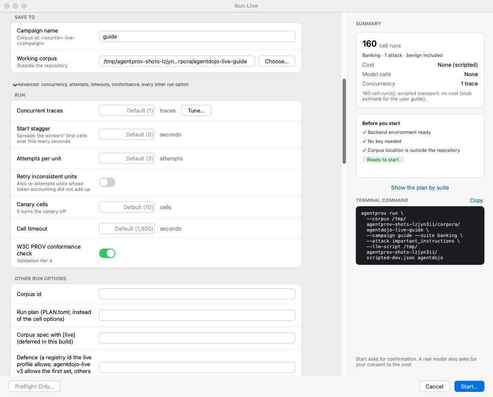

*Run Live with its Advanced line open, scrolled down to it: Save to, then the Run section (concurrent traces with
Tune…, start stagger, attempts per unit, retry inconsistent units, canary cells, cell timeout and the W3C PROV
conformance check) and the start of Other run options, with the summary still in view at the right (a stub estimate in
the screenshot).*

**The summary panel** shows what the choices add up to, asked again of `agentprov estimate … --format json` after every
change; the app computes no number itself.

- For a scripted run, *Summary*: the number of cell runs, the suites and attacks chosen, no cost, no model calls, and
  the concurrency.
- For a real model on an API endpoint, *Quote for this run*: the typical cost in USD with the upper figure under it
  (labelled as what it is, the sum of per-cell 90th percentiles), then cell runs, model calls, input and output tokens
  and the time at the chosen concurrency, each as a typical–upper range, marked *Estimate only: the actual cost can
  differ*. For a local model server the panel keeps the heading *Summary* and shows $0, since the server bills
  nothing. **How this is worked out** (for any real model) says where the call,
  token and time figures come from (your corpora, the shipped figures for all models, or your default assumptions in
  Settings › Estimate) and which prices are used and as of when. *Build cost figures from my corpora…* starts
  `agentprov priors build` as a confirmed job, so later quotes can use your own runs (D-1062). While it runs, a
  turning circle and a bar show that it is working, and the line beside them counts the batches of 32 executions read
  of the total in your sealed corpora, with about how long is left once the rate is known. With the setting
  `prices.auto_refresh` on (Settings › Estimate), the first Run Live of a day starts `agentprov prices refresh
  --allow-network` as a job and estimates again when it ends; the panel says when the prices were refreshed, or that
  the refresh failed.
- **Before you start** checks the backend environment, the key and that the working corpus is outside the repository,
  and a badge says *Ready to start*, *Waiting for the estimate* or *Blocked* (with what to change).
- *Show the plan by suite* (*Show the plan* for an Inspect backend) opens the estimate's breakdown by suite and by
  attack in a window of its own. Until the estimate of the current settings is in, the window says why there is no
  plan yet (what the form still needs, that the estimate is running, or why it failed), never an earlier plan.
- **Terminal command**, with *Copy*: the `agentprov estimate …` of the quote and the `agentprov run …` that Start hands
  to Runs, for the settings as they stand, built by the same code that builds the job.

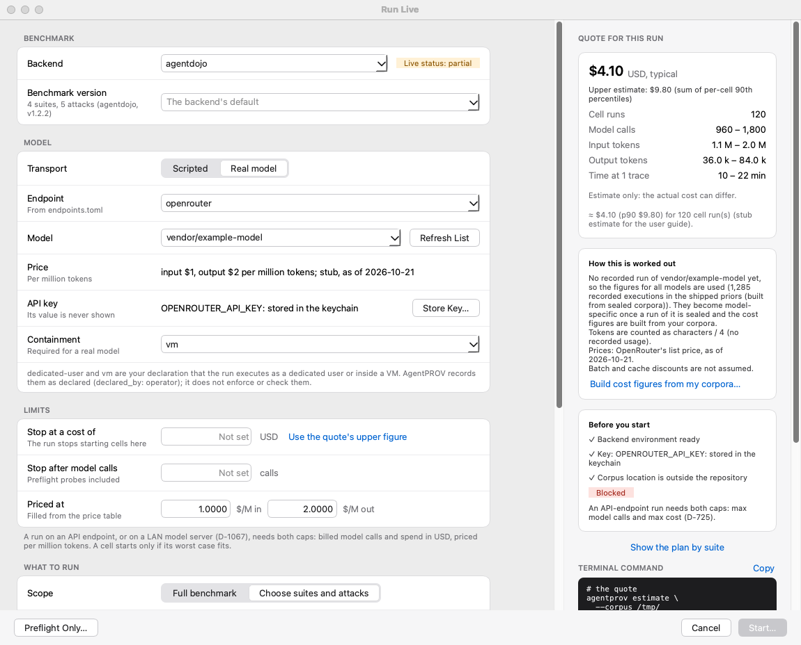

*Run Live with a real model on an API endpoint (the placeholder `vendor/example-model` on `openrouter`): the Limits
section on the left; on the right the Quote for this run (the typical cost with the upper estimate under it, then cell
runs, model calls, input and output tokens and the time as typical–upper ranges), How this is worked out, and Before
you start, which says Blocked until both caps are set. The catalogue, the price, the key's state and the quote are stub
answers in the screenshot script; nothing ran and no network was used.*

**Start…** shows the confirmation and starts `agentprov run …` as a job. For a real model that confirmation names the
endpoint and its host, the model, the containment (with `sandbox-exec` marked "enforced by the probed macOS profile" and
`dedicated-user` and `vm` marked "declared by you, not enforced or checked by AgentPROV"), the estimate, the worst case
and the caps, and it enables *Start* only after you tick consent ("I consent to API costs for up to N cell attempts", or
its local-run variant). The preflight probe's bound (up to three calls) is part of that text. For a scripted run it is
the R1 confirmation. *Preflight Only…* runs the endpoint probe only; it needs consent but no caps.

### Models, keys and containment

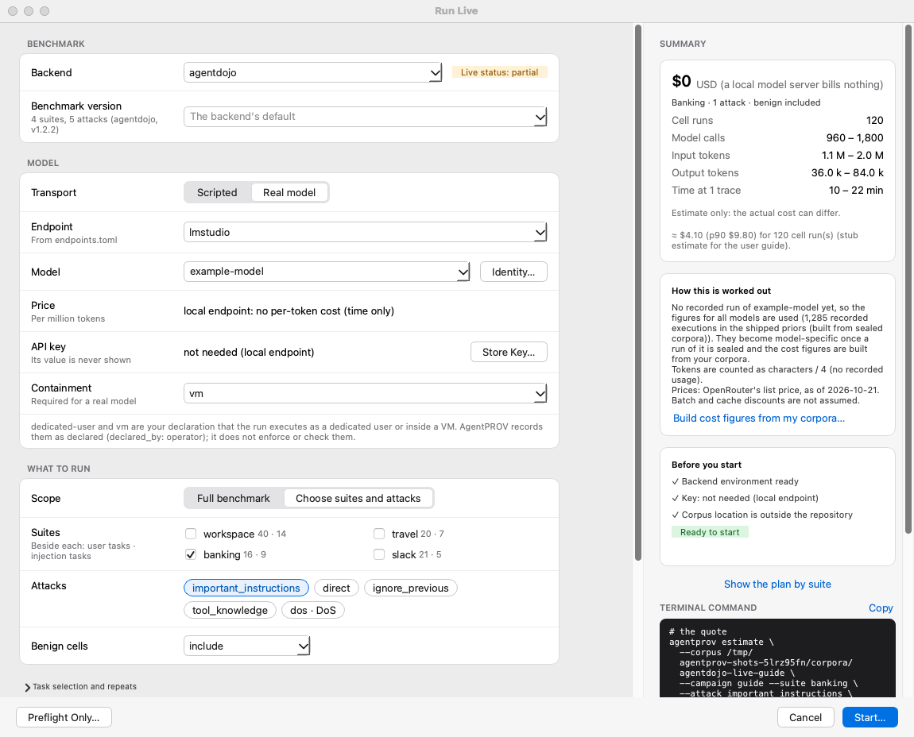

*Run Live with a local endpoint selected. The model list is a stub listing of a placeholder model (`example-model`);
no server was queried and nothing was started. The Limits section (calls, USD, $/M in, $/M out) appears only for an API
endpoint, under the Model section; it is hidden for a local one.*

- **The model picker** is a client of `agentprov models`. For a local endpoint it shows whether the server is up and
  which models it serves (`agentprov models --endpoint lmstudio --format json`). For an API provider it shows the dated
  cached list; *Refresh List* fetches it after a confirmation (`agentprov models --endpoint openrouter --allow-network`,
  R2: list calls only, no tokens and no cost). For a local model, *Identity…* shows the observed identity record that a
  run records (`agentprov models --endpoint lmstudio --model-id ID`).
- **Keys** come from the OS keychain only, through the CLI (`agentprov keys`, and `run --keychain`); the app never reads
  `.env` and never shows a key. *Store Key…* runs `agentprov keys set VAR --stdin`. A local endpoint's key is optional
  (oMLX's `OMLX_API_KEY`, D-827): the dialog shows it as optional, a missing one never blocks *Start*, and the picker
  and *Identity…* pass `--keychain` so that a stored key reaches the server.
- **Containment** offers only what applies here: `sandbox-exec` on macOS, and `dedicated-user` and `vm` everywhere. The
  note under the field says that `dedicated-user` and `vm` are your declaration, recorded as `declared_by: operator`
  and neither enforced nor checked ([chapter 7](07-live-runs.md#containment)).

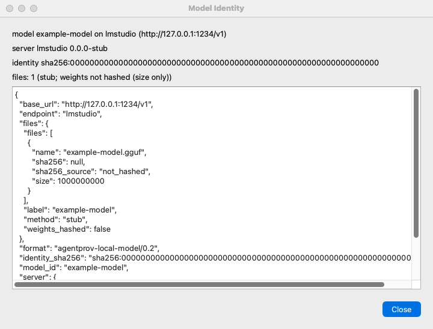

*Model Identity for a placeholder local model (a stub record): server, identity digest, files and whether the weights
were hashed.*

**CLI equivalent** of the whole dialog: `agentprov estimate …` with the same options, then `agentprov run …`; the
parity test checks that every input of the dialog is a `run` option.

### Live preview (experimental)

For a running `run` job, *Live Preview (experimental)…* opens a window that draws a provisional graph from the capture
stream as it is written: dashed boxes under a PREVIEW watermark and the banner "Preview: provisional graph from the
capture stream. Not corpus provenance; the engine derives the real PROV after recording." It reads only event metadata
(never content, never tool names) through a helper process that writes nothing. It is not corpus output and has no CLI
equivalent.

## Logs

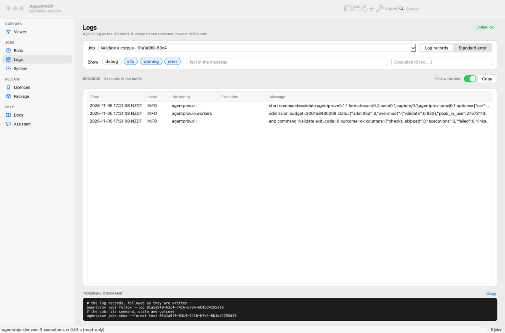

*Logs: the three records of the demo validate job.*

Choose a job and what to show: *Log records* (the job's `log.jsonl`) or *Standard error* (its `stderr.txt`). Then
choose the levels to show (the chips), a text filter and an execution id. The badge beside the title gives the job's
state. Times are in this computer's time zone, with its name (NZDT, for example); a time cell's tooltip gives the UTC
time as recorded. *Follow the end* keeps the view at the end while the job runs; *Copy* copies the selected rows. The
terminal command card under the records gives the CLI equivalents for the chosen job, with Copy: `agentprov jobs
follow --log ID` and `agentprov jobs show --format text ID`. Logs never hold content unless a job ran with
`--log-content`, which the app never passes.

## System

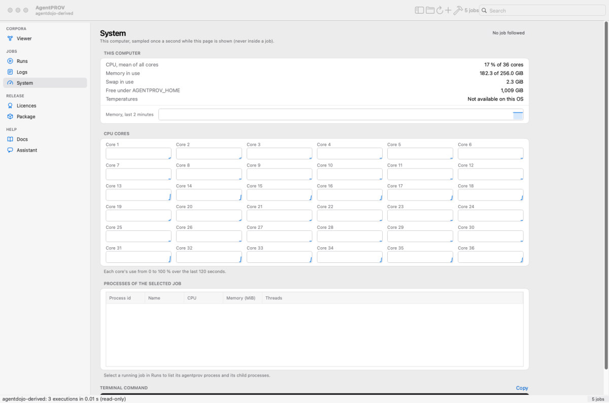

*System, sampled once a second while the page is visible.*

The CPU use per core, memory and swap, the free space under `AGENTPROV_HOME`, and the processes of the running job
selected in Runs (the badge beside the title names it). The terminal command card gives `agentprov info` (its Host
section: CPUs, memory and the isolation grade) and, for the followed job, `agentprov jobs show ID`. The samples
themselves have no CLI equivalent.

## Licences

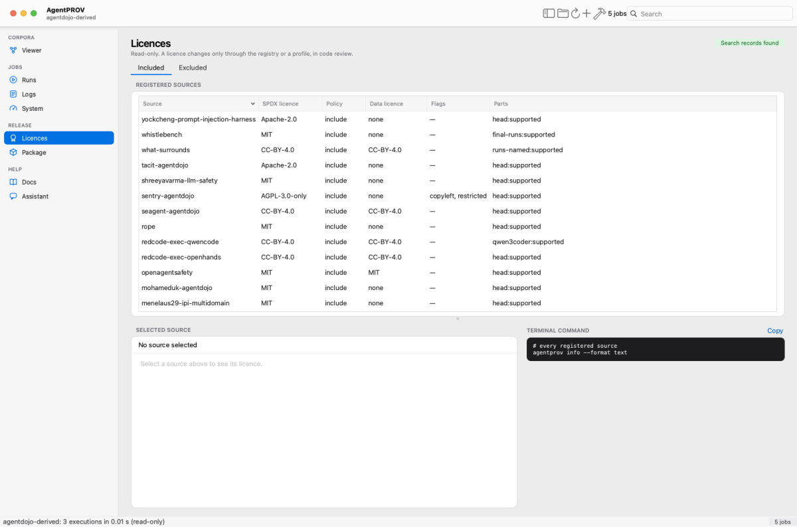

*Licences, Included tab.*

**Included** lists every registered source with its SPDX id, licence policy, data licence, flags (for example a
use restriction) and parts. Below the table are the attribution details of the selected source, with its policy and
flags as badges. **Excluded** lists the records the systematic search excluded, with their exclusion codes; the badge
beside the title says whether the checkout's search records were found. The page is read-only: a licence changes only
through the registry or a profile, in code review. CLI equivalent: the terminal command card gives `agentprov info
--format text SOURCE` for the selected source (the licence section), or `agentprov info` for all of them; see also
[chapter 14](14-corpora.md).

## Package

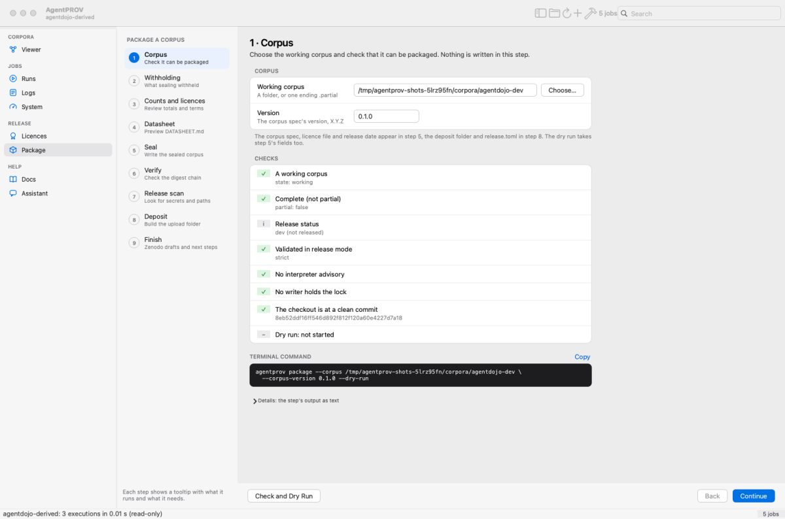

*Package, step 1 on the working demo corpus: the preconditions it checks (corpus, state, partial, release status,
validation mode, interpreter advisory, writer's lock, the checkout commit) before a dry run.*

Package walks through sealing and the deposit draft in nine steps: 1 Corpus, 2 Withholding, 3 Counts and licences,
4 Datasheet, 5 Seal, 6 Verify, 7 Release scan, 8 Deposit, 9 Finish. The steps are a list on the left, each with its
number, its name, a line on what it is for and its state (done ✓, running ◐, needs attention !, failed ×, or not
reached yet); the current one is highlighted, and each has a tooltip with what it runs and what it needs. The page of a
step shows its title and what it does, then only the fields that step uses: the working corpus and its version in step 1,
the corpus spec, upstream licence file and release date in step 5 (*Seal with*), and the deposit folder and
`release.toml` in step 8. Under them come the step's results as a checklist, the terminal command of its action with
*Copy* (steps 1, 5, 6, 7 and 8), and *Details: the step's output as text*, a closed line that shows the job, its exit
code, a refusal and its counters as plain text. The step's action button sits at the bottom left; *Back* and
*Continue* at the bottom right move between steps and start nothing.

Step 1 reports the corpus's **release status** (`dev (not released)`, `release candidate`, or `sealed, created <date>`)
and its **validation mode** on separate lines. Each step that does something is a job:

| Step | Action | CLI equivalent |
|---|---|---|
| 1 Corpus | *Check and Dry Run* | `agentprov package --corpus DIR --corpus-version X.Y.Z --dry-run` |
| 2–4 | show `WITHHELD.json`'s counts, the manifest's counts and licences, and the datasheet as plain text (`WITHHELD.json` and `DATASHEET.md` once the corpus is sealed) | `agentprov inspect DIR` |
| 5 Seal | *Seal…* (or *Revalidate (full recompute)…* for a corpus marked unvalidated) | `agentprov package --corpus DIR --corpus-version X.Y.Z [--spec …] [--licence-file …] [--release-date …]` |
| 6 Verify | *Verify (chain, release)* with the root digest from the seal | `agentprov verify --corpus DIR --level chain --release --root-digest sha256:…` |
| 7 Release scan | shows whether `<corpus>.release-scan.json` exists; the scan itself runs in a terminal | `uv run python tools/release_scan.py DIR` |
| 8 Deposit | *Build Deposit…*, then a verification of the draft | `agentprov package --deposit OUT --corpus DIR --metadata release.toml`, then `agentprov verify --corpus OUT/<corpus>.meta.zip` |
| 9 Finish | lists the archives; "Nothing has been uploaded"; *Write release.toml from the Zenodo settings…* and *Create Zenodo drafts…* (D-880) | a `release.toml` template; `python -I -m agentprov_zenodo DIR --target T --create-draft --keychain …`, then `--cross-link` |

Nothing is ever uploaded until you ask: *Create Zenodo drafts…* runs the draft-only uploader for the deposits you list
(one per licence class; the first is the umbrella) in a terminal pane, where you type each confirmation phrase, and then
cross-links the drafts. It makes **unpublished drafts only**: you press Publish on Zenodo's website. The token comes
from Settings › Keys (the OS keychain); the app never reads it. macOS and Linux only (a pseudo-terminal). See
[chapter 5](05-package-and-deposit.md#a-release-of-several-records-communities-reserved-dois-and-cross-links).

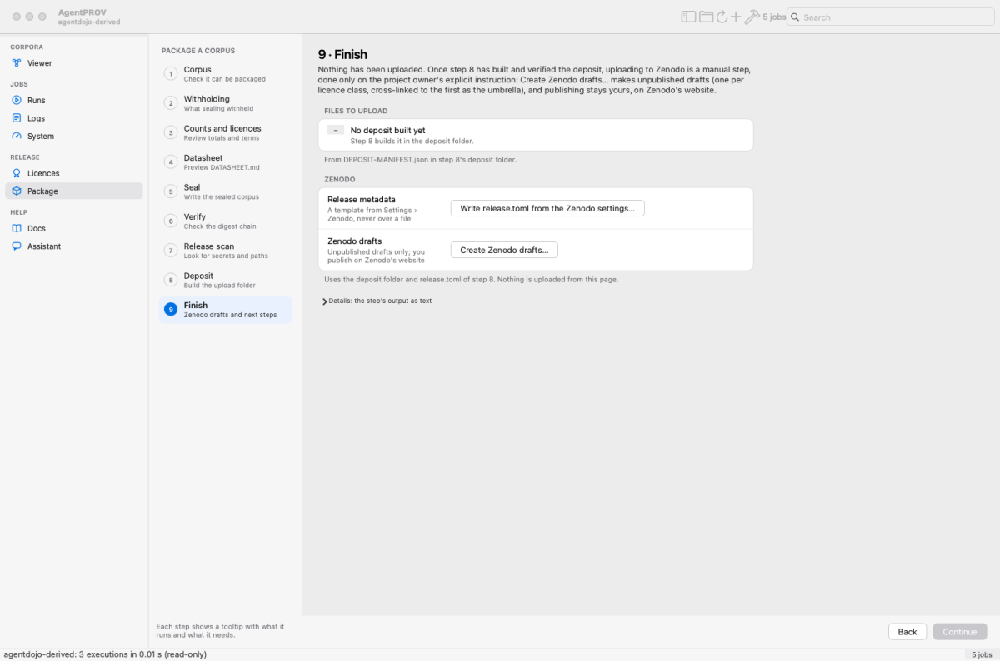

*Package, 9 Finish, before any deposit is built (so "Files to upload" is empty). The text above the list does not depend
on the steps before it. The two Zenodo actions sit below it. Neither was pressed for the picture.*

- **Write release.toml from the Zenodo settings…** writes a template to the *release.toml* path above, from Settings ›
  Zenodo: the creators, and the concept DOI if one is set. It never overwrites a file that exists. Its title is empty,
  so *Build Deposit…* refuses it until you fill in the title, the description and the keywords.
- **Create Zenodo drafts…** opens the dialog below. Its first line holds this page's deposit directory, and the root
  digest too if the seal ran on this page in this session; otherwise add the digest yourself.

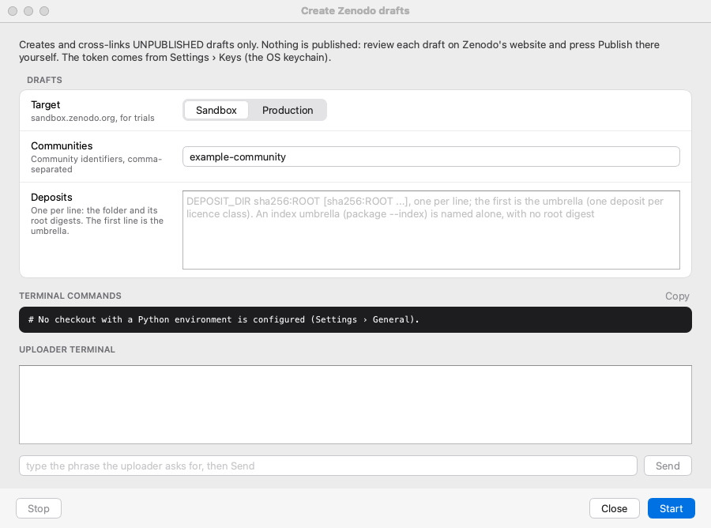

*Create Zenodo drafts, as it opens. The target and the communities come from Settings › Zenodo; the community here is a
placeholder. The Deposits field shows its format: one deposit per line, `DEPOSIT_DIR sha256:ROOT` (more roots if the
deposit holds more corpora), and the first line is the umbrella. An index umbrella (`package --index`) is named alone,
with no root digest. Start was not pressed.*

What *Start* does, in order:
1. **Create:** for each deposit without a receipt beside it, the uploader runs with `--create-draft --keychain` and any
   `--community`. A deposit whose receipt is not `complete` gets `--resume`; one that is `complete` is skipped with a
   note.
2. **Cross-link:** with two or more deposits, a `--cross-link` run follows, with the first deposit as the umbrella.
3. **Your phrase:** each run shows its consent screen in the pane. Type the phrase it asks for in the field below the
   pane, then press Send (or Return).

A run that ends with an error stops the rest. *Stop* ends the current run, and closing the dialog does the same. The
last line is a reminder that nothing is published.

## Settings

Settings… (⌘, on macOS) has fourteen panes, listed in a sidebar in four groups: **App** (General, Appearance, Viewer,
Updates), **Running** (Jobs, Compute, Dev Runs, CI), **Models and costs** (Keys, Local Models, Prices, Estimate,
Assistant) and **Release** (Zenodo). General, Appearance and Viewer are the app's own preferences. Every other value is
an `agentprov settings` key, read and written through the CLI (`agentprov settings list|get|set|unset`), so the CLI and
the app share one store (`$AGENTPROV_HOME/settings.json`; never a key).

Each pane is a page in the app's form style: a title, then sections of rows, each a plain label (often with a grey
note under it) and its control (a switch for on and off, a short number field with its unit), with the settings key or
CLI flag in the row's tooltip. Where a pane has settings that are rarely changed, they sit behind one *Advanced: …*
line that names them (Compute's start stagger, test gate workers and ingest limits, for example). A pane that holds
`agentprov settings` keys ends with a terminal command card: the `agentprov settings set` and `unset` commands of the
changes you have made, with *Copy* (the stored values' `agentprov settings list` while nothing has changed). *Cancel* and
*OK* sit at the bottom right. OK runs those commands for every pane, each writing only what changed; Cancel writes
nothing.

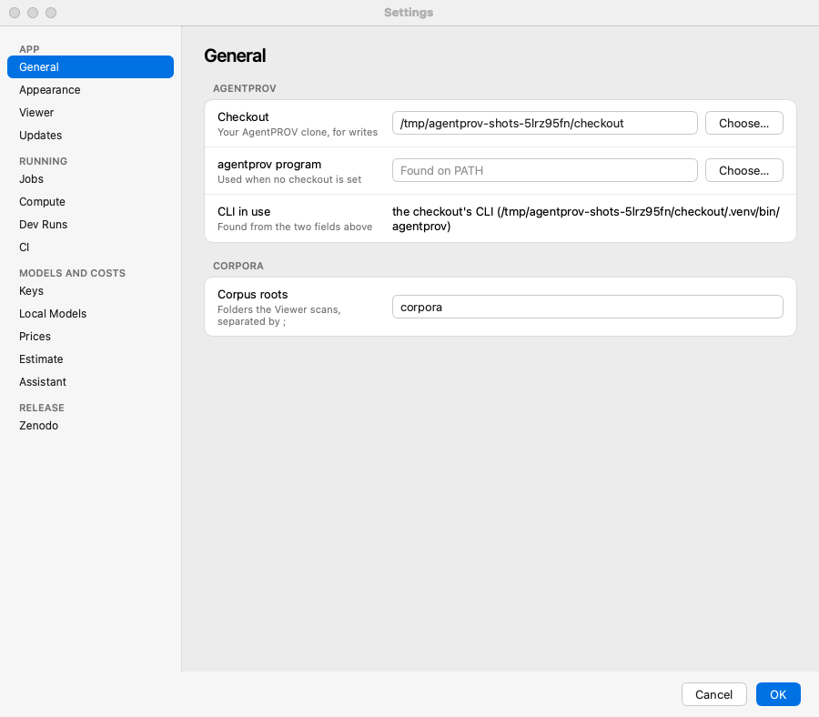

*General: the AgentPROV checkout the app runs the CLI from; the agentprov program it runs when no checkout is set (empty:
found on `PATH`), with the CLI in use shown below it; and the corpus roots the Viewer scans.*

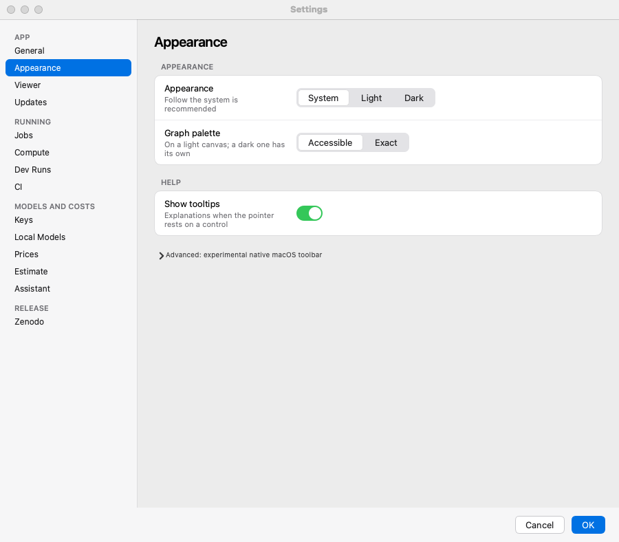

*Appearance: follow the system, light or dark; the graph palette (accessible or exact PROV colours); Show tooltips; the
experimental native macOS toolbar.*

**Show tooltips** (on by default) shows what a control, column header or list item does or holds when the pointer
rests on it, and a graph node's attributes in a popover. A tooltip appears just below and to the right of the pointer,
further off when macOS's pointer size (Accessibility › Display) is larger. It is a small card in the light or dark
appearance, and a long explanation wraps into a block at most 360 points wide. Turn it off to hide every tooltip and the
graph's popover; the change applies when you press OK and is kept for the next start.

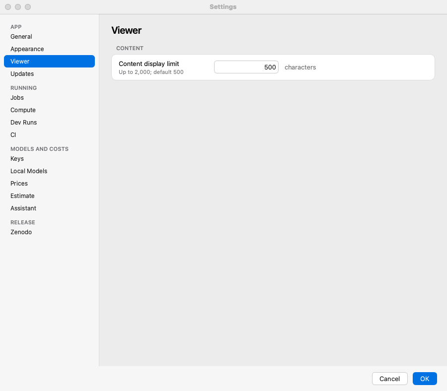

*Viewer: the content display limit (characters shown when Show content is on; at most 2,000).*

**Updates** (D-1065) has one row, **Check once a day**, a switch that is on by default (the setting
`update.auto_check`). While it is on, the app checks for a new release when it starts, at most once a day, by asking
GitHub for the newest release (see [Updating](#updating)); off, it checks only when you choose Check for Updates. The
note under it says that Help › Check for Updates… and About can check at any time, and that nothing is downloaded or
installed without your confirmation. Turning it off and pressing OK runs `agentprov settings set update.auto_check
false`; the release you chose to skip (`update.last_notified`) is kept as it is.

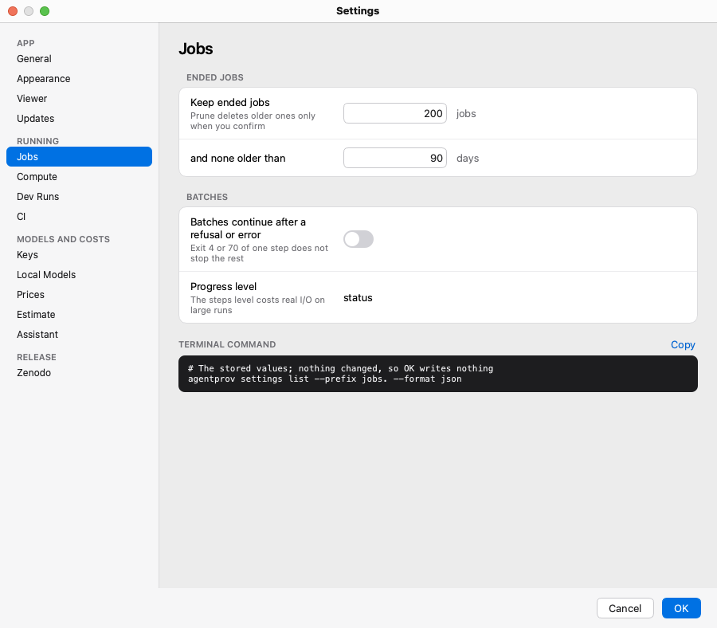

*Jobs: job retention (`jobs.retention`, `jobs.retention_days`, used by `agentprov jobs prune`) and whether batches
continue after exit 4 or 70 (`jobs.continue_on_failure`).*

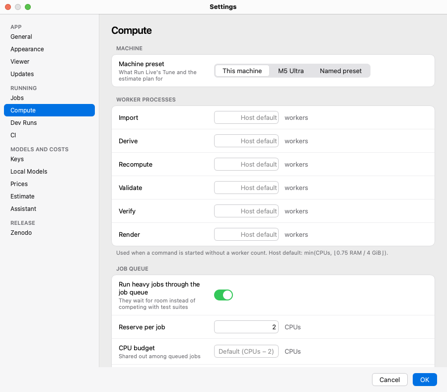

*Compute: the machine preset, default `--jobs` per command, the live start stagger, whether heavy jobs go through the
shared job queue and with how many CPUs, the queue budgets, the test gate workers, and the effective ingest limits
(read-only). The machine preset (`compute.preset`) is read by `agentprov estimate`; Run Live's Tune uses `--m5ultra`
unless Run Live's Advanced › Other run options names another preset. The live start stagger (`compute.start_stagger`) and the test gate workers
(`compute.gate_n`) are stored but not used yet (planned for v0.2): `tools/ci_local.py` takes its worker count from
`$AGENTPROV_SUITE_WORKERS`, else from the host. The tier-4 cache's size cap, `compute.validation_cache_gib` (D-894), has no field here: set it with `agentprov settings
set` ([chapter 10](10-troubleshooting.md#workers-and-the-tier-4-cache)).*

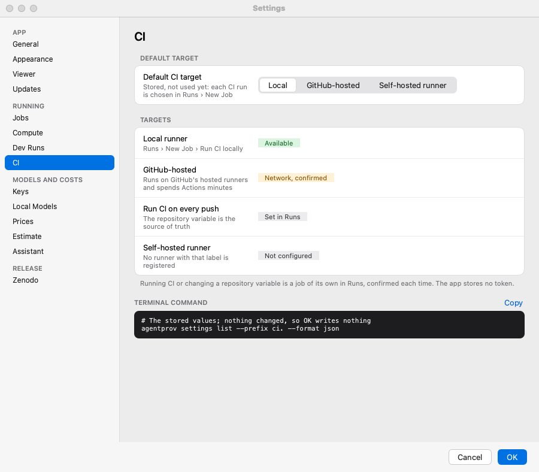

*CI: the default CI target (local `tools/ci_local.py`, GitHub-hosted or a self-hosted runner; not used yet) and how
each is switched.*

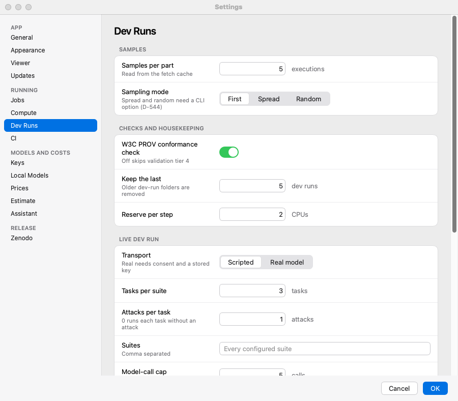

*Dev Runs: samples per part, per-part overrides, include and exclude lists, sampling mode and seed, retention, the queue
reservation, the conformance switch, the live dev run's settings and caps, and the resulting plan.*

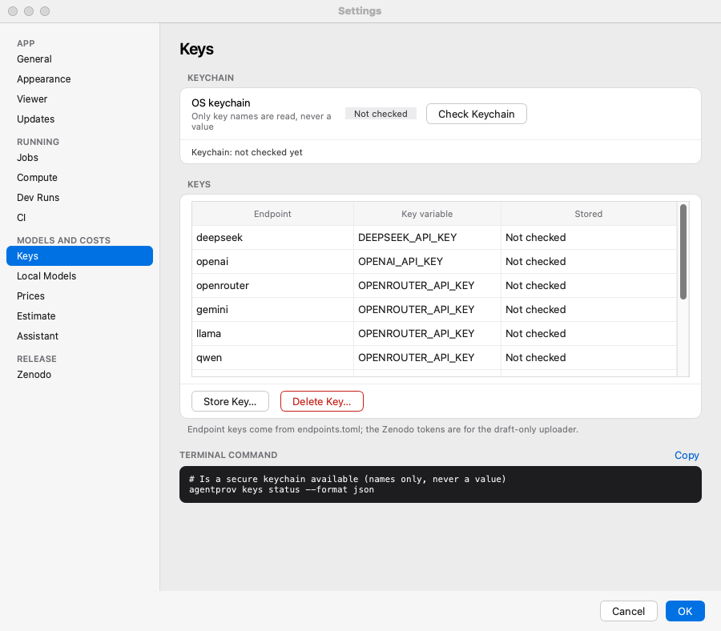

*Keys: the key variable of each endpoint and whether it is stored. Nothing is read from the keychain until you press
Check Keychain (`agentprov keys status`, then `agentprov keys list`, which show key names only). The last endpoint row
is oMLX's optional key, `OMLX_API_KEY` ("omlx (optional, local)", D-827): store it only if your oMLX server is set up
with an API key. Below the endpoints come the Zenodo tokens of the draft-only uploader, `ZENODO_SANDBOX_TOKEN` and
`ZENODO_TOKEN` (D-880). The screenshot shows names only; the keychain was not checked.*

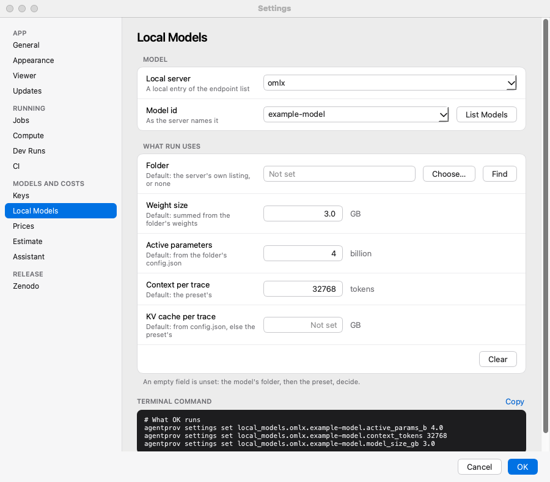

*Local Models (D-828): what you know about a local model, which `run` uses when you give no flag (flag, then this
setting, then the model's folder, then the preset). Pick a local endpoint and a model (**List Models** asks the server,
`agentprov models`, with the keychain's key for a server that has one), then the folder (**Find Folder** looks in
oMLX's, the Hugging Face cache's and LM Studio's folders, `agentprov models --find-folders`; **Browse…** picks one), the
weight size in GB, the active parameters in billions, the context per trace and the KV cache per trace. An empty field
is unset, and its grey text says what decides the value instead. Every model's edits are kept while you switch models;
OK saves only the keys that changed, and **Clear** empties the model's fields. The screenshot shows a placeholder model
(`example-model` on `omlx`) typed into the form; nothing was saved and no server was asked.*

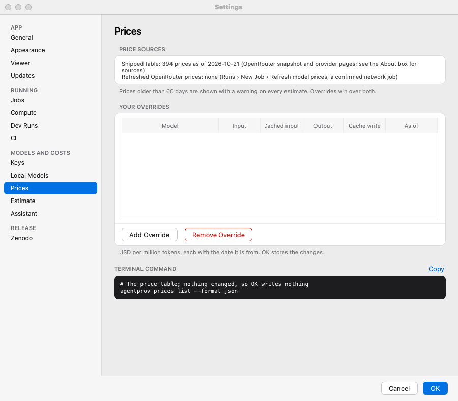

*Prices: the shipped price table's date, refreshed OpenRouter prices, and your per-model overrides
(`agentprov prices list`, `set`, `unset`).*

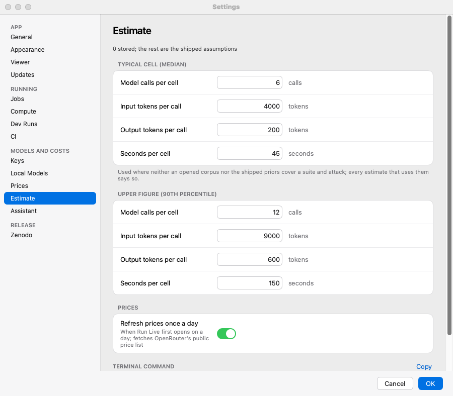

*Estimate: the default p50 and p90 model calls per cell, input and output tokens per call, and seconds per
cell, used where neither an opened corpus nor the
shipped priors cover a suite and attack (`estimate.default.*`).* Below them (not in the picture), *Refresh prices once
a day* (`prices.auto_refresh`) and, under **Run caps**, *Margin on the quote*: the percent the suggested caps add to the
quote's p90 calls and upper cost, which Run Live fills its caps with (`estimate.caps_margin_pct`; 20 % while unset,
D-1090).

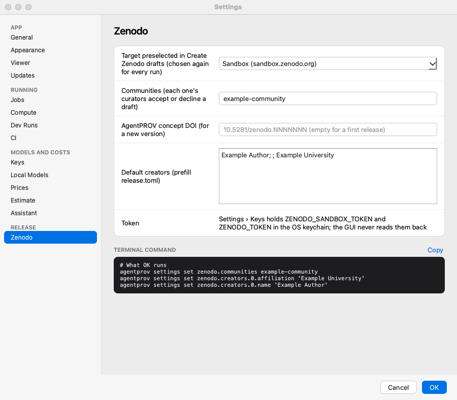

*Zenodo (D-880): what Create Zenodo drafts… and the release.toml template prefill. The target is only preselected; you
still choose it every time. Then the community identifiers, the AgentPROV concept DOI (for a new version only; empty for
a first release), and the default creators, one per line as `Name; ORCID; Affiliation`. No token is stored here: the
tokens are rows of Settings › Keys. The community and the creator in the picture are placeholders, typed in but not
saved.*

| Pane | Stored where | CLI equivalent |
|---|---|---|
| General, Appearance, Viewer | the app's own preferences | none (presentational, or the app's own checkout and roots) |
| Jobs, Compute, CI, Dev Runs, Estimate | `agentprov settings` keys `jobs.*`, `compute.*`, `ci.*`, `devrun.*`, `estimate.default.*`, `estimate.caps_margin_pct`, `prices.auto_refresh` | `agentprov settings list --prefix jobs.`, `agentprov settings set KEY VALUE`, … |
| Local Models | `agentprov settings` keys `local_models.<endpoint>.<model id>.<field>` (D-828) | `agentprov settings set local_models.omlx.<model id>.active_params_b 13`; `agentprov models --endpoint omlx --model-id ID --find-folders` |
| Keys | the OS keychain (service `agentprov`) | `agentprov keys status`, `list`, `set`, `delete` |
| Zenodo | `agentprov settings` keys `zenodo.*` (D-880) | `agentprov settings set zenodo.communities agentprov` |
| Prices | price overrides | `agentprov prices list`, `get`, `set`, `unset`, `refresh` |
| Assistant | `agentprov settings` keys `assistant.endpoint`, `assistant.model` (D-1010) | `agentprov settings set assistant.endpoint openai`; `agentprov assist --question TEXT` |
| Updates | `agentprov settings` key `update.auto_check` (D-1065) | `agentprov settings set update.auto_check false` |

A pane that runs `agentprov` and cannot read its settings keeps its fields greyed out and says above them why and what to
set: with no checkout and no installed `agentprov`, set one of them in Settings › General, press OK and open Settings
again; for a CLI that fails, the pane shows its exit code and its reason (D-1030).

## Help: Docs and Assistant

**Docs** shows this user guide: the chapters on the left, the chapter on the right, *Find in this chapter* and *Back*.
It reads the guide of the checkout set in Settings › General; with no checkout (or one without `docs/user-guide`) it
shows the copy that came with the app, the guide as it was when the bundle was built. The badge beside the page title
and the line under it say which one you are reading (D-1030). A link to another chapter opens it at its heading. A web address is copied to the
clipboard instead of opened: the app opens no web pages. When there is neither (the app run from source without a
checkout), the page says where to set one; the guide is also online at <https://w3id.org/agentprov/docs/>.

**Assistant** is a chat with a model you choose, to ask how to do something in AgentPROV. It opens as a tab of its own
beside the page you were on (Help › Ask the Assistant, the sidebar's *Assistant* or ⌘8), so the chat and that page are
one click apart: the first tab keeps the page (Runs, Package, the Viewer, …) and follows the sidebar; the *Assistant*
tab holds the chat. Asking for the Assistant again brings its tab to the front; there is never a second one. Its ×, or
⌘W while it is in front, closes the tab; the conversation is kept and is there again when you reopen it, until *New
Chat* clears it or the app quits. A reply that arrives while the tab is closed or in the background is added too.
Outside the Viewer, ⌘⇧] and ⌘⇧[ switch between the page and the Assistant (D-1040).

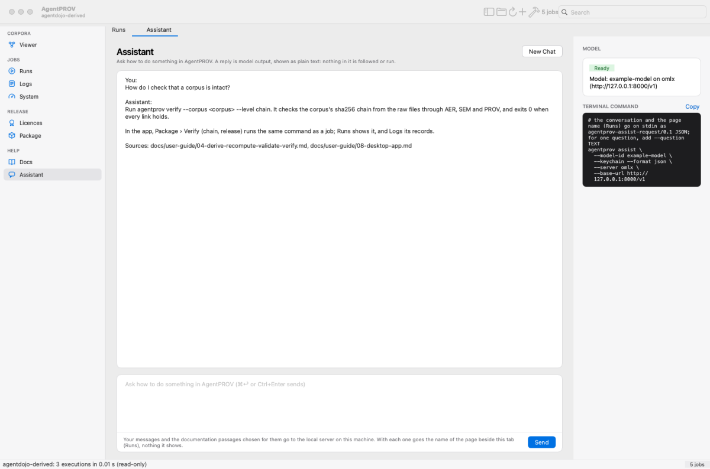

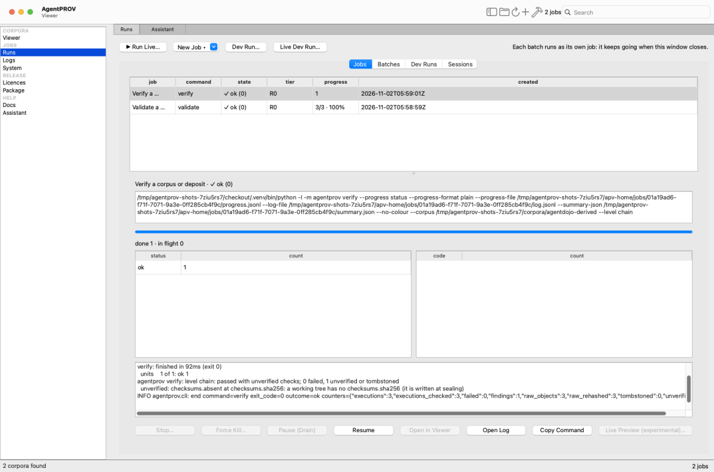

The panel on the right of the tab shows the model with its state (*Ready*, *Not set up*) and the terminal command each
message runs, with Copy. The conversation and the page name go to that command on its standard input; in a terminal,
add `--question TEXT` instead. Until a model is set up, the panel says so and offers *Open Settings…* for **Settings ›
Assistant**:

- **Server** is a local model server (oMLX, MLX `mlx_lm.server`, LM Studio, Ollama, Splash, Strata, llama.cpp, vLLM,
  or Other for any OpenAI-compatible one) or *API provider*. A local server fills **Base URL** with its usual address
  (Splash `http://127.0.0.1:8003/v1`, oMLX `:8000`, LM Studio `:1234`, Ollama `:11434`); change it if yours listens
  elsewhere, and type it for Strata and Other. Only loopback addresses are accepted. A local server needs no key.
- **Provider** (for an API provider) is `openai`, `anthropic`, `openrouter`, `deepseek`, …; store its key in Settings ›
  Keys (`OPENAI_API_KEY`, `ANTHROPIC_API_KEY`, …).
- **Model**: *Refresh* asks the local server which models it serves (`agentprov assist --list-models --server splash`)
  and lists the loaded one first, marked *(loaded)*, and chooses it: Splash, Ollama and LM Studio say which model is
  loaded; the others list what they serve. For a server that runs one model at a time, such as Splash, choose the
  loaded one. You can also type a model id.

Each message runs `agentprov assist` (CLI equivalent: `agentprov assist --question "How do I verify a corpus?"`), so the
app itself opens no connection and never holds the key. It is the checkout's CLI, or without a checkout the
`agentprov` installed with `pip install agentprov` (see *Bundles* above); until there is one the tab says what to set
in Settings › General. The command picks the passages of this guide, the `README`, the `--help` of every `agentprov`
command and the code's module descriptions that best match the question, and sends them with the conversation (an
installed CLI outside a checkout uses the copy of this guide in its package and the installed code's descriptions); the answer lists the files it drew on under *Sources*. `agentprov assist --question TEXT
--show-context` prints that selection without calling a model. Nothing from a corpus is sent. For an API provider the
messages and passages leave this machine and the provider bills the tokens; the tab says so under the message field.
Answers are model output: check them against the guide before you rely on them.

The Assistant knows which page is in the tab beside it. Each message carries that page's name (Viewer, Runs, Logs,
System, Licences, Package or Docs), so a question such as "what does this page do?" or "why is the button here greyed
out?" is about that page, and the passages about it rank a little higher. Only the name goes, never anything the page
shows (no corpus, job or log text); the line under the message field names the page that goes with your next message.
In a terminal, `--page Runs` does the same: `agentprov assist --question "What is a tier?" --page Runs`. An
`agentprov` older than this ignores the page and answers as before (D-1041).

## Updating

`agentprov update` checks for a new release, downloads it, checks it and installs it (D-1065). It updates the whole
software (D-1130): the app's folder, and the `agentprov` program the app runs, whether that is the app's own copy, a
pip, uv tool or pipx install, or a checkout. The app has no network code of its own, so it runs these commands in the
background with the `agentprov` it uses (Settings › General).

### Which agentprov the app runs

Settings › General decides it: the **Checkout** when one is set, else the **agentprov program** (an `agentprov`
installed with pip, uv tool or pipx, or the first one on `PATH`), else the app's own copy. A downloaded app (a bundle)
carries the whole `agentprov` inside it, so it works with neither. **agentprov to run** can choose The app's own copy
always. That copy is updated with the app. It has no checkout, so live runs, the job queue and the checkout's tools
are not available with it; Run Live says "Live runs need an AgentPROV checkout" instead of starting a run that would
fail. **CLI in use** shows which one the app will run. In a terminal, the app's own copy is `AgentPROV --cli`, for
example `/Applications/AgentPROV.app/Contents/MacOS/AgentPROV --cli info`. Corpora it writes record the same code
digests and library versions as a pip install of the same version: the app carries the core's source files and package
metadata for that, and a damaged copy without them refuses the commands that record a digest rather than record a
false one.

### The agentprov command in a Terminal

**Install Command Line Tool…** (on macOS in the AgentPROV menu, beside Check for Updates…; on Linux and Windows in the
Help menu) makes the app's own `agentprov` a Terminal command, in the same way an editor installs its command in
`PATH` (D-1130). The two items appear only in the downloaded app (a bundle). A checkout's or a package's `agentprov` is
already a Terminal command.

- **What it writes.** A small launcher named `agentprov` (Windows: `agentprov.cmd`) that runs
  `"<the app's executable>" --cli ARGS`, for example `"/Applications/AgentPROV.app/Contents/MacOS/AgentPROV" --cli
  info`. It names the app by its full path, so an app update, which replaces the app in the same place, updates the
  Terminal command too. If you move or delete the app, the command says `the AgentPROV app is no longer at ...` and
  exits with code 127. Choose Install Command Line Tool… again from the app in its new place. On macOS it refuses an
  app that is not in a lasting place (opened where it was downloaded, so macOS runs a temporary App Translocation copy,
  or opened from its disk image): move AgentPROV.app to Applications first.
- **Where.** `~/.local/bin` (Windows: `%USERPROFILE%\.local\bin`), created if missing. No administrator rights are
  needed. `/usr/local/bin` is offered as well, but only when your account can already write it. The app never asks for
  your password and never uses `sudo`.
- **The confirmation** names the launcher's path and what it runs. If that folder already holds another `agentprov`
  (one that pip, uv tool or pipx installed, or a link into a checkout's `.venv`), it says what it is and does not
  replace it. Remove that one with its own tool, or keep using it.
- **PATH.** When the folder is not on your `PATH`, the reply gives the line that adds it. For zsh on macOS:
  `echo 'export PATH="$HOME/.local/bin:$PATH"' >> ~/.zprofile`, then open a new Terminal window. On Windows, add the
  folder under "Edit environment variables for your account" › Path. The reply also says when another `agentprov`
  comes first on `PATH`.
- **Uninstall Command Line Tool** lists the launchers the app made and removes only those. It recognises them by
  their second line, `agentprov-launcher/1`. Any other `agentprov` is left as it is, and named.
- **Which agentprov the app runs is unchanged.** The app never counts the launcher as a separately installed
  `agentprov`, so the order above (checkout, installed `agentprov`, the app's own copy) stays the same. The app never
  runs itself through its own launcher.

In a terminal, the same three commands (here with the app in Applications):

```bash
/Applications/AgentPROV.app/Contents/MacOS/AgentPROV --cli launcher install   # or: --dir /usr/local/bin
agentprov launcher status
agentprov launcher remove
```

`install` from any other `agentprov` (a checkout or a pip install) needs `--app` with the app's executable. All three
take `--format json` (`agentprov-launcher/0.1`). Exit code 4 means the command refused: another `agentprov` is in the
way, or the folder is missing or not writable. The reason is printed on stderr.

### In the app

- **About** (Help › About AgentPROV; on macOS, the AgentPROV menu) has an Updates section: when the last check was
  made, in your time zone, and what it found; the newest release with its notes, as plain text; **Check for Updates**;
  **Download and Install…**; what the last download or install said; and the terminal command of each action. Opening
  About reads the last check without the network (`agentprov update status`). **Help › Check for Updates…** opens
  About and checks at once.
- **Check for Updates** runs `agentprov update check --allow-network --bundle APP --gui-version VERSION --format json`.
  `APP` is the app's own folder (`AgentPROV.app`, or the `AgentPROV` folder on Linux and Windows); an app that runs
  from a checkout or a package install leaves `--bundle` out.
- **Download and Install…** updates everything it can, with one confirmation:
  1. When the `agentprov` the app runs is out of date too and is not the app's own copy, it first asks that program
     how it is installed (`agentprov update install --format json`, which changes nothing).
  2. It downloads and verifies the app (`agentprov update download --allow-network`) and, for a pip, uv tool or pipx
     install, the release's wheels of `agentprov` (`agentprov update download --package --allow-network`). Both are
     checked the same way: the release's signature first, then each file's sha256.
  3. It asks you once. The dialog names each part it will replace (the app's folder, the program's install), the
     version it has and the one it gets, how the download was checked (for a checkout, its source: a git pull is not a
     verification), and what is kept to go back to: the old app
     stays beside it for rollback; a package install's old version is not kept, and the dialog gives the command that
     reinstalls it; a checkout's old commit stays in git. It also names each part it cannot update, says why, and gives
     the command to run yourself.
  4. Only after you choose Install does it run `agentprov update install --confirm --bundle APP`, then `agentprov
     update install --package --confirm` (or `--checkout`, below). These run without a time limit: an install is never
     stopped part of the way through. If the `agentprov` the app runs was changed in Settings › General while the
     downloads ran, nothing is installed (the dialog described the other one); Download and Install… asks again.
  5. When the program was updated and the app runs a checkout, it then starts `agentprov backends rebuild-stale
     --allow-network` as a job on the Runs page: the backend environments the new version no longer accepts are
     rebuilt and checked ([Runs](#runs)). The dialog in step 3 says so before you confirm (it may download pinned wheels
     and take about 15 minutes). An update of the app alone starts nothing; without a checkout, About says that live
     runs need one and nothing starts.

  Nothing is replaced while a job runs from it: jobs keep running after the app quits and read their program's files
  as they go, so a part whose files a running job uses is refused, naming the jobs (stop them in Runs, or wait), and
  the other parts go on. Each part reports itself: when one is refused or fails and the next succeeds, the line under
  the buttons names both and the outcome keeps each part's reason. If the package lists no release key, the app says the files were checked against
  `SHA256SUMS` only, which does not prove who published them. Afterwards, quit the app and open it again. On Windows, the app's update is applied once
  the app has quit. Cancel installs nothing, and the verified downloads stay staged.
- An app that is not a bundle (one run from a checkout with `uv run`, or a package install) has **Update agentprov…**
  instead. It updates only the `agentprov` program, the same way and after the same confirmation, or, when it cannot,
  shows the command that upgrades your install for you to run in a terminal.
- **What the program's update does.** A pip, uv tool or pipx install gets the release's own wheels, installed by its
  own installer with `--no-deps --no-index`, so nothing is fetched from PyPI. If the new version needs a package your
  install does not already have, nothing is installed and the app shows the ordinary upgrade command. A checkout is
  updated in the same flow, with no second question, when it is on `main`, has no changes or untracked files, `main`
  has no commit that `origin` lacks, and its `origin` is the project's GitHub repository: then `git pull --ff-only
  origin main` and `uv sync --frozen --group docs`, and the result gives the old and the new commit. Nothing is ever
  discarded (no reset, no stash, no other branch). Any other checkout (another branch, work in progress, unpushed
  commits, a fork, a pull that is not a fast-forward) is skipped; the app says why and shows the commands, and still
  updates the other parts.
- **At start-up**, unless Settings › Updates › Check once a day is off (`update.auto_check false`), the app runs
  `agentprov update check --allow-network --if-stale`, which asks GitHub at most once a day. The window never waits
  for it, and when you are offline nothing is shown. When a newer release is out, a notice says "AgentPROV X.Y.Z is
  available" and shows its notes. **Update Now** opens About and starts Download and Install…, which still asks before
  anything is replaced. **Later** closes the notice and asks again at the next start. **Skip This Version** runs
  `agentprov settings set update.last_notified X.Y.Z`, so that release is not announced again; a later one is.
- **When only the agentprov program is out of date** (D-1070): the app runs the `agentprov` of the checkout or package
  install named in Settings › General, and the check compares that program and the app separately. If the app is
  current but the program is older, installing the app's bundle would not change the program. The notice then says
  "The agentprov this app runs is out of date", with both versions and the newest release, and its button is
  **Update agentprov…**; About's button is Update agentprov… too. Both update that program after you confirm, when it
  can be updated as described above, and otherwise show its upgrade command (for a checkout: `git pull --ff-only`,
  then `uv sync --frozen --group docs`). The app itself is not downloaded or replaced. A checkout's `.venv` keeps the
  version it was last synced with, so after pulling a new version run `uv sync --frozen --group docs` there.

Updates are not among the features a platform limit turns off (D-1064). Where the CLI refuses a step, the app shows
the CLI's reason.

### In a terminal

The same commands, on macOS:

```bash
agentprov update check --allow-network --bundle /Applications/AgentPROV.app
agentprov update download --allow-network
agentprov update install --confirm --bundle /Applications/AgentPROV.app
```

- **`check`** asks GitHub for the newest release of `nickjones39/AgentPROV` (drafts and pre-releases are ignored) and
  compares it with the installed `agentprov` and, with `--bundle`, the app. macOS reads the app's version from the
  app itself; on Linux and Windows, give it with `--gui-version`. It prints the release notes as plain text. It needs
  `--allow-network`, and `--format json` gives the `agentprov-update-check/0.1` document. The answer is kept in
  `$AGENTPROV_HOME/update/check.json`, and `agentprov update status` shows it without the network. With `--if-stale`
  it checks at most once a day (in your local time), and not at all while the setting `update.auto_check` is false
  (`agentprov settings set update.auto_check false`; unset means on).
- **`download`** fetches this platform's bundle, the release's `SHA256SUMS` and, when the release has one,
  `SHA256SUMS.sig`, into `$AGENTPROV_HOME/update/staging/<platform>/`. It checks the signature first, with
  `ssh-keygen -Y verify` against the release keys that come with the package. Then it checks the bundle's sha256
  against `SHA256SUMS`, then every file name in the archive. Any mismatch refuses the download, and nothing is kept.
  If the package lists no release key, the bundle is checked against `SHA256SUMS` alone, which came over https from
  the same release, and the command says so. Once a key is listed, a release without a valid signature is refused.
- **`install --confirm --bundle PATH`** checks the staged files again, unpacks the bundle into a new folder beside the
  app and swaps the two folders. The previous version stays in `.AgentPROV-previous`, next to the app. The extractor
  accepts only files, folders and relative links that stay inside the bundle, and never writes outside the new folder.

| Platform | What `install` does |
|---|---|
| macOS | Replaces `AgentPROV.app` at once. The disk image is attached read-only and its app copied with `ditto`, which keeps the signature. Quit the app and open it again. The app must be in a folder you can write, such as Applications, not on the disk image |
| Linux | Replaces the `AgentPROV` folder at once (the desktop entry keeps working, since the path is the same). Quit the app and open it again |
| Windows | Windows cannot replace a running app. The new folder waits beside the app, and a helper swaps the folders once AgentPROV has quit (it waits up to 30 minutes). Then open the app again. The outcome is in `$AGENTPROV_HOME/update/applied.json` |

`agentprov update rollback --yes --bundle PATH` swaps back to the version kept beside the app (on Windows, once the
app has quit).

The command-line program, by the way it was installed:

```bash
agentprov update install --format json
```

prints the command that upgrades it (`uv tool upgrade agentprov`, `pipx upgrade agentprov`, `pip install --upgrade
agentprov` with its own interpreter, or git for a checkout) and, under `automatic`, whether `agentprov` can do it
itself here and why not. Nothing changes. Then:

- **A pip, uv tool or pipx install:**

  ```bash
  agentprov update download --package --allow-network
  agentprov update install --package --confirm
  ```

  The first command fetches the release's wheels (`agentprov`, `agentprov-capture`, and `agentprov-zenodo` when it is
  installed) into `$AGENTPROV_HOME/update/staging/package/` and checks them like a bundle: the signature, then each
  sha256, then each wheel's name and version. The second checks them again and installs exactly those files with your
  install's own installer (`pip`, `uv pip`, `pipx runpip`), with `--no-deps --no-index` and without reading any
  `pip.conf` or `uv.toml` (`--isolated`, `--no-config`; a `pip install --user` install is upgraded with `--user`). It
  refuses when the new version needs a package your install did not already need. **The previous version is not kept**: the output gives
  the command that reinstalls it (from PyPI).
- **A checkout** that is clean, on `main` and whose `origin` is the project's:

  ```bash
  agentprov update install --checkout --confirm --allow-network
  ```

  runs `git pull --ff-only origin main` and `uv sync --frozen --group docs`, naming again every extra you have installed
  (`--extra live`, …: `uv sync` would remove them). It refuses when the `agentprov` doing it runs from another
  environment than the checkout's `.venv`, and when a new commit adds a file where you have an ignored one (git would
  overwrite it). The output gives the old commit and the `git reset --keep` that goes back to it.
- **The app's own copy** (`AgentPROV --cli`) is updated with the app (`agentprov update install --confirm --bundle
  APP`).

## About

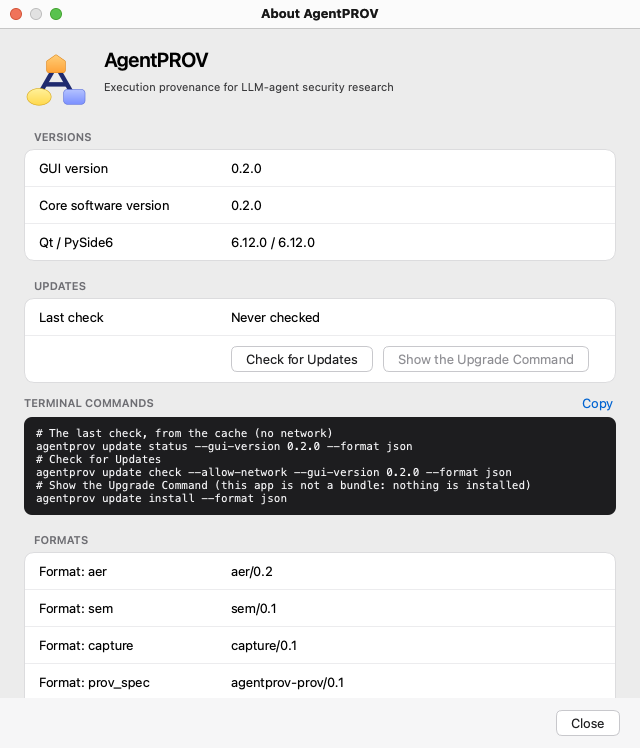

*About: the AgentPROV mark, the app and core versions, the record formats, the checkout's commit (marked "modified" when its tree has
changes), the repository, the licence (MIT), the author, Qt and PySide6 versions, and the third-party notices.*

About is one page in the app's form style: the AgentPROV mark and name, then sections: **Versions** (the app, the core
library, Qt and PySide6), **Updates**, **Formats** (the format versions this app reads and the core writes),
**Project** (the checkout's commit, the repository, the licence, the author) and **Third-party notices** (plain
text). The **Updates** section, right under the versions, has
these rows (see [Updating](#updating)):

- **Last check**: when `agentprov update check` last asked GitHub for the newest release, in your time zone, and what
  it found. Opening About reads it without the network (`agentprov update status`).
- **Newest release**: its version, when it was published and the bundle for this platform, with a badge that says
  whether it is newer than this app or its `agentprov`; then **Release notes**, as plain text.
- **Check for Updates** and **Download and Install…** (or **Update agentprov…** for an app run from a checkout or a
  package install, which updates only that program, after the same confirmation, or shows its upgrade command), then a line on what the update commands are doing and what the last
  download or install said.
- **Terminal commands**, with *Copy*: the `agentprov update` command of each action.

CLI equivalent: `agentprov --version` and `agentprov info`; for the Updates section, `agentprov update status` and
`agentprov update check --allow-network`.
