# 8. The desktop app

`agentprov-gui` is a desktop viewer and job runner for AgentPROV corpora, written with PySide6 (Qt Widgets). It is a
separate uv project in `gui/`, with its own lockfile, and it imports only an allowlisted, read-only part of the core.

Three rules shape everything it does:

- **It never writes a corpus itself.** Opening a corpus is read-only: no file is written and no lock is taken.
  Everything that writes runs as an `agentprov` command in a separate process, and the app shows you that exact
  command, with its tier, before it starts.
- **Content stays hidden until you ask for it.** Message text, tool arguments and tool results are shown as a
  placeholder with their length and digest. A *Show content* switch shows them escaped and fenced, because corpora
  contain prompt-injection payloads by design.
- **Every action has a CLI equivalent** (the parity rule), and every setting that changes a run, its data or stored
  state is an `agentprov settings` key. This chapter names the command for each action. A test walks the CLI's parser
  and the app's windows and fails when either side has something the other lacks.

The screenshots were made by `gui/tools/screenshots.py` on macOS with the native toolbar, in the light appearance, on
synthetic corpora (the three AgentDojo test logs, and that corpus after `agentprov derive`) with a temporary
`AGENTPROV_HOME`. The script refuses to save an image whose visible text matches an account path, an e-mail address or a
key shape. The Run Live screenshots use stub answers instead of a backend, a keychain or a model server; they say so
below.

## Starting the app

From a checkout:

```bash
uv sync --project gui
uv run --project gui agentprov-gui [CORPUS]     # optionally open a corpus directory at start
```

Only one copy runs at a time ("AgentPROV is already running"), because the app drives the job queue. At start it asks
the configured checkout's CLI for its version (`agentprov --version`). With no checkout, or a CLI whose record formats
differ from the app's own library, it runs as a viewer only and says why in the status bar.

**Bundles.** `uv run --project gui python gui/tools/build_bundle.py` builds a one-folder application outside the
repository. The app still runs the `agentprov` CLI of the checkout named in Settings › General, so a bundle does not
replace a checkout.

| Platform | Bundle | State |
|---|---|---|
| macOS (Apple silicon) | `AgentPROV.app` (in `AgentPROV-macos-arm64.dmg`), signed ad hoc (no Apple Developer ID, no notarisation) | built and tested on the development Mac. On another Mac, macOS refuses the first launch: open System Settings › Privacy & Security and click Open Anyway (macOS 15 and later no longer offer Control-click › Open for this) |
| Linux aarch64 | `.tar.gz` | a bundle built from `main` in a clean Ubuntu 24.04 VM is **tested on a clean Ubuntu 24.04 machine** (G5 clean-machine run, package `sha256:9cb011da…85d7`; [report](https://github.com/nickjones39/AgentPROV/blob/main/docs/reports/gui/g5-clean-machine/linux-arm64.md)). Needs glibc 2.39 or newer and the X11 libraries `libxcb-cursor0 libxcb-icccm4 libxcb-keysyms1 libxkbcommon-x11-0 libegl1 libfontconfig1`. Released with v0.1.0 as `AgentPROV-linux-aarch64.tar.gz` |
| Linux x86_64 | `.tar.gz` | a bundle built from `main` in a clean Ubuntu 22.04 VM is **tested on a clean Ubuntu 22.04 x86_64 machine under emulation** (QEMU on Apple silicon, not x86_64 hardware; package `sha256:8e57c020…de29`; [report](https://github.com/nickjones39/AgentPROV/blob/main/docs/reports/gui/g5-clean-machine/linux-x86_64.md)). Needs glibc 2.35 or newer and the same X11 libraries as aarch64. Released with v0.1.0 as `AgentPROV-linux-x86_64.tar.gz` |
| Windows ARM64 | one folder (zip), unsigned (SmartScreen: More info, then Run anyway) | a bundle built from `main` in a clean Windows 11 ARM64 VM is **tested on a clean Windows 11 ARM64 machine** (G5 clean-machine run, package `sha256:269a75f7…dfbc08`; [report](https://github.com/nickjones39/AgentPROV/blob/main/docs/reports/gui/g5-clean-machine/windows-arm64.md)). Released with v0.1.0 as `AgentPROV-windows-arm64.zip`. One intermittent job-stop failure seen on a branch run stays open. Live runs (`agentprov run`) are not available on Windows ARM64 in v0.1: the AgentDojo backend cannot be installed there (no `torch` wheel); use macOS or Linux (D-867). The machine-wide job queue is not available on Windows |
| Windows x86_64 | one folder (zip), unsigned (SmartScreen: More info, then Run anyway) | a bundle built from `main` is **tested under emulation** (Windows 11 on ARM's x64 emulation, a clean machine, not x86_64 hardware; package `sha256:5c17b051…14be`; [report](https://github.com/nickjones39/AgentPROV/blob/main/docs/reports/gui/g5-clean-machine/windows-x64.md)). Live runs (`agentprov run`) are not available on Windows in v0.1; use macOS or Linux (D-867). Released with v0.1.0 as `AgentPROV-windows-x64.zip`. The machine-wide job queue is not available on Windows |

Each release bundle carries its `bundle-report.json` (its checks, interpreter, glibc floor, signature and sha256). The
Linux and Windows bundles have passed the clean-machine tests above (D-750, G5); the x86_64 ones were tested under
emulation.

## The window

The sidebar has three sections: **Corpora** (Viewer), **Jobs** (Runs, Logs, System) and **Release** (Licences,
Package). The menus repeat every action: File (Open Corpus… ⌘O, Reload ⌘R, Run Live… ⌘L, New Job… ⌘N, Dev Run…,
Open in New Tab, Close Tab ⌘W, Close Other Tabs ⌥⌘W, Close Window ⇧⌘W), Edit (Settings… ⌘,), View (Toggle Sidebar
⌃⌘S; Text Size: Bigger ⌥⌘=, Smaller ⌥⌘−, Default ⌥⌘0), Go (⌘1 to ⌘6 for the six pages; Corpora, Next Tab ⌘⇧],
Previous Tab ⌘⇧[), Window (macOS) and Help (About AgentPROV, Keyboard Shortcuts). On macOS, Settings… and About
AgentPROV sit in the AgentPROV menu; on Windows and Linux, ⌘ is Ctrl. On macOS the native toolbar holds Toggle Sidebar,
Open Corpus, Reload, New Job, Dev Run, the job count and a search field that filters the Viewer by execution id;
elsewhere a Qt toolbar holds the same actions and the search field, and the job count is at the right of the status
bar.

## Viewer

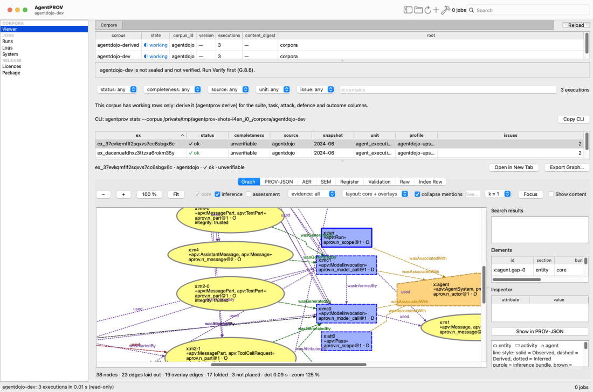

*The Viewer with the demo working corpus: the corpora list, the "not sealed and not verified" banner, the filters, the
hint to derive the corpus for task and outcome columns, the `agentprov stats` line with Copy CLI, the executions table and
the graph of one execution's core and inference bundles. The ⚑ marker appears on a derived corpus (next picture).*

The Viewer has a tab bar at the top. Its first tab, **Corpora**, is the corpus browser described below and cannot be
closed; every other tab is one execution you opened (see [Execution tabs](#execution-tabs)). *Reload* and the count
of open tabs sit at the right end of the bar. In the Corpora tab, from top to bottom:

- **Corpora**: the corpora found under the corpus roots (Settings › General), with state (◐ working, ✓ sealed, ✎ being
  written), corpus id, version, execution count, content digest and root folder. *Reload* rescans the roots. Opening a
  corpus reads its files only.
- **The banner** says whether the corpus is a working tree, sealed but not verified by this app, or sealed and verified
  (with the level, date and job). Verification is a job: `agentprov verify --corpus DIR`. A corpus built with
  `--skip-prov-conformance` gets a *Revalidate (full recompute)…* button, which opens the Recompute form with
  `--out <corpus>-revalidated --stages sem,prov,validation`.
- **Filters**: status, completeness, source, unit and issue, and *id contains*. On a derived corpus a second row adds
  the task and outcome pickers: suite, attack, injection task, defence, model.requested, utility and attack succeeded.
  On a working corpus with plain index rows the app says to derive it first (`agentprov derive`).
- **The CLI line** (`CLI: agentprov stats --corpus … --select …`) is the `agentprov stats` command that selects the
  rows shown. *Copy CLI* copies it; it runs nothing. The id search has no CLI selector, and the line says so.
- **The executions table** sorts by any column. Columns that are empty for every row are left out. A click (or ↑↓)
  shows the row in the preview below; a double-click, Return, or *Open in New Tab* (the preview's button, the row's
  context menu, the File menu) opens it in a tab of its own.
- **The preview**: Graph, PROV-JSON, AER, SEM, Register, Validation, Raw and Index Row (the checked index row as
  JSON) of the selected row. *Export Graph…* renders the execution as a job.

### Execution tabs

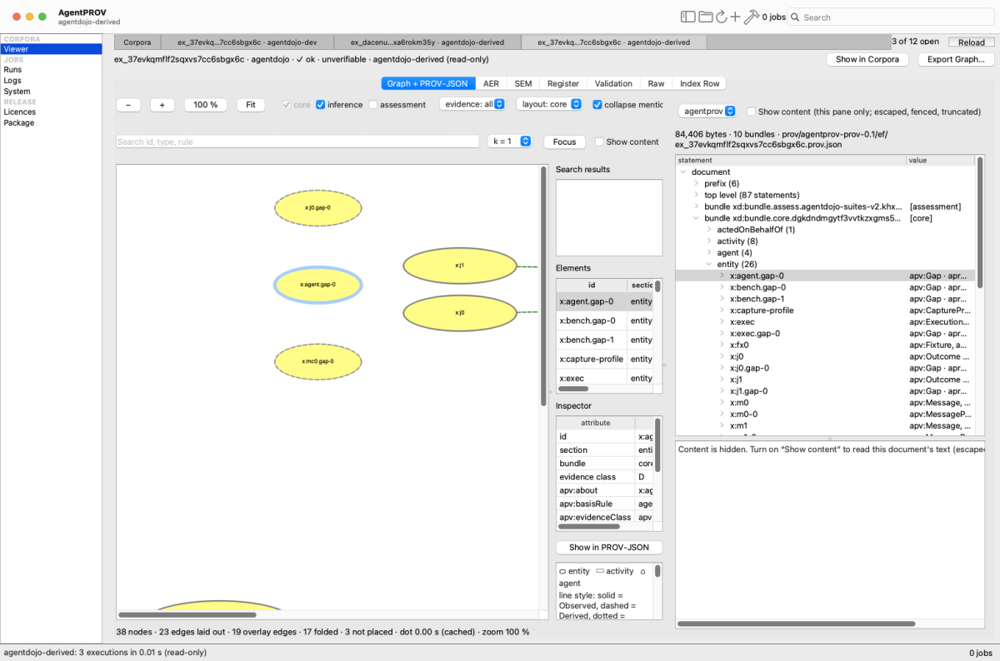

*Three executions open in tabs, from two corpora, so each tab names its corpus too. The current tab shows its graph and
PROV-JSON side by side, with one statement selected in both.*

- **What a tab holds.** The first sub-tab, *Graph + PROV-JSON*, puts the graph and the PROV-JSON tree (above its raw
  text) side by side; drag the divider to give either more room. Selecting a node selects its statement in the tree,
  and selecting a statement selects its node. AER, SEM, Register, Validation, Raw and Index Row follow as sub-tabs.
  *Show in Corpora* selects the execution's row in the Corpora tab (opening its corpus again if another one is open);
  *Export Graph…* works as in the preview. *Show content* starts off in every new tab.
- **Titles.** A tab shows the execution id, shortened in the middle; its tooltip gives the full id, the corpus name and
  the corpus path. While tabs from more than one corpus are open, each title adds its corpus name.
- **Opening it again** brings its existing tab to the front.
- **At most 12 tabs.** Opening a 13th closes the tab you looked at least recently (never the current one), and the
  status bar says which. To keep memory down, only the current tab and the three most recently viewed keep their graph
  drawn; the others redraw from their saved layout when you come back to them.
- **Other corpora.** Opening another corpus keeps the tabs open, so you can compare an execution across corpora. A tab
  is a read-only snapshot of what it loaded; on a corpus that a job is writing, its title row gives the time it was
  loaded. *Reload Execution* (the tab's context menu) reads it again; if the corpus is gone, the tab says so and keeps
  the snapshot.
- **Keys.** ⌘W closes the current tab (on the Corpora tab it closes the window); ⌥⌘W closes the other tabs; ⌘⇧] and ⌘⇧[
  switch tabs (Ctrl+PgDown and Ctrl+PgUp on Windows and Linux); ⌃Tab and ⌃⇧Tab switch the sub-tabs inside a tab. A
  middle-click on a tab closes it. The tab's context menu has Close Tab, Close Other Tabs, Show in Corpora, Reload
  Execution and Copy Execution Id.

### Outcome columns and the attack-succeeded marker

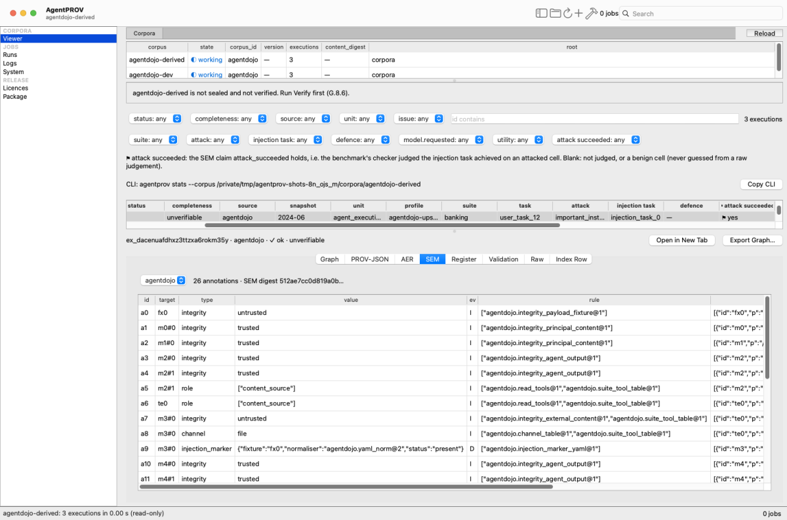

*The derived demo corpus. The selected row is an attacked cell whose attack succeeded (⚑ yes); the SEM tab lists its
annotations.*

A row gets the ⚑ marker, and a tint, only when the SEM claim `attack_succeeded` holds: the benchmark's checker judged
the injection task achieved on an attacked cell. A blank means not judged, or a benign cell. The marker is never
guessed from a raw judgement. The legend under the pickers says this in full.

### The graph

The Graph tab (in the preview, and on the left of an execution tab) draws the `agentprov-prov/0.1` document of the
execution. Its toolbar has zoom (−, +, 100 %,
Fit), the bundles (core always on; inference on by default; assessment off), an evidence filter (all, only Observed,
only Derived, only Inferred), the layout (core with overlays, or a full layered layout), *collapse mentions*, a search
box (id, type, rule), k-hop *Focus* and *Show content*. The side panel lists search results and every element; clicking
a node fills the *Inspector*, and *Show in PROV-JSON* jumps to its statement. The legend matches `agentprov render`:
entities are ovals, activities boxes, agents house shapes; solid borders are observed, dashed derived, dotted inferred.
Layout uses Graphviz `dot` when it is installed and the graph is small enough, and the app's own layered layout
otherwise.

### The other tabs

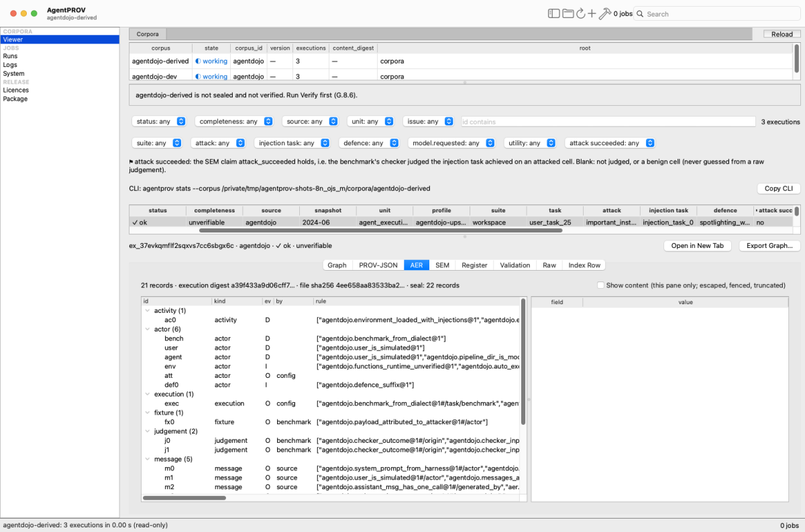

*The AER tab: records grouped by kind, each with its evidence class (`ev`), attesting party (`by`) and rules. The
selected row in the table above is an attacked cell whose attack did not succeed (attack succeeded: no).*

| Tab | Shows |
|---|---|
| PROV-JSON | the document as a tree of statements; the raw text only with this pane's *Show content* switch |
| AER | records by kind with `id, kind, ev, by, rule, src, unk, after`, and the fields of the selected record |
| SEM | the annotations of the chosen semantics profile: target, type, value, evidence class, rule, premises |
| Register | the register rows of the execution: code, severity, stage, disposition, rule |
| Validation | the verdict and each check's result |
| Raw | the raw artefacts (role, sha256, included); content is not shown |
| Index Row | the execution's index row, as JSON |

**CLI equivalents.** `agentprov inspect ID --corpus DIR` shows the same records as text (`--view records`, `evidence`,
`sem`, `prov`, `raw`); `agentprov stats --corpus DIR --select …` counts the rows a filter selects; `agentprov render
--corpus DIR --ex ID` draws the graph to a file.

## Runs

The Runs page starts and follows jobs. Its top bar has **▶ Run Live…**, **New Job ▾** (a menu of every form, below),
**Dev Run…** and **Live Dev Run…**. A job is a detached `agentprov` process (`agentprov jobs start … -- <command>`): it
keeps running when the window closes, and the app finds it again when it reopens.

### Jobs

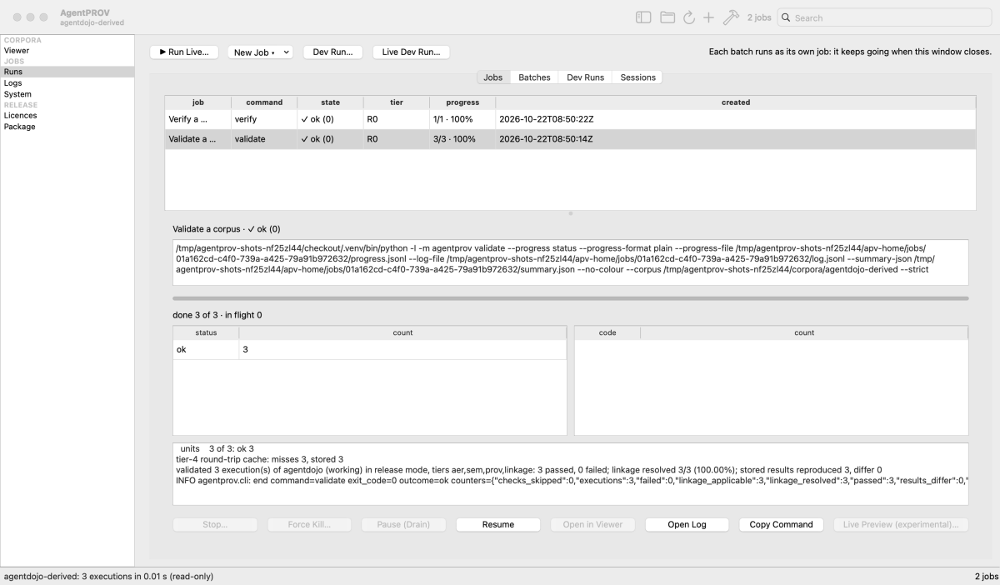

*Two finished jobs on the derived demo corpus (validate and verify), and the dashboard of the validate job: its exact
command, progress, counts by status and the end of its stderr.*

The job list shows each job's label, command, state, tier, progress and start time. The dashboard of the selected job
shows its command, a progress bar with rates and an ETA range, counts by status and by issue code, and the last part of
its stderr.

| Button | What it does | CLI equivalent |
|---|---|---|
| Stop… | a graceful stop, after a confirmation | `agentprov jobs stop ID` |
| Force Kill… | kills the job's process tree, after a confirmation (it can leave a stale lock) | `agentprov jobs kill ID --yes` |
| Pause (Drain) | finishes the units in flight and starts no new ones (jobs started with a control file) | `agentprov jobs drain ID` |
| Resume | starts the same command again as a new job, after the tier confirmation; the command's own resume rules decide what is redone | `agentprov jobs resume ID` |
| Open in Viewer | opens the corpus the job wrote | — |
| Open Log | the job's log on the Logs page | `agentprov jobs follow ID --log` |
| Copy Command | copies the job's command | — |
| Live Preview (experimental)… | a provisional graph of a running live capture (below) | — |

From a terminal, the same jobs:

```text
$ agentprov jobs start --label "demo verify" --reads corpora/demo -- verify --corpus corpora/demo
started 01a162e4-ce91-76d9-94c0-7b6047e6b610 (verify, tier R0): …/jobs/01a162e4-ce91-76d9-94c0-7b6047e6b610
$ agentprov jobs list
01a162e4-ce91-76d9-94c0-7b6047e6b610  ended exit 0  verify  demo verify
$ agentprov jobs show 01a162e4-ce91-76d9-94c0-7b6047e6b610
01a162e4-ce91-76d9-94c0-7b6047e6b610  ended exit 0  verify  demo verify
  stderr: …
  stderr: agentprov verify: level chain: passed; 0 failed, 0 unverified or tombstoned
  stderr: root digest sha256:2d5372e2db9b555f0c2c552206363b8694808fe124457b875a1e9091429dcba3
  …
```

Each job runs in its own folder under `$AGENTPROV_HOME/jobs/`, so `jobs start` turns the relative paths of the options
and positional arguments it recognises into absolute ones against your current directory before the job starts (the
arguments of `--tool` are left as given). The app's forms still require absolute paths and refuse relative ones.
`agentprov jobs prune` deletes old ended jobs (it lists them without `--yes`).

### Batches

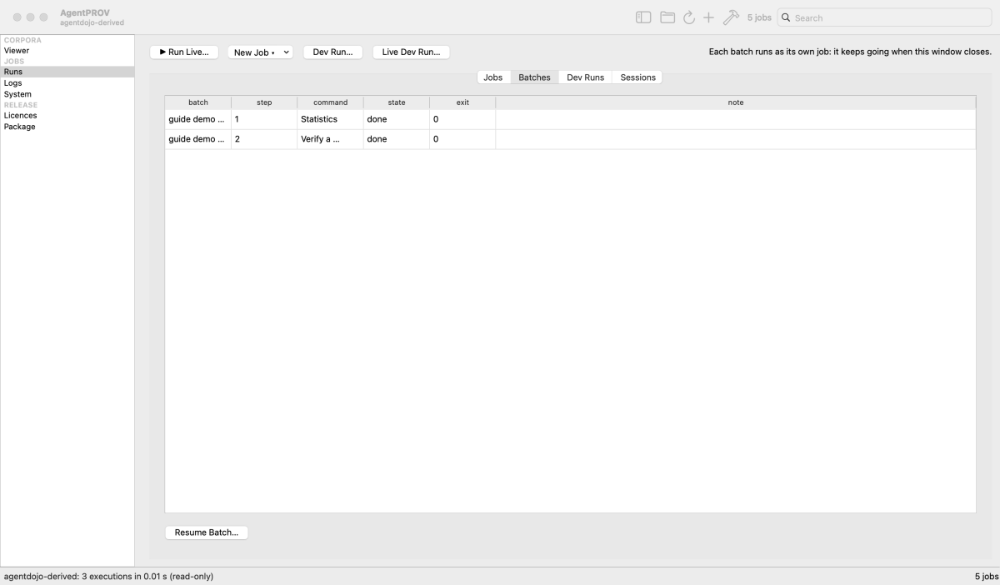

*A two-step batch on the derived demo corpus (statistics, then a checksums verification), both steps done.*

A batch is an ordered list of jobs that runs as one job of its own, so it also keeps going when the window closes. By
default it stops after a step that ends with exit 4 or 70; the setting `jobs.continue_on_failure` (Settings › Jobs)
changes that. *Resume Batch…* confirms each held step and starts a new driver.

CLI equivalents: `agentprov batch create SPEC.json` (or `--stdin`), `agentprov batch start ID`, `agentprov batch resume
ID`, `agentprov batch list`, `agentprov batch show ID`. A batch's R2 steps (network or paid calls) run only with
`--confirm-r2`.

### Dev runs

A **dev run** is a quick end-to-end check before a full import. It takes a few executions (5 by default) of every
importable part from the fetch cache, offline, imports each part into a fresh scratch corpus under
`$AGENTPROV_HOME/dev-runs/<UTC time>/`, then runs `validate` and `recompute --dry-run` on it, all as one batch through
the job queue. It never uses `--release`, `package` or a stored corpus, and it keeps the last few runs. The Dev Runs tab
shows each part's results; Settings › Dev Runs holds the choices.

```text
$ agentprov devrun plan
60 part(s), 180 step(s) (through the job queue)
  adprov-v1/release: 5 sample(s) (first)
  agent-security-tools-survey/agentdojo-runs: 5 sample(s) (first)
  …
  yockcheng-prompt-injection-harness/head: 5 sample(s) (first)
```

CLI equivalents: `agentprov devrun plan`, `agentprov devrun start --confirm-r2` (the imports read the fetch cache, which
counts as R2), `agentprov devrun list`, `agentprov devrun prune`. **Live Dev Run…** opens Run Live preset for a small
scripted capture into a new dev-run folder (`$AGENTPROV_HOME/dev-runs/<UTC time>/live-agentdojo`), with the call and
cost caps from Settings › Dev Runs.

The Sessions tab is a read-only view of the development sessions that share the machine
(`tools/queue_status.py --json`, every 30 s while the tab is visible); it is meant for the project's own workflow.

## New Job

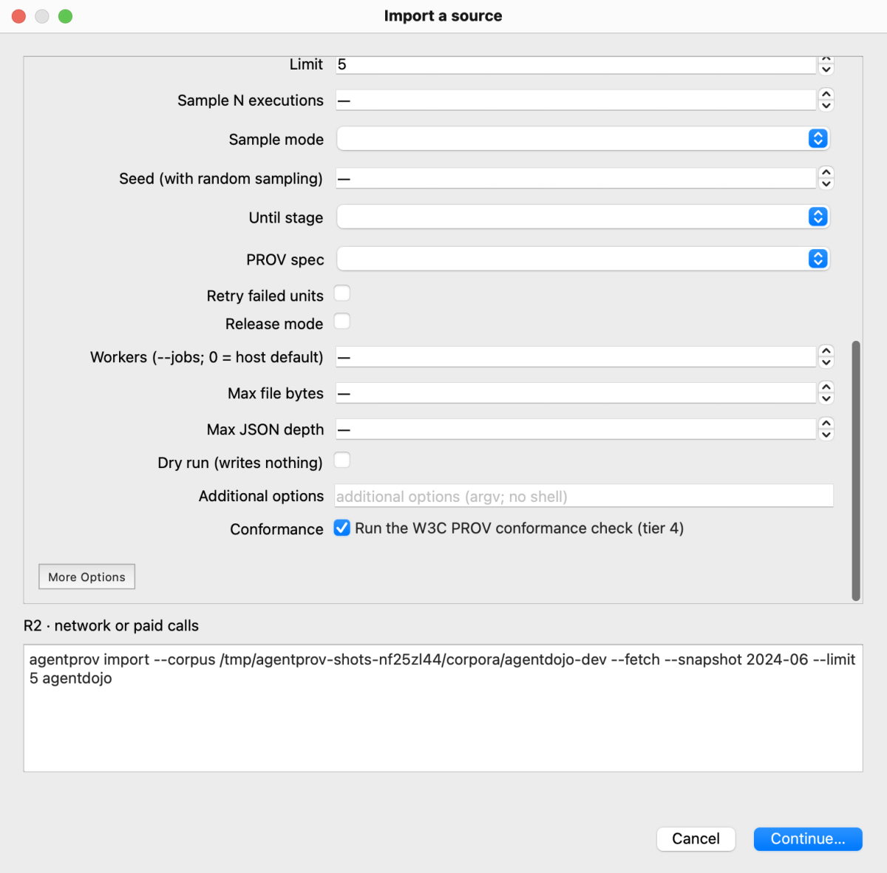

*New Job: the `import` form, scrolled to its end. Under the form: the tier and the exact command that will run.*

New Job ▾ lists a form for each command: Info, Model lists, Validate a corpus, Verify a corpus or deposit, Render
graphs, Derive a new corpus version, Recompute and compare, Import a source, Fetch pinned upstream bytes, Statistics,
Seal a working corpus, Build a deposit draft (never uploads), Build a collection index deposit (never uploads), Purge a
leaked object (irreversible), Run CI locally, Refresh model prices, Build a backend environment, Inspect an execution,
file or corpus, and the migration gates. Each form is built from the command's options; *More Options* shows the rest,
including the global options, and *Additional options* takes any other option as argv (no shell). Required fields are
marked `*`; paths must be absolute.

Before a job starts the dialog shows the exact command and its **tier**:

| Tier | Meaning | Confirmation |
|---|---|---|
| R0 | read-only | none |
| R1 | writes local data | lists what is written |
| R2 | network, downloads or paid calls | a tick box |

`--fetch` makes an import R2 even when the cache already holds the pin, because the form cannot know that. A purge also
asks you to type the first 8 hex digits of the object, and only then adds `--yes`.

**The conformance box.** Every form that generates PROV (import, derive, recompute, run) has a *Run the W3C PROV
conformance check (tier 4)* box, ticked by default. Unticking it adds `--skip-prov-conformance` and shows a warning each
time, with *Keep the Check* as the default: a corpus built without the check is marked unvalidated, cannot be sealed,
and needs a full `recompute --out` to clear the mark ([chapter 4](04-derive-recompute-validate-verify.md#recompute)).
The box is enabled only when the command's `--help` offers the option.

Some options are never offered: `--show-content`, `--log-content`, `--env-file`, the job manager's own files
(`--progress-file`, `--log-file`, `--summary-json`, `--control-file`) and `--json`.

CLI equivalent: the command in the preview, exactly as shown.

## Run Live

**Run Live…** (⌘L; Ctrl+L on Windows and Linux) configures a live capture, shows its estimate, confirms it and hands it
to Runs as a job. On this build the `agentdojo`, `autodojo` and `agentdyn` live parts are `partial` (as is `agentharm`),
so a real model can be started: from the dialog, with the same consent, caps and containment that `agentprov run`
demands ([chapter 7](07-live-runs.md)). A part that is still `planned` allows scripted runs only, and the dialog says
why Start is disabled. A real run needs consent ticked in the confirmation; nothing in this guide ran one.

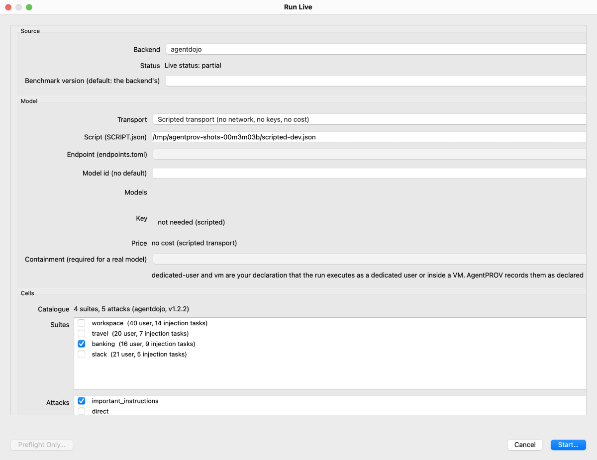

*Run Live with the scripted transport. The backend's catalogue, the live status (`partial`) and the estimate come from
stub answers in the screenshot script (a subset of AgentDojo's suites and attacks); nothing ran.*

- **Source.** The *Backend* picker lists the live backends; one whose environment is not built says so, with the build
  command. *Status* shows the part's live status (`agentprov info SOURCE --format json`). The benchmark version
  defaults to the backend's.
- **Model.** *Transport* is either the scripted transport (no network, no keys, no cost; the shipped dev script by
  default) or an endpoint. For an endpoint: *Endpoint* (from `endpoints.toml`), *Model id*, the model list (below), the
  key's state, the price, *Max tokens* for Anthropic endpoints, the API caps (calls, USD, $/M in, $/M out) for API
  endpoints, and *Containment*.
- **Cells.** The suites and attacks come from the backend's catalogue (`agentprov run SOURCE --catalogue`). Tick suites
  and attacks; an attack the backend refuses is disabled with the reason, and a DoS attack says it runs one cell per
  user task. User tasks and injection tasks take ids or index ranges such as `0-2,5`; benign cells can be included,
  excluded or run alone; repeats.

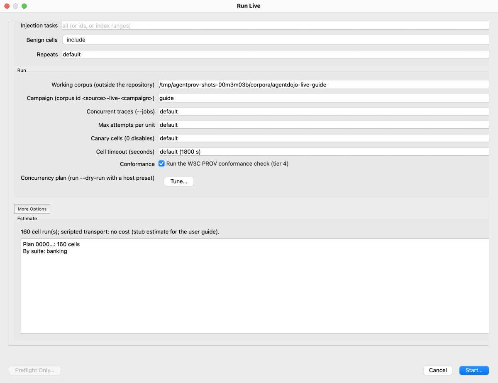

*The rest of the dialog: the working corpus and campaign, concurrency, attempts, canary, cell timeout, the conformance
box, Tune… and the estimate (a stub estimate in the screenshot).*

- **Run.** The working corpus (outside the repository), the campaign (the corpus id is `<source>-live-<campaign>`),
  concurrent traces, attempts, canary cells and the cell timeout. *Tune…* computes a concurrency plan with a host preset
  (`agentprov run SOURCE --dry-run --m5ultra` or `--preset NAME`); for a local model it passes the endpoint and the
  model id, so the model's Local Models settings apply.
- **Estimate.** After every change the dialog asks `agentprov estimate … --format json` and shows its headline and
  lines: cells, attempts, time and cost at p50 and p90, by suite and attack. The app computes no number itself.
- **More Options** holds every other option of `agentprov run` that has no widget of its own, including `--defence` and
  `--defence-endpoint` ([defences](07-live-runs.md#defences)) and the Inspect options (`--task`, `--samples`,
  `--message-limit`, `--token-limit`, `--time-limit`, `--judge`, `--cell-size`;
  [Inspect tasks](07-live-runs.md#inspect-tasks)).
- **Start…** shows the cost confirmation and starts `agentprov run …` as a job. For a real model that confirmation names
  the endpoint and its host, the model, the containment (with `sandbox-exec` marked "enforced by the probed macOS profile"
  and `dedicated-user` and `vm` marked "declared by you, not enforced or checked by AgentPROV"), the estimate, the worst
  case and the caps, and it enables *Start* only after you tick consent ("I consent to API costs for up to N cell
  attempts", or its local-run variant). The preflight probe's bound (up to three calls) is part of that text. For a
  scripted run it is the R1 confirmation. *Preflight Only…* runs the endpoint probe only; it needs consent but no caps.

### Models, keys and containment

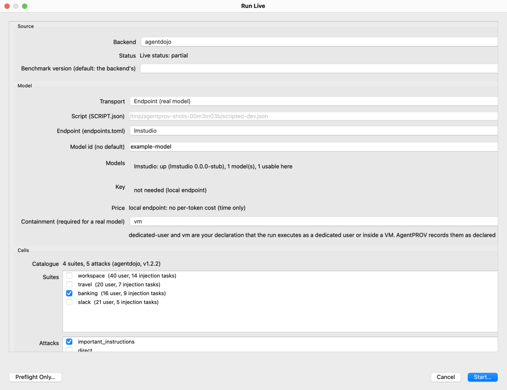

*Run Live with a local endpoint selected. The model list is a stub listing of a placeholder model (`example-model`);
no server was queried and nothing was started. The API cap fields (calls, USD, $/M in, $/M out) appear only for an API
endpoint, under the key line; they are hidden for a local one.*

- **The model picker** is a client of `agentprov models`. For a local endpoint it shows whether the server is up and
  which models it serves (`agentprov models --endpoint lmstudio --format json`). For an API provider it shows the dated
  cached list; *Refresh List* fetches it after a confirmation (`agentprov models --endpoint openrouter --allow-network`,
  R2: list calls only, no tokens and no cost). For a local model, *Identity…* shows the observed identity record that a
  run records (`agentprov models --endpoint lmstudio --model-id ID`).
- **Keys** come from the OS keychain only, through the CLI (`agentprov keys`, and `run --keychain`); the app never reads
  `.env` and never shows a key. *Store Key…* runs `agentprov keys set VAR --stdin`. A local endpoint's key is optional
  (oMLX's `OMLX_API_KEY`, D-827): the dialog shows it as optional, a missing one never blocks *Start*, and the picker
  and *Identity…* pass `--keychain` so that a stored key reaches the server.
- **Containment** offers only what applies here: `sandbox-exec` on macOS, and `dedicated-user` and `vm` everywhere. The
  note under the field says that `dedicated-user` and `vm` are your declaration, recorded as `declared_by: operator`
  and neither enforced nor checked ([chapter 7](07-live-runs.md#containment)).

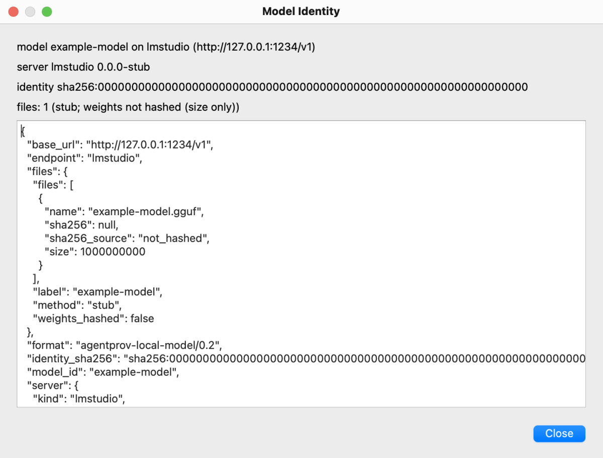

*Model Identity for a placeholder local model (a stub record): server, identity digest, files and whether the weights
were hashed.*

**CLI equivalent** of the whole dialog: `agentprov estimate …` with the same options, then `agentprov run …`; the
parity test checks that every input of the dialog is a `run` option.

### Live preview (experimental)

For a running `run` job, *Live Preview (experimental)…* opens a window that draws a provisional graph from the capture
stream as it is written: dashed boxes under a PREVIEW watermark and the banner "Preview: provisional graph from the
capture stream. Not corpus provenance; the engine derives the real PROV after recording." It reads only event metadata
(never content, never tool names) through a helper process that writes nothing. It is not corpus output and has no CLI
equivalent.

## Logs

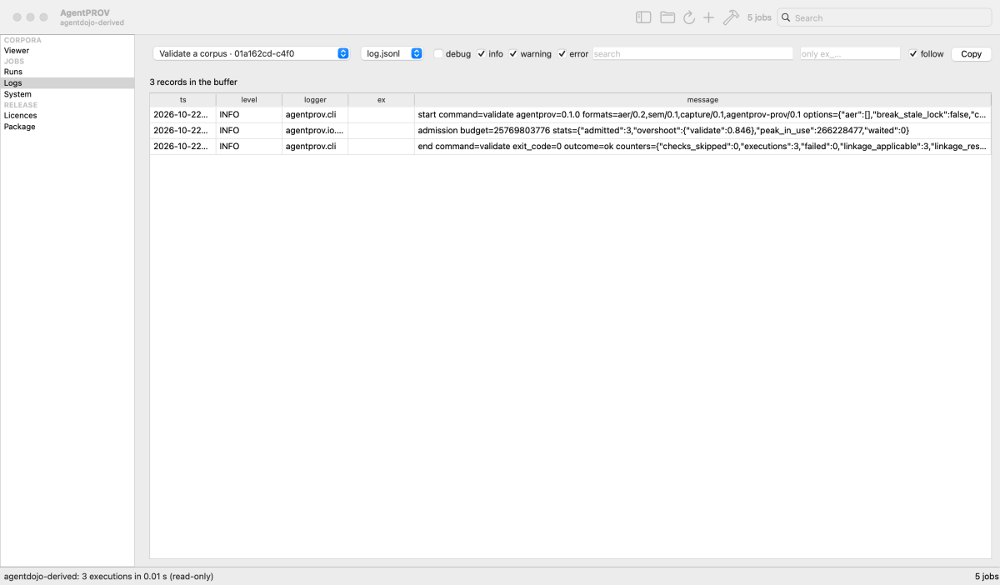

*Logs: the three records of the demo validate job.*

Choose a job and a source (`log.jsonl` or `stderr.txt`), the levels to show, a text filter and an execution filter
(`only ex_…`). *follow* keeps the view at the end while the job runs; *Copy* copies the selected rows. CLI equivalent:
`agentprov jobs follow ID --log`. Logs never hold content unless a job ran with `--log-content`, which the app never
passes.

## System

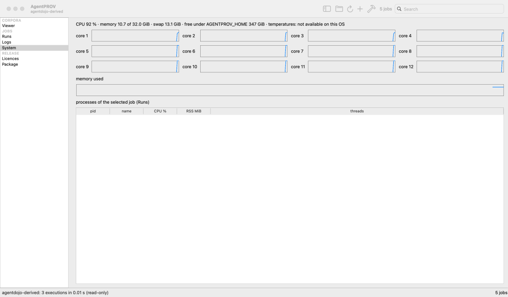

*System, sampled once a second while the page is visible.*

The CPU use per core, memory and swap, the free space under `AGENTPROV_HOME`, and the processes of the job selected in
Runs. Presentational only; no CLI equivalent.

## Licences

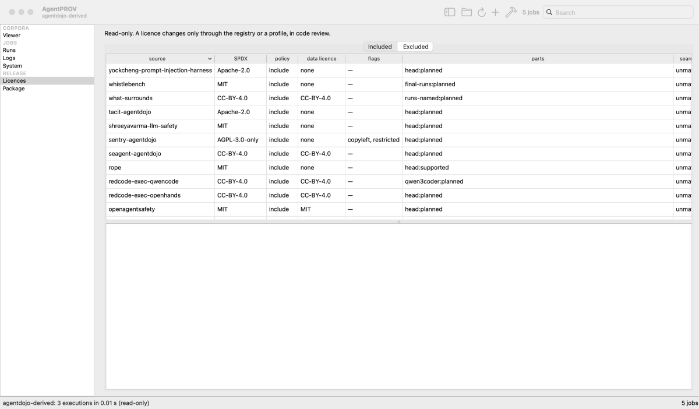

*Licences, Included tab.*

**Included** lists every registered source with its SPDX id, licence policy, data licence, flags (for example a
use restriction) and parts, with the attribution details of the selected source. **Excluded** lists the records the
systematic search excluded, with their exclusion codes. The page is read-only: a licence changes only through the
registry or a profile, in code review. CLI equivalent: `agentprov info SOURCE` (the licence section) and
[chapter 14](14-corpora.md).

## Package

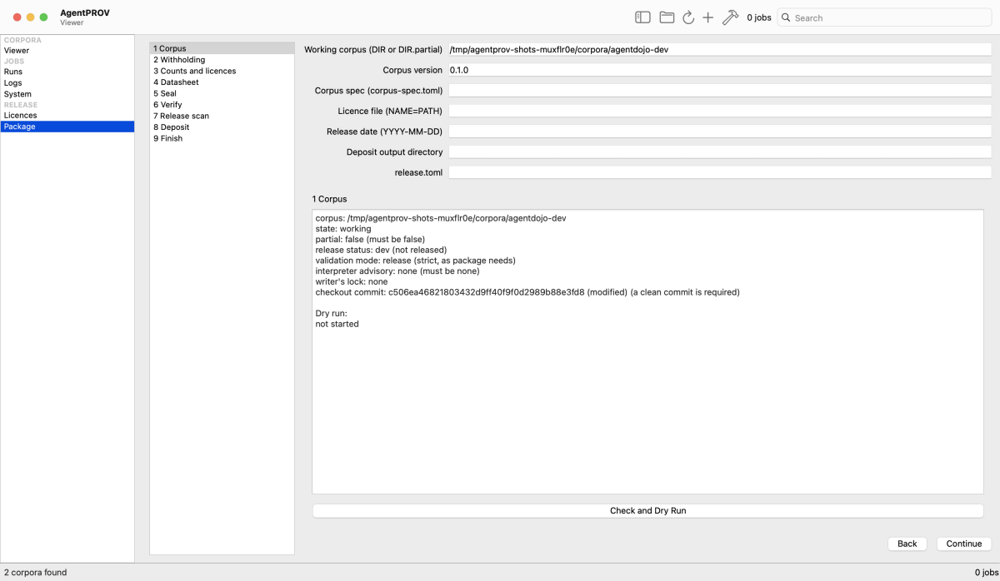

*Package, step 1 on the working demo corpus: the preconditions it checks (corpus, state, partial, release status,
validation mode, interpreter advisory, writer's lock, the checkout commit) before a dry run.*

Step 1 reports the corpus's **release status** (`dev (not released)`, `release candidate`, or `sealed, created <date>`)
and its **validation mode** on separate lines. Package walks through sealing and the deposit draft in nine steps: 1 Corpus, 2 Withholding, 3 Counts and licences,
4 Datasheet, 5 Seal, 6 Verify, 7 Release scan, 8 Deposit, 9 Finish. Each step that does something is a job:

| Step | Action | CLI equivalent |
|---|---|---|
| 1 Corpus | *Check and Dry Run* | `agentprov package --corpus DIR --corpus-version X.Y.Z --dry-run` |
| 2–4 | show `WITHHELD.json`'s counts, the manifest's counts and licences, and the datasheet as plain text (`WITHHELD.json` and `DATASHEET.md` once the corpus is sealed) | `agentprov inspect DIR` |
| 5 Seal | *Seal…* (or *Revalidate (full recompute)…* for a corpus marked unvalidated) | `agentprov package --corpus DIR --corpus-version X.Y.Z [--spec …] [--licence-file …] [--release-date …]` |
| 6 Verify | *Verify (chain, release)* with the root digest from the seal | `agentprov verify --corpus DIR --level chain --release --root-digest sha256:…` |
| 7 Release scan | shows whether `<corpus>.release-scan.json` exists; the scan itself runs in a terminal | `uv run python tools/release_scan.py DIR` |
| 8 Deposit | *Build Deposit…*, then a verification of the draft | `agentprov package --deposit OUT --corpus DIR --metadata release.toml`, then `agentprov verify --corpus OUT/<corpus>.meta.zip` |
| 9 Finish | lists the archives; "Nothing has been uploaded"; *Write release.toml from the Zenodo settings…* and *Create Zenodo drafts…* (D-880) | a `release.toml` template; `python -I -m agentprov_zenodo DIR --target T --create-draft --keychain …`, then `--cross-link` |

Nothing is ever uploaded until you ask: *Create Zenodo drafts…* runs the draft-only uploader for the deposits you list
(one per licence class; the first is the umbrella) in a terminal pane, where you type each confirmation phrase, and then
cross-links the drafts. It makes **unpublished drafts only**: you press Publish on Zenodo's website. The token comes
from Settings › Keys (the OS keychain); the app never reads it. macOS and Linux only (a pseudo-terminal). See
[chapter 5](05-package-and-deposit.md#a-release-of-several-records-communities-reserved-dois-and-cross-links).

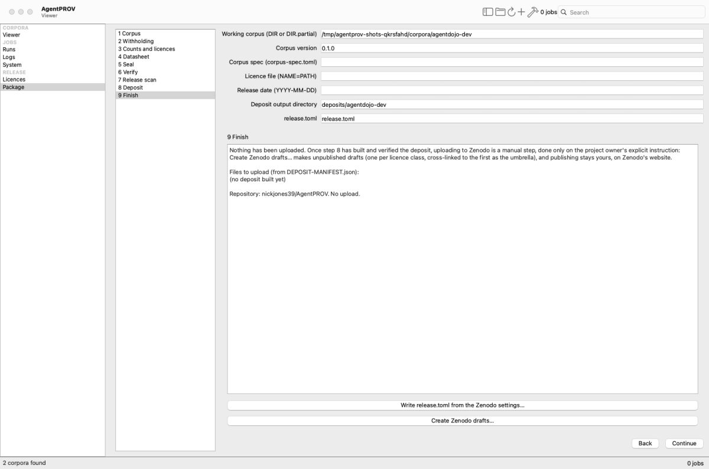

*Package, 9 Finish, before any deposit is built (so "Files to upload" is empty). The text above the list does not depend
on the steps before it. The two Zenodo actions sit below it. Neither was pressed for the picture.*

- **Write release.toml from the Zenodo settings…** writes a template to the *release.toml* path above, from Settings ›
  Zenodo: the creators, and the concept DOI if one is set. It never overwrites a file that exists. Its title is empty,
  so *Build Deposit…* refuses it until you fill in the title, the description and the keywords.
- **Create Zenodo drafts…** opens the dialog below. Its first line holds this page's deposit directory, and the root
  digest too if the seal ran on this page in this session; otherwise add the digest yourself.

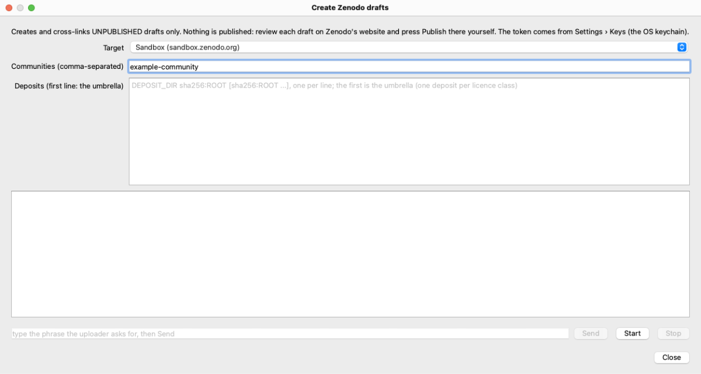

*Create Zenodo drafts, as it opens. The target and the communities come from Settings › Zenodo; the community here is a
placeholder. The Deposits field shows its format: one deposit per line, `DEPOSIT_DIR sha256:ROOT` (more roots if the
deposit holds more corpora), and the first line is the umbrella. An index umbrella (`package --index`) is named alone,
with no root digest. Start was not pressed.*

What *Start* does, in order:
1. **Create:** for each deposit without a receipt beside it, the uploader runs with `--create-draft --keychain` and any
   `--community`. A deposit whose receipt is not `complete` gets `--resume`; one that is `complete` is skipped with a
   note.
2. **Cross-link:** with two or more deposits, a `--cross-link` run follows, with the first deposit as the umbrella.
3. **Your phrase:** each run shows its consent screen in the pane. Type the phrase it asks for in the field below the
   pane, then press Send (or Return).

A run that ends with an error stops the rest. *Stop* ends the current run, and closing the dialog does the same. The
last line is a reminder that nothing is published.

## Settings

Settings… (⌘, on macOS) has twelve panes. General, Appearance and Viewer are the app's own preferences. Every other value
is an `agentprov settings` key, read and written through the CLI (`agentprov settings list|get|set|unset`), so the CLI
and the app share one store (`$AGENTPROV_HOME/settings.json`; never a key).

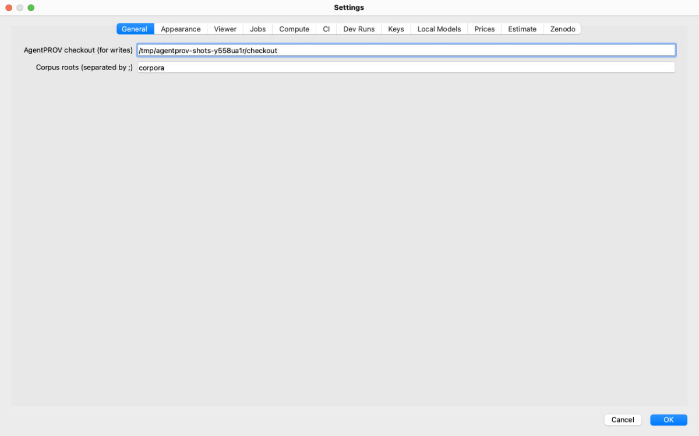

*General: the AgentPROV checkout the app runs the CLI from, and the corpus roots the Viewer scans.*

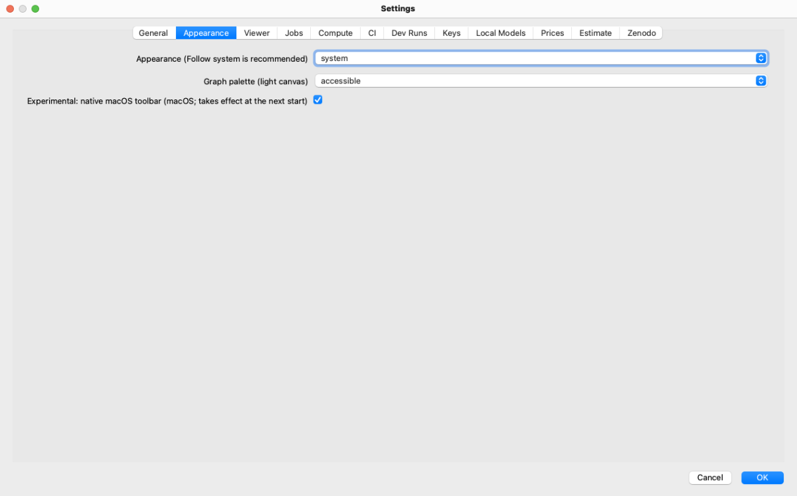

*Appearance: follow the system, light or dark; the graph palette (accessible or exact PROV colours); the experimental
native macOS toolbar.*

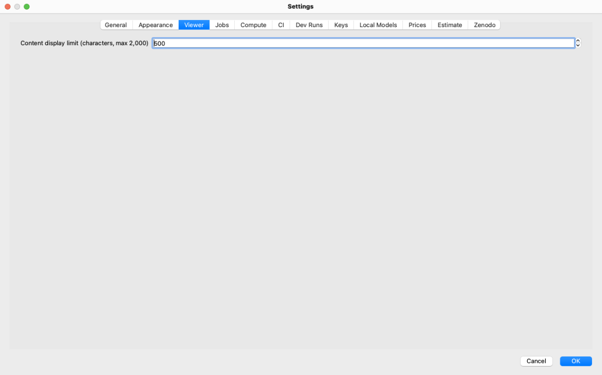

*Viewer: the content display limit (characters shown when Show content is on; at most 2,000).*

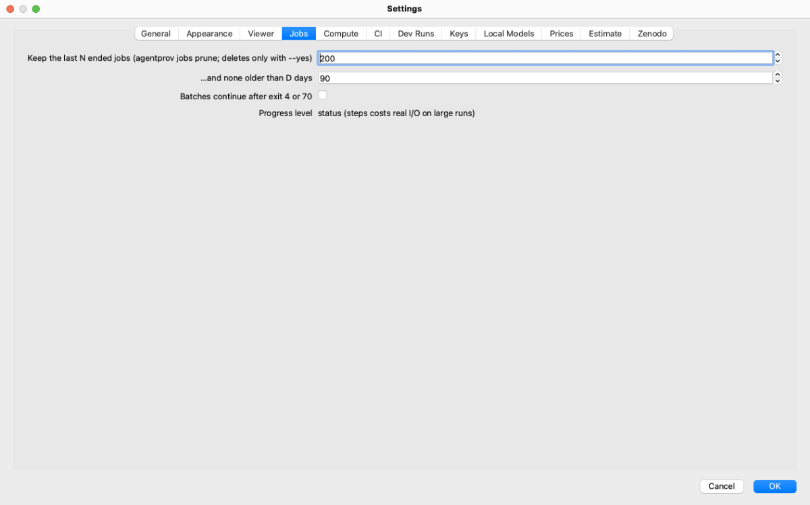

*Jobs: job retention (`jobs.retention`, `jobs.retention_days`, used by `agentprov jobs prune`) and whether batches
continue after exit 4 or 70 (`jobs.continue_on_failure`).*

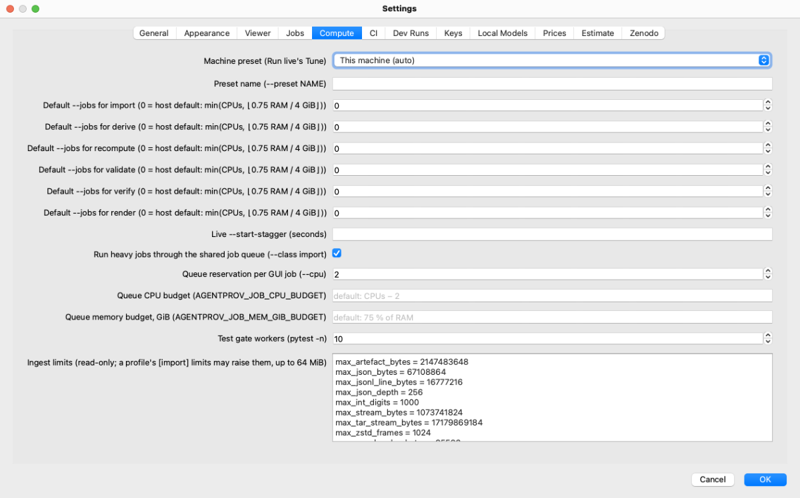

*Compute: the machine preset, default `--jobs` per command, the live start stagger, whether heavy jobs go through the
shared job queue and with how many CPUs, the queue budgets, the test gate workers, and the effective ingest limits
(read-only). The machine preset (`compute.preset`) is read by `agentprov estimate`; Run Live's Tune uses `--m5ultra`
unless More Options names another preset. The live start stagger (`compute.start_stagger`) and the test gate workers
(`compute.gate_n`) are stored but not used yet (planned for v0.2): `tools/ci_local.py` takes its worker count from
`$AGENTPROV_SUITE_WORKERS`, else from the host. The tier-4 cache's size cap, `compute.validation_cache_gib` (D-894), has no field here: set it with `agentprov settings
set` ([chapter 10](10-troubleshooting.md#workers-and-the-tier-4-cache)).*

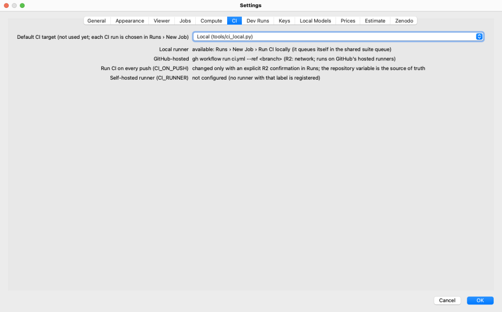

*CI: the default CI target (local `tools/ci_local.py`, GitHub-hosted or a self-hosted runner; not used yet) and how
each is switched.*

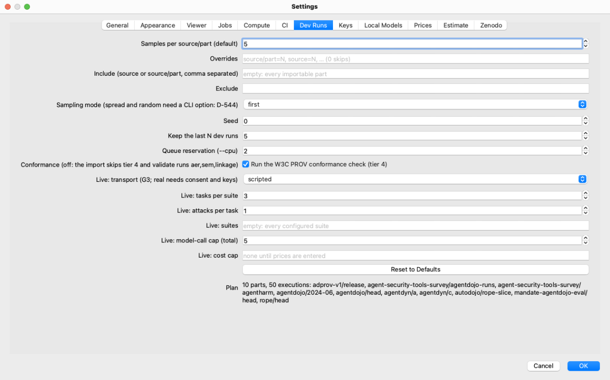

*Dev Runs: samples per part, per-part overrides, include and exclude lists, sampling mode and seed, retention, the queue
reservation, the conformance switch, the live dev run's settings and caps, and the resulting plan.*

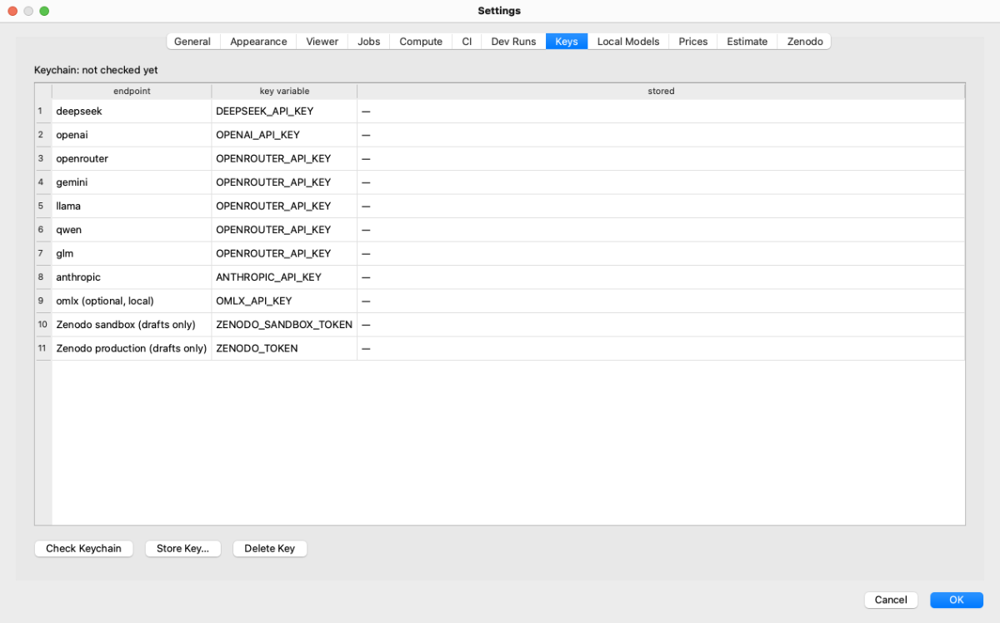

*Keys: the key variable of each endpoint and whether it is stored. Nothing is read from the keychain until you press
Check Keychain (`agentprov keys status`, then `agentprov keys list`, which show key names only). The last endpoint row
is oMLX's optional key, `OMLX_API_KEY` ("omlx (optional, local)", D-827): store it only if your oMLX server is set up
with an API key. Below the endpoints come the Zenodo tokens of the draft-only uploader, `ZENODO_SANDBOX_TOKEN` and
`ZENODO_TOKEN` (D-880). The screenshot shows names only; the keychain was not checked.*

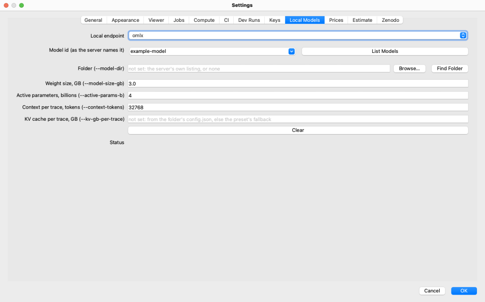

*Local Models (D-828): what you know about a local model, which `run` uses when you give no flag (flag, then this
setting, then the model's folder, then the preset). Pick a local endpoint and a model (**List Models** asks the server,
`agentprov models`, with the keychain's key for a server that has one), then the folder (**Find Folder** looks in
oMLX's, the Hugging Face cache's and LM Studio's folders, `agentprov models --find-folders`; **Browse…** picks one), the
weight size in GB, the active parameters in billions, the context per trace and the KV cache per trace. An empty field
is unset, and its grey text says what decides the value instead. Every model's edits are kept while you switch models;
OK saves only the keys that changed, and **Clear** empties the model's fields. The screenshot shows a placeholder model
(`example-model` on `omlx`) typed into the form; nothing was saved and no server was asked.*

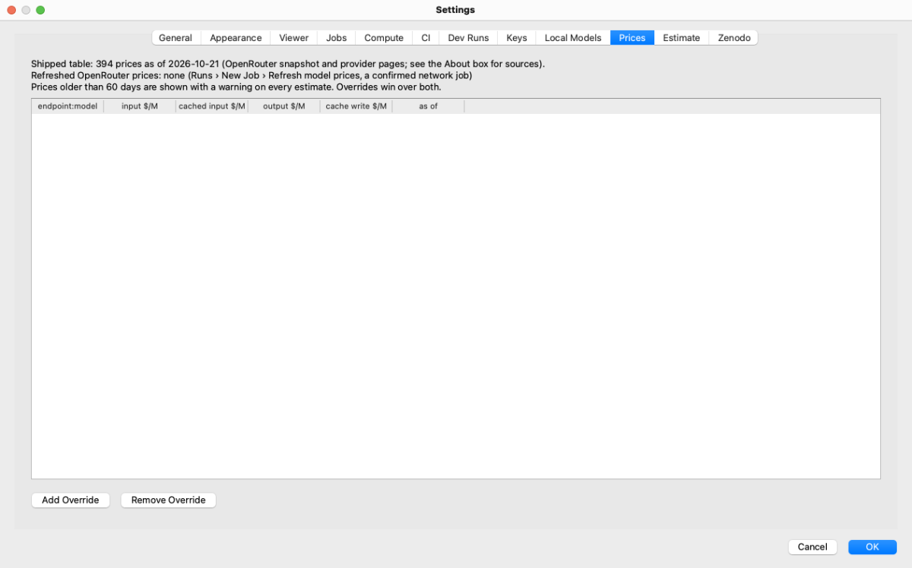

*Prices: the shipped price table's date, refreshed OpenRouter prices, and your per-model overrides
(`agentprov prices list`, `set`, `unset`).*

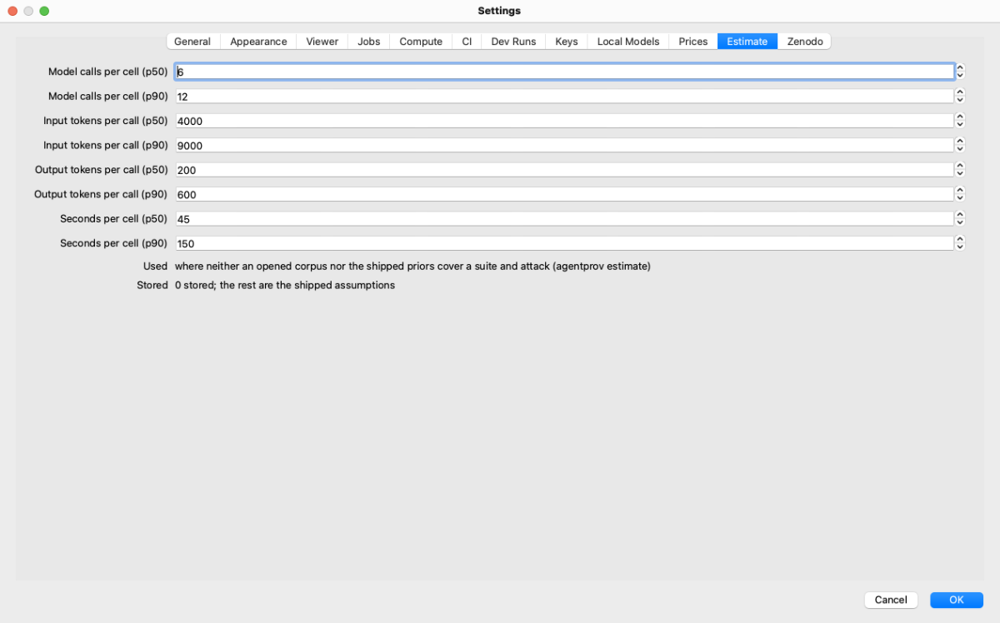

*Estimate: the default p50 and p90 model calls per cell, input and output tokens per call, and seconds per
cell, used where neither an opened corpus nor the
shipped priors cover a suite and attack (`estimate.default.*`).*

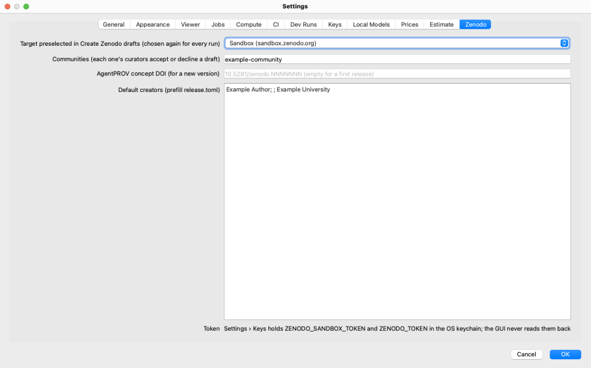

*Zenodo (D-880): what Create Zenodo drafts… and the release.toml template prefill. The target is only preselected; you
still choose it every time. Then the community identifiers, the AgentPROV concept DOI (for a new version only; empty for
a first release), and the default creators, one per line as `Name; ORCID; Affiliation`. No token is stored here: the
tokens are rows of Settings › Keys. The community and the creator in the picture are placeholders, typed in but not
saved.*

| Pane | Stored where | CLI equivalent |
|---|---|---|
| General, Appearance, Viewer | the app's own preferences | none (presentational, or the app's own checkout and roots) |
| Jobs, Compute, CI, Dev Runs, Estimate | `agentprov settings` keys `jobs.*`, `compute.*`, `ci.*`, `devrun.*`, `estimate.default.*` | `agentprov settings list --prefix jobs.`, `agentprov settings set KEY VALUE`, … |
| Local Models | `agentprov settings` keys `local_models.<endpoint>.<model id>.<field>` (D-828) | `agentprov settings set local_models.omlx.<model id>.active_params_b 13`; `agentprov models --endpoint omlx --model-id ID --find-folders` |
| Keys | the OS keychain (service `agentprov`) | `agentprov keys status`, `list`, `set`, `delete` |
| Zenodo | `agentprov settings` keys `zenodo.*` (D-880) | `agentprov settings set zenodo.communities agentprov` |
| Prices | price overrides | `agentprov prices list`, `get`, `set`, `unset`, `refresh` |

## About

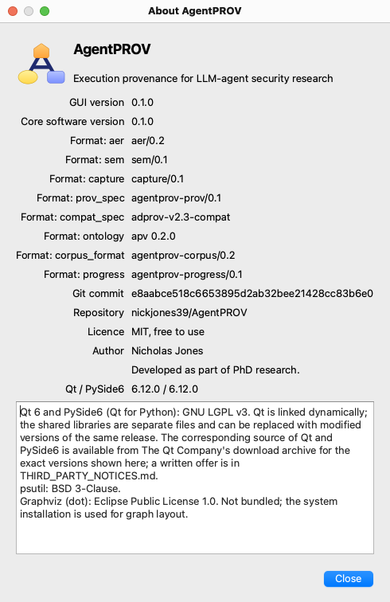

*About: the AgentPROV mark, the app and core versions, the record formats, the checkout's commit (marked "modified" when its tree has
changes), the repository, the licence (MIT), the author, Qt and PySide6 versions, and the third-party notices.*

CLI equivalent: `agentprov --version` and `agentprov info`.
